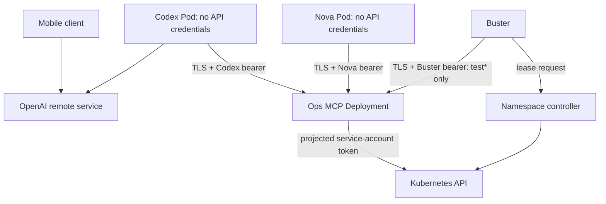

# Codex Ops Pod Architecture

Status: implemented in source; live cluster acceptance and mobile pairing pending
Audience: architecture reader, platform maintainer, security reviewer
Owner: platform operations
Evidence: `charts/ops-pod/`; `ops/pod/`; `tools/ops-mcp/src/`; `scripts/deploy-ops-pod.sh`
Applies to: the Codex host and central Ops MCP
Last verified: local source, transport and Helm checks on 2026-10-21; live cutover pending

## Navigation

- [Decision](#decision), [scope](#scope-and-existing-infrastructure), [topology](#runtime-topology)
- [Resources and ownership](#resource-and-ownership-model)
- [Startup and authentication](#startup-authentication-and-process-lifecycle)
- [Authority boundaries](#identity-and-authority-boundaries), [network](#network-dependencies)
- [MCP and pagination](#mcp-requests-and-bounded-results)
- [Build contract](#build-and-release-contract), [failure domains](#failure-domains-and-accepted-trade-offs)
- [Validation](#validation-evidence-and-remaining-live-proof), [source map](#source-map)

## Decision

Run a persistent Kubernetes StatefulSet for Codex and a separate Ops MCP
Deployment in `kubeclaw-ops`. Codex, Nova and Buster authenticate to the central service
using distinct credentials and centrally configured grants. Promote immutable image receipts in Git; Argo installs the chart.
Keep host/K3s recovery on the existing management/KVM path. The operator explicitly
accepts that a failure of the host or the cluster dependencies can make this Pod
unreachable. No additional VM is required.

The primary outcome is a persistent, ready-to-pair Codex workspace for mobile
operation. Cluster observations are available through a preconfigured central MCP;
GitHub work uses Git and GitHub CLI. Recovery authority is deliberately separate
from the permanent observer identity.

The [operations runbook](../ops/ops-pod.md) defines installation, acceptance,
diagnosis, maintenance, credential rotation and recovery procedures.

## Scope and existing infrastructure

The Ops Pod is independent of Nova/Buster/Prism execution and of Argo reconciliation.
Its chart is not installed through the pipeline it is meant to diagnose. A stopped
Argo controller does not by itself stop a running Ops Pod. Kubernetes still owns
scheduling, restart, networking, projected credentials and storage.

Codex is the interactive operations workspace; Nova and Buster use the same central MCP.
The MCP Service is internal, with TLS and per-client bearer authentication. There
is no public Ingress, external tunnel or Kubernetes credential in an agent Pod.
The MCP owns the observer/exec bindings. Separate platform identities provision credentials and reconcile namespace access; agents never receive them.

This chart installs no pipeline worker, task queue, generic privileged command
executor, backup service, monitoring stack, or cluster repair controller.

## Runtime topology

The MCP listens on `0.0.0.0:8080` behind the internal Service
`codex-ops-mcp.kubeclaw-ops.svc`. NetworkPolicy allows only configured client Pod
selectors. Authentication and authorization do not trust Pod labels supplied by
clients: a distinct bearer maps to each client, and exec target labels are read
from the Kubernetes API. The headless Codex Service remains its StatefulSet identity.

## Resource and ownership model

| Resource | Owner / purpose | Lifecycle |
| --- | --- | --- |
| StatefulSet and headless Service | Helm release `codex-ops` in `kubeclaw-ops` by default | One replica, rolling updates, three controller revisions |
| ServiceAccounts, observer/exec roles and bindings | Helm; only MCP receives bindings | Global observer binding only to MCP; exec RoleBindings remain scoped |
| NetworkPolicy, optional CiliumNetworkPolicy | Helm; Pod traffic boundary | Applied to all containers in the Pod |
| Home and workspace PVCs | StatefulSet claim templates | Retained after ordinary StatefulSet/release deletion |
| Optional Tailscale PVC | Helm resource with keep annotation | Retained on removal; separate from immutable StatefulSet claim templates |
| MCP credentials and trust | Argo declares objects; scoped provisioner fills data | Retained CA/client credentials; daily leaf renewal |
| GitHub, Tailscale and pull Secrets | Operator / existing credential owner | Separate from MCP provisioning |
| API credential projection | Kubelet | Short-lived token, requested expiry 3600 seconds; API CA ConfigMap projection |
| Codex auth and user configuration | Codex / operator | Persistent home; sensitive account state |

Do not introduce a second resource owner without migrating ownership explicitly.
Argo may be adopted later, but automatic reconciliation can revert an imperative
recovery change and must be considered during that migration.

### Capacity

| Container | CPU request / limit | Memory request / limit |
| --- | --- | --- |
| Codex | 100m / 2 | 256Mi / 3Gi |
| MCP | 25m / 500m | 64Mi / 512Mi |
| Namespace access reconciler | 10m / 200m | 32Mi / 128Mi |
| Optional Tailscale | 25m / 500m | 64Mi / 256Mi |

Without Tailscale, steady-state requests total 135m and 352Mi; limits total 2.7 CPU and 3712Mi.
With it, steady-state requests total 160m and 416Mi; limits total 3.2 CPU and 3968Mi. Requests are
scheduler reservations, not observed working sets. Limits are per-container,
not a shared pool: unused Codex memory does not raise the MCP limit.

Home requests 2Gi, workspace 20Gi, optional Tailscale state 1Gi. Codex `/tmp` is a
size-limited 1Gi emptyDir; Tailscale `/tmp` is 64Mi. These emptyDirs are ephemeral,
not configured as memory-backed volumes. The chart does not configure ephemeral-
storage resource requests/limits. Actual node disk pressure and storage guarantees
must be assessed at deployment. The default StorageClass is inherited; local-path
storage does not provide recovery from loss of the storage node.

## Startup, authentication and process lifecycle

1. Kubernetes mounts persistent volumes and the MCP bearer. Codex receives no API
   service-account mount. Only MCP receives the projected observer credential.
2. Tini starts the Python supervisor as UID 1000. The supervisor creates the Codex
   configuration only if none exists and configures the GitHub credential helper.
3. It reads the bearer into the environment inherited by the remote-control child.
   It checks `codex login status`, with a 15-second timeout and five-second waits
   while unauthenticated.
4. The operator runs device login through `kubectl exec`. The running supervisor
   notices the persistent login and runs `codex app-server --remote-control --listen unix://`. It waits up
   to twenty seconds for the local control socket used by `pair` to accept connections.
5. Pairing is a separate CLI action. A process being alive does not prove that a
   mobile client is connected or that the remote service is reachable.
6. A lost control socket causes the supervisor to terminate and reap the app-server,
   then retry after ten seconds. SIGTERM interrupts startup/waits and stops the child.
   Shutdown has a ten-second limit before killing and reaping the child.
   The Pod termination grace period is 30 seconds. The standalone daemon and its
   automatic updater are not used; the server runs from the pinned image.

Interactive access through the deployment helper uses `/opt/codex/shell.sh` to
load and export the mounted bearer for the new shell. It does not depend on
inheriting the supervisor environment and refuses a missing/short credential.

The status file is `/tmp/codex-ops-status.json`. Its `pairingVerified` field is
always false: the supervisor does not observe or certify pairing. Codex readiness
checks `remote-process-running`, which is only reported while the control socket
accepts local connections. A leftover socket file alone is insufficient. There is no Codex liveness probe that restarts the
container simply because login or a remote service is unavailable. MCP has HTTPS readiness and TCP liveness checks on its own Pod. Invalid credentials
or policy make it unready without causing a liveness restart loop.

Default configuration is copied only on first startup. Updating the image does
not overwrite existing user settings on the home PVC. The supervisor overrides
the central MCP URL and bearer environment-variable setting when launching the
remote process, so that this connection remains attached to the deployed service. Interactive shells update only the named MCP section as well.

## Identity and authority boundaries

| Identity | Available authority | Explicit boundary |
| --- | --- | --- |
| Bootstrap operator | Install resources, provision credentials and TLS, revoke legacy bindings | External administrative context; never mounted into an agent |
| Codex runtime | Own workspace, MCP client bearer and separately configured GitHub identity | No Kubernetes token, kubeconfig or RBAC binding |
| Nova runtime | Own workspace and distinct MCP client bearer | No API token, lease-client role, verification-read role or broker deployer grant |
| Central MCP | Selected observer reads and pod exec | Dedicated `codex-ops-mcp` ServiceAccount; per-client policy further restricts its authority |
| Buster | Read/exec through MCP only in `test*`; existing broker lease exception | Own MCP bearer; explicit lease token only in worker; controller retains namespace management |
| Namespace access reconciler | List namespaces; maintain two named MCP RoleBindings | Admission restricts writes to workload namespaces (or configured prefixes), exact roles and MCP subject; no workload, exec or Secret rights |

`mcp.clients` is the authorization source. Each client declares exact tool names,
readable `namespaces`, dynamic `namespacePrefixes`, and explicit exec grants.
Exact namespace grants either require a nonempty Pod label selector and exact
container names, or explicitly set both `allPods: true` and `allContainers: true`. Prefix exec grants explicitly set `namespacePrefix`, `allPods: true` and
`allContainers: true`, with timeout and output ceilings. Empty `exec: []` denies
exec. All calls check client scope before accessing Kubernetes. Buster has no
exact namespaces and only the `test` prefix; Nova retains `kubeclaw` plus `test`; Ops reads all namespaces and has an explicit `allNonSystemNamespaces` exec
grant for all regular containers. Nova can exec all regular containers in exactly `kubeclaw` and in `test*` namespaces. Prefix matching ignores case; tool input is canonicalized
to Kubernetes' lowercase namespace names. `test`, `testing` and `test-build` match;
`prod-test` and `contest` do not.

`rbac.namespaces`, `rbac.execNamespaces` and `rbac.namespacePrefixes` cap the MCP
identity. The separate namespace-access reconciler lists namespaces every five
seconds and maintains reader/exec RoleBindings for every matching namespace,
including existing, newly created and recreated namespaces.
`rbac.execAllNonSystemNamespaces` extends this reconciliation to every namespace
except the Kubernetes-reserved `kube-*` namespaces. The mandatory admission
guard enforces that same exclusion; there is no global exec ClusterRoleBinding.
Only Codex receives the broad client grant. The MCP rejects Pods with
`system-node-critical`/`system-cluster-critical` priority classes or numeric system
priority (at least 2000000000), even outside the reserved namespaces. No opt-in label or
per-namespace Git change is needed. New namespace access may initially return
403 until the next successful reconciliation; terminating namespaces are skipped.
Only the MCP receives these RoleBindings. Buster's namespace-controller inventory
recognizes these two exact role/name/subject combinations as reviewed platform
access; it still reports changed names, roles, subjects or additional grantees.
`busterNamespaceBroker.controller.opsMcpAccess` must agree with the Ops namespace
and release name; it recognizes bindings without creating them. Kubernetes RBAC cannot restrict binding
creation by prefix, so a mandatory, fail-closed ValidatingAdmissionPolicy also
checks the reconciler identity, namespace selection, exact binding/role names and
single MCP subject. Argo installs that guard before the reconciler's RBAC.
`rbac.readAllNamespaces: true` binds the existing read-only observer role globally
to the MCP. Only the Ops/Codex client declares `readAllNamespaces: true`; Nova and
Buster retain their explicit namespaces/prefixes. The `platform_cluster_state(resource=namespaces)`
operation requires both an explicit tool grant and this global read capability. New
namespaces are readable immediately without discovery or a per-namespace binding.
Global observation never grants exec: that still requires a matching exact, prefix or explicit non-system-namespace
exec grant, checked before fetching a Pod or opening remotecommand.
No agent receives the reader binding. The observer role contains no Secret reads,
exec, port-forward or mutation rights. Disabling global reads reconciles the named
ClusterRoleBinding to empty subjects, even with Argo pruning disabled.
There is no cluster-wide exec binding. Removing a client
prefix immediately denies its subsequent MCP calls; changing the backend prefix
set also requires retiring old managed RoleBindings as part of that migration.

`exec_pod` uses Kubernetes remotecommand over verified TLS/WebSocket. It accepts
bounded argv, no stdin or TTY, and no arbitrary API method or URL. It is a mutating,
non-idempotent tool: commands run with the target container's identity and can read
that container's mounted credentials. Exec grants are therefore a delegation of
that target's effective authority, including Buster's lease token where applicable.
Timeout, cancellation and output overflow close the transport; they do not prove
that the remote process terminated. Never automatically retry an ambiguous exec.
Four concurrent exec connections are allowed; successful calls report the remote
exit code separately from transport failures.

The server reopens client policy and token files on every HTTP request. Token
rotation, revocation or an invalid policy cannot fall back to the legacy shared
bearer. The compatibility shared-bearer mode is for standalone observers and never
exposes exec; the Helm deployment always uses the client policy. Audit JSON records
client, request ID, tool, target, outcome and exec command digest without logging
bearers, command arguments or output. Ship stderr through the cluster's log collector.

Buster remains the only agent with direct API credentials. Its existing broker may
grant rights inside leased test namespaces; this change preserves that exception,
removes Nova from the broker allowlist, and does not give Buster global namespace
creation rights. Drain Nova leases before cutover: the controller deletes owned
test namespaces for provisioned leases rejected by the tightened allowlist,
revoking their RoleBindings. Argo reconciles Nova's former named roles/bindings
to empty rules/subjects, which also revokes grants when `prune: false`.

Codex uses `danger-full-access` within the restricted container and `on-request`
approvals. There is no nested Codex OS sandbox. Account credentials, GitHub access,
files in its mounts and network access granted to the Pod are usable by processes
Codex launches. Approvals express operator intent; Kubernetes RBAC and container
configuration enforce the infrastructure boundary. Do not describe the bearer or
an approval prompt as protection against a compromised Codex process.

Logs and workload descriptions may themselves contain sensitive application data.
Read-only access does not mean that output is suitable for public sharing. The
observer has no Secret API permission, but cannot prevent applications from
writing credentials into logs or plain environment-variable specifications.

## Network dependencies

Codex permits DNS, the MCP service and public HTTPS for the OpenAI/GitHub path.
It has no API egress rule. The separate MCP Pod permits DNS, selected API endpoints
and Hubble relay, and accepts only configured clients on 8080. Per-client egress
policies allow the other side of the default-deny boundary, including Nova.
Cilium API-server entity access, when enabled, selects only the MCP Pod.
Buster/controller keep their existing API path; Nova's lease API allowance is removed.

The MCP uses a service certificate and client trust ConfigMap; private keys remain
only in the MCP Pod. Codex uses `CODEX_CA_CERTIFICATE`, as documented in the
[official OpenAI environment-variable reference](https://learn.chatgpt.com/docs/config-file/environment-variables).
Nova's client verifies both CA and hostname. A daily scoped CronJob renews the
90-day leaf under the retained private CA before fewer than 30 days remain. MCP
validates and reloads Secret certificate/key rotations without restarting. The CA
signing key is only accessible to the provisioner, never the MCP or agent Pods.
Argo wave -3 creates empty named credential objects and the provisioner RBAC;
the wave -1 Sync hook fills them before workloads start. The provisioner can only
get/patch those exact names, not create arbitrary Secrets or list them. Argo ignores
`/data` only on those exact objects and uses `RespectIgnoreDifferences=true` to
preserve generated state. The chart render remains deterministic. Existing client
credentials and the CA survive retries, re-sync and pruning. A lost CA fails closed
when an existing leaf would otherwise lose its trust anchor. No public endpoint
or externally exposed API credential is created.

Optional Tailscale runs in userspace with SOCKS5 at localhost:1055 and persistent
file state. Kubernetes Secret state storage is disabled. `TS_AUTH_ONCE=true`
reuses the stored login. Public UDP 3478/41641 and HTTPS are permitted by the chart;
actual peer paths depend on networking and tailnet grants. This sidecar does not
install routes into the Codex container, enable Tailscale SSH, provide inbound
mobile access or bypass broken cluster networking. Commands must explicitly use
the proxy to reach tailnet destinations.

## MCP requests and bounded results

MCP accepts authenticated internal HTTPS and calls Kubernetes through HTTPS with
CA and hostname verification. API credentials are read again for each request so
kubelet token rotation does not require an MCP restart. Requests have a ten-second
transport timeout and an 8-MiB response ceiling. Redirects are not followed with the
credential. API error bodies are not echoed as diagnostic output.

List pagination retries only an oversized response, halving its requested item
count while preserving the selector and continuation token. Failed attempts do
not consume the successful-page budget. The successful reduced page size is kept
for the remainder of that list call. A single oversized item still fails; raising
the memory limit does not silently disable the response ceiling.

`namespace_overview` follows list pages and collects mapped summaries. Platform
and Argo list tools return an explicit continuation token and partial indicator
when additional pages remain. Event reads scan pages while keeping only the
newest requested events; pod logs have a separate 64-KiB output bound and describe
history limitations. These controls do not impose a global response, concurrency
or heap budget. Very large collections and simultaneous calls can still exhaust
the MCP's 512-MiB memory limit. Pagination fixes oversized pages, not every possible
memory-pressure scenario.

## Build and release contract

[Build Ops Images](../../.github/workflows/build-ops-mcp.yaml) uses one matrix for
the MCP and Codex images. PR checks install dependencies, run actual Helm/Codex and
MCP tests, build images, and smoke-test the real restricted Codex container without
account credentials. PR images are not published.

Main pushes matching the workflow paths and manual dispatch publish after the
validation steps. The publication build attaches provenance and SBOM data; the
local Docker-loaded validation image omits attestations because that exporter
cannot load the resulting manifest list. The workflow prints immutable registry
digests. Both primary chart images must be supplied by digest. Optional Tailscale
is currently pinned by version tag; base images and apt dependencies are not fully
content-pinned, so this is not a claim of bit-for-bit reproducible builds.

The workflow does not deploy the chart or certify cluster recovery. It does not
verify mobile-account compatibility. A package version change requires an image
build, while a chart resource-limit change requires a chart deployment only.

## Failure domains and accepted trade-offs

| Failure | What can remain available | Recovery authority |
| --- | --- | --- |
| KubeClaw pipeline or agent fails | Codex and MCP, if their dependencies are healthy | Observe, propose Git fix; operator applies/resumes through supported mechanisms |
| Argo controller fails | Existing Pod and direct Kubernetes observations | Existing operator context for imperative remediation |
| MCP API token/RBAC/API access fails | Codex workspace and GitHub may remain available | Diagnose projection, API reachability and exact bindings |
| OpenAI login/remote service fails | Container exec, workspace, possibly central MCP | Existing Kubernetes administration session |
| Cilium/DNS/network fails | Depends on the affected paths; no availability promise | Existing management access outside the failed path |
| API/control plane fails | Running containers may continue; exec and reconciliation cannot be assumed | Existing host/K3s management path |
| Node, runtime or local storage fails | No promised Ops Pod availability | Management/KVM plus storage restore |
| GitHub/registry unavailable | Existing running image and local checkout may remain usable | Local diagnosis; new pulls/pushes/releases can fail |

One replica avoids concurrent writers to one Codex identity and workspace. A
second Pod on the same host would not remove host, CNI, DNS or storage dependence.
A second independently authenticated workspace would be a different design, not
an automatic failover mechanism for this one.

## Validation evidence and remaining live proof

Source tests exercise actual Helm rendering, the pinned Codex executable, local
MCP HTTP handling and HTTPS transport with real sockets/certificates. Transport
fixtures test protocol and pagination behavior; they are not a real Kubernetes
cluster or proof of deployed RBAC. The image smoke test proves unprivileged startup
and configuration loading before login, not remote pairing.

The operator must still prove image pulling, storage binding, network reachability,
positive observer reads, negative Secret authorization, mobile task execution,
PVC persistence after recreation and a usable management fallback. Record image
digests, chart/source revision, date, namespace and actual outcomes. No live
acceptance result is inferred from a green build.

## Source map

| Concern | Authoritative implementation |
| --- | --- |
| Defaults, workloads, storage | [Chart](../../charts/ops-pod/values.yaml), [workload](../../charts/ops-pod/templates/workload.yaml), [Tailscale storage](../../charts/ops-pod/templates/tailscale-storage.yaml) |
| Authorization and traffic | [RBAC](../../charts/ops-pod/templates/rbac.yaml), [network policy](../../charts/ops-pod/templates/network.yaml) |
| Bootstrap and administration | [Deployment helper](../../scripts/deploy-ops-pod.sh), [discovery and Secrets](../../ops/pod/bootstrap.py) |
| Remote process and configuration | [Supervisor](../../ops/pod/supervisor.py), [config](../../ops/pod/config.toml), [image](../../ops/pod/Dockerfile) |
| MCP and API transport | [Server](../../tools/ops-mcp/src/server.mjs), [transport/pagination](../../tools/ops-mcp/src/kubernetes.mjs) |
| Acceptance | [Live verifier](../../ops/pod/verify.py), [Helm/CLI tests](../../ops/pod/test/deployment.test.mjs), [container test](../../ops/pod/test-image.sh) |

## Related documentation

- [Ops Pod operations](../ops/ops-pod.md)
- [Worker trust operations](../operations/worker-trust-runbook.md)
- [Architecture index](README.md)

## Argo application and portable deployment direction

`codex-ops` is the Argo Application and Helm release, not a combined agent/MCP
Pod. A full sync installs the Codex StatefulSet, separate `codex-ops-mcp`
Deployment/Service and separate namespace-access reconciler Deployment. The Sync
hook provisions credentials before these workloads start.

The current installation remains in `kubeclaw-ops`. Kubernetes namespaces cannot
be renamed: moving to `ops` requires a planned migration of workloads, retained
PVCs/Secrets and client Service URLs. A portable cluster-operations package in a
dedicated `ops` namespace is the intended later direction; the current change
adds global observation without migrating state or changing namespace ownership.
