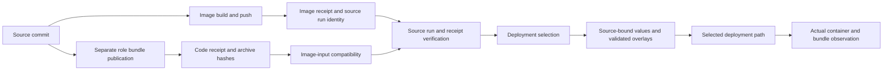

# Images, Digests, and Release Selection

Status: bounded reference; source and running-state limits stated below
Audience: release maintainer, platform operator, developer
Owner: documentation; release owners select artifacts and workload owners verify deployment
Evidence: versions.json; .github/workflows/build-images.yaml; .github/workflows/build-ops-mcp.yaml; scripts/updates/deployment-release.mjs; scripts/updates/oci-image-identity.mjs; scripts/updates/code-release.mjs
Applies to: ten runtime and two Ops image slots, three separate role bundles, and named release/deployment readers
Last verified: 2026-10-15; current source and local selection files checked; no registry, build, deployment or container observed

## Choose the task and authority

Use this page to identify which image was selected, what produced it, which
platform it can describe, and what still needs observation before rollout or
rollback. A source recipe, a stored receipt and a running container answer
different questions. Keep all applicable identities in the change record.

A pull request (PR) proposes a Git change for review and merge. GitOps keeps
the deployment's desired state in Git. Argo is the reconciler on the selected
GitOps path: it brings the cluster toward that desired state. Merging a
selection can authorize deployment when that path is enabled and bootstrapped.

| Your question | Start here | Required boundary |
| --- | --- | --- |
| Which image/bundle is selected? | Local receipt and generated-value status below | Do not substitute a development tag for an absent release selection |
| Which source and platform produced it? | Twelve-slot matrix, versions and descriptor identities | Recipe or architecture branch alone is not publication evidence |
| Will promotion deploy it? | Promotion and GitOps paths | PR creation, merge, automatic selection and cluster apply are separate transitions |
| Why was an overlay or pull rejected? | Failure and safe action table | Preserve first error and actual desired/running state; do not swap an unselected image |
| Can an earlier image be restored? | Rollback and data compatibility | Earlier selection is not known healthy, data rollback or a source revert |

For the actual procedures, use [Maintenance](../use/maintenance.md),
[Installation](../use/install.md), [Diagnosis](../use/diagnose.md) and
[Recovery](../use/recovery.md). A reference table does not replace those
procedures' identity, credential, tool, source and writer-fence prerequisites.

## Current local selection: runtime missing, Ops present

In the source state described here, `releases/runtime-images.json`,
`releases/runtime-code.json`, and runtime values for `nova`, `buster`,
`prism-agent` and `prism` are absent. Runtime installation must stop until the
release owner accepts a genuine selection through the existing
[release acquisition procedure](../use/maintenance.md#acquire-a-reviewed-runtime-selection).
Do not invent digests, manufacture a receipt, use a private tag workaround or
copy development `my-values` as if it were an accepted runtime release.

[Ops image receipt](../../../releases/ops-images.json) and
[Ops generated values](../../../releases/values/ops.yaml) are present. These
are local stored data. Their presence is not a current remote workflow-run,
source-configuration, registry or live-Pod verification result.
An image-only selection can be readable without a code receipt, but that does
not create the missing runtime image selection in this checkout.

**Source — complete family validation and fail-closed selection:**
[validateReleaseReceipt / selectedRelease](../../../scripts/updates/deployment-release.mjs#L8-L43) (`scripts/updates/deployment-release.mjs:8–43`, current-checkout SHA-256 `87d7c5e64c9718aba77a259611a760666f05626379dd2cc3f218b75869ed9ac3`).

## Do not equate these identities

Open Container Initiative (OCI) formats describe image indexes, manifests and
configuration. A descriptor identifies another object by media type, digest
and size. A digest is a content hash; it does not authenticate the producer or
prove that a container ran. A tag is a mutable name pointing to an object.

Here `rootfs` means the image's root filesystem. Configuration metadata does
not prove that layer bytes or a running container were inspected.

| Identity | Meaning | Not equivalent to |
| --- | --- | --- |
| Source Git commit | Source tree used by the named build or bundle producer | Deployment-selection commit or every active bundle commit |
| Recipe byte hash / managed version argument | Exact Dockerfile text or selected input/default | Actual base/context/build-argument closure, resulting image bytes or successful build |
| Tag, including `candidate-<full-source-SHA>`, `:proof` or `:latest` | A naming pointer | Immutable content identity; even a source-looking tag can be repointed |
| Image reference `repository@sha256:...` | Selected immutable root object | Necessarily one platform's runnable manifest |
| Root index digest | Multi-entry descriptor object, when the root is an index | Selected platform manifest or configuration digest |
| Platform manifest digest | Runnable-image manifest selected for an explicit OS/architecture[/variant] | Root index when different, configuration or downloaded layer bytes |
| Configuration digest | Image configuration object, including platform/rootfs metadata | Layer digest, root index or a running Pod's universally normalized image ID |
| Layer descriptor/digest | Layer identity/size/media type in the manifest | Proof that the layer bytes were downloaded or checked |
| Bundle archive SHA-256 / role / code commit | Independently published application archive and its source/role | Container image digest, capability grant or active archive already loaded by an agent |
| Selection commit | Git state containing accepted receipt, generated values and optional GitOps selection | The build's source commit or proof rollout completed |
| Pod UID, selected container name and `containerID`, requested image and `imageID` | Actual workload instance, request and runtime-reported identity | Universal string equality with an OCI root index or active bundle identity |

OS means operating system; architecture selects CPU instruction format.
A variant can distinguish architecture subvariants. UID is the unique identity
of a Kubernetes object; here it identifies the Pod. The selected container
name chooses its status entry. `containerID` identifies its runtime instance;
`imageID` is the runtime-reported image identity. A container can restart within
the same Pod; retain both identities and the restart count.
Container Runtime Interface (CRI) implementations can
report different image-ID forms; this page defines no universal CRI normalizer.
A reference that includes both a tag and `@digest` still selects by digest;
the presence of the word `latest` in that name alone does not make it tag-only.

**Source — actual Pod and selected container identity readers:**
[fault_consumer_identity](../../../docs/site/use/diagnose.md#L516-L528) (`docs/site/use/diagnose.md:516–528`, current-checkout SHA-256 `5bc06556def06f1edb61193867ea499c9c407f092ffe7530e817d91d5e55853b`). [memory_pod_identity](../../../docs/site/use/diagnose.md#L1755-L1766) (`docs/site/use/diagnose.md:1755–1766`, current-checkout SHA-256 `5bc06556def06f1edb61193867ea499c9c407f092ffe7530e817d91d5e55853b`).

## Source-to-selection paths

The following source-described paths are not an observed build or rollout.



**Text alternative to the diagram**

Each row names a directed connection. Labels preserve the diagram’s conditions or handoffs; dotted relationships are identified explicitly.

| From | Relationship | To |
| --- | --- | --- |
| Source commit | Directed connection | Image build and push |
| Image build and push | Directed connection | Image receipt and source run identity |
| Source commit | Directed connection | Separate role bundle publication |
| Separate role bundle publication | Directed connection | Code receipt and archive hashes |
| Image receipt and source run identity | Directed connection | Source run and receipt verification |
| Code receipt and archive hashes | Directed connection | Image-input compatibility |
| Image-input compatibility | Directed connection | Source run and receipt verification |
| Source run and receipt verification | Directed connection | Deployment selection |
| Deployment selection | Directed connection | Source-bound values and validated overlays |
| Source-bound values and validated overlays | Directed connection | Selected deployment path |
| Selected deployment path | Directed connection | Actual container and bundle observation |


Text: the image producer and code-bundle producer can publish independently.
Only compatible selected inputs proceed through receipt/source checks to a
selection. Values/render validation precedes the selected deployment path.
Actual container, active bundle and application observations remain separate.
A graph edge is a source-described dependency, not a successful-run claim.

## Twelve first-party image slots

A build context is the file input boundary supplied to the image builder.
Here `.` means repository root; the two Ops contexts are named below.

The runtime workflow's finite matrix has ten slots and repository-root build
context `.`. Ops has two separate contexts. The matrix below identifies
recipe and consumer routes; central versions/receipts remain the authorities
for changing values. It is not a manually copied digest/version inventory.

| Slot / family | Actual recipe | Build context | Selected consumer meaning |
| --- | --- | --- | --- |
| `nova` / runtime | [`docker/Dockerfile.nova`](../../../docker/Dockerfile.nova) | `.` | Nova-role gateway/main and shared init image; Nova bundle is separate |
| `prism-agent` / runtime | [`docker/Dockerfile.prism-agent`](../../../docker/Dockerfile.prism-agent) | `.` | Prism-role gateway/bridge and init image; Prism bundle is separate |
| `buster-gateway` / runtime | [`docker/Dockerfile.buster-gateway`](../../../docker/Dockerfile.buster-gateway) | `.` | Buster gateway and init image; Buster bundle is separate |
| `buster-runtime` / runtime | [`docker/Dockerfile.buster-runtime`](../../../docker/Dockerfile.buster-runtime) | `.` | `buster-v2-runtime` sidecar, not gateway or code bundle |
| `namespace-controller` / runtime | [`docker/Dockerfile.namespace-controller`](../../../docker/Dockerfile.namespace-controller) | `.` | Buster namespace-broker controller binary |
| `archviewer` / runtime | [`docker/Dockerfile.archviewer`](../../../docker/Dockerfile.archviewer) | `.` | Nova presentation sidecar, not Prism Studio |
| `prism-control` / runtime | [`docker/Dockerfile.prism-control`](../../../docker/Dockerfile.prism-control) | `.` | Prism Control workload and database bootstrap/migration Jobs |
| `prism-studio` / runtime | [`docker/Dockerfile.prism-studio`](../../../docker/Dockerfile.prism-studio) | `.` | Prism Studio workload |
| `prism-worker` / runtime | [`docker/Dockerfile.prism-worker`](../../../docker/Dockerfile.prism-worker) | `.` | Prism Worker workload; native-host admission is separate |
| `prism-ingestion` / runtime | [`docker/Dockerfile.prism-ingestion`](../../../docker/Dockerfile.prism-ingestion) | `.` | Independent Prism ingestion workload |
| `codex-ops` / ops | [`ops/pod/Dockerfile`](../../../ops/pod/Dockerfile) | `ops/pod` | Ops workload `codex` container |
| `ops-mcp` / ops | [`tools/ops-mcp/Dockerfile`](../../../tools/ops-mcp/Dockerfile) | `tools/ops-mcp` | Ops workload `ops-mcp` container |

The image repositories follow their family's source receipt. Placeholder
owners or candidate tags are not deployable substitutes for those receipts.
Role enablement and chart conditions still select which listed consumers exist.
External Tailscale, Envoy, PostgreSQL, upstream-chart and other operator-produced
images have different owners and are not automatically covered by these twelve slots.

**Source — actual workflow matrices and consumer slots:**
[runtime image matrix](../../../.github/workflows/build-images.yaml#L18-L49) (`.github/workflows/build-images.yaml:18–49`, current-checkout SHA-256 `8fe4c8b087a816429e08cf5901a4db6e55dd9e3e17211528541bd142a731f06d`). [Ops context and image selection](../../../.github/workflows/build-ops-mcp.yaml#L38-L63) (`.github/workflows/build-ops-mcp.yaml:38–63`, current-checkout SHA-256 `79cb301569d096bfff6c82135c6d4ee84df487da8cc2f0ccf1ee1b6e196460ba`). [separate namespace controller consumer](../../../charts/kubeclaw/templates/buster-namespace-controller.yaml#L180-L189) (`charts/kubeclaw/templates/buster-namespace-controller.yaml:180–189`, current-checkout SHA-256 `760a82838ffce8fbf2a29f17914a1395b5dbaac61b71742155e378f962ccaee3`). [Prism workload image iteration](../../../charts/prism/templates/workloads.yaml#L11-L20) (`charts/prism/templates/workloads.yaml:11–20`, current-checkout SHA-256 `9bb2865f5d232b2cc5fac39259c8957e573decc891d2c9b25d7554da01148739`). [Prism ingestion image](../../../charts/prism/templates/ingestion.yaml#L18-L24) (`charts/prism/templates/ingestion.yaml:18–24`, current-checkout SHA-256 `73f19bc39066d2f6f0944846c2784c193a4d1e59202ed737d3a6c6ff8ec77f98`). [Control image for bootstrap Job](../../../charts/prism/templates/jobs.yaml#L25-L29) (`charts/prism/templates/jobs.yaml:25–29`, current-checkout SHA-256 `9ea1bcd344c7ccc2177836ea64adcf82fbdc7df451032c77f8245596ba96902c`). [Control image for migration Job](../../../charts/prism/templates/jobs.yaml#L43-L47) (`charts/prism/templates/jobs.yaml:43–47`, current-checkout SHA-256 `9ea1bcd344c7ccc2177836ea64adcf82fbdc7df451032c77f8245596ba96902c`). [Ops codex image](../../../charts/ops-pod/templates/workload.yaml#L49-L54) (`charts/ops-pod/templates/workload.yaml:49–54`, current-checkout SHA-256 `3471a815948e99e52b03b7952f1076c9d21afddbd24b62c37e1c848b7a129d58`). [Ops MCP image](../../../charts/ops-pod/templates/workload.yaml#L84-L90) (`charts/ops-pod/templates/workload.yaml:84–90`, current-checkout SHA-256 `3471a815948e99e52b03b7952f1076c9d21afddbd24b62c37e1c848b7a129d58`).

### Three code-bundle roles are not three more images

Role archives are `nova`, `buster` and `prism`; their role manifests select
packages, plugins and entrypoints. The bundle manifest binds role, commit,
runtime surface, packages/plugins and dependencies. The code receipt binds
URLs, archive SHA-256, contract `v2`, source run and attempt. A role archive
is not a Nova caller grant, Buster service credential or native-host permission.
Use [Roles and package ownership](roles-and-package-ownership.md) for that boundary.

The build workflow can package role archives after deployment-only changes
without rebuilding compatible images. `selectedCode` compares image-input
identity between the selected image commit and code commit; it does not require
those commits to be identical. A difference in image inputs rejects with
`CODE_RELEASE_REQUIRES_NEW_IMAGES`. Retaining an older compatible image does
not prove the newer bundle is active in a running workload.

**Source — separate bundle branch, manifest and image compatibility:**
[conditional separate three-role bundle publication](../../../.github/workflows/build-images.yaml#L115-L157) (`.github/workflows/build-images.yaml:115–157`, current-checkout SHA-256 `8fe4c8b087a816429e08cf5901a4db6e55dd9e3e17211528541bd142a731f06d`). [role/commit/runtime surface bundle manifest](../../../scripts/build-runtime-role-bundle.mjs#L253-L267) (`scripts/build-runtime-role-bundle.mjs:253–267`, current-checkout SHA-256 `0e20765fdcc03f09b884aba805e6733f42e63c494d39a11827b2fda5c9bd6ef9`). [validateCodeReceipt / selectedCode](../../../scripts/updates/code-release.mjs#L6-L26) (`scripts/updates/code-release.mjs:6–26`, current-checkout SHA-256 `bedd4f2a8668a27b675e53aa415451a4b428543e6fc6a99bc88988355bff3259`).

## Versions, defaults and architecture limits

`ARG` declares a Dockerfile build-time parameter. `TARGETARCH` names the
selected target architecture where a recipe uses it. A source branch does not
prove that every named architecture was built or published.

`versions.json` owns central OpenClaw version/base digest and managed build
arguments plus applicable per-image overrides. `versions.mjs` generates the
recipe ARG defaults, rejects unmanaged/unused overrides and requires pinned
base syntax. OpenClaw inputs have one authority; they cannot be overridden
independently per role. The workflow separately supplies source revision and
database-refresh controls. These declarations do not prove the final builder
used every expected base, context byte, lock or tool result.

Neither the runtime nor Ops build workflow declares an explicit `platforms`
option. Recipes with `TARGETARCH` branches/checksums for amd64/arm64 do not prove
both architectures were published. A runner label such as `ubuntu-latest` is
not descriptor evidence for the resulting artifact. Select a concrete
`os/architecture[/variant]` and verify the actual descriptor relation.

The current checked-in recipe guard requires **both** complete exact recipe-byte
hash equality and the retained selected-instruction hash equality. Its finite
nine-recipe scope is not all twelve recipes or complete image provenance.
The narrow source-guard witness does not build/run Docker, verify actual bases,
context, registry publication or deployed contents. This page adds no recipe
to that guard and changes no versions or pins.

**Source — managed defaults and exact-byte AND guard:**
[versionArguments / managed base validation](../../../scripts/versions.mjs#L7-L26) (`scripts/versions.mjs:7–26`, current-checkout SHA-256 `5f7b15d0a9a033083b4fd438b2869295987f73e2fc559eda56ccaf457991c48c`). [dockerfileVersions / named overrides](../../../scripts/versions.mjs#L29-L62) (`scripts/versions.mjs:29–62`, current-checkout SHA-256 `5f7b15d0a9a033083b4fd438b2869295987f73e2fc559eda56ccaf457991c48c`). [finite existing nine-recipe byte map](../../../scripts/docs-runtime-consumer-contracts.mjs#L1164-L1202) (`scripts/docs-runtime-consumer-contracts.mjs:1164–1202`, current-checkout SHA-256 `61e79704a061ac9e752b6c72e5f5332692062a16874be532f32cd2a962f6aba8`). [assertImageAssembly complete-byte AND selected-instruction checks](../../../scripts/docs-runtime-consumer-contracts.mjs#L1214-L1227) (`scripts/docs-runtime-consumer-contracts.mjs:1214–1227`, current-checkout SHA-256 `61e79704a061ac9e752b6c72e5f5332692062a16874be532f32cd2a962f6aba8`).

## Promotion, materialization and deployment

| Transition | Source-defined checks / effects | What remains separate |
| --- | --- | --- |
| Image build/push and receipt | Runtime root context/recipe, source revision, pushed digest and receipt; workflow requests provenance and a software bill of materials (SBOM) | Remote attestation/signature verification, full layer bytes and actual deployed identity are not established here |
| Source verification | Exact successful matching main run/attempt, expected workflow/event/commit, persistent release asset and receipt equality | Merely collecting a receipt does not prove the producer run finished successfully |
| Manual promotion | Verify/materialize/scan, then propose selection PR; no rebuild | When GitOps is enabled and bootstrapped, merging included production Argo selection can authorize deployment |
| Automatic source-success path | Separate enabled/same-repository/successful-source conditions; can materialize/export and push main | It is not universally inert PR creation; deployment follows the actual selected GitOps/Argo path |
| Materialize/check | Selected source chart/value file set and Git bytes; bind image and optional bundle slots; compare or write generated values | Even `--check` prepares the values directory and invokes source/Git-backed helpers; not a pure-memory or effect-free command |
| Render / overlays | Validate selected primary/sidecar/controller/service/Ops slots and bundle role/URL/hash/commit/enablement, including intermediate overlays | Native Helm/temp inputs and all selected source/caller prerequisites need their own execution boundary |
| Workload observation | Exact Pod UID, selected container name/`containerID`, node platform, requested image and runtime-specific `imageID`, plus separately active bundle and application reader | Desired values and descriptor success do not prove actual running bytes or application/data compatibility |

The kubeclaw image helper chooses a supplied digest before a development tag.
That fallback does not bypass production receipt admission. Prism requires
repository plus digest; Ops requires immutable image strings. An overlay must
not remove/replace a selected slot, introduce another unselected first-party
image, disable a required bundle or change its selected identity. This is not
an approval of every external image or arbitrary private settings.

**Source — source verification, promotion and selected-render boundary:**
[runtime push, limited post-push checks and immutable receipt](../../../.github/workflows/build-images.yaml#L63-L105) (`.github/workflows/build-images.yaml:63–105`, current-checkout SHA-256 `8fe4c8b087a816429e08cf5901a4db6e55dd9e3e17211528541bd142a731f06d`). [successful source run/attempt and persistent receipt equality](../../../scripts/updates/verify-release-source.mjs#L31-L48) (`scripts/updates/verify-release-source.mjs:31–48`, current-checkout SHA-256 `498f7e2d08546f1587d70c5e256ae17129dda1e10172abac5f949f2fc90e91b3`). [manual PR and conditional automatic deployment after merge](../../../.github/workflows/promote-runtime.yaml#L84-L113) (`.github/workflows/promote-runtime.yaml:84–113`, current-checkout SHA-256 `22867f17cf940d7b1137068e308d3b8216714d8da37dff1fd257eb8664f69981`). [enabled successful-source automatic path](../../../.github/workflows/auto-promote-runtime.yaml#L13-L41) (`.github/workflows/auto-promote-runtime.yaml:13–41`, current-checkout SHA-256 `e233296becb27f3da4f188298e397e487952f89f02639d04ef114e4968ced0e9`). [automatic materialization/export/main push](../../../.github/workflows/auto-promote-runtime.yaml#L42-L61) (`.github/workflows/auto-promote-runtime.yaml:42–61`, current-checkout SHA-256 `e233296becb27f3da4f188298e397e487952f89f02639d04ef114e4968ced0e9`). [materialize selected images/bundles and compare/write values](../../../scripts/updates/materialize-release.mjs#L5-L42) (`scripts/updates/materialize-release.mjs:5–42`, current-checkout SHA-256 `8d7fab9533226d6c5d568daaab2f16b60f6e72b185213a636609e9c530854f8b`). [selected bundle controls](../../../scripts/updates/deployment-release.mjs#L89-L112) (`scripts/updates/deployment-release.mjs:89–112`, current-checkout SHA-256 `87d7c5e64c9718aba77a259611a760666f05626379dd2cc3f218b75869ed9ac3`). [selected images cannot change/disappear](../../../scripts/updates/deployment-release.mjs#L115-L132) (`scripts/updates/deployment-release.mjs:115–132`, current-checkout SHA-256 `87d7c5e64c9718aba77a259611a760666f05626379dd2cc3f218b75869ed9ac3`). [per-overlay validation and native render inputs](../../../scripts/updates/deployment-release.mjs#L157-L197) (`scripts/updates/deployment-release.mjs:157–197`, current-checkout SHA-256 `87d7c5e64c9718aba77a259611a760666f05626379dd2cc3f218b75869ed9ac3`). [digest priority and development tag fallback](../../../charts/kubeclaw/templates/_helpers.tpl#L131-L141) (`charts/kubeclaw/templates/_helpers.tpl:131–141`, current-checkout SHA-256 `69986722975a973479b9fb1a2c35ab1a1ecb972662e8c19dd03718ac441f5103`).

Runtime published-artifact checks are not uniform across all slots: the
workflow invokes its exact published check for four selected runtime images.
Other helper branches and Ops scan/smoke/publication have different scopes.
Local PR proof images are loaded without push. None of those source-declared
steps is reported as executed by this page.

## Descriptor inspection: useful, bounded, not a running-container verdict

Only after the existing release/maintenance prerequisites are met may the
source inspector be selected. It needs the repository working directory,
accepted selection/source bytes, actual Node/dependency/tool/Git context,
explicit platform, approved GHCR access and, when selected, a protected bearer
token file. GHCR is GitHub Container Registry. Do not print or copy token contents.

**CLI syntax only, not a ready-to-run example or an executed command:**

```text
node scripts/updates/inspect-release-image.mjs <runtime|ops> <image-slot> <os/architecture[/variant]> [registry-bearer-token-file]
```

`selectedRelease` can launch materialization `--check`; the inspector can read
the token file and make bounded registry requests. It is not a new offline,
write-free inspection tool. Before use, follow the existing
[release acquisition procedure](../use/maintenance.md#acquire-a-reviewed-runtime-selection)
with the accepted selection and original source checkout. Its required tools
and dependencies, explicit platform, and approved registry/token-file access
must be available; stop if a prerequisite is missing.

The resolver hashes raw bytes and checks descriptor size/media type before
interpreting the selected relationship. If the root is an index it requires
exactly one matching platform child; missing/duplicate choices and nested
indexes fail rather than selecting the first child. It then validates the
manifest/config platform and rootfs/layer descriptor relations. It does **not**
fetch or verify layer bytes, run a container, prove active code or authenticate
signed build provenance. Signed-blob redirects are bounded and constrained;
registry authorization is not forwarded to the signed blob host.

Its output retains `scope: descriptor-relationships-only` and these distinct
false flags: `layersVerified: false`, `runningContainerVerified: false`,
`activeBundleVerified: false`. Do not turn a successful descriptor result into
any of those claims. An index digest, selected platform manifest, configuration
digest and runtime-specific Pod image ID require their actual relationship,
not a universal string-equality test.

**Source — actual inspector and descriptor/transport limits:**
[inspector syntax, selected slot and three false flags](../../../scripts/updates/inspect-release-image.mjs#L7-L20) (`scripts/updates/inspect-release-image.mjs:7–20`, current-checkout SHA-256 `5bff13e7bb6dd44af029a80fa92ca3b46c0c35ff41f9ff3b8479f4d23b702a7c`). [raw descriptor size/digest/JSON checks](../../../scripts/updates/oci-image-identity.mjs#L19-L29) (`scripts/updates/oci-image-identity.mjs:19–29`, current-checkout SHA-256 `779177e1dc60e1674c37a1ed06b595e46ff22fd81b1364354d4b5b4cf512b7f8`). [unique platform manifest and nested-index denial](../../../scripts/updates/oci-image-identity.mjs#L44-L54) (`scripts/updates/oci-image-identity.mjs:44–54`, current-checkout SHA-256 `779177e1dc60e1674c37a1ed06b595e46ff22fd81b1364354d4b5b4cf512b7f8`). [config/rootfs/layer descriptor shape](../../../scripts/updates/oci-image-identity.mjs#L57-L81) (`scripts/updates/oci-image-identity.mjs:57–81`, current-checkout SHA-256 `779177e1dc60e1674c37a1ed06b595e46ff22fd81b1364354d4b5b4cf512b7f8`). [resolveOciImageIdentity result identities](../../../scripts/updates/oci-image-identity.mjs#L84-L106) (`scripts/updates/oci-image-identity.mjs:84–106`, current-checkout SHA-256 `779177e1dc60e1674c37a1ed06b595e46ff22fd81b1364354d4b5b4cf512b7f8`). [bounded signed-blob redirects without auth forwarding](../../../scripts/updates/ghcr-descriptor-reader.mjs#L29-L41) (`scripts/updates/ghcr-descriptor-reader.mjs:29–41`, current-checkout SHA-256 `71b023232c2a995a64264bae1f48cfab03c4cea45b50acfce24e9c630c7ee1cd`). [GHCR token/scope/size/timeout and network effects](../../../scripts/updates/ghcr-descriptor-reader.mjs#L44-L88) (`scripts/updates/ghcr-descriptor-reader.mjs:44–88`, current-checkout SHA-256 `71b023232c2a995a64264bae1f48cfab03c4cea45b50acfce24e9c630c7ee1cd`).

## Failure, change and safe recovery

| Condition | Meaning / impact | First safe action and stop rule |
| --- | --- | --- |
| Runtime receipt/values absent | Selected-release/render/install route cannot establish authority | Stop before mutation; release owner follows the existing maintenance acquisition path. No latest/private-tag/ad-hoc receipt workaround |
| Wrong source/run/attempt/assets or incomplete family | Verification rejects even if some build/published artifacts already exist | Preserve first failed step and identities; release owner reconciles the original run instead of blindly rebuilding or redispatching |
| Source chart/value bytes or generated values drift | Accepted selection and checkout no longer agree | Stop; use the documented disposable repair/current accepted checkout procedure. Do not silently regenerate installation inputs |
| Overlay changes selected slot/bundle controls | Rendered workload would differ from selection | Correct only the owning source/selection; do not widen allowlists or disable required bundles |
| `OCI_*` digest/size/media/platform failure | Requested descriptor relation is invalid or ambiguous | Preserve exact reference/platform/status. Registry/release owner investigates; do not try another image/platform merely to pass |
| Registry auth/HTTP/timeout/redirect failure | Access or bounded acquisition failed, not proof the image is bad or running | Correct the approved read identity/access path; retain non-secret status. Do not publish bearer tokens |
| `ImagePullBackOff` | Desired workload could not complete its pull/start path | Use existing install/diagnosis for registry availability/credentials and node platform; retain Pod/container identity instead of swapping the digest |
| Code source differs in image inputs | `CODE_RELEASE_REQUIRES_NEW_IMAGES` blocks mixing incompatible image/code | Obtain a new qualified image selection; do not mislabel code or image source commit |
| Rollback after data/schema writes | Old selection can be unavailable or incompatible with new state | Check retained image/bundle availability and original data/application compatibility before merge. Image rollback is not database restore |

The rollback source chooses an earlier **different** first-parent deployment
selection or a guarded explicit ancestor. It does not call it known healthy.
It checks scope and retained bundle bytes, then proposes selected receipts,
values and GitOps changes; it is not a source revert, data restore or guarantee
that resources retained with `prune=false` revert. Record selection, image and
code source commits independently and follow the existing
[rollback boundary](../use/recovery.md#rollback-boundary).

**Source — retained-selection rollback limits:**
[earlier different selection, never known healthy](../../../scripts/gitops-rollback.mjs#L14-L28) (`scripts/gitops-rollback.mjs:14–28`, current-checkout SHA-256 `cb99e161b264852a620710b73dbbc4f3162d1abb78e8ff36be741889e667b958`). [scope/history and retained bundle-byte checks](../../../scripts/gitops-rollback.mjs#L31-L50) (`scripts/gitops-rollback.mjs:31–50`, current-checkout SHA-256 `cb99e161b264852a620710b73dbbc4f3162d1abb78e8ff36be741889e667b958`). [rollback proposal and provenance, not rebuild or data restore](../../../.github/workflows/rollback-runtime.yaml#L32-L64) (`.github/workflows/rollback-runtime.yaml:32–64`, current-checkout SHA-256 `be392f5c8fbe2261c0273d6a88dd054e0a72b4cc61ecca39f6979f0c2428b0e8`). [data-write rollback boundary](../../../docs/site/use/recovery.md#L1072-L1082) (`docs/site/use/recovery.md:1072–1082`, current-checkout SHA-256 `944988014bbfecd79138d2180f47631218ecea38efef9ae4bc3239e4e76a1a52`).

## Coverage and follow-up evidence

This reference covers the two named workflow families, twelve first-party
slots, three bundle roles and their selected source/receipt/render/descriptor
readers. It does not inventory every upstream chart, external image,
extra-container override, pipeline/provider build, sandbox/native-host image,
registry mirror or dynamically produced image. Conditional supported routes
still need an owning source and operational evidence; absence here is not an
exclusion or permission to substitute them.

Actual builder platform, remote run/assets, provenance signatures, layer bytes,
current cluster/Pod/CRI relations, active bundle and original application/data
behavior were not observed. Current local Ops data is not remotely reverified;
runtime selection remains absent. The new manuscript does not repair an older
generic imageID comparison into a universal OCI normalization algorithm.

Keep source changes connected to the existing maintenance and reader ownership
routes. Slot/role/recipe removal or rename must update consumers and links;
a stored hash or a complete-looking table is not add/change/remove drift proof.
The current page generators do not make this authored reference an image
inventory generator. No build, scan, OCI inspection, workflow, Helm render,
registry/network call, container, deployment or rollback was executed here.
