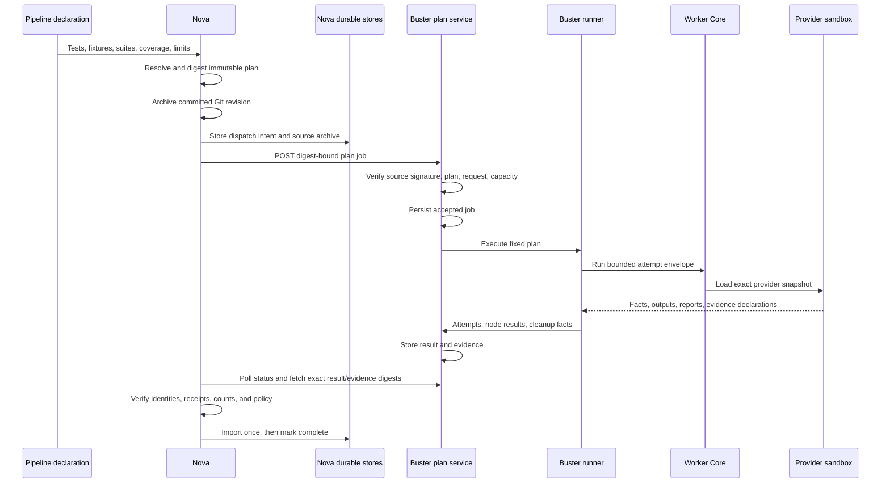

# Buster: From Test Intent to Verified Result

Status: implemented with stated environment limits
Audience: technical reader, operator, test author, Buster maintainer
Owner: buster
Evidence: skills/nova/core/test-gates; skills/buster/engine/test-gates; contracts/pipeline-test-gate/v1; skills/nova/plugins/buster-quality-gate
Evidence revision: `3cf7dc4f72c2ae1e0ba4c47cceb08c98f4c70b7f`
Applies to: the current Nova-to-Buster remote test-gate path
Last verified: source and contract inspection on 2026-09-19. Optional-evaluator section source-reviewed 2026-10-22. Original other-scope dates and execution limits unchanged.

## Product Boundary

Buster executes a test plan. It does not decide which product work Nova must do.
Nova selects the test scope, resolves suites, and freezes the plan. Buster admits
that plan, executes its nodes, retains evidence, and returns a digest-bound
result identity. Nova verifies and imports the result. Nova then applies the
gate policy.

This separation prevents a test provider from changing the pipeline. A provider
can report facts about one attempt. It cannot add a test, change a blocking node
to advisory, or declare the complete pipeline successful.

### Decision record: freeze the plan before remote execution

This decision record has these facets:

- **Problem and constraints:** Nova can restart and Buster can execute on a
  different host. Both sides must still agree on the nodes, package bytes,
  configuration, limits, links, and source revision.
- **Decision:** Nova resolves the complete test plan and its
  digest before it submits a remote Buster job. Buster executes that fixed plan.
- **Rejected alternative:** Let Buster discover or select tests from the project
  at execution time. [ADR-013](../decisions/core-and-plugins.md#adr-013-use-authenticated-durable-nova-to-buster-plan-jobs)
  and [D-110](../decisions/test-gate.md#d-110-remote-nova-to-buster-plan-job)
  retain the actual transport decision and its alternatives.
- **Reason:** A later discovery step would let caller and executor use different
  meanings for the same job identity.
- **Cost:** The plan is traceable and repeatable. It cannot include a later provider or configuration change.
  Nova must resolve a new plan and digest.
- **Reconsider when:** Reconsider the transport when the accepted queue target in
  D-098 replaces the first authenticated service transport. Do not reconsider the
  fixed-plan identity rule unless a replacement preserves the same authority.
- **Decision status:** [D-097](../decisions/test-gate.md#d-097-one-immutable-attempt-is-the-worker-unit)
  accepts the immutable-attempt rule. D-110 records the remote fixed-plan job,
  but its individual approval and date remain unconfirmed. The implementation
  does not change that historical status.
- **Implementation status:** Implemented for the inspected Nova resolver, Buster
  runner, and remote result path. Live multi-host acceptance is separate.
- **Supersession:** No successor replaces the fixed-plan rule. D-110 narrows the
  initial transport relative to D-098. It does not replace plan immutability.

> **Source evidence — authority split**
>
> **Claim:** Nova fixes the plan identity. Buster validates that identity. Nova
> owns the final gate decision after result verification.
>
> **Implementation:** [Nova resolver, `resolveTestPlan`](https://github.com/datrab/kubeclaw/blob/3cf7dc4f72c2ae1e0ba4c47cceb08c98f4c70b7f/skills/nova/core/test-gates/resolver.ts#L720-L754) ·
> [Buster runner admission](https://github.com/datrab/kubeclaw/blob/3cf7dc4f72c2ae1e0ba4c47cceb08c98f4c70b7f/skills/buster/engine/test-gates/runner.ts#L234-L265) ·
> [Nova result authority](https://github.com/datrab/kubeclaw/blob/3cf7dc4f72c2ae1e0ba4c47cceb08c98f4c70b7f/skills/nova/core/test-gates/remote-result-authority.ts#L109-L190)
>
> **Contract or setting:** [ADR-013](../decisions/core-and-plugins.md#adr-013-use-authenticated-durable-nova-to-buster-plan-jobs) ·
> [ADR-014](../decisions/core-and-plugins.md#adr-014-separate-buster-execution-evidence-from-nova-quality-judgment)
>
> **Test evidence:** `npm run verify:test-gate:suite-resolver` passed on
> 2026-09-19. `npm run verify:test-gate:remote-plan` stopped at the durable-store
> lock because this host has BusyBox `flock`, which does not support the required
> timeout option. No live multi-host job ran.
>
> **Revision:** `3cf7dc4f72c2ae1e0ba4c47cceb08c98f4c70b7f`
>
> **Limit:** These sources prove code and contract behavior. They do not prove
> live dependency readiness or the original reason beyond the decision records.

## Why Each Boundary Exists

The canonical decision records are [ADR-003, ADR-013, and ADR-014](../decisions/core-and-plugins.md)
and [D-001 through D-119](../decisions/test-gate.md). The table below is a
mechanism map. It explains the consequence of current behavior. Its contrast
column identifies the failure that the mechanism prevents. It does not claim
that every contrast was a historically considered alternative.

| Current mechanism | Why the flow needs it | Failure it prevents | Cost and consequence |
| --- | --- | --- | --- |
| Send one committed Git archive. | Buster must execute the same bytes that Nova identified. | Send the mutable working tree or let Buster clone a moving branch. | The author must commit every required file before execution. |
| Sign the source statement with Nova's Ed25519 key. | Buster must know which trusted source authority created the archive identity. | Trust a repository name, transport token, or archive digest alone. | Operators must provision, protect, and rotate an asymmetric key pair. |
| Keep Buster result receipts hash-bound with no signatures. | The authenticated service boundary and exact digests provide the implemented result authority. | Describe deterministic receipt hashes as cryptographic signatures. | A receipt proves internal identity binding, not independent non-repudiation. |
| Store status, result, and evidence as separate objects. | Polling must stay small while result and evidence bytes retain exact identities. | Put all bytes into every status response. | Operators must preserve and recover several related durable objects. |
| Reserve result capacity during admission. | An accepted job must not create storage debt that can fail only after execution. | Admit work until the result store becomes full. | Conservative reservations can reject work before the store is physically full. |
| Run providers through Worker Core capabilities. | A package receives only declared, bounded authority for one attempt. | Let provider code open host processes, sockets, cluster clients, or scanners directly. | Each new authority needs a policy, adapter, limits, tests, and operator configuration. |
| Keep original evidence and normalized report facts. | Normalization supports common decisions, while original bytes preserve diagnostic detail. | Keep only parsed counts or only raw files. | Evidence storage must account for both forms and their separate limits. |
| Import a verified result once in Nova. | A retry must continue the same durable import. It must not duplicate evidence or change identity. | Mark the gate complete before every evidence object is present. | Nova needs pending and complete import records plus conflict handling. |

This table is not a decision register. Decision status, implementation status,
reconsideration conditions, evidence, and supersession remain in the canonical
records. In particular,
[ADR-003](../decisions/core-and-plugins.md#adr-003-keep-buster-test-semantics-outside-nova-and-worker-core)
owns the component split, [ADR-013](../decisions/core-and-plugins.md#adr-013-use-authenticated-durable-nova-to-buster-plan-jobs)
owns durable remote work, and [ADR-014](../decisions/core-and-plugins.md#adr-014-separate-buster-execution-evidence-from-nova-quality-judgment)
owns the separation between execution facts and pipeline judgment.

## Complete Request Path

**Text alternative to the diagram**

Read the following messages in order. A self-action stays with the same participant. A dashed reply is identified explicitly.

Participants: Pipeline declaration, Nova, Nova durable stores, Buster plan service, Buster runner, Worker Core, Provider sandbox.

| Step | From | Relationship | To |
| --- | --- | --- | --- |
| 1 | Pipeline declaration | Message — Tests, fixtures, suites, coverage, limits | Nova |
| 2 | Nova | Self-action — Resolve and digest immutable plan | Nova |
| 3 | Nova | Self-action — Archive committed Git revision | Nova |
| 4 | Nova | Message — Store dispatch intent and source archive | Nova durable stores |
| 5 | Nova | Message — POST digest-bound plan job | Buster plan service |
| 6 | Buster plan service | Self-action — Verify source signature, plan, request, capacity | Buster plan service |
| 7 | Buster plan service | Self-action — Persist accepted job | Buster plan service |
| 8 | Buster plan service | Message — Execute fixed plan | Buster runner |
| 9 | Buster runner | Message — Run bounded attempt envelope | Worker Core |
| 10 | Worker Core | Message — Load exact provider snapshot | Provider sandbox |
| 11 | Provider sandbox | Dashed reply — Facts, outputs, reports, evidence declarations | Buster runner |
| 12 | Buster runner | Message — Attempts, node results, cleanup facts | Buster plan service |
| 13 | Buster plan service | Self-action — Store result and evidence | Buster plan service |
| 14 | Nova | Message — Poll status and fetch exact result/evidence digests | Buster plan service |
| 15 | Nova | Self-action — Verify identities, receipts, counts, and policy | Nova |
| 16 | Nova | Message — Import once, then mark complete | Nova durable stores |

Text version: Nova reads the selected test scope and creates a deterministic
plan. It archives only one committed Git tree and signs that source identity.
Nova stores the job before network dispatch. Buster verifies the job before it
stores an `accepted` status. The runner executes each ready node through Worker
Core and a package snapshot. Buster stores the terminal result and evidence.
Nova fetches those bytes by digest, verifies them, and records the import before
it returns the decision to the pipeline.

## 1. Plan Resolution

The input scope contains direct tests, fixtures, selected suites, coverage, and
concurrency limits. Suite templates are composition data. They can contribute
nodes, defaults, links, conditions, and concurrency groups. They cannot install
code or grant authority.

The resolver performs these operations:

1. The resolver validates every suite contract. It builds a unique catalog.
2. The resolver applies exclusions and permitted overrides.
3. The resolver combines suite nodes with project-local nodes.
4. The resolver validates provider configuration against the selected package schema.
5. The resolver expands permitted matrix fields within the policy limit.
6. The resolver binds input ports to exact upstream output ports.
7. The resolver rejects cycles, missing dependencies, and incompatible ports.
8. The resolver binds provider and report-adapter package digests.
9. The resolver calculates stable execution and test identities.
10. The resolver calculates the final plan digest.

The resolved plan records what will run. It does not prove that a provider,
cluster, browser, scanner, or network target is available.

> [Suite admission, exclusions, overrides, and template digests are resolved before node expansion](https://github.com/datrab/kubeclaw/blob/3cf7dc4f72c2ae1e0ba4c47cceb08c98f4c70b7f/skills/nova/core/test-gates/resolver.ts#L279-L409).
>
> [The resolver validates links, graph order, concurrency, coverage, and the final plan digest](https://github.com/datrab/kubeclaw/blob/3cf7dc4f72c2ae1e0ba4c47cceb08c98f4c70b7f/skills/nova/core/test-gates/resolver.ts#L624-L754).

## 2. Committed Source Snapshot

Nova never sends the mutable working tree to Buster. It resolves a commit and its tree.
It creates a compressed Git archive. It binds repository, stage, revision, tree, archive digest, size, and creator authority. An Ed25519
signature protects this source statement.

Buster verifies the configured authority and public key before admission. The
signature proves which authority created the snapshot statement. The archive
digest proves byte identity. Neither fact proves that the source is safe.

The archive limit is at most 128 MiB. Nova rejects a non-root repository path,
an invalid Git object identity, an empty archive, or a changed digest.

> [Nova archives one committed Git tree and signs its exact identity](https://github.com/datrab/kubeclaw/blob/3cf7dc4f72c2ae1e0ba4c47cceb08c98f4c70b7f/skills/nova/core/test-gates/source-snapshot.ts#L17-L64).
>
> [The shared contract signs and verifies the source statement with Ed25519](https://github.com/datrab/kubeclaw/blob/3cf7dc4f72c2ae1e0ba4c47cceb08c98f4c70b7f/contracts/pipeline-test-gate/v1/src/remote.ts#L61-L104).

## 3. Dispatch and HTTP API

Nova calculates the job ID from the idempotency key. The request contains the
resolved plan, source snapshot, encoded archive, node grants, concurrency
limit, stage identity, and submission time. Its request digest covers the
complete job.

The Buster API has these routes:

| Route | Meaning |
| --- | --- |
| `GET /health` | HTTP process liveness. |
| `GET /ready` | Recovery completed and the service can admit work. |
| `POST /v1/plan-jobs` | Validate and durably admit one exact job. |
| `GET /v1/plan-jobs/:jobId` | Read current durable status. |
| `DELETE /v1/plan-jobs/:jobId` | Request cancellation for the same job. |
| `GET /v1/plan-jobs/:jobId/results/:digest` | Read one terminal result by content digest. |
| `GET /v1/plan-jobs/:jobId/evidence/:digest` | Read one retained evidence object by digest. |

The transport permits HTTPS or loopback HTTP. Bearer mode requires a token of
at least 32 characters. SPIFFE-proxy mode requires a loopback endpoint because
the local proxy owns peer authentication. The transport rejects redirects. Request,
response, result, archive, evidence, and store limits remain separate.

> [The Nova transport defines job, status, cancellation, result, and evidence calls](https://github.com/datrab/kubeclaw/blob/3cf7dc4f72c2ae1e0ba4c47cceb08c98f4c70b7f/skills/nova/core/test-gates/remote-dispatch.ts#L94-L197).
>
> [Remote non-loopback plaintext endpoints fail before transport creation](https://github.com/datrab/kubeclaw/blob/3cf7dc4f72c2ae1e0ba4c47cceb08c98f4c70b7f/skills/nova/core/test-gates/secure-endpoint.ts#L7-L15).

## 4. Durable Admission and State

Buster verifies the source signature, archive encoding and digest, derived job
ID, plan digest, request digest, and wire contract. It also reserves the maximum
result capacity before it accepts a job. This conservative reservation prevents
several admitted jobs from exhausting the result store after they finish.

The status states are `accepted`, `running`, `completed`, `failed`, and
`cancelled`. A compare-and-transition record protects each state change. A
repeated idempotency key returns the prior status only when job and request
identities match. A different request under the same key fails.

The stores are local durable record and blob stores under the configured state
root. They are not a replicated database. Backup, filesystem durability,
capacity monitoring, and off-host recovery remain operator responsibilities.

> [Admission verifies identities, reserves result capacity, and stores one accepted job under a lock](https://github.com/datrab/kubeclaw/blob/3cf7dc4f72c2ae1e0ba4c47cceb08c98f4c70b7f/skills/buster/engine/test-gates/remote-plan-service.ts#L94-L165).
>
> [State transition rejects an unexpected predecessor and preserves an existing terminal result](https://github.com/datrab/kubeclaw/blob/3cf7dc4f72c2ae1e0ba4c47cceb08c98f4c70b7f/skills/buster/engine/test-gates/remote-plan-service.ts#L180-L258).

## 5. Execution, Providers, and Worker Core

The runner validates the plan against the installed registry snapshot. It
creates a secure workspace, extracts the verified repository archive, and
schedules nodes only after their dependencies permit execution. Concurrency
groups and the job-wide limit bound parallel work.

For each attempt, Buster loads the exact provider package snapshot. Worker Core
binds attempt identity, limits, deadline, cancellation, resource accounting,
cleanup, and the sealed result. The provider receives only its declared
configuration, inputs, workspace, log function, signal, and capability calls.

Fixtures can retain a live resource for dependent tests. Their cleanup runs
after consumers finish. Tests return facts and evidence, not fixture lifecycle
authority. A non-retry-safe provider receives no retries by default. A suite can explicitly
request retries with `acceptUnsafeRetry: true`, within the policy retry limit.
This acknowledges the risk. It does not make the provider retry-safe.

> [Provider loading verifies the package digest and imports an attempt-owned snapshot](https://github.com/datrab/kubeclaw/blob/3cf7dc4f72c2ae1e0ba4c47cceb08c98f4c70b7f/skills/buster/engine/test-gates/provider-loader.ts#L37-L86).
>
> [The runner validates result counts, evidence, reports, and output contracts](https://github.com/datrab/kubeclaw/blob/3cf7dc4f72c2ae1e0ba4c47cceb08c98f4c70b7f/skills/buster/engine/test-gates/runner.ts#L325-L390).

## 6. Evidence, Reports, and Result Authority

A provider declares evidence files. Buster opens and stores them under bounded
rules, calculates content digests, and creates immutable references. The runner
adds its own log evidence. It rejects duplicate IDs or paths, undeclared types,
missing report files, unknown report formats, invalid counts, and incompatible
outputs.

A report adapter parses one declared report artifact. It receives bytes and
limits, but no host capability. The current installed adapter handles JUnit XML.
The original report remains evidence when normalized case or finding lists are
truncated.

Buster creates attempt receipts, node receipts, and one remote result receipt.
These receipts bind authority, identity, and result digest. They do not sign
with a private key. The remote result receipt uses deterministic hashes under
the named `buster-plan-service.v1` authority. Source authentication uses the
separate Ed25519 signature described above.

> [The result contract derives the Buster receipt from job and result identity](https://github.com/datrab/kubeclaw/blob/3cf7dc4f72c2ae1e0ba4c47cceb08c98f4c70b7f/contracts/pipeline-test-gate/v1/src/remote.ts#L106-L137).
>
> [Report admission checks format, media type, size, cancellation, and runtime-root integrity](https://github.com/datrab/kubeclaw/blob/3cf7dc4f72c2ae1e0ba4c47cceb08c98f4c70b7f/skills/buster/engine/test-gates/report-adapter-runtime.ts#L118-L153).

## 7. Nova Verification and One-Time Import

Nova accepts only a terminal status that belongs to the submitted job and
request. For a completed job, Nova downloads the exact result object. It validates the content and result digests.
It checks all job, run, plan, node, attempt, receipt, and source identities. It then derives the gate decision.

Nova then stores a pending import record, imports every referenced evidence
blob by digest, and changes the record to `complete`. A retry with the same
identity continues or returns that import. A conflicting result fails. Nova
does not use the Buster status alone as the pipeline verdict.

> [The importer validates terminal status, result identity, total evidence size, and every evidence digest](https://github.com/datrab/kubeclaw/blob/3cf7dc4f72c2ae1e0ba4c47cceb08c98f4c70b7f/skills/nova/core/test-gates/remote-result-import.ts#L156-L207).
>
> [The import store writes pending intent before blobs and completes with a guarded transition](https://github.com/datrab/kubeclaw/blob/3cf7dc4f72c2ae1e0ba4c47cceb08c98f4c70b7f/skills/nova/core/test-gates/remote-result-import.ts#L82-L154).

### Optional evaluator after the native decision

The Nova stage `kubeclaw.test.quality-evaluation` adds an optional evaluator
judgment to the native result. It does not replace Buster execution. Follow the
[existing native production procedure](../use/workflows/buster-suite.md#5-submit-and-observe-in-production)
for compilation, submission, verified import and audit. The existing
`testAgentEnabled` setting controls only the branch below, not a new submission
path or permission to accept caller-supplied test evidence.

The closed stage input contains `gateId`, `task`, `providerPlan`, and optional
`expectedCoverage`. Caller-supplied `suiteEvidence`, `runId`, or `attempt` is not
an alternative input contract. The stage resolves the admitted source revision and checks coverage expectations when present.
It invokes `test.plan.execute`. It parses the returned digest-bound native decision and checks its run against Core's leased run. An enabled evaluator needs a nonblank configured `agent`. That
configuration check happens before the native invocation. An invalid native
plan, import or coverage decision does not become evaluator evidence.

The stage writes the native decision through `artifacts.write` in namespace
`kubeclaw.buster-quality-gate`, object
`buster-quality:<gateId>:decision:<attemptNumber>`, before it chooses a judgment branch. This ordering preserves native facts independently of evaluator output.

| Native decision / evaluator branch | Result and retained artifacts |
| --- | --- |
| Native state is not `passed` | Return the native stage result with the native decision artifact. Never dispatch the optional evaluator. Native `failed` reduces to `request_fix` / `test_gate.failed`. `cancelled` stays cancelled, and `execution_error` or `review_required` is blocked with its native reason. |
| Native passed. Evaluator disabled | Write a second assessment object `buster-quality:<gateId>:<attemptNumber>` with these fields: `testAgent.enabled: false`, `nativeOutcome`, `sourceRevision`, and `decisionDigest`. Return the native passed result plus both artifacts. |
| Native passed. Evaluator enabled | Dispatch the configured agent with protocol `kubeclaw.buster-quality-gate.v2`. The request contains task, runtime-supplied identity and suite evidence from the parsed native decision. A valid assessment writes the second object with `testAgent.enabled: true`, bound `verdict`, `sourceRevision`, `decisionDigest`, and `suiteEvidence`. |

The request describes a **four-field agent-owned output**, not a copy of the
request envelope:

| Agent-owned field | Illustrative passed assessment |
| --- | --- |
| `outcome` | `passed` |
| `summary` | The verified native evidence meets the requested judgment. |
| `failureClass` | `none` |
| `findings` | Empty list. |

The evaluator must return `outcome` as `passed`, `request_fix`, or `blocked`.
`failureClass` is `none`, `test_failure`, `contract`, `configuration`,
`infrastructure`, `rate_limit`, or `timeout`. Do not add `protocol`, `agent`,
`identity`, `task`, evidence, or contract fields. Core's lease supplies run and
attempt. The stage's input supplies gate ID. The parser attaches those values to the verdict itself. An agent cannot select another run/gate/attempt even if it copies identity fields into its output.

Beyond the request's declared shape, the parser requires:

- A nonblank summary of at most 8,192 JavaScript string code units
- At most 128 findings
- Nonblank finding strings of at most 4,096 code units each.

 These are not UTF-8 byte limits.

A passed verdict must have `failureClass: none`, no findings, and no failing
suite evidence. A nonpassing verdict needs a non-`none` class and at least one
finding. The parser retains the supplied summary/findings. It does not replace
them with a generic issue list. These consistency rules cannot authorize a pass
for a failed native decision: that branch never dispatches the agent.

For a valid passed verdict, the stage preserves the native passed result. For a
valid nonpassing verdict, it keeps the requested `request_fix` or `blocked`
outcome and emits `buster_quality.<failureClass>`, the summary, findings and
native decision digest. It does not choose `request_fix` solely because the
class is `test_failure`, or automatically turn every infrastructure class into
`blocked`. The explicit admissible outcome and class are separate fields.

Only an exception from `parseVerdict(response.result, judgedInput)` becomes a
blocked `buster_quality.invalid_verdict` result. That result returns the native
decision artifact, not a successfully stored evaluator assessment. A dispatch
failure, source/coverage/native-decision error, or either artifact-write failure
lies outside that catch and propagates to Core's existing effect/error/recovery
policy.

Do not relabel those failures as malformed model output.
Do not assume that an already-written native artifact disappeared.
Do not resubmit native tests merely because the evaluator response was lost.

Preserve the run, native decision, assessment if present, effect receipts and exact input/package identities.
Before any permitted continuation, follow [the existing recovery boundary](#8-failure-cancellation-restart-and-recovery). If you disable an evaluator, that action neither repairs native evidence nor proves that a failed external dispatch had no effect.

> **Source evidence — native-first optional evaluator contract**
>
> **Claim:** The optional evaluator judges already-verified native evidence, with runtime-owned identity and a separate assessment artifact. It cannot overrule a nonpassing native decision.
>
> **Implementation:** [Native decision, artifact order and optional branches](https://github.com/datrab/kubeclaw/blob/3cf7dc4f72c2ae1e0ba4c47cceb08c98f4c70b7f/skills/nova/plugins/buster-quality-gate/src/stage.ts#L13-L70) [Request/output contract, limits, consistency and identity](https://github.com/datrab/kubeclaw/blob/3cf7dc4f72c2ae1e0ba4c47cceb08c98f4c70b7f/skills/nova/plugins/buster-quality-gate/src/protocol.ts#L18-L45)
>
> **Contract or setting:** [Closed stage input and native provider-plan requirement](https://github.com/datrab/kubeclaw/blob/3cf7dc4f72c2ae1e0ba4c47cceb08c98f4c70b7f/skills/nova/plugins/buster-quality-gate/schemas/input.schema.json#L1-L43) [Native decision stage reduction](https://github.com/datrab/kubeclaw/blob/3cf7dc4f72c2ae1e0ba4c47cceb08c98f4c70b7f/contracts/pipeline-test-gate/v1/src/gate-decision.ts#L39-L56)
>
> **Test evidence:** [Protocol vectors](https://github.com/datrab/kubeclaw/blob/3cf7dc4f72c2ae1e0ba4c47cceb08c98f4c70b7f/skills/nova/plugins/buster-quality-gate/tests/protocol.test.ts#L1-L28) [Native input authority assertions](https://github.com/datrab/kubeclaw/blob/3cf7dc4f72c2ae1e0ba4c47cceb08c98f4c70b7f/skills/nova/plugins/buster-quality-gate/tests/suite-first.test.ts#L1-L21) The assertions reject caller-owned evidence and contradictory or identity-bearing verdicts. They attach runtime input identity to a valid verdict. They were inspected, not executed for this addition. The package live-function test is a negative caller-evidence test, not proof of the complete optional dispatch path.
>
> **Revision:** `3cf7dc4f72c2ae1e0ba4c47cceb08c98f4c70b7f`. All linked whole Source objects equal this checkout at that immutable revision.
>
> **Limit:** Source and protocol assertions do not prove live agent, native Buster, artifact-store or resumed pipeline success. Only parser exceptions enter `invalid_verdict`. External-effect uncertainty still belongs to Core recovery.

## 8. Failure, Cancellation, Restart, and Recovery

| Failure | Current behavior | Safe action |
| --- | --- | --- |
| Dispatch response lost | Nova keeps the stored job and polls the derived job ID. | Reuse the same idempotency key and inspect durable status. |
| Retryable HTTP failure | Dispatcher retries within the one gate deadline. | Restore transport. Do not create a different job. |
| Job deadline | Nova requests cancellation and records interruption facts. | Inspect both Nova and Buster records before another run. |
| Buster restart | Runtime calls recovery before it listens. | Keep readiness closed until recovery finishes. |
| Running work after restart | Service reconciles durable jobs and terminal workspaces. | Preserve workspaces that cannot prove cleanup. |
| Provider crash | Attempt becomes errored or unresolved according to Worker proof. | Read attempt, cleanup, and process evidence. |
| Fixture cleanup failure | Cleanup error remains in the remote result. | Do not treat a passed test as complete cleanup. |
| Evidence import interruption | Nova retains `pending_evidence` and retries the same import. | Restore the missing blob path. Do not re-execute tests. |
| Store capacity exhausted | Admission fails before it accepts more result liability. | Free only verified retained data or add capacity. |
| Completed archive pressure | Manual compaction can remove inline archive bytes after full proof. | Use an exact compaction intent. Retain source, result, and evidence authority. |

Cancellation is cooperative across boundaries. Nova aborts transport and asks
Buster to cancel. Buster aborts the running job. Worker Core and capability
implementations must propagate their signals to owned processes. A closed HTTP
connection alone does not prove that every descendant stopped.

## 9. Configuration and Environment Boundary

The production path depends on a selected Buster runtime role, Worker Core,
the local durable state volume, exact provider packages, and capability
implementations. Individual suites add BuildKit, Kubernetes, Tailscale,
browsers, network targets, Trivy databases, or report tools.

The [suite reference](../reference/buster-suites.md) gives all shipped suite
fields and prerequisites. The [namespace controller](buster-namespace-controller.md)
explains Kubernetes fixture ownership. The [workflow](../use/workflows/buster-suite.md)
shows one complete suite, fixture, matrix, report, and decision path.

## 10. Implemented Limits

These implemented limits apply:

- The durable stores use one local filesystem. They do not provide replication.
- Result receipts are deterministic integrity bindings, not asymmetric Buster signatures.
- Suite templates can be empty and require project nodes or overrides.
- A role manifest proves package selection, not live capability readiness.
- Local contract tests do not prove BuildKit, Kubernetes, Tailscale, browsers,
  scanners, SPIFFE, or remote network behavior.
- Compaction is a manual local operation. It does not define general retention
  or garbage collection.
- Buster cannot turn missing mandatory coverage, an excluded node, or a skipped
  node into a pass.

These limits are part of the architecture. They prevent a reader from treating
one green provider result as complete pipeline or platform evidence.
