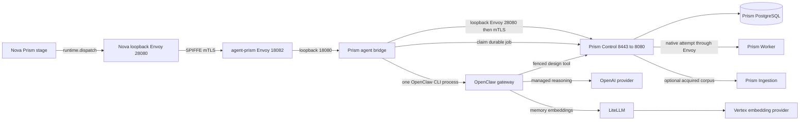

# Communication: End-To-End Transport And Failure Contracts

Status: implemented paths documented; unavailable guarantees stated explicitly
Audience: platform operator, runtime maintainer, integration developer, security reviewer
Owner: runtime and platform maintainers
Evidence: contracts/pipeline-test-gate/v1; contracts/pipeline-worker-core/v1; skills/nova/core; skills/worker/core; skills/common/plugins/redis-transport; charts/kubeclaw; charts/prism; tests/verification/reliability
Evidence revision: `13bff0a18a64e74f2cbbaa1978e746fcdeff0c10`
Upstream source scope: Ops changes on main at `34cf38ef53ee41381543785d0ffae90a37fac9ca`; runtime adoption in this checkout and the deployed release must be verified separately
Applies to: current Nova, Buster, Prism, Worker Core, specialist, Redis, registry, Git, BuildKit, Tailscale, and SPIFFE paths
Last verified: original path inspection on 2026-09-21; native restart, Core isolation, observer delivery and private-route source details extended on 2026-10-21; no live or native exercise asserted
Scoped source correction: 2026-10-21 against `0e35889a3c4e65d5c47ba88e924611aace67eb1d`; selected role routing and mention policy reconciled; no observed model or Discord traffic.

## How To Read This Page

A connection is safe only when its message, identity, time, ordering, storage,
and failure rules agree. A diagram can show direction, but it cannot show all
these conditions. The matrix below is therefore the primary communication
inventory.

“None” means that the implementation deliberately has no mechanism. “Owner
store” means the receiving domain persists the accepted operation. “Caller
journal” means Nova or the invoking runtime keeps the durable intent. A retry is
safe only when the row names an idempotency or identity rule.

## Prism Request Topology

The production design path does not connect Nova directly to Prism Control.
The complete path is:

**Text alternative to the diagram**

Each row names a directed connection. Labels preserve the diagram’s conditions or handoffs; dotted relationships are identified explicitly.

| From | Relationship | To |
| --- | --- | --- |
| Nova Prism stage | Directed connection — runtime.dispatch | Nova loopback Envoy 28080 |
| Nova loopback Envoy 28080 | Directed connection — SPIFFE mTLS | agent-prism Envoy 18082 |
| agent-prism Envoy 18082 | Directed connection — loopback 18080 | Prism agent bridge |
| Prism agent bridge | Directed connection — loopback Envoy 28080 then mTLS | Prism Control 8443 to 8080 |
| Prism Control 8443 to 8080 | Directed connection | Prism PostgreSQL |
| Prism agent bridge | Directed connection — claim durable job | Prism Control 8443 to 8080 |
| Prism agent bridge | Directed connection — one OpenClaw CLI process | OpenClaw gateway |
| OpenClaw gateway | Directed connection — fenced design tool | Prism Control 8443 to 8080 |
| Prism Control 8443 to 8080 | Directed connection — native attempt through Envoy | Prism Worker |
| Prism Control 8443 to 8080 | Directed connection — optional acquired corpus | Prism Ingestion |
| OpenClaw gateway | Directed connection — managed reasoning | OpenAI provider |
| OpenClaw gateway | Directed connection — memory embeddings | LiteLLM |
| LiteLLM | Directed connection | Vertex embedding provider |

Text version: Nova sends one idempotent request to its loopback Envoy. Envoy
authenticates the Nova workload to the `agent-prism` Envoy. That proxy forwards
to the bridge on loopback. The bridge sends the request through its second
loopback Envoy listener to Prism Control. The first hop validates Nova. Control
validates the Prism Agent identity, persists the request and agent job in
PostgreSQL, and returns waiting state. The bridge later claims that durable job,
starts one OpenClaw CLI process, and the OpenClaw Prism tool commits exactly
three designs or one revision back to Control with the job ID and fence.
Control, not OpenClaw, owns the final document, revision, approval, and job state.

The bridge and Control have different failure boundaries. A 30-second bridge
dispatch timeout can lose the HTTP response after Control committed the request.
The caller must reconcile the same idempotency key. After the bridge claims a
job, any uncertain OpenClaw launch becomes `needs_nova`; the implementation does
not replay it. A claim expires after 16 minutes. The OpenClaw attempt allows 15
minutes plus 10 seconds for cleanup, and its local logs and result are each
limited to 1 MiB. PostgreSQL retains the job, request digest, stable session key,
fence, result, and outcome. The OpenClaw PVC retains gateway session state, but
it is not the authority for Control state.

> **Source evidence — the complete Prism bridge**
>
> **Claim:** Nova reaches Control through the private Prism bridge; Control owns admitted jobs and committed design state.
>
> **Implementation:** Stage, proxy, bridge, attempt and job-store links trace those separate owners.
>
>
> [Nova derives the dispatch idempotency key from run, architecture, and phase](https://github.com/datrab/kubeclaw/blob/13bff0a18a64e74f2cbbaa1978e746fcdeff0c10/skills/nova/plugins/prism-design/src/stage.ts#L10-L34).
>
> [Nova and Prism-agent proxies define the two mTLS hops and loopback listeners](https://github.com/datrab/kubeclaw/blob/13bff0a18a64e74f2cbbaa1978e746fcdeff0c10/charts/kubeclaw/templates/configmap-worker-trust.yaml#L84-L130) and [the agent-to-Control cluster](https://github.com/datrab/kubeclaw/blob/13bff0a18a64e74f2cbbaa1978e746fcdeff0c10/charts/kubeclaw/templates/configmap-worker-trust.yaml#L175-L197).
>
> [The bridge bounds request size and dispatch/read time, polls once per second, and stops its runner on shutdown](https://github.com/datrab/kubeclaw/blob/13bff0a18a64e74f2cbbaa1978e746fcdeff0c10/skills/prism/server/agent-bridge.mjs#L1-L37).
>
> [The shared dispatch adapter defaults request and response limits to 1 MiB](https://github.com/datrab/kubeclaw/blob/13bff0a18a64e74f2cbbaa1978e746fcdeff0c10/skills/common/plugins/runtime-dispatch/src/adapter.ts#L63-L89).
> [The OpenClaw attempt fixes its timeout, cleanup period, and output limits](https://github.com/datrab/kubeclaw/blob/13bff0a18a64e74f2cbbaa1978e746fcdeff0c10/skills/prism/server/agent-attempt.ts#L10-L28).
>
> [Control persists the request before job admission](https://github.com/datrab/kubeclaw/blob/13bff0a18a64e74f2cbbaa1978e746fcdeff0c10/skills/prism/server/control-server.ts#L202-L240).
>
> [The job store enforces one active session, a 16-minute fence, and `needs_nova`](https://github.com/datrab/kubeclaw/blob/13bff0a18a64e74f2cbbaa1978e746fcdeff0c10/skills/prism/control/agent-jobs.ts#L31-L65).
>
> **Contract or setting:** SPIFFE peers, dispatch identity, body limits and job fence constrain this selected path.
>
> **Test evidence:** No deployed Nova-to-bridge-to-Control journey is established by these source bindings.
>
> **Revision:** `13bff0a18a64e74f2cbbaa1978e746fcdeff0c10`. Source bindings, not execution receipts.
>
> **Limit:** A lost response is uncertain; a claimed job must not be blindly replayed or replaced.
>

## Complete Connection Matrix

The [embedding client limits and failure rules](platform-and-operations.md#embedding-client-limits-and-failure-rules) give the pinned source, attempt budgets, cancellation limits, and source-versus-live boundary for the LiteLLM row below.

Use the [inbound route and outbound connection reference](../reference/endpoints.md)
for the discovered method/path inventory, including probe routes, forwarding
prefixes, static fallbacks and their exclusions. The rows below group connections
by their owner and failure contract; a grouped row is not a replacement for the
individual route's schema or admission rules.

| Sender → receiver | Purpose and schema | Transport / endpoint | Authentication and authorization | Timeout and ordering | Retry, persistence, and deduplication | Backpressure | Failure effect and recovery |
| --- | --- | --- | --- | --- | --- | --- | --- |
| Nova → Buster | Submit `buster-plan-job.v1`; read status, `buster-plan-result.v1`, and digest-bound evidence. | HTTP(S): `POST /v1/plan-jobs`; `GET` or `DELETE /v1/plan-jobs/:jobId`; `GET .../results/:digest` and `.../evidence/:digest`. | Bearer token of at least 32 characters, or loopback HTTP behind a SPIFFE proxy; capability and fixed plan/source grants are in the job. | One gate deadline; polling is at least 10 ms; cleanup defaults to 10 s. Submit precedes status and import. | Nova stores intent first. Job ID derives from idempotency key. Buster locks and stores one job. Retry uses the same ID. Import records pending before blobs and completes once. | Configured response/result ceilings, plan limits, Buster concurrency, and evidence byte limits. | Retry only classified transport/server failures within the deadline. Lost response causes status reconciliation, never a new job. Digest or identity mismatch blocks import. |
| Nova → Prism agent bridge → Control | Submit `prism.design-request.v1`; receive `202 waiting` or an approved archive. | `POST /v1/dispatch`: Nova Envoy `127.0.0.1:28080` → `agent-prism:8080`/Envoy `18082` → bridge `127.0.0.1:18080` → its Envoy `28080` → Control mTLS Service `8443` → app `8080`. | SPIFFE authenticates Nova to agent-prism and agent-prism to Control. Control admits Nova, Prism Agent, or test runner. The idempotency key and configured preference subject are mandatory. HMAC is only the non-SPIFFE Control fallback. | Adapter request/response defaults are 1 MiB; bridge and Control accept at most 2 MB. Bridge dispatch is 30 s. Architecture revisions must move forward. | PostgreSQL stores the request before job admission. Dispatch idempotency starts one design round. Existing approved baseline is returned for the bound approval. | Body ceilings, database pool, one active agent session, and bridge admission. | Invalid peer, transition, schema, or signature fails closed. Reconcile a lost response with the same key; it is not a new design identity. |
| Prism Control → native Prism Worker | Execute `worker-attempt-envelope.v3`; receive `worker-attempt-result.v3`. | HTTP `POST /v1/attempts`; `/health`, `/bootstrap`, and `/ready` separate liveness and admission. | SPIFFE Control allowlist or body-bound HMAC with timestamp and one-time nonce. Worker profile, claim, package, capability, and attempt digests authorize work. | Envelope queue deadline, attempt timeout, claim expiry, and cleanup deadlines. Worker executes one admitted native attempt at a time. | Control operation store reserves idempotency identity and records terminal result before hydration. Conflicting results are rejected. | Input ceiling, one native attempt, declared CPU/memory/task/log/evidence budgets. | 503 means dependency, reconciliation, or busy; 422 means rejected input/execution. Reconcile stored operation and Worker journal before retry. |
| Prism Control ↔ Prism Agent Bridge / OpenClaw | Claim durable agent jobs and commit exactly three designs or one next revision. | Control agent-job HTTP routes through loopback Envoy; bridge listens on `127.0.0.1:18080` and polls each second. | SPIFFE Prism Agent identity at Control. Job ID and fence bind mutation tools. | Bridge dispatch timeout 30 s; control reads 10 s; one active job; accepted job fence lasts 16 minutes. | PostgreSQL owns job state. Stable session key and job fence prevent replacement. A lost launch becomes an explicit errored/needs-Nova state. | One active job, 2 MB bridge body, fixed attempt and model limits. | Do not spawn again after uncertain launch. Examine the durable job. There is no API operation to continue this job from `needs_nova`. Keep the job identity and stopped state for the Prism maintainers. Shutdown stops polling and terminates the owned process. |
| Prism Control → Ingestion | Acquire allowed corpus input into quarantine, verify it, and delete it after publication. | HTTP `POST /v1/acquisitions` and `DELETE /v1/acquisitions/:sha256` at `prism-ingestion:8080`. | Bearer `PRISM_INGESTION_SECRET`; NetworkPolicy permits Control only. Control rejects public-web input until a source policy is approved. | Acquisition 30 s; cleanup 10 s; request 2 MB; acquired body 6 MB; HTTPS fetch 15 s with at most three redirects. | Quarantine file name is the SHA-256. Control verifies bytes, stores an inactive corpus revision and embedding, cleans quarantine, then activates the exact revision. | One 4 GiB `emptyDir`; TTL defaults to one hour and is clamped to 1 minute–1 day. | Acquisition, digest, embedding, publication, and cleanup errors stay distinct. Do not activate the corpus until storage and cleanup complete. |
| Prism Control → native Worker → design provider | Generate, render, evaluate, ingest, or publish a bounded native attempt. | Control calls Worker through Envoy/mTLS; the per-attempt host invokes the in-process Prism engine. | Control and Worker SPIFFE IDs, claim/fence, accepted profile, resource policy, and content digest. | Attempt 300 s; cleanup 10 s; queue claim 10 minutes; Worker request-body timeout defaults to 120 s. | Control operation state and Worker native journal bind the result. The current native host instantiates `DeterministicDesignProvider`; it does not call the available OpenAI-compatible provider. | One native attempt, 16 MiB result, 128 MiB evidence, 64 files, and cgroup budgets. | Reconcile a failed or interrupted attempt from Control state and the Worker journal. Do not infer an external provider call from a provider class that is not composed. |
| Nova, Buster, or Prism OpenClaw → managed OpenAI | Supply reasoning for one OpenClaw agent session. Provider request and response schemas are owned by the pinned OpenClaw runtime, not by Nova or Prism contracts. | External provider transport selected by OpenClaw; the repository configures provider `openai` and allowed model IDs, but not a fixed remote URL. | OpenClaw OAuth profiles authenticate the external account. Selected Nova values choose `openai/gpt-6.1-sol` with `openai/gpt-5.5` fallback. Buster inherits the chart primary `openai/gpt-5.6-sol`; Prism selects that primary explicitly, both with the same fallback. The chart always allows the two GPT-5 IDs and adds `openai/gpt-6-astra` and `openai/gpt-6.1-sol` only when one is selected as primary; each generated reasoning-model entry selects the Codex agent runtime. | Provider timeout and retry policy are not defined in this repository. The owning pipeline deadline, Prism 15-minute attempt, and OpenClaw session order remain the outer bounds. | OpenClaw retains session state. Prism also retains job ID and fence; Nova retains its effect and stage records. No repository contract proves provider-side request deduplication. | Provider quotas, OpenClaw session limits, and the owning operation deadline. | Preserve and reconcile the same session or durable job after an unknown outcome. Do not create a replacement agent merely because transport failed. |
| Nova, Buster, or Prism OpenClaw → LiteLLM → Vertex | Create remote memory-search embeddings. Agent reasoning uses the separately configured managed OpenAI model route. | OpenAI-compatible `http://litellm.kubeclaw.svc.cluster.local:4000/v1`; model `gemini-embedding-001`; LiteLLM routes to Vertex AI. | OpenClaw receives `LITELLM_API_KEY`; LiteLLM reads its master key and mounted Google service-account credential. | Pinned source: 60 s per query attempt; 10 min per inline index request; query cancellation propagates. The role probe calls only `/health`. | Memory manager allows at most three query attempts; index requests allow three transient or five rate-limit attempts, with recursive splitting for selected failures. These are attempt counts, not a whole-run ceiling. LiteLLM PostgreSQL and OpenClaw memory state have separate owners. | Index input estimate: 8,000 UTF-8 bytes per group; success response: 16 MiB and 30 s body-idle limit. No adapter request-body cap. Provider quota and gateway capacity remain external. | Keep the owning operation incomplete on timeout, auth, quota, provider, or vector error. Diagnose and prove one real embedding; health success is not route proof. |
| Discord service and allowed user ↔ Nova or Buster OpenClaw | Carry the two enabled bot channels, allowed commands, threaded sessions, replies, and Buster execution approvals. | External Discord bot gateway and HTTPS APIs as implemented by the pinned OpenClaw Discord plugin. The repository fixes channel IDs but not Discord service endpoints. | Distinct `DISCORD_TOKEN` Secret keys authenticate each bot. Channel, allowed-user, owner, mention, and Buster approver lists authorize application handling. | The chart default requires a guild mention; selected Nova values set `discord.requireMention: false`, while Buster inherits `true`. The configured user allowlist remains in force for both. The configured inbound worker limit is 12 hours; thread idle is 999 hours. External request timeout, reconnect, and rate-limit retry are not defined here. | OpenClaw retains role session state. Discord retains external message identity. No Discord message can replace a Nova journal, Buster receipt, or Prism row, and no repository contract proves end-to-end message deduplication. | Discord limits, one gateway's session controls, and external rate controls. | Keep domain state unchanged on disconnect, denial, or uncertain reply. Restore the same bot and channel, then prove an allowed user and a denied user without replaying an uncertain command. |
| Prism Control / Worker → Prism PostgreSQL | Transact projects, revisions, operations, agent jobs, approvals, preferences, corpus, and worker nonces. | PostgreSQL to `prism-postgresql:5432`; separate runtime, migration, backup, and test URLs. | Credentials come from `prism-postgresql-auth`; NetworkPolicy restricts named Prism clients. | Pool, statement, lock, and transaction limits are owner-specific. Worker dependency checks default to 750 ms. | PostgreSQL is authoritative. Row locks, unique keys, advisory locks, revision CAS, and job fences serialize conflicts. | Database pool and retained PVC. | Stop Prism mutation when unavailable. Restore the matched database-and-artifact group and reconcile operations before new admission. |
| Nova stage → Forge or Echo via runtime adapter | `kubeclaw.implementation.v2` or the Echo review request; strict typed completion. | In-process capability call, then bearer-authenticated HTTP POST JSON to the configured OpenClaw Gateway endpoint for the selected allowlisted target; ACP/subagent selects the runtime, not a second wire transport. | Core capability grant, target ID allowlist, named secret; optional verified workspace owner. OpenClaw controls model/tool access. | Target polling defaults 1–15 s and session deadline 30 minutes. One session identity orders all polls and result collection. | Core effect identity and runtime idempotency key; session identity is reconciled after lost response. Final artifact is stored by the stage. | Fixed prompt/context/output budgets; target response sizes; bounded session polls. | Parser rejection blocks the stage. Abort sends cancel/stop and must prove terminal state. Unresolved cleanup blocks retry to prevent duplicate agents. |
| Granted consumer → generic `kubeclaw.runtime-dispatch:runtime` target | Caller-owned JSON dispatch; no Gateway spawn/session/result schema is imposed. | One HTTP(S) POST through granted `network.http` to the configured target. | Exact runtime target grant; confidential secret HMAC (`v1=` over key, period and serialized payload), or loopback SPIFFE proxy. | No adapter-owned timeout/poll/retry; selected network adapter and owning effect deadline apply. Request/response defaults 1 MiB, configurable up to 8 MiB. | No local job/session store; Core effect and remote receiver own reconciliation and deduplication. | Recursive JSON shape and byte limits, plus selected HTTP limits. | Unknown target, auth, shape/status/size or cancellation fails. Reconcile uncertain remote acceptance under the original key; OpenClaw cancel/cleanup does not apply. See [generic HTTP runtime registration](openclaw.md#generic-http-runtime-registration). |
| Granted consumer → `kubeclaw.transport-publisher:publisher` → configured receiver | Closed `{message: object}`; receiver acknowledges exactly `{accepted: true, publicationId}`. | One HTTP(S) POST per send branch through granted `network.http`. | Exact transport target/Secret grant; `sha256=` HMAC binds target, key and serialized wrapper. HTTP is accepted by this adapter and is not confidential transport. | No publisher-owned timer/retry; network/effect deadlines apply; stable per-target request identity precedes each attempt terminal. | Durable request + attempt reservation + receipt/failure at `deliveryRoot`; completed receipt replays, but unresolved reservations can resend and require receiver deduplication. | Default 256 KiB message wrapper, maximum 1 MiB; durable record/count/store limits stop before send. | Preserve target/key/request/attempt and remote evidence. Same-attempt terminal failure is rethrown; new attempts may send again. Never infer exactly-once or a Redis stream from this HTTP receipt. |
| Nova Core → stage | Invoke stage with `StageInvocationContract`; receive `stage-result.v2`, wait, effects, facts, and artifacts. | In-process module call for direct activation; isolated stage IPC when that activation is selected. | Registry snapshot, package digest, registration ID, role selection, stage capability grant, attempt lease and fence. | Attempt lease and abort signal propagate. Scheduler orders graph dependencies; stages do not select successors. | Run journal and attempt records are authoritative. Attempt number and effect idempotency keys prevent reuse. | Declared input/artifact limits, scheduler concurrency, effect limits, and isolation channel limits. | Invalid result or expired fence cannot change lifecycle. Core records failure and applies declared retry/repair policy. |
| Stage → adapter | Request one effect such as Git, artifact, secret, dispatch, Redis, or Buster transport. | In-process capability router; adapter can then use local or network transport. | Exact capability grant, operation, resource type and canonical ID; confidential calls hide secret results from ordinary stage data. | Caller abort and effect deadline propagate. Core journals intent before uncertain external work. | Effect ID and idempotency key bind retries. Adapter-specific reconciliation decides whether an unknown result can repeat. | Adapter request/response limits and bounded cleanup scope. | Unknown external outcome becomes reconciliation-required. Do not translate it into an ordinary stage retry. |
| Buster provider → configured HTTP(S) target | Execute a Buster `network.http` request whose method and complete URL are supplied by the admitted provider request; inventory identity is `DYNAMIC {configuredUrl}`. | Fetch with manual redirects; HTTP or HTTPS only. WebSocket is a separately gated operation and is not this HTTP family. | The capability request must name `network.http`, `network.url`, and an allowed operation. Runtime policy checks exact origin or suffix, port, exact-origin authority, method, request headers, and optional registry-health credentials; URL credentials and fragments are denied. | The request timeout is the smaller configured request value or runtime maximum and is combined with caller cancellation. There is no automatic redirect or request retry. | The invoker stores no response or deduplication state. The owning Buster job/attempt and its evidence remain authoritative, so an uncertain non-idempotent target outcome needs target-specific reconciliation. | Configured request and response byte ceilings; request header entries and requested response-header names are each limited to 32; WebSocket message count/bytes are separately bounded. | Denied policy, cancellation, timeout, redirect, response overflow, or transport error fails the provider request. Do not replay a mutating configured method unless the owning effect and remote target make that replay safe. |
| Granted stage/plugin → common `network.http` adapter → configured HTTP(S) target | Execute the common adapter's runtime-configured method and URL; inventory identity is `DYNAMIC {configuredUrl}`. | Fetch to the request canonical URL with manual redirects and connection close. | Core must grant `network.http`/`request`; the adapter requires an exact configured origin and allowed method/header set, rejects URL credentials, and checks the current fence for non-confidential calls. Any application credential is an explicitly allowed request header, not implicit adapter identity. | Caller cancellation propagates; adapter timeout defaults to 30 s. It performs one request and never follows or retries a redirect. | The adapter is stateless. Core's effect journal, effect ID, and idempotency key own retry/reconciliation; the remote service owns any accepted mutation. | Request and decompressed response each default to 1 MiB and are configurable; response collection stops at the ceiling. | Origin, method, header, fence, timeout, redirect, size, HTTP, decode, or transport failure rejects the effect. Preserve an unknown remote outcome for reconciliation rather than turning it into a fresh stage retry. |
| Core → observer | Deliver lifecycle and telemetry events after authoritative state changes. | In-process observer callback; an observer may emit to Redis or another sink through a granted adapter. | Observer registration and narrow telemetry capabilities. Observer has no lifecycle-write grant. | Delivery follows committed lifecycle order; observer deadline applies. | Canonical journal is the source of truth. Sink delivery can deduplicate by event/idempotency identity. | Journal-backed drain with no bounded delivery-queue ceiling; sink-specific bounds. | Observer failure can degrade visibility but cannot reverse or invent pipeline state. Replay from authority where supported. |
| Native supervisor ↔ unprivileged worker host | Carry role-defined control messages; process input/result use the Worker envelope/result contracts. | One duplex native control stream with 4-byte big-endian length framing; process stdin/stdout is separate. | Local process ownership, fixed executable, dropped privilege, attempt identity, cgroup, and journal. No network credential. | Single reader; writes serialize in call order. Attempt, close, poll, and cleanup timeouts come from native policy. | Native journal records accepted input, process result, spooled output, and sealed result. The framing layer has no message deduplication. | Per-message and total-session byte ceilings; stdout/stderr spool and result limits. Stream write backpressure is awaited. | Truncated, oversized, closed, or ambiguous channel fails the attempt. Supervisor terminates and drains the owned process tree before recovery. |
| Plugin → Redis | Publish transport payload or telemetry JSON. | RESP over `redis://` or TLS over `rediss://`; `AUTH`, then one Lua `EVAL`. Stream is `<prefix>:v2:<kind>:<encoded target>`. | Password is resolved through `secrets.read`; URL cannot contain credentials. TLS validates the server hostname in `rediss` mode. Capability must match publisher or telemetry adapter. | Configured timeout, maximum 300 s. Redis stream IDs order accepted entries per stream. | Lua checks a digest-derived dedup key, then `XADD MAXLEN ~`, then stores entry ID with configured TTL. Redis is transport, not run authority. | Payload ≤1 MiB; response ≤about 1 MiB; `maxLen` ≤1,000,000; socket pressure and timeout stop the call. | Connection, auth, protocol, timeout, or response failure rejects the effect. Reconcile by the same idempotency key; lifecycle recovers from Nova's journal. |
| OpenClaw observer → Redis | Write agent-observability v1 control or payload events and failed-control dead letters. | `XADD MAXLEN ~` to fixed `pipeline:agent-observability:{control,payload,deadletter}:v1` streams. | Observer Redis credentials and optional TLS; host policy controls which OpenClaw hooks enter the writer. | One queue drains control before payload. Each command has a configured timeout. Control retries use bounded exponential delay; payload writes try once. | Redis retains entries to approximate configured length. Runtime sequence/content suppression reduces duplicate observations, but there is no atomic Redis dedup key and no consumer acknowledgement here. | Separate bounded control and payload queues. A full queue drops the new event for that same queue. Control drain priority does not evict a payload event. | Failed control writes go to the dead-letter stream after bounded retry. If that write also fails, counters and warnings are the only evidence. Telemetry loss never changes lifecycle authority. |
| Browser → Prism Studio static responder | Load the Studio shell or a built asset. The server route is the method-agnostic SPA fallback `ANY /*`, excluding exact `/health` and `/ready` and the proxied `/v1/*` prefix; `/v1` without the trailing slash is therefore static fallback input. | HTTPS through the private Tailscale Ingress, then local filesystem streaming. Missing files fall back to `index.html`; this path never calls Control. | Tailnet route policy protects external reachability. The static responder itself does not require the Prism session cookie and grants no domain authority; browser API mutations still use the separate `/v1/*` proxy with session and CSRF checks. | There is no application fallback timer or ordering state. The response stream awaits filesystem and socket backpressure; health and API classification precede fallback selection. | Built Studio files are deployment content, not mutable domain state. The fallback writes no database, journal, session, or deduplication record. | Traversal outside the configured root is denied. Content streams without buffering the whole file; limits are filesystem, server, and ingress bounds rather than a route body quota. | Invalid URL encoding returns 400, traversal returns 403, a missing fallback index returns 404, and other I/O failures return 500. Repair or redeploy the static bundle; never infer Control state from a successful shell response. |
| User → Prism Studio / Control | Browser session, project and revision work, approval, publication. | HTTPS Tailscale Ingress to Studio; Studio proxies the `/v1/*` prefix to Control. | Tailscale identity exchange, signed 15-minute session cookie, CSRF cookie/header for mutations, product-role checks. | Studio proxy timeout; disconnect aborts upstream. Revision CAS orders edits and approval. | PostgreSQL persists domain state. Operation and revision identities reject stale writes. | Request/body limits, pool limits, one publication per locked project path. | Authentication, CSRF, stale revision, validation, or publication evidence failure stops mutation. Reload authoritative revision and retry explicitly. |
| Private client → Tailscale-published service | Reach Prism Studio, Archviewer, Argo CD, or a temporary Buster fixture; the optional Ops SOCKS sidecar is not an inbound publication. | Tailnet DNS and Tailscale Ingress; Buster exposure returns a typed HTTPS endpoint and lease. | Tailnet device/user ACL plus service auth where present. Archviewer also requires Basic auth. Temporary fixture authority is namespace-lease and capability bound. | Readiness and lease deadlines are service-specific. Exposure must exist before tests use it and release follows consumers. | Platform routes have controller state. Buster exposure persists lease identity; it is not a general durable message queue. | Ingress/service limits and test concurrency. | DNS, certificate, ACL, readiness, or lease failure blocks that consumer. Release or retain according to cleanup policy; never reuse a stale lease URL. |
| Nova / Buster → Git | Clone or fetch source; create a local worktree; commit selected files; merge an exact revision. | Operator-configured Git SSH/HTTPS remote and local filesystem worktrees. No supported local Git-mirror service exists in the current repository. | Deploy key and host trust at Git transport; Core capability grants and workspace owner records for mutation. | Git command deadlines; expected parent and source revision impose order. | Git objects and refs persist. Attempt generation separates worktrees. Commit SHA and owner record bind identity. | Repository size, command output, path count, disk, and lock-wait bounds. | Stale parent, conflict, lock timeout, remote failure, or owner mismatch blocks. Reconcile refs before retry. A managed Git mirror remains roadmap work and has no current fallback contract. |
| Buster → BuildKit → OCI registry | Build an image, push immutable manifest/layers, verify digest, then let consumers pull it. | BuildKit client protocol to rootless BuildKit; OCI Distribution API to local registry; upstream pulls may use Docker Hub mirror. | Registry client configuration controls endpoints and credentials. Current lab local registry is anonymous HTTP; it is not production-grade HTTPS. | Build and push deadlines are provider settings. Manifest digest binds later verification and pull order. | BuildKit cache and registry blobs persist independently. Content digests deduplicate layers and bind the selected manifest. | Build context, output, cache, disk, concurrent build, and registry limits. | Build, push, digest check, or pull failure fails the node. Retry only after checking whether the digest exists. A mirror miss is not local-registry success. |
| Workload → SPIRE / Envoy → protected service | Obtain SVID, establish mTLS, and forward verified SPIFFE identity to loopback application HTTP. | SPIFFE Workload API over CSI socket; Envoy mTLS listener and local plaintext application listener. | SPIRE issues workload identity. Envoy validates peer trust domain and SAN. Application accepts forwarded identity only from loopback proxy and an exact peer allowlist. | SVID rotation is handled by workload API/Envoy. Application request deadlines still apply. | No message persistence or deduplication at mTLS. Domain stores retain accepted operations. | Envoy connection/request limits plus application limits. | Missing SVID, invalid SAN, unlisted peer, non-loopback forwarded header, or proxy failure denies the request. Restore identity/proxy; never fall back silently to anonymous remote HTTP. |
| Codex/Nova/Buster → central Ops MCP → Kubernetes API | Typed read tools and separately authorized `exec_pod`. | Internal HTTPS at `codex-ops-mcp.kubeclaw-ops.svc:8080/mcp`; Nova/Buster use native OpenClaw with a local stdio-to-HTTPS adapter. | Distinct per-client bearer, CA verification, tool/namespace checks; exec checks live labels/container. MCP holds gateway operations credentials; Buster workers separately hold direct lease-scoped workload/test Kubernetes authority. | Reads: 10 s/8 MiB per API request. Exec: requested timeout up to 120 s, reduced by policy (selected grants 30 s), up to 64 KiB combined output, four active connections. | No durable MCP job/result store. Tokens and policy reload per call. | Full namespace/event scans retain their aggregate-pressure limits; native adapter bounds its response to 2 MiB. | Read retries are new observations. Never automatically replay exec after timeout, disconnect or cancellation; reconcile remote effects first. |
| Ops MCP → Hubble Relay | Read bounded Cilium flow evidence. | Fixed `hubble observe` process to `hubble-relay.cilium.svc.cluster.local:4245`. | Ops Pod process and cluster network boundary; result filtering rechecks exact namespace and Pod identity. | Two concurrent queries; 12 s; maximum 15-minute window; 2 MiB raw and 192 KiB returned; 1–50 flows. | No lossless cursor. Warnings and partial reasons are part of the result. | Query semaphore, byte ceilings, and Hubble peer capacity. | Partial, lost-event, timeout, parse, relay, or process failure cannot prove absence of traffic or drops. Narrow the window and retain partial reasons. |
| Prometheus / Alloy → monitoring stores → Grafana | Project metrics and logs for diagnosis. | Prometheus scrapes; Alloy reads CRI logs and posts to Loki `/loki/api/v1/push`; Grafana queries configured data sources. | Target-specific scrape identity; checked-in Loki uses network controls, not application auth; Grafana reads an existing admin Secret. | Profile-specific scrape and batch settings; Prometheus retains 15 days and Loki 720 hours. | Prometheus, Loki, and Alloy positions hold derived observations only. | Collector queues, storage, retention, and backend availability. | Monitoring failure reduces visibility. Recover backend before collectors and correlate gaps with canonical journals; do not synthesize lifecycle events. |

The two `{configuredUrl}` records and `{kubernetesApiPath}` are deliberately
symbolic. They describe active runtime provider families whose concrete targets
exist only after an admitted request selects them. They are not wildcard server
routes and must not be expanded into fabricated concrete endpoints. Likewise,
Studio's `/*` record is explicitly a static-response fallback with exclusions;
it is not a general application catchall.

> **Source evidence — dynamic HTTP families and Studio fallback**
>
> **Claim:** Dynamic outbound targets and Studio static fallback have different admission rules, not wildcard server authority.
>
> **Implementation:** HTTP provider policy, Kubernetes GET transport and Studio routing below define the selected families.
>
>
> [Buster validates the configured URL, origin, and port before it permits the dynamic target](https://github.com/datrab/kubeclaw/blob/13bff0a18a64e74f2cbbaa1978e746fcdeff0c10/skills/buster/engine/test-gates/network-http-runtime.ts#L185-L198).
>
> [The request path enforces the method, headers, timeout, and byte ceilings before and during the dynamic fetch](https://github.com/datrab/kubeclaw/blob/13bff0a18a64e74f2cbbaa1978e746fcdeff0c10/skills/buster/engine/test-gates/network-http-runtime.ts#L208-L268).
>
> [The common adapter converts its configured origins, methods, headers, timeout, and byte limits into an enforceable policy](https://github.com/datrab/kubeclaw/blob/13bff0a18a64e74f2cbbaa1978e746fcdeff0c10/skills/common/plugins/network-http/src/adapter.ts#L18-L51).
>
> [Its fetch path applies cancellation, timeout, redirect, and response-size controls](https://github.com/datrab/kubeclaw/blob/13bff0a18a64e74f2cbbaa1978e746fcdeff0c10/skills/common/plugins/network-http/src/adapter.ts#L53-L100).
>
> [Activation binds the dynamic canonical URL and method to that policy and checks the execution fence](https://github.com/datrab/kubeclaw/blob/13bff0a18a64e74f2cbbaa1978e746fcdeff0c10/skills/common/plugins/network-http/src/adapter.ts#L107-L137).
>
> [Ops MCP fixes HTTPS and GET while accepting a validated dynamic Kubernetes API path, rotating token, CA, timeout, and response ceiling](https://github.com/datrab/kubeclaw/blob/13bff0a18a64e74f2cbbaa1978e746fcdeff0c10/tools/ops-mcp/src/kubernetes.mjs#L1-L58).
>
> [Studio classifies health first, proxies only `/v1/`, and sends every other path to the bounded static-file/SPA responder](https://github.com/datrab/kubeclaw/blob/13bff0a18a64e74f2cbbaa1978e746fcdeff0c10/skills/prism/server/studio-request.ts#L89-L139).
>
> **Contract or setting:** Origins, methods, headers, canonical URLs and static-root containment constrain their respective handlers.
>
> **Test evidence:** No complete deployed dynamic-target and static-fallback matrix execution is established here.
>
> **Revision:** `13bff0a18a64e74f2cbbaa1978e746fcdeff0c10`. Source bindings, not execution receipts.
>
> **Limit:** A symbolic endpoint is not a discovered concrete route or permission to call arbitrary addresses.
>

> **Source evidence — selected reasoning and Discord configuration**
>
> **Claim:** Nova selects a different reasoning primary and mention policy from the chart/Buster and Prism defaults.
>
> **Implementation:** Role overlays and gateway templates below define model order, conditional allowlist and guild handling.
>
>
> [Nova selects no-mention guild handling and the GPT-6.1 primary.](https://github.com/datrab/kubeclaw/blob/0e35889a3c4e65d5c47ba88e924611aace67eb1d/my-values/nova-values.yaml#L52-L74)
> [Chart defaults require mention and select the GPT-5.6 primary and GPT-5.5 fallback.](https://github.com/datrab/kubeclaw/blob/0e35889a3c4e65d5c47ba88e924611aace67eb1d/charts/kubeclaw/values.yaml#L186-L214)
> [Prism explicitly selects the GPT-5.6 primary and GPT-5.5 fallback.](https://github.com/datrab/kubeclaw/blob/0e35889a3c4e65d5c47ba88e924611aace67eb1d/my-values/prism-agent-values.yaml#L54-L60)
> [The selected Buster overlay does not override those model or mention defaults.](https://github.com/datrab/kubeclaw/blob/0e35889a3c4e65d5c47ba88e924611aace67eb1d/my-values/buster-values.yaml#L45-L70)
> [The gateway renders the selected model order, conditional allowlist and Codex runtime mapping.](https://github.com/datrab/kubeclaw/blob/0e35889a3c4e65d5c47ba88e924611aace67eb1d/charts/kubeclaw/templates/configmap-gateway.yaml#L85-L130)
> [The guild policy receives the selected mention value.](https://github.com/datrab/kubeclaw/blob/0e35889a3c4e65d5c47ba88e924611aace67eb1d/charts/kubeclaw/templates/configmap-gateway.yaml#L235-L242)
>
> These are authored selections and template behavior, not observed provider
> traffic or Discord access. Rendering alone does not establish the effective
> persisted OpenClaw state or prove an allowed/denied user request.
>
> **Contract or setting:** Nova selects GPT-6.1 and no mention; chart/Buster and Prism use the documented GPT-5 model order.
>
> **Test evidence:** These are authored selections and rendering rules, not an executed provider or Discord access check.
>
> **Revision:** `0e35889a3c4e65d5c47ba88e924611aace67eb1d`. Source bindings, not execution receipts.
>
> **Limit:** Configuration does not prove persisted host state, wire traffic or an allowed/denied user interaction.
>

### Dynamic Prism Route Families

Prism Control matches several routes at runtime because project, document,
revision, direction, job, artifact, and decision IDs are part of the path. The
families below are application contracts, not a promise that any arbitrary ID
is valid. Each handler authenticates first, then checks ownership or binding in
PostgreSQL or the artifact store.

| Route family | Caller and authority | State, ordering, and limits | Failure and safe continuation |
| --- | --- | --- | --- |
| `GET /health`, `GET /ready` | Kubernetes or an operator. Health proves the process; readiness also executes `SELECT 1`. Neither route grants domain authority. | No mutation. Readiness depends on Prism PostgreSQL. | Keep admission stopped when readiness fails. Process health alone cannot justify a write. |
| `POST /v1/session` | Tailscale-authenticated browser exchanges trusted identity headers for a signed 15-minute session and a separate CSRF value. | Session cookie is HTTP-only; mutation requests must carry the CSRF value. Product mode also checks the exact configured Origin. | Reject missing or changed identity and origin. Start a new authenticated browser session; do not reuse a failed mutation as proof of success. |
| `POST /v1/dispatch` | Nova, Prism Agent, or test-runner over the protected proxy path; HMAC is the non-SPIFFE fallback. | Body is at most 2 MB. Idempotency key, preference subject, project, architecture digest, and forward-only revision bind admission. PostgreSQL records the request before an agent job. | A lost response is reconciled with the same key. Invalid identity, signature, schema, project transition, or stale revision fails closed. |
| `/v1/agent/jobs/{claim|<job>|<job>/finish}` and `GET /v1/agent-jobs/<job>` | The Prism Agent identity claims, reads, and finishes the durable job; an authenticated human can read the separate public status receipt. | One active session, stable session key, runner ID, 16-minute claim, fence, request digest, and terminal outcome live in PostgreSQL. | An uncertain launch is not replayed. Examine the same job and fence. There is no API operation to continue this job from `needs_nova`. Keep the job identity and stopped state for the Prism maintainers. |
| `POST /v1/agent/design-sets` and `POST /v1/agent/revisions` | Only the protected Prism Agent tool identity can commit generated work. | A design set has exactly three unique directions. A revision must belong to the project and increment the expected revision once. Job ID, generation, and fence bind both writes. | Reject stale fence, changed project/document, invalid generation, or schema. Reconcile the durable job rather than submitting an unbound replacement. |
| `GET/POST /v1/projects`, `GET /v1/projects/<projectId>/brief`, and `GET/POST /v1/projects/<projectId>/directions` | Authenticated Studio user lists or creates projects, reads the active architecture, reads directions, or starts another agent round. | PostgreSQL owns the project and active request. A new round binds user, document, expected revision, parent round, architecture digest, and an explicit idempotency key. | Reload the active project and round after conflict. Do not attach a result from an old architecture or preference generation. |
| `POST /v1/directions/<id>/{feedback|select}` | Authenticated Studio user records preference feedback or selects one direction. | The idempotency header, user identity, direction ID, action, and optional document bind the decision. PostgreSQL serializes the change. | Re-read the direction state after a lost response. Reuse the original key; do not create a second preference event to guess the outcome. |
| `POST /v1/documents`, `GET /v1/documents/<documentId>`, `GET .../revisions`, `POST .../revisions/<revisionId>/restore`, `POST .../operations`, and `POST .../engine` | Authenticated Studio user creates a document in an active project, reads it, restores or edits it, or requests a bounded agent/native operation. | Creation requires an active design request and a valid document. Revision compare-and-set, operation identity, base revision, worker envelope, and artifact digests order later changes. `generate` becomes a durable agent job; render, evaluate, and publish use the native Worker. | Missing active request, invalid document, stale revision, or changed digest stops the mutation. Re-read the current project and revision before another request. |
| `POST /v1/approvals` and `POST /v1/baselines` | Authenticated Studio user accepts the current design and then publishes its bound baseline. | Approval binds project, current revision, design digest, architecture digest, operator, and accepted warning IDs. Publication checks that binding, renders every declared view/state/viewport, stores content-addressed files, and records one bundle digest. | Any stale digest, changed warning, missing selection, render failure, or accessibility failure blocks publication. Repair the same revision or create an explicit later revision; never relabel bytes. |
| `POST /v1/artifacts`, `GET /v1/artifacts/<sha256:64hex>`, and protected `GET/POST /v1/internal/artifacts/<sha256:64hex>` | Authenticated Studio writes up to 6 MB of canonical base64; authenticated readers fetch by digest; Control, Worker, and Prism Agent use the protected internal route. | Content hash is the identity. The store, not a caller filename, owns retrieval. The internal route requires an exact trusted workload identity or the configured non-SPIFFE secret. | Reject malformed base64, oversized content, digest mismatch, or unauthorized peer. Restore the same content-addressed bytes; do not mint a different digest for missing content. |
| `POST /v1/corpus`, `GET /v1/corpus/search`, `DELETE /v1/acquisitions/<64hex>`, `GET/POST /v1/preferences`, and `PUT /v1/preferences/policy` | Authenticated Studio user governs approved corpus and personal preference input. Control coordinates optional Ingestion, native embedding, PostgreSQL, and cleanup. Ingestion accepts the protected cleanup request. | Corpus activation occurs only after acquisition, digest verification, embedding, inactive revision storage, and quarantine deletion. The cleanup path uses raw 64-hex without the `sha256:` prefix. Search limits results to 50. Preference identity must match the session. | Keep an item inactive if publication or cleanup fails. Do not activate partial input. Repair the classified step, then continue with the same source digest or create an explicit new revision. |
| `GET/POST /v1/product-decisions`, `GET .../subjects`, `POST .../<decisionId>/recover`, and `GET .../operator` | An authenticated operator records or reconciles an optional signed product decision. The static operator page has no authority by itself. | Input is at most 32 KB. PostgreSQL stores intent before the external controller call. Decision ID, payload digest, signed envelope, actor, lease identity, generation, and receipt bind the outcome. | A lost controller response remains `pending`. Recover the same decision ID; never issue a replacement decision while the result is unknown. |

> **Source evidence — route matching and authority**
>
> **Claim:** Prism routes separate pipeline, agent, user, artifact, corpus and optional product-decision authority.
>
> **Implementation:** Control, bridge, job and product-decision handlers below implement these route families.
>
>
> [Control separates health, database readiness, session exchange, and protected pipeline dispatch](https://github.com/datrab/kubeclaw/blob/13bff0a18a64e74f2cbbaa1978e746fcdeff0c10/skills/prism/server/control-server.ts#L141-L200).
>
> [The agent tool routes bind exactly three designs or one forward revision to the protected agent identity](https://github.com/datrab/kubeclaw/blob/13bff0a18a64e74f2cbbaa1978e746fcdeff0c10/skills/prism/server/control-server.ts#L242-L278).
> [Claim, read, and finish use the same `/v1/agent/jobs` family and bind finish to the durable job fence](https://github.com/datrab/kubeclaw/blob/13bff0a18a64e74f2cbbaa1978e746fcdeff0c10/skills/prism/server/agent-job-routes.ts#L6-L26).
> [The Bridge reads that protected job family](https://github.com/datrab/kubeclaw/blob/13bff0a18a64e74f2cbbaa1978e746fcdeff0c10/skills/prism/server/agent-bridge.mjs#L20-L31), and [the runner submits the finish result to the same family](https://github.com/datrab/kubeclaw/blob/13bff0a18a64e74f2cbbaa1978e746fcdeff0c10/skills/prism/server/agent-job-runner.mjs#L39-L47).
>
> [Project and direction routes bind an active request and explicit round identity](https://github.com/datrab/kubeclaw/blob/13bff0a18a64e74f2cbbaa1978e746fcdeff0c10/skills/prism/server/control-server.ts#L346-L386).
>
> [Document routes preserve revision and operation ordering](https://github.com/datrab/kubeclaw/blob/13bff0a18a64e74f2cbbaa1978e746fcdeff0c10/skills/prism/server/control-server.ts#L389-L444).
> [Agent generation records a durable job instead of an inline model result](https://github.com/datrab/kubeclaw/blob/13bff0a18a64e74f2cbbaa1978e746fcdeff0c10/skills/prism/server/control-server.ts#L445-L488).
>
> [Approval binds the current architecture and design revision](https://github.com/datrab/kubeclaw/blob/13bff0a18a64e74f2cbbaa1978e746fcdeff0c10/skills/prism/server/control-server.ts#L521-L565), and [baseline publication rechecks the approval before generating evidence](https://github.com/datrab/kubeclaw/blob/13bff0a18a64e74f2cbbaa1978e746fcdeff0c10/skills/prism/server/control-server.ts#L567-L625).
>
> [Public artifact upload and download bind content to size and digest](https://github.com/datrab/kubeclaw/blob/13bff0a18a64e74f2cbbaa1978e746fcdeff0c10/skills/prism/server/control-server.ts#L799-L808) and [the internal route authenticates exact workload peers](https://github.com/datrab/kubeclaw/blob/13bff0a18a64e74f2cbbaa1978e746fcdeff0c10/skills/prism/server/internal-artifacts.ts#L17-L53).
>
> [Corpus publication keeps acquisition, digest verification, storage, cleanup, and activation in explicit order](https://github.com/datrab/kubeclaw/blob/13bff0a18a64e74f2cbbaa1978e746fcdeff0c10/skills/prism/server/control-server.ts#L810-L842), and [search bounds results and filters](https://github.com/datrab/kubeclaw/blob/13bff0a18a64e74f2cbbaa1978e746fcdeff0c10/skills/prism/server/control-server.ts#L844-L887).
>
> [Preference routes bind policy and events to the authenticated user](https://github.com/datrab/kubeclaw/blob/13bff0a18a64e74f2cbbaa1978e746fcdeff0c10/skills/prism/server/control-server.ts#L888-L920).
>
> [Product decisions store intent and expose recovery of the same decision](https://github.com/datrab/kubeclaw/blob/13bff0a18a64e74f2cbbaa1978e746fcdeff0c10/skills/prism/server/product-decisions.ts#L42-L70), and [the route layer authenticates every data action](https://github.com/datrab/kubeclaw/blob/13bff0a18a64e74f2cbbaa1978e746fcdeff0c10/skills/prism/server/product-decisions.ts#L73-L104).
>
> **Contract or setting:** Peer/session/CSRF checks, request contracts and durable identities depend on the selected route.
>
> **Test evidence:** No successful complete live Prism route journey is established by this handler inventory.
>
> **Revision:** `13bff0a18a64e74f2cbbaa1978e746fcdeff0c10`. Source bindings, not execution receipts.
>
> **Limit:** A route match or HTTP success does not substitute for its owning domain transaction or receipt.
>

## Endpoint Catalog

| Service | Important endpoints | Caller identity | Main limit or failure response |
| --- | --- | --- | --- |
| Buster remote plan | `/v1/plan-jobs`, `/v1/plan-jobs/:id`, `/results/:digest`, `/evidence/:digest` | Nova bearer or SPIFFE proxy | Configured response/result/evidence ceilings; contract or digest mismatch fails. |
| Prism Control | `/v1/dispatch`, protected agent job/tool routes, public job status, internal artifacts, user `/v1` routes | Nova, Prism Agent, Worker, test runner, or signed user session according to route | Dispatch body 2 MB; route-specific validation and database transaction. |
| Prism Studio | Exact `/health` and `/ready`; proxied `/v1/*`; static SPA fallback `ANY /*` excluding those paths | Private browser through Tailscale; static fallback itself has no application session authority | Proxy request 2 MB and configured timeout; static traversal is denied and missing fallback index is 404. `/v1` without a trailing slash is static, not proxied. |
| Prism Worker | `/health`, `/bootstrap`, `/ready`, `POST /v1/attempts` | Control SPIFFE ID or HMAC principal | 503 for busy/dependency/reconciliation; 422 for rejected attempt. |
| Prism Agent Bridge | `/health`, `/ready`, `/v1/dispatch`, `/v1/design-set`, `/v1/revise` on loopback | Same-pod OpenClaw/Envoy path and durable job ID | 2 MB body; 30 s dispatch; 10 s job read. |
| Buster `network.http` provider | `DYNAMIC {configuredUrl}` with a configured HTTP method | Admitted Buster capability request plus origin/suffix, port, method, and header policy | Runtime execution/request/response ceilings; redirects and implicit retry are denied. |
| Common `network.http` adapter | `DYNAMIC {configuredUrl}` with a configured HTTP method | Core capability grant and adapter exact-origin/method/header policy; fence for non-confidential calls | 30 s, 1 MiB request, and 1 MiB response defaults; redirects and adapter retry are denied. |
| Ops MCP | `/healthz`, `/mcp` on its internal HTTPS Service at port 8080; Kubernetes GETs and separate exec WebSocket | Per-client bearer and optional Origin allowlist; dedicated MCP Kubernetes token/CA/RBAC, narrowed by policy | Logs 64 KiB; Kubernetes reads 8 MiB/10 s; bounded Hubble; exec output/timeout capped by policy. See [the complete Ops MCP contract](ops-mcp.md). |
| Archviewer | `/healthz`, static document paths on 3456 | Tailnet route plus Basic auth for documents | No directory listing; 401/403/404 fail closed. |
| OCI registry | `/v2/` and OCI blob/manifest routes | Anonymous HTTP in the current lab service | Not suitable as the final production registry security posture. |
| Direct retained-storage registry | `registry-local:5001` ClusterIP Service to container 5000, `/v2/` and OCI routes; selected namespace | Anonymous HTTP lab; no TLS or registry authentication | Explicit ReadWriteOncePod PVC and Recreate writer; delete/upload purging disabled. PVC survival and independent backup are separate. |
| GitOps-adopted ephemeral registry | `registry-local.kubeclaw.svc:5001` to container 5000; NodePort 30051; `/v2/` and OCI routes | Anonymous HTTP lab; no TLS or registry authentication | No persistent data volume; deletion enabled. Pod replacement can lose all content; use the [profile-specific recovery boundary](#select-the-actual-writable-registry-profile). |
| Docker Hub mirror | `registry-mirror:5000`, `/v2/` and pull-through OCI routes | Cluster network boundary; upstream Docker Hub policy applies | Cache is not source authority; a running mirror does not configure clients. |
| Redis | `redis-master.kubeclaw.svc.cluster.local:6379` | Password; optional TLS is adapter-specific | Streams and dedup keys are bounded transport state, not canonical run state. |
| Prism PostgreSQL | `prism-postgresql:5432` | Four chart-managed database identities and NetworkPolicy | Domain transactions stop when unavailable; restore database and artifact set to one recovery point. |
| LiteLLM | `litellm.kubeclaw.svc.cluster.local:4000/v1`; `/health/liveliness`, `/health/readiness` | Consumer API key and provider credentials | OpenAI-compatible model/embedding gateway; not lifecycle authority. |
| Managed OpenAI | Endpoint and wire protocol are owned by the pinned OpenClaw runtime; selected Nova primary is `openai/gpt-6.1-sol`; Buster/chart and Prism primary is `openai/gpt-5.6-sol`; all use `openai/gpt-5.5` fallback | OpenClaw OAuth profile and model allowlist | A gateway health response does not prove a reasoning request; provider retry behavior is not specified here. |
| Vertex AI | External HTTPS route selected by LiteLLM for `gemini-embedding-001` | Mounted Google service-account identity, LiteLLM model configuration, and upstream project policy | Prove a valid vector, not only LiteLLM readiness. Quota and provider availability remain external. |
| Discord | External bot gateway and HTTPS APIs selected by the pinned OpenClaw plugin; distinct configured Nova and Buster channels | Per-role bot token plus channel, user, mention, owner, and approver rules | Bot delivery has no pipeline authority. External reconnect and rate-limit retry are not specified in this repository. |
| Prometheus / Grafana | Chart-managed scrape endpoints; Grafana NodePort 30030 in the lab values | Grafana existing admin Secret; scrape authorization is chart/target specific | Optional monitoring. Prometheus retains 15 days on a 20 GiB claim in the checked-in values. |
| Alloy → Loki | `POST http://loki.monitoring.svc.cluster.local:3100/loki/api/v1/push` | Monitoring namespace/network boundary; checked-in Loki has `auth_enabled: false` | Optional log projection. Alloy positions persist on each node; Loki retains 720 hours in the checked-in values. |

> **Source evidence — service and optional monitoring endpoints**
>
> **Claim:** Service listeners, external clients and optional monitoring endpoints have different readiness and ownership scopes.
>
> **Implementation:** Services, registry manifests, gateway values and monitoring configuration below declare the selected connections.
>
>
> [Prism Services expose Studio, Control, Worker, ingestion, and their mTLS variants on separate ports](https://github.com/datrab/kubeclaw/blob/13bff0a18a64e74f2cbbaa1978e746fcdeff0c10/charts/prism/templates/services.yaml#L1-L47).
>
> [The local registry defines one retained writer](https://github.com/datrab/kubeclaw/blob/13bff0a18a64e74f2cbbaa1978e746fcdeff0c10/my-values/infra/registry-local.yaml#L1-L55).
>
> [Its Service maps port 5001 to port 5000 and probes `/v2/`](https://github.com/datrab/kubeclaw/blob/13bff0a18a64e74f2cbbaa1978e746fcdeff0c10/my-values/infra/registry-local.yaml#L56-L106).
>
> [The mirror names Docker Hub as its only upstream](https://github.com/datrab/kubeclaw/blob/13bff0a18a64e74f2cbbaa1978e746fcdeff0c10/my-values/infra/registry-mirror.yaml#L1-L55) and [exposes its bounded Service on port 5000](https://github.com/datrab/kubeclaw/blob/13bff0a18a64e74f2cbbaa1978e746fcdeff0c10/my-values/infra/registry-mirror.yaml#L56-L94).
>
> [The generated gateway separates OpenAI OAuth from the LiteLLM embedding client](https://github.com/datrab/kubeclaw/blob/0e35889a3c4e65d5c47ba88e924611aace67eb1d/charts/kubeclaw/templates/configmap-gateway.yaml#L28-L79).
> [The agent block fixes the allowed reasoning models](https://github.com/datrab/kubeclaw/blob/0e35889a3c4e65d5c47ba88e924611aace67eb1d/charts/kubeclaw/templates/configmap-gateway.yaml#L81-L128).
>
> [LiteLLM maps the one public model name to Vertex project and location](https://github.com/datrab/kubeclaw/blob/13bff0a18a64e74f2cbbaa1978e746fcdeff0c10/my-values/infra/litellm-config.yaml#L1-L14), and [its Deployment mounts the Google identity](https://github.com/datrab/kubeclaw/blob/13bff0a18a64e74f2cbbaa1978e746fcdeff0c10/my-values/infra/litellm-deployment.yaml#L35-L75).
>
> [Nova selects its enabled Discord bot identity, channel, and allowed users](https://github.com/datrab/kubeclaw/blob/0e35889a3c4e65d5c47ba88e924611aace67eb1d/my-values/nova-values.yaml#L38-L59).
> [Buster selects a different enabled channel and execution approver](https://github.com/datrab/kubeclaw/blob/13bff0a18a64e74f2cbbaa1978e746fcdeff0c10/my-values/buster-values.yaml#L41-L65).
>
> [The rendered Discord block applies token indirection, user rules, mention behavior, session binding, and execution approvers](https://github.com/datrab/kubeclaw/blob/0e35889a3c4e65d5c47ba88e924611aace67eb1d/charts/kubeclaw/templates/configmap-gateway.yaml#L200-L252).
>
> [Alloy discovers and processes node log streams](https://github.com/datrab/kubeclaw/blob/13bff0a18a64e74f2cbbaa1978e746fcdeff0c10/gitops/platform/values/alloy.yaml#L30-L79) and [sends them to the exact Loki push URL](https://github.com/datrab/kubeclaw/blob/13bff0a18a64e74f2cbbaa1978e746fcdeff0c10/gitops/platform/values/alloy.yaml#L80-L101).
>
> [Prometheus and Grafana values define credentials, persistence, retention, resources, and the lab NodePort](https://github.com/datrab/kubeclaw/blob/13bff0a18a64e74f2cbbaa1978e746fcdeff0c10/gitops/platform/values/prometheus.yaml#L1-L44).
>
> **Contract or setting:** Ports, Secret references, model/channel selections and retention belong to their respective deployment profiles.
>
> **Test evidence:** No complete deployed connectivity, provider-vector or monitoring-delivery check is established by these declarations.
>
> **Revision:** `13bff0a18a64e74f2cbbaa1978e746fcdeff0c10`; `0e35889a3c4e65d5c47ba88e924611aace67eb1d`. Source bindings, not execution receipts.
>
> **Limit:** A ready listener does not prove an authenticated business operation, current model route or complete retained history.
>

## Detailed Transport Notes

### Nova And Buster

Nova creates the complete job before transport. The job contains the resolved
plan, signed source snapshot, repository archive identity, per-node grants,
concurrency, stage ID, and request digest. Buster stores admission under the
derived job ID. Status polling and cancellation address that same ID. Result and
evidence downloads include a digest in the URL; Nova hashes received bytes
before import.

> **Source evidence — remote calls and content binding**
>
> **Claim:** Nova dispatch retains one job identity and verifies digest-bound results before their import.
>
> **Implementation:** Remote dispatch construction and transport below bind the admitted job and downloads.
>
>
> [The transport defines endpoint, authentication, and request rules](https://github.com/datrab/kubeclaw/blob/13bff0a18a64e74f2cbbaa1978e746fcdeff0c10/skills/nova/core/test-gates/remote-dispatch.ts#L23-L74).
>
> [It defines remote operations and response ceilings](https://github.com/datrab/kubeclaw/blob/13bff0a18a64e74f2cbbaa1978e746fcdeff0c10/skills/nova/core/test-gates/remote-dispatch.ts#L75-L134).
>
> [It checks result and evidence digests](https://github.com/datrab/kubeclaw/blob/13bff0a18a64e74f2cbbaa1978e746fcdeff0c10/skills/nova/core/test-gates/remote-dispatch.ts#L135-L194).
>
> **Contract or setting:** Plan/source/request identities and the operation deadline constrain the handoff.
>
> **Test evidence:** No live complete Nova-to-Buster result and evidence import is established by this source trace.
>
> **Revision:** `13bff0a18a64e74f2cbbaa1978e746fcdeff0c10`. Source bindings, not execution receipts.
>
> **Limit:** Transport success alone does not validate remote execution or permit replacement of an uncertain job.
>

### Forge and Echo: Gateway envelope and result import

The physical adapter transport is an authenticated HTTP POST to the configured
target's OpenClaw Gateway URL. Its JSON body contains `tool`, `args`, optional
controller `sessionKey`, and optional `idempotencyKey`; the same key is encoded
in the capability resource URL fragment for effect identity. `runtime=acp` or
`runtime=subagent` selects Gateway execution behavior, not a second MCP or ACP
wire transport implemented by this adapter. Core grants `runtime.dispatch`, the
target allowlist and its secret reference authorize the request; OpenClaw owns
agent/model/tool execution after admission.

| Request protocol | Bound input and expected result |
| --- | --- |
| `kubeclaw.implementation.v2` | Forge receives the selected task, source/attempt identity and agent-owned output contract. Its output must not copy controller-owned request fields. The implementation plugin validates completion before accepting artifacts or source changes. |
| `kubeclaw.echo-review.v1` | Echo receives immutable review bundle, bundle digest, resolved policy profile/digest, task and `outputContract`. Output is `echo-review-output.v1` with observations/proposed findings, not PASS/FAIL or lifecycle authority. |
| `kubeclaw.echo-review-verification.v1` | Verification binds bundle, policy and proposal-set identities. Result is `echo-review-verification.v1`, with `confirmed`, `rejected`, or `insufficient_evidence` decisions for the specified proposals. |
| `kubeclaw.echo-review-scale.v1` | One deterministic review job and its digest; the response uses the strict Echo review output schema. Context expansion stays bound to available complete sources, not an arbitrary file request. |
| `kubeclaw.echo-review-scale-verification.v1` | Verification bundle/policy/proposal-set digests, one named proposal and supplied sources; output uses the verification schema. |
| `kubeclaw.repository-finding-revalidation.v1` | Baseline/target heads, finding fingerprint and cluster, current path states/source and relationship candidates; result uses the repository revalidation contract. Absence proves path absence, not that behavior was not moved elsewhere. |

Protocol builders and strict result definitions are the field authority:
[implementation input/completion](https://github.com/datrab/kubeclaw/blob/a721a6e69aef5900002cef1dca3d1272f7903009/skills/nova/plugins/implementation-agent/src/protocol.ts#L1-L59),
[Echo request](https://github.com/datrab/kubeclaw/blob/a721a6e69aef5900002cef1dca3d1272f7903009/skills/nova/plugins/review/src/protocol.ts#L62-L75),
[Echo output](https://github.com/datrab/kubeclaw/blob/a721a6e69aef5900002cef1dca3d1272f7903009/skills/nova/plugins/review/src/echo-review-contract.ts#L64-L124); [Echo output (continued 2)](https://github.com/datrab/kubeclaw/blob/a721a6e69aef5900002cef1dca3d1272f7903009/skills/nova/plugins/review/src/echo-review-contract.ts#L125-L137),
[verification contract](https://github.com/datrab/kubeclaw/blob/a721a6e69aef5900002cef1dca3d1272f7903009/skills/nova/plugins/review/src/echo-review-verification-contract.ts#L5-L35),
[scaled review](https://github.com/datrab/kubeclaw/blob/a721a6e69aef5900002cef1dca3d1272f7903009/skills/nova/plugins/review/src/scalable-review-jobs.ts#L157-L165),
[scaled verification](https://github.com/datrab/kubeclaw/blob/a721a6e69aef5900002cef1dca3d1272f7903009/skills/nova/plugins/review/src/scalable-review-verification.ts#L292-L305),
and [repository revalidation](https://github.com/datrab/kubeclaw/blob/a721a6e69aef5900002cef1dca3d1272f7903009/skills/nova/plugins/review/src/repository-revalidation-stage.ts#L174-L182).

The adapter recovers a registered subagent using its stable label and expected
model, then requires a complete, unambiguous run/session identity. Conflicting
aliases or multiple candidates fail reattachment. Polling defaults to 1,000 ms,
backs off up to 15,000 ms, and is bounded by 1,800 polls and a 1,800,000 ms
session timeout. The owning invocation's abort/deadline further narrows this
budget. Before dispatch, the adapter validates prompt bytes, tokenizer, reserved input,
output and context token budgets; these checks are not provider-side streaming guarantees.
Before polling, spawns are serialized within each adapter activation by Gateway
endpoint and controller session key. The promise chain has no queue-length
ceiling. After each spawn operation it waits `spawnIntervalMs` (default 1,500 ms),
even when the operation fails. The session timeout starts inside `pollSession`,
after spawning: it does not bound queue residence or spawn time. The caller's
invocation signal and declared attempt deadline remain the outer cancellation
boundary; queued work checks that signal before spawning.

Source: [spawn serialization and spacing](https://github.com/datrab/kubeclaw/blob/a721a6e69aef5900002cef1dca3d1272f7903009/skills/common/plugins/runtime-dispatch/src/openclaw.ts#L187-L207),
[configured default](https://github.com/datrab/kubeclaw/blob/a721a6e69aef5900002cef1dca3d1272f7903009/skills/common/plugins/runtime-dispatch/src/openclaw-config.ts#L59-L69),
and [post-spawn polling deadline](https://github.com/datrab/kubeclaw/blob/a721a6e69aef5900002cef1dca3d1272f7903009/skills/common/plugins/runtime-dispatch/src/openclaw-session.ts#L223-L240).

This adapter polls bounded HTTP tool responses and imports one terminal result;
it does not specify a model-token streaming protocol. Progress or a partial
assistant message is not a completed stage result.

Result selection has distinct paths:

1. With both result endpoint and token secret, GET the result file's basename
   from that endpoint using the separate bearer. Require status 200 and a record
   containing non-empty text content.
2. Otherwise, for an admitted workspace reference, read the workspace result,
   validate JSON and persist its repository result record before Git cleanup.
3. Read the repository result path through `git.repository.read`. Only an
   explicit file-not-found result permits fallback; other read failures stop.
4. Prefer a collector's structured result, then its non-empty result text;
   validate and persist that value. Only when neither structured output nor non-empty result text is available does the collector schema/error state fail this selection. A selected structured value still requires the owning plugin’s validation.
5. Otherwise read session history and require exactly one assistant message
   marked `__openclaw.runTerminal=true`, containing exactly one text item.
   Validate and persist it before parsing the stage result. Multiple or absent
   terminal values fail; the adapter does not guess the last useful message.

A lost spawn response is not permission to spawn again. Cleanup first resolves
the original identity, requests subagent cancellation or sends the ACP stop
message, then observes exact terminal state in Core's bounded cleanup scope.
Neither a collector acknowledgement nor the stop message proves termination.
Unknown identity or unproved termination leaves reconciliation unresolved and
blocks ordinary replacement/retry. A valid terminal JSON result still passes
the owning plugin's strict result contract before lifecycle or artifacts change.

Source: [Gateway envelope](https://github.com/datrab/kubeclaw/blob/a721a6e69aef5900002cef1dca3d1272f7903009/skills/common/plugins/runtime-dispatch/src/openclaw-session.ts#L167-L177),
[target polling defaults](https://github.com/datrab/kubeclaw/blob/a721a6e69aef5900002cef1dca3d1272f7903009/skills/common/plugins/runtime-dispatch/src/openclaw-config.ts#L51-L74),
[terminal result selection](https://github.com/datrab/kubeclaw/blob/a721a6e69aef5900002cef1dca3d1272f7903009/skills/common/plugins/runtime-dispatch/src/openclaw-result.ts#L48-L101),
and [unknown-outcome cleanup](https://github.com/datrab/kubeclaw/blob/a721a6e69aef5900002cef1dca3d1272f7903009/skills/common/plugins/runtime-dispatch/src/openclaw-cleanup.ts#L29-L65).

### Core, Plugins, And Worker Control

Core communication is an authority boundary even when it is an in-process
function call. Registry selection and a capability grant occur before the call.
The invocation context carries attempt identity, fence, abort signal, config,
and effect access. A result is data until Core validates and reduces it.

The native control channel deliberately knows nothing about message meaning.
It preserves message boundaries and provides one ordered writer, one reader,
and byte ceilings. The specialist role must define schema and durable phase
acknowledgment. This keeps binary framing reusable without making it a hidden
state machine.

> **Source evidence — bounded framing**
>
> **Claim:** Native control framing preserves bounded messages without owning their specialist meaning.
>
> **Implementation:** The channel implementation below defines byte framing, ordered writer and reader behavior.
>
>
> [The channel validates limits and serializes framed writes](https://github.com/datrab/kubeclaw/blob/13bff0a18a64e74f2cbbaa1978e746fcdeff0c10/skills/worker/core/worker/native-control-channel.ts#L1-L45), then [rejects a second reader and truncated or oversized input](https://github.com/datrab/kubeclaw/blob/13bff0a18a64e74f2cbbaa1978e746fcdeff0c10/skills/worker/core/worker/native-control-channel.ts#L46-L74).
>
> **Contract or setting:** Channel byte ceilings are separate from a role-owned schema and durable phase acknowledgement.
>
> **Test evidence:** No deployment-host native channel and specialist phase exercise is established by these implementation links.
>
> **Revision:** `13bff0a18a64e74f2cbbaa1978e746fcdeff0c10`. Source bindings, not execution receipts.
>
> **Limit:** Framing does not prove payload validity, process isolation or a committed lifecycle transition.
>

### Prism hop identities and native pressure

The checked-in profiles enable SPIFFE with trust domain `kubeclaw.internal`.
Let `N` be the Prism Helm release namespace and `K` the role-workload
KubeClaw Helm release namespace. These are independently derived values, not
an assumed shared namespace.
The chart defaults Nova namespace/ServiceAccount to `kubeclaw`/`agent-nova`
and the Prism Agent to `kubeclaw`/`agent-prism`; the selected Prism profile
explicitly repeats the Agent pair. The resulting exact URI SANs are:

| Authenticated hop | Client identity | Expected server identity |
| --- | --- | --- |
| Nova → Prism Agent (production dispatch) | `spiffe://kubeclaw.internal/ns/K/sa/agent-nova` | `spiffe://kubeclaw.internal/ns/K/sa/agent-prism` |
| Control → Worker | `spiffe://kubeclaw.internal/ns/N/sa/prism-control` | `spiffe://kubeclaw.internal/ns/N/sa/prism-worker` |
| Worker → Control | `spiffe://kubeclaw.internal/ns/N/sa/prism-worker` | `spiffe://kubeclaw.internal/ns/N/sa/prism-control` |
| Control → Prism Agent | `spiffe://kubeclaw.internal/ns/N/sa/prism-control` | `spiffe://kubeclaw.internal/ns/kubeclaw/sa/agent-prism` |
| Agent → Control | `spiffe://kubeclaw.internal/ns/K/sa/agent-prism` | `spiffe://kubeclaw.internal/ns/K/sa/prism-control` |

The role chart derives both the Agent ingress allowlist and its Control
upstream SAN from `K`; Prism's `novaNamespace`/`agentNamespace` do not rewrite
those checks. Agent ingress accepts Nova, Control and the Prism test runner
in `K`. Consequently Control → Agent and Agent → Control require `N = K`
with the current templates, matching trust domains, and matching Agent
namespace/account settings in the Prism chart. With the selected profile's
Agent namespace `kubeclaw`, that also requires `K = kubeclaw`. Different
namespaces need an explicit supported template/configuration change; changing
only Prism's peer settings cannot make the role chart accept a different SAN.
The charts do not establish an arbitrary cross-namespace deployment contract.

Control also allowlists Nova directly at the configured Nova namespace/account;
that permission is not the production Nova → Agent dispatch hop.

Control's ingress allowlist additionally includes
`spiffe://kubeclaw.internal/ns/N/sa/prism-test-runner` and Control itself.
These are exact URI matches, not a trust-domain-wide grant. The template uses
`workerTrust.spiffe.trustDomain`, `novaNamespace`, `novaServiceAccount`,
`agentNamespace` and `agentServiceAccount`; changing these changes the expected
identity. Studio's user-facing browser route has its own authentication boundary
and is not an additional workload SPIFFE identity. A wrong SAN/namespace/account
fails transport admission before operation/result binding; the matrix does not
prove that SPIRE issued these identities or that a deployed proxy enforced them.

Source: [selected Prism profile](https://github.com/datrab/kubeclaw/blob/a721a6e69aef5900002cef1dca3d1272f7903009/my-values/prism-values.yaml#L35-L40),
[selected Nova profile](https://github.com/datrab/kubeclaw/blob/0e35889a3c4e65d5c47ba88e924611aace67eb1d/my-values/nova-values.yaml#L118-L121),
[identity defaults](https://github.com/datrab/kubeclaw/blob/a721a6e69aef5900002cef1dca3d1272f7903009/charts/prism/values.yaml#L75-L84),
[Control identity and accepted clients](https://github.com/datrab/kubeclaw/blob/a721a6e69aef5900002cef1dca3d1272f7903009/charts/prism/templates/configmap-worker-trust.yaml#L9-L38),
[Worker, Control and Agent upstream SANs](https://github.com/datrab/kubeclaw/blob/a721a6e69aef5900002cef1dca3d1272f7903009/charts/prism/templates/configmap-worker-trust.yaml#L80-L130),
[role-chart Agent ingress](https://github.com/datrab/kubeclaw/blob/a721a6e69aef5900002cef1dca3d1272f7903009/charts/kubeclaw/templates/configmap-worker-trust.yaml#L84-L104),
[Nova upstream SAN](https://github.com/datrab/kubeclaw/blob/a721a6e69aef5900002cef1dca3d1272f7903009/charts/kubeclaw/templates/configmap-worker-trust.yaml#L129-L160),
[Agent Control SAN](https://github.com/datrab/kubeclaw/blob/a721a6e69aef5900002cef1dca3d1272f7903009/charts/kubeclaw/templates/configmap-worker-trust.yaml#L175-L198),
and [Worker's Control allowlist](https://github.com/datrab/kubeclaw/blob/a721a6e69aef5900002cef1dca3d1272f7903009/charts/prism/templates/configmap-worker-trust.yaml#L139-L160).

Native process stdout and stderr share one aggregate output budget, distinct
from result-artifact and evidence-import limits. Configuration comes from the
Worker's `PRISM_NATIVE_*` environment, not the Control HTTP response ceiling:

| Environment suffix after `PRISM_NATIVE_` | Fallback | Pressure boundary |
| --- | --- | --- |
| `MAXIMUM_OWNERSHIP_RECORDS` / `MAXIMUM_OWNERSHIP_BYTES` | 65,536 / 64 MiB | Bounds durable ownership accounting; capacity is not permission to discard ownership evidence. |
| `MAXIMUM_INPUT_BYTES` | 16 MiB | Bounds admitted input, separate from the aggregate journal reservation. |
| `MAXIMUM_OUTPUT_BYTES` | 32 MiB | Aggregate stdout plus stderr overflow stops the producer with `WORKER_NATIVE_OUTPUT_LIMIT`. Persistence failure stops it with `WORKER_NATIVE_OUTPUT_PERSISTENCE_FAILED`. |
| `MAXIMUM_RESULT_BYTES` | 67,108,864 bytes | Bounds native result storage/transport; separate from the 16 MiB result artifact. |
| `MAXIMUM_JOURNAL_BYTES` | 64 GiB | New admission reserves input plus maximum output/result bytes, 65,536 bytes overhead and state space. Over-capacity rejects with `WORKER_NATIVE_JOURNAL_CAPACITY_EXCEEDED` before retaining a new accepted identity. |
| `POLL_INTERVAL_MS` / `DRAIN_TIMEOUT_MS` / `CLOSE_TIMEOUT_MS` | 20 / 10,000 / 105,000 ms | Bounds supervision polling and cleanup phases; failed cleanup or uncertain ownership fences further admission. |

Actual environment values override these fallbacks and must satisfy the config
validator. Spooling pauses the corresponding host pipe until durable append
completes, propagating pressure to the process. Historical receipts remain
replayable; do not delete journals/ownership records to free capacity or retry
an uncertain process under a new identity. Diagnose capacity versus output
termination versus fenced cleanup before resuming the same admitted work.

Source: [native configuration and fallbacks](https://github.com/datrab/kubeclaw/blob/a721a6e69aef5900002cef1dca3d1272f7903009/skills/prism/config/native-worker.ts#L4-L14),
[Worker storage and cleanup limits](https://github.com/datrab/kubeclaw/blob/a721a6e69aef5900002cef1dca3d1272f7903009/skills/prism/config/native-worker.ts#L56-L82),
[journal reservation before new admission](https://github.com/datrab/kubeclaw/blob/a721a6e69aef5900002cef1dca3d1272f7903009/skills/worker/core/worker/native-attempt-journal.ts#L157-L179),
and [aggregate output and durable-pipe pressure](https://github.com/datrab/kubeclaw/blob/a721a6e69aef5900002cef1dca3d1272f7903009/skills/worker/core/worker/native-process-output.ts#L5-L26).

### Native Prism restart decisions

Keep the original Control idempotency key and request content when a dispatch
response is lost. A new key is new work, not reconciliation. Control first stores
the input artifact, derives its content-bound request identity, and reserves the
original `worker-attempt-envelope.v3` in `prism.engine_operation` under an advisory
transaction lock. These are separate boundaries: an input artifact can exist
without a reserved operation, and a reserved operation can exist without a response.

| Durable state for the same key | Implemented continuation | Stop condition |
| --- | --- | --- |
| No operation row | Reserve the proposed envelope, then submit that reserved attempt. | Input artifact or request validation fails. Do not bypass validation by constructing another envelope. |
| Row with the same request digest and a valid stored envelope, no result | Use the stored original envelope, including its execution ID, for the Worker request. | Changed request digest produces `PRISM_OPERATION_IDEMPOTENCY_CONFLICT`; inconsistent envelope, operation or execution binding produces `PRISM_NATIVE_OPERATION_BINDING_INVALID`. |
| Bound successful (`completed`) terminal result already stored | Hydrate that stored result and evidence; do not dispatch another Worker execution. Mark completion for the same execution only after hydration. | A different result cannot replace the receipt; `PRISM_NATIVE_OPERATION_RESULT_CONFLICT` stops it. Failed hydration leaves the receipt available for another hydration attempt. |
| Bound failed terminal receipt already stored | Preserve the receipt; cached-result acceptance throws the Worker error before evidence hydration. Do not dispatch again. | A non-`completed` state is not a hydratable successful result; reservation/acceptance fails rather than marking completion. |
| Legacy row with no stored envelope but a cached result | Validate the cached result against the request digest and original attempt ID, then hydrate it. | An incompatible cached result is not permission to execute again. |
| Legacy pending row without an envelope or result | Stop with `PRISM_NATIVE_LEGACY_PENDING_RECONCILIATION_REQUIRED`. | No automatic replay exists for this state. Preserve the row, Worker journal, source identity and original request for the platform maintainer; do not delete it or invent a replacement attempt. |

The transport posts the reserved envelope to `/v1/attempts`. Non-success HTTP
status cancels the body and fails the request; a successful response still needs
bounded UTF-8/JSON decoding and result binding. Control's transport defaults are
900,000 ms and 67,108,864 response bytes, configurable through
`PRISM_NATIVE_DISPATCH_TIMEOUT_MS` and `PRISM_NATIVE_MAXIMUM_RESULT_BYTES`.
They are distinct from the envelope's 300-second execution, 10-second cleanup,
16 MiB result-artifact and 128 MiB evidence limits. A transport timeout does not
establish whether execution finished. The operation receipt is committed before
evidence hydration, so a failed download must not cause a second execution.
Control accepts completion only for the stored execution whose Worker state is
`completed`; an incompatible completion raises
`PRISM_NATIVE_OPERATION_COMPLETION_CONFLICT`.

Source: [reservation, legacy-state and result binding](https://github.com/datrab/kubeclaw/blob/a721a6e69aef5900002cef1dca3d1272f7903009/skills/prism/control/native-operation-store.ts#L25-L68),
[dispatch versus cached hydration](https://github.com/datrab/kubeclaw/blob/a721a6e69aef5900002cef1dca3d1272f7903009/skills/prism/control/native-operation.ts#L12-L31),
[bounded Worker response](https://github.com/datrab/kubeclaw/blob/a721a6e69aef5900002cef1dca3d1272f7903009/skills/prism/control/worker-operation-transport.ts#L8-L35),
and [transport defaults](https://github.com/datrab/kubeclaw/blob/a721a6e69aef5900002cef1dca3d1272f7903009/skills/prism/config/native-worker.ts#L4-L14).
The implementation contains these recovery branches; they do not record a native restart exercise.

On the Worker side, reconciliation precedes launch. A sealed cached receipt is
returned without another process. An archived process result is reconstructed
only if its ownership record is `disposed`, has a final observation, and that
observation exactly matches the archived resources; otherwise recovery stops
with `WORKER_NATIVE_JOURNAL_OWNERSHIP_UNPROVEN`. Without an archived result,
non-quiescent ownership stops with `WORKER_NATIVE_RECOVERY_NOT_QUIESCENT`;
a historical admitted attempt is sealed as interrupted, not relaunched.
Only a newly accepted attempt with no ownership record can reach fresh launch.
New admission validates active claim and queue deadline; replay of an existing
journal admission does not reapply that new-admission test. Expiry between
admission and launch seals a never-launched failure. Failed cleanup fences
further admission; persistence/ownership uncertainty also fences it.

Source: [replay, recovery and launch](https://github.com/datrab/kubeclaw/blob/a721a6e69aef5900002cef1dca3d1272f7903009/skills/worker/core/worker/native-attempt-executor.ts#L22-L62),
[claim admission](https://github.com/datrab/kubeclaw/blob/a721a6e69aef5900002cef1dca3d1272f7903009/skills/worker/core/worker/native-attempt-executor.ts#L70-L79),
[archived and interrupted recovery](https://github.com/datrab/kubeclaw/blob/a721a6e69aef5900002cef1dca3d1272f7903009/skills/worker/core/worker/native-attempt-recovery.ts#L24-L41),
and [historical admission selection](https://github.com/datrab/kubeclaw/blob/a721a6e69aef5900002cef1dca3d1272f7903009/skills/worker/core/worker/native-attempt-journal.ts#L157-L172).

### Core invocation and isolation contracts

The complete typed field authority is the [SDK runtime interface](https://github.com/datrab/kubeclaw/blob/a721a6e69aef5900002cef1dca3d1272f7903009/skills/common/plugin-runtime/sdk/src/runtime.ts#L21-L81); [SDK runtime interface (continued 2)](https://github.com/datrab/kubeclaw/blob/a721a6e69aef5900002cef1dca3d1272f7903009/skills/common/plugin-runtime/sdk/src/runtime.ts#L82-L111)
and its [generated contract definitions](https://github.com/datrab/kubeclaw/blob/a721a6e69aef5900002cef1dca3d1272f7903009/skills/common/plugin-runtime/sdk/src/generated/contracts.ts#L110-L163).
They distinguish the following messages rather than treating every call as an
untyped request:

| Boundary | Request and response |
| --- | --- |
| Core → stage context | `plugin-context.v2`: lease, config, input and artifacts; optional runtime-dispatch/review-cache profiles, guidance and stage-lifecycle budgets. The lease carries registration provenance, attempt identity, grants, limits, expiry and status. |
| Stage → Core result | `stage-result.v2` contains `schemaVersion`, `outcome` and `artifacts`, with branch-specific fields. `passed` can add `facts` but forbids `reason` and other extra fields; every other outcome requires `reason`; `retry`, `request_fix`, `blocked`, `failed`, `timed_out` and `cancelled` require a reason; `wait`/`orchestrator_required` also require `wait`; `rate_limited` requires reason and `retryAt`. The declared contract supplies no independent attempt-identity authority: Core binds it to the invoking context, validates and reduces it. A returned extra field cannot commit lifecycle. |
| Plugin → capability router | `CapabilityInvocation`: operation, resource `{type, canonicalId}`, payload and optional runtime-dispatch profile. Core creates `effect-request.v2` with `effectId`, `idempotencyKey`, `attempt`, `capability`, `operation`, `resource`, `payload`, `requestedAt` and optional `deliveryId`/`runtimeDispatchProfile`. |
| Core → adapter | A fenced `AdapterInvocation` includes request, `AbortSignal`, lock and `assertCurrent()` fence. A confidential invocation instead has `confidential=true` and no lock/fence fields. These are different authority shapes, not interchangeable JSON messages. Adapter returns a record; durable `effect-receipt.v2` contains `effectId`, `idempotencyKey`, `adapter`, `status`, `recordedAt` and optional `result`/`error`. Status is `accepted`, `completed` or `failed`. |
| Core → observer | `observer-delivery.v2`: delivery ID, observer provenance, delivery attempt number, canonical event and delivery time. The event is lifecycle or plugin-domain data, not a lifecycle command. Completion is an acknowledgement, not a stage result. |

An attempt identity contains `runId`, `stageId`, `attemptId` and `attemptNumber`.
An `invocation-lease.v2` adds `leaseId`, registration, `active`/`revoked` status,
grants, wall-time/memory/CPU limits, `issuedAt`, `expiresAt` and optional
`revokedAt`/`revocationReason`. A reason contains a namespaced `code` and optional
message/details. A `wait-request.v2` contains `waitId`, `signal`/`orchestrator`
kind, `signalType`, authorized issuer type/ID, nullable `expiresAt` and optional
request data; it is not an instruction for the plugin to admit its own resume.
For field constraints and compatibility use the [contract reference](../reference/contracts.md)
and [schema authorities](../reference/schemas.md), with the exact
[result/reason/wait definitions](https://github.com/datrab/kubeclaw/blob/a721a6e69aef5900002cef1dca3d1272f7903009/skills/common/plugin-runtime/sdk/src/generated/contracts.ts#L509-L552).

Direct activation uses JavaScript calls. Isolated stage/observer activation uses
newline-delimited JSON over the owned child's pipes; this is not the native
binary Worker Control Channel. The first message is `kind=invoke` with surface,
canonical module path, export name, argument and context. Child requests are
`capability` with RPC ID/capability/request, or `event` with ID/type/identity/payload.
Parent replies `response` with the same ID, Boolean `ok` and value or error.
Terminal child messages are `result` with value, or `error`/`fatal` with an error.
The parent accepts a result only after pending RPCs drain. The child redirects
console methods to stderr so they do not corrupt protocol stdout.

| Isolation pressure or failure | Enforced boundary |
| --- | --- |
| Input, response or result serialization | At most 1 MiB for each encoded value; invalid or undefined JSON serialization fails. Pending stdin bytes plus the next value are also bounded to 1 MiB. |
| Incoming protocol | At most 256 KiB per line and 1 MiB pending buffer; strict UTF-8, JSON object messages and complete newline framing. Invalid UTF-8/JSON, arrays, unknown message kinds and trailing partial bytes fail. |
| Capability/event RPCs | At most 64 pending; capability name at most 128 characters, event type at most 256. Each request still passes Core capability/event authorization. |
| Diagnostics | Child stderr is bounded to 64 KiB. It is not a second result channel. |
| Abort, deadline or invalid result | Parent finishes the session, destroys stdin and sends SIGTERM. After one second it invokes the host process-tree boundary and SIGKILL; after another second unclosed cleanup becomes `ISOLATION_PROCESS_CLEANUP_TIMEOUT`. This does not establish rollback of an external effect. |

Source: [initial invocation and process ownership](https://github.com/datrab/kubeclaw/blob/a721a6e69aef5900002cef1dca3d1272f7903009/skills/common/plugin-runtime/foundation/isolation/runner.ts#L25-L51),
[session input and diagnostics](https://github.com/datrab/kubeclaw/blob/a721a6e69aef5900002cef1dca3d1272f7903009/skills/common/plugin-runtime/foundation/isolation/session.ts#L6-L60), [RPC and result handling](https://github.com/datrab/kubeclaw/blob/a721a6e69aef5900002cef1dca3d1272f7903009/skills/common/plugin-runtime/foundation/isolation/session.ts#L61-L120), [termination and cleanup](https://github.com/datrab/kubeclaw/blob/a721a6e69aef5900002cef1dca3d1272f7903009/skills/common/plugin-runtime/foundation/isolation/session.ts#L121-L168),
[byte framing](https://github.com/datrab/kubeclaw/blob/a721a6e69aef5900002cef1dca3d1272f7903009/skills/common/plugin-runtime/foundation/isolation/protocol.ts#L1-L37),
and [child dispatch](https://github.com/datrab/kubeclaw/blob/a721a6e69aef5900002cef1dca3d1272f7903009/skills/common/plugin-runtime/foundation/isolation/child.mjs#L51-L98).

Core maps unresolved/recovery effect errors to `blocked` with
`core.effect_reconciliation_required`. Caller cancellation maps to `cancelled`
with `core.attempt_cancelled`; the exact `PLUGIN_ATTEMPT_TIMEOUT` error maps to
`timed_out` with `core.attempt_timed_out`. Other exceptions, including result-schema
validation and isolation errors, map to `retry` with `core.plugin_runtime_failed`.
An isolation timeout therefore does not automatically become a timed-out stage
result. These are invocation results; the stage transition policy decides the
subsequent lifecycle action.

Source: [invocation and validation](https://github.com/datrab/kubeclaw/blob/a721a6e69aef5900002cef1dca3d1272f7903009/skills/nova/core/execution/stage-executor.ts#L35-L51),
[deadline and failure mapping](https://github.com/datrab/kubeclaw/blob/a721a6e69aef5900002cef1dca3d1272f7903009/skills/nova/core/execution/stage-executor.ts#L123-L143).

Adapter cleanup has a separate, single-use budget from platform runtime
`shutdownTimeoutMs`. It combines its own timeout with adapter lifecycle
cancellation, not the already-aborted invocation signal, so cleanup can still
send Gateway cancellation. The cleanup context preserves the original adapter,
attempt, request, execution-key and confidential authority while substituting
that cleanup signal; it does not grant new capabilities. A second cleanup call
fails with `ADAPTER_CLEANUP_ALREADY_STARTED`; closed invocation or revoked
lifecycle fails with `ADAPTER_INVOCATION_CLOSED` or `ADAPTER_CONTEXT_REVOKED`.
Expiry rejects with `ADAPTER_CLEANUP_TIMEOUT`; the signal is closed on completion.
A cleanup acknowledgement without terminal proof leaves dispatch unresolved.

Source: [cleanup budget and invocation ownership](https://github.com/datrab/kubeclaw/blob/a721a6e69aef5900002cef1dca3d1272f7903009/skills/nova/core/execution/adapter-startup.ts#L106-L140),
[single-use timeout and lifecycle rules](https://github.com/datrab/kubeclaw/blob/a721a6e69aef5900002cef1dca3d1272f7903009/skills/nova/core/execution/adapter-invocation-phase.ts#L25-L60),
and [validating result branches](https://github.com/datrab/kubeclaw/blob/a721a6e69aef5900002cef1dca3d1272f7903009/skills/common/plugin-runtime/contracts/plugin-system/v2/plugin-system-v2.schema.json#L609-L669); [validating result branches (continued 2)](https://github.com/datrab/kubeclaw/blob/a721a6e69aef5900002cef1dca3d1272f7903009/skills/common/plugin-runtime/contracts/plugin-system/v2/plugin-system-v2.schema.json#L670-L675).

### Observer ordering, retries and restart

An observer's failure is not always degraded visibility. For each granted
observer, Core filters subscribed canonical events, retains per-run sequence
order, and does not deliver events already covered by its checkpoint. Observer
effect events are excluded from input to avoid a delivery feedback loop.
Before each delivery it records `started`; completion or failure appends the
matching delivery record. The stable identity is observer ID plus event ID,
not a fresh delivery identity for every retry.

Retries are owned by `ObserverRuntime`: attempts continue only up to the
registration's `failurePolicy.maxAttempts`, with `backoffMs` between failures.
The attempt count survives restart. `timeoutMs` bounds one delivery, aborts its
signal on expiry, and its invocation lease is revoked when delivery finishes.
That prevents continued Core-authorized use of an expired delivery context; it
does not prove that an external request was rolled back.

The checked-in telemetry observer and both notification observer registrations
use `best_effort`, five attempts, 1,000 ms backoff and a 10,000 ms delivery timeout.
Required-observer handling is supported by Core but is not the selected policy
for these registrations. `drain()` refreshes and materializes the whole canonical
journal; it does not impose a bounded delivery-queue ceiling or journal-size
backpressure. A failed delivery blocks later events for that run in this drain.

Source: [telemetry policy](https://github.com/datrab/kubeclaw/blob/a721a6e69aef5900002cef1dca3d1272f7903009/skills/common/plugins/telemetry-observer/plugin.json#L39-L47),
[notification policy](https://github.com/datrab/kubeclaw/blob/a721a6e69aef5900002cef1dca3d1272f7903009/skills/common/plugins/notification-observer/plugin.json#L26-L34),
[preview delivery policy](https://github.com/datrab/kubeclaw/blob/a721a6e69aef5900002cef1dca3d1272f7903009/skills/common/plugins/notification-observer/plugin.json#L47-L55).

| Outcome | Effect on later delivery and recovery |
| --- | --- |
| Delivered | Record completion, then commit a monotonic checkpoint bound to event/run/provenance. |
| Required observer exhausts attempts or fails | Throw `REQUIRED_OBSERVER_DELIVERY_FAILED`; callers cannot treat the drain as successful or merely optional visibility loss. Diagnose the delivery and its effects before continuing. |
| Best-effort observer fails | Return the failure and block later events for that run in this drain. Other runs can continue; advancing past the failed event would break ordering. |
| Restart after completion but before checkpoint | Recover the completed delivery and commit the checkpoint without executing the observer again. |
| Restart after started/failed delivery | Recover the highest attempted number; remaining retries use the same logical delivery. An exhausted budget remains exhausted. Invalid event order, provenance, checkpoint or delivery transitions stop recovery rather than silently reset history. |

Source: [delivery record, ordering and failure policy](https://github.com/datrab/kubeclaw/blob/a721a6e69aef5900002cef1dca3d1272f7903009/skills/nova/core/telemetry/observers.ts#L41-L101); [delivery record, ordering and failure policy (continued 2)](https://github.com/datrab/kubeclaw/blob/a721a6e69aef5900002cef1dca3d1272f7903009/skills/nova/core/telemetry/observers.ts#L102-L108),
[deadline, abort and lease](https://github.com/datrab/kubeclaw/blob/a721a6e69aef5900002cef1dca3d1272f7903009/skills/nova/core/telemetry/observer-delivery.ts#L8-L44),
and [restart validation](https://github.com/datrab/kubeclaw/blob/a721a6e69aef5900002cef1dca3d1272f7903009/skills/nova/core/telemetry/observer-recovery.ts#L13-L73); [restart validation (continued 2)](https://github.com/datrab/kubeclaw/blob/a721a6e69aef5900002cef1dca3d1272f7903009/skills/nova/core/telemetry/observer-recovery.ts#L74-L83).

### Redis

The Redis publisher sends `AUTH` and one atomic Lua operation on a fresh socket.
The script returns the earlier stream entry when the dedup key exists. Otherwise
it appends the payload with approximate stream trimming and stores the new entry
ID for `dedupTtlMs`. The dedup TTL must cover the caller's retry window. After
it expires, the same key can create another entry.

The current adapter is a publisher, not a consumer-group implementation. It
does not promise end-to-end acknowledgement, replay position, or lossless
retention. Consumers must define those rules separately. Redis interruption
does not change Nova's durable lifecycle record.

The OpenClaw observer uses different, fixed observability streams. It keeps
control and payload queues separate, drains control first, retries only control
writes, and sends exhausted control events to a bounded dead-letter stream.
This path intentionally favors lifecycle-shaped observations over large model
payloads under pressure. It still does not create a durable consumer contract.

Redis migration is a storage operation, not a live protocol negotiation. The
migration check preserves stream entries, consumer pending state, and absolute
dedup expiry. It also proves that a lost-ack retry returns the original entry
after restore. Stop writers, verify the snapshot digest, migrate to an empty
target, verify it, and then cut clients over. Do not let two Redis instances
accept writes under one logical stream prefix.

> **Source evidence — stream, atomic deduplication, and limits**
>
> **Claim:** Redis publication has bounded deduplication and stream retention, separate from consumers and host ingress queues.
>
> **Implementation:** The Lua publisher, protocol parser, host writer and migration fixture below define those boundaries.
>
>
> [The adapter validates bounded configuration](https://github.com/datrab/kubeclaw/blob/13bff0a18a64e74f2cbbaa1978e746fcdeff0c10/skills/common/plugins/redis-transport/src/adapter.ts#L1-L48) and [atomically deduplicates before `XADD`](https://github.com/datrab/kubeclaw/blob/13bff0a18a64e74f2cbbaa1978e746fcdeff0c10/skills/common/plugins/redis-transport/src/adapter.ts#L49-L91).
>
> [Stream names include version, kind, encoded target, and a hashed idempotency key](https://github.com/datrab/kubeclaw/blob/13bff0a18a64e74f2cbbaa1978e746fcdeff0c10/skills/common/plugins/redis-transport/src/stream-identity.ts#L1-L8).
>
> [The RESP decoder bounds scalar and bulk replies](https://github.com/datrab/kubeclaw/blob/13bff0a18a64e74f2cbbaa1978e746fcdeff0c10/skills/common/plugins/redis-transport/src/resp.ts#L1-L40) and [permits only the required reply forms](https://github.com/datrab/kubeclaw/blob/13bff0a18a64e74f2cbbaa1978e746fcdeff0c10/skills/common/plugins/redis-transport/src/resp.ts#L41-L67).
>
> [The OpenClaw writer applies queue priority and bounded retry](https://github.com/datrab/kubeclaw/blob/13bff0a18a64e74f2cbbaa1978e746fcdeff0c10/skills/common/plugins/openclaw-agent-observer/src/redis-writer.ts#L140-L195) and [`MAXLEN` plus dead-letter handling](https://github.com/datrab/kubeclaw/blob/13bff0a18a64e74f2cbbaa1978e746fcdeff0c10/skills/common/plugins/openclaw-agent-observer/src/redis-writer.ts#L196-L255).
>
> [The native migration test creates stream, pending-consumer, and dedup-expiry state](https://github.com/datrab/kubeclaw/blob/13bff0a18a64e74f2cbbaa1978e746fcdeff0c10/tests/verification/reliability/redis-migration.test.mts#L12-L60) and [verifies that state after migration](https://github.com/datrab/kubeclaw/blob/13bff0a18a64e74f2cbbaa1978e746fcdeff0c10/tests/verification/reliability/redis-migration.test.mts#L61-L83).
>
> **Contract or setting:** Stream identity, MAXLEN, dedupTtlMs and host queue/retry settings govern different retained state.
>
> **Test evidence:** The linked native-binary migration fixture asserts stream/pending-state/absolute-expiry preservation and lost-ACK replay; no fresh run is claimed.
>
> **Revision:** `13bff0a18a64e74f2cbbaa1978e746fcdeff0c10`. Source bindings, not execution receipts.
>
> **Limit:** The fixture requires real source/destination binaries; stream acceptance is not downstream consumption or indefinite deduplication.
>

### Signed HTTP Transport Publisher

`kubeclaw.transport-publisher:publisher` provides `transport.publish`, not the
Redis publisher's stream protocol. Nova's role package includes it, but an
active platform still needs this exact provider binding, consumer grants,
`network.http`, `secrets.read`, private delivery storage and a compatible receiver.
Package availability is not a deployed endpoint or selected consumer.

The closed configuration requires `targets` and `deliveryRoot`; optional
`maximumDeliveryRecords` defaults to 100,000 and `maximumDeliveryBytes` to
268,435,456. Each must be a positive safe integer. Each target has only
`endpoint`, `signingSecret` and optional `maxPayloadBytes` (default 262,144;
range 1–1,048,576). Target and signing-Secret names start with a lowercase
letter, then use lowercase letters, digits, period, underscore or hyphen, at
most 128 characters total. Endpoints accept HTTP or HTTPS with no URL
credentials/fragment. Unlike generic runtime HMAC admission, this adapter does
not reject non-loopback HTTP. HMAC authenticates a message; it neither encrypts
it nor proves the selected network boundary is suitable for production.

Admission requires `transport.publish` / `publish` / `transport.target`, current
fence for non-confidential invocation, un-aborted signal and a configured target.
The payload is exactly `{message: object}`; extra wrapper keys reject. The
message must be a plain JSON object, finite and acyclic, depth at most 64, with
non-empty keys at most 128 characters, no control characters and no
`__proto__`, `constructor` or `prototype`. The UTF-8 byte limit applies to
`JSON.stringify({message})`, not one isolated message field. No semantic redaction
is applied: publisher storage and receiver must be authorized for message content.

Before resolving the signing Secret or sending, the adapter appends a
`transport-publication-request.v1` to stream `publications/<target>` in
`<deliveryRoot>/records/store.json`. The record carries the original key,
target and `message: {message: ...}` wrapper. Its record key is `delivery:request:`
plus SHA-256 of the effect idempotency key. Identical request replay is admitted;
changed message under that same target/key raises
`DURABLE_RECORD_IDEMPOTENCY_CONFLICT` before publication. A prior completed
receipt for that key returns without another send. Otherwise an attempt-specific
`transport-publication-reservation.v1` reserves 8,192 characters before the
external action. Its key includes attempt number and the first 16 hex digits
of SHA-256(attempt ID), plus the full key digest. This is capacity reservation,
not a remote delivery lock or exactly-once guarantee.

The adapter resolves `signingSecret` through `secrets.read`; the response must
contain only a non-empty `value` string without CR/LF. The HMAC-SHA-256 input is
target ID, LF, idempotency key, LF, then the exact serialized wrapper. It sends
POST with `content-type: application/json`, `idempotency-key`,
`x-kubeclaw-target`, and `x-kubeclaw-signature: sha256=<hex>`. The network provider
must allow POST, the selected origin and all four header names. The publisher
adds no transport timer or automatic retry; the selected HTTP adapter supplies
its timeout/response bounds and the owning effect supplies its deadline.
This signature differs from generic runtime dispatch's period separator and
`v1=` header: the receiver must implement the selected protocol, not substitute
one adapter for another.

The network result needs integer status 200–299 and a body with exactly
`accepted: true` and `publicationId`. A publication ID starts with an ASCII
letter/digit followed by letters, digits, period, underscore, colon or hyphen,
at most 256 characters. A bare HTTP 200, extra body key or `accepted: false`
is not acceptance. The returned receipt is exactly `accepted`, `target`,
`publicationId` and `status`; it is persisted as
`transport-publication-receipt.v1` before return. It is a receiver acknowledgement,
not downstream processing, human acceptance or a canonical pipeline event.

A send/auth/response error transitions the reserved slot to
`transport-publication-failure.v1`, storing attempt, target/key, a reason digest
and at most 2,048 error characters, then rethrows. The same attempt's retained
failure is rethrown without another send; a different attempt can send again
under the same publication key. A retained reservation without a terminal
record can also re-enter the send branch after interruption. Concurrent
receipt/failure terminal-transition conflicts re-read accepted receipt state; a completed
success wins over a racing failure. These rules do not implement receiver
idempotency: the remote receiver must enforce the key and reconcile lost ACKs.

The record store limits each record to 1,114,112 bytes and applies count/whole
store limits; append/reservation/capacity failure before the send prevents that
send. A later persistence failure can follow remote acceptance. `ready()` only
checks shutdown state; it does not probe remote service, credentials or free
capacity. Shutdown denies new invocations; it is not remote cancellation.
Keep private request/terminal/effect records and receiver observations together.
Do not dump messages or bounded remote error text into public diagnostics.
On unknown outcome, stop new publication identities and reconcile the original
key at the receiver; do not delete a reservation or force a new key to get past
it. No publisher status/reconcile/retirement/backup/restore CLI or automatic TTL
is supplied. Quiesce writers and retain the complete delivery root through its
storage owner; do not copy one JSON row or assume compaction is safe. Drain old
consumers before changing endpoint, Secret, grants or store, recreate validated
configuration and preserve old pinned-run inputs. Changing the message/ACK/HMAC
protocol requires a versioned receiver contract and new boundary tests.

**Verification limit (2026-10-21):** Configuration tests and direct-adapter
probes of generic runtime dispatch and this publisher passed; the direct probes
used stubbed Secret/network providers. The maintained publisher Core-backed
live-function fixture fails canonical `effectRequest` admission before a
successful integration, reporting `EFFECT_OUTCOME_UNRESOLVED` with
`Value failed canonical contract effectRequest`. Retain that first error and
repair its owning admission boundary; do not relax the schema to obtain a pass.
These results do not prove a deployed transport, receiver or live credential.

> **Source evidence — publisher admission, delivery and replay**
>
> **Claim:** The HTTP publisher binds a closed message and ACK to durable request and per-attempt terminal records.
>
> **Implementation:** Publisher admission, HMAC transport and durable driver below implement this non-Redis protocol.
>
>
> [Closed target/store configuration and defaults.](https://github.com/datrab/kubeclaw/blob/0e35889a3c4e65d5c47ba88e924611aace67eb1d/skills/common/plugins/transport-publisher/src/adapter.ts#L61-L98)
> [Published closed target/store configuration.](https://github.com/datrab/kubeclaw/blob/0e35889a3c4e65d5c47ba88e924611aace67eb1d/skills/common/plugins/transport-publisher/schemas/config.schema.json#L1-L40)
> [JSON/wrapper/key/size and Secret response admission.](https://github.com/datrab/kubeclaw/blob/0e35889a3c4e65d5c47ba88e924611aace67eb1d/skills/common/plugins/transport-publisher/src/adapter.ts#L100-L158)
> [Closed receiver ACK, publication ID and durable key/receipt lookup.](https://github.com/datrab/kubeclaw/blob/0e35889a3c4e65d5c47ba88e924611aace67eb1d/skills/common/plugins/transport-publisher/src/adapter.ts#L159-L195)
> [Request first, retained receipt and per-attempt terminal reservation.](https://github.com/datrab/kubeclaw/blob/0e35889a3c4e65d5c47ba88e924611aace67eb1d/skills/common/plugins/transport-publisher/src/adapter.ts#L197-L253)
> [Secret resolution, LF-delimited HMAC and POST headers/body.](https://github.com/datrab/kubeclaw/blob/0e35889a3c4e65d5c47ba88e924611aace67eb1d/skills/common/plugins/transport-publisher/src/adapter.ts#L254-L282)
> [Receipt shape, terminal transition and success reconciliation.](https://github.com/datrab/kubeclaw/blob/0e35889a3c4e65d5c47ba88e924611aace67eb1d/skills/common/plugins/transport-publisher/src/adapter.ts#L283-L316)
> [Bounded durable failure, conflict reconciliation and shutdown.](https://github.com/datrab/kubeclaw/blob/0e35889a3c4e65d5c47ba88e924611aace67eb1d/skills/common/plugins/transport-publisher/src/adapter.ts#L317-L339)
> [Driver path, locking, replay, record and whole-store capacity.](https://github.com/datrab/kubeclaw/blob/0e35889a3c4e65d5c47ba88e924611aace67eb1d/skills/common/plugin-runtime/foundation/observability/durable-records.ts#L56-L109)
> [Digest-CAS terminal transition and durable write.](https://github.com/datrab/kubeclaw/blob/0e35889a3c4e65d5c47ba88e924611aace67eb1d/skills/common/plugin-runtime/foundation/observability/durable-records.ts#L183-L219)
> [Nova package selection includes runtime dispatch and transport publisher, not activation configuration.](https://github.com/datrab/kubeclaw/blob/0e35889a3c4e65d5c47ba88e924611aace67eb1d/packaging/runtime/roles/nova.json#L26-L43)
>
> **Contract or setting:** Target/key/wrapper limits, receiver publicationId and store capacity constrain each send branch.
>
> **Test evidence:** The preceding dated record distinguishes passing stubbed direct probes from the failed Core-backed fixture; these links add no execution result.
>
> **Revision:** `0e35889a3c4e65d5c47ba88e924611aace67eb1d`. Source bindings, not execution receipts.
>
> **Limit:** An unresolved reservation can resend; receiver deduplication and reconciliation remain necessary, not exactly-once delivery.
>

### SPIFFE And mTLS

Applications do not parse a remote client's self-asserted SPIFFE header. Envoy
terminates mTLS and forwards verified client-certificate identity to the local
application. The application then requires a loopback proxy connection and an
exact allowed SPIFFE ID. This two-part check stops a remote caller from adding
the forwarding header directly.

SPIFFE protects transport identity. It does not replace attempt, job, digest,
fence, capability, or application-role authorization.

> **Source evidence — application-side peer proof**
>
> **Claim:** Application peer admission requires both a local trusted proxy connection and an allowed SPIFFE identity.
>
> **Implementation:** Worker trust parsing below checks forwarded URI identity and loopback origin.
>
>
> [Worker trust accepts one URI identity, validates its form, checks loopback proxy origin, and enforces the exact allowlist](https://github.com/datrab/kubeclaw/blob/13bff0a18a64e74f2cbbaa1978e746fcdeff0c10/skills/worker/core/worker/trust.ts#L1-L52).
>
> **Contract or setting:** The exact peer allowlist supplements, rather than replaces, job/capability/fence authorization.
>
> **Test evidence:** No live proxy certificate and allowed/denied peer exercise is established by this source trace.
>
> **Revision:** `13bff0a18a64e74f2cbbaa1978e746fcdeff0c10`. Source bindings, not execution receipts.
>
> **Limit:** A self-asserted remote forwarding header is not trusted identity or business authority.
>

### Private routes are not one transport

The checked-in private HTTP publications use the Tailscale Ingress class, but
have different owners, backend ports and application authentication. Their TLS
host labels are requested names, not proof of an issued certificate or a live
Tailnet FQDN. Use the operator-reported Ingress address; no Tailnet suffix, user
ACL policy or successful route is established by these manifests.

| Publication and owner | Requested host and internal receiver | Application identity and boundary |
| --- | --- | --- |
| Argo CD bootstrap | `argocd` in namespace `argocd`; `argocd-server:80`. The bootstrap includes the separate Tailscale Ingress. | Argo CD owns its login and authorization. `server.insecure=true` selects internal HTTP because the private proxy terminates TLS; it is not a statement that the external route should use HTTP. |
| Prism chart, when `tailscale.enabled` | Selected `prism-studio`; Service `prism-studio:80` → Studio port 8080 in the Prism release namespace. | Static UI and Control's proxied `/v1/*` are different contracts. A page load is not an authenticated API session. Control expects trusted identity headers, a signed session and mutation CSRF; product mode also checks the configured Origin. Prove those proxy headers and the actual Origin before using the route. |
| Nova Archviewer chart/profile | Selected `nova-architecture`; the chart-named Service on 3456 reaches the Nova-side presentation container on 3456. | Nginx reads `/etc/archviewer-auth/htpasswd`; only `/healthz` bypasses Basic auth. Read-only `/designs` is the Nova workspace presentation subpath, not Prism's approved design authority. Network policy binds the exact owning Tailscale proxy labels and operator namespace. |
| Broker-owned Buster final preview | Default label `<namespace>-<service>`, or a validated requested label; `buster-final-preview` Ingress routes the declared Prefix path to the lease-bound Service/port. | Tailnet admission and fixture application auth are separate from Buster's capability/lease authority. A broker `Ready` status is not a successful client HTTP or browser check. |

There is no matching inbound Ops route in the Ops Pod chart. Its optional,
default-disabled Tailscale sidecar uses userspace networking and a SOCKS5 server
on `127.0.0.1:1055`, with persistent device state and an authkey Secret. That is
an outbound client facility, not a Tailscale Ingress, Serve configuration or a
publication of the MCP port. The GitOps Ops application selects this chart;
listing the Tailscale namespace in its RBAC is not an exposure declaration.
Do not infer an inbound MCP URL from `tailscale.hostname`.

Source: [Argo private Ingress](https://github.com/datrab/kubeclaw/blob/f88a8c5c56adc2098d73804c85c6f41d7d7a239f/my-values/infra/argocd-tailscale-ingress.yaml#L1-L15),
[Argo backend TLS boundary](https://github.com/datrab/kubeclaw/blob/f88a8c5c56adc2098d73804c85c6f41d7d7a239f/my-values/infra/argocd-values.yaml#L1-L16),
[Prism Service](https://github.com/datrab/kubeclaw/blob/f88a8c5c56adc2098d73804c85c6f41d7d7a239f/charts/prism/templates/services.yaml#L1-L6),
[Prism private Ingress](https://github.com/datrab/kubeclaw/blob/f88a8c5c56adc2098d73804c85c6f41d7d7a239f/charts/prism/templates/services.yaml#L38-L47),
[selected Prism route](https://github.com/datrab/kubeclaw/blob/f88a8c5c56adc2098d73804c85c6f41d7d7a239f/my-values/prism-values.yaml#L32-L40),
[Archviewer Ingress and proxy policy](https://github.com/datrab/kubeclaw/blob/0e35889a3c4e65d5c47ba88e924611aace67eb1d/charts/kubeclaw/templates/archviewer.yaml#L22-L79),
[selected presentation container](https://github.com/datrab/kubeclaw/blob/0e35889a3c4e65d5c47ba88e924611aace67eb1d/my-values/nova-values.yaml#L154-L188),
[Basic auth and health exception](https://github.com/datrab/kubeclaw/blob/f88a8c5c56adc2098d73804c85c6f41d7d7a239f/docker/archviewer.nginx.conf#L1-L21),
[Ops outbound sidecar](https://github.com/datrab/kubeclaw/blob/f88a8c5c56adc2098d73804c85c6f41d7d7a239f/charts/ops-pod/templates/workload.yaml#L113-L135),
and [disabled default and SOCKS contract](https://github.com/datrab/kubeclaw/blob/f88a8c5c56adc2098d73804c85c6f41d7d7a239f/charts/ops-pod/values.yaml#L37-L46).

#### Buster exposure request, readiness and release

The test-provider boundary is `kubernetes.exposure`, operations `prepare` and
`release`, with resource type `kubernetes.exposure` and canonical ID
`kubernetes-exposure:attempt:<identity>`. Buster does not directly create an
Ingress as the test workload. Its configured kubectl identity must be able to
`get` and `patch` the namespace-lease custom resource in the controller
namespace. The namespace controller owns the Ingress lifecycle; the Tailscale
operator owns the private proxy and its reported address.

1. The input binds lease name, allowed namespace prefix, Service/port and exact
   expiry to an existing lease whose namespace is `Ready`. Expired or mismatched
   authority is rejected. This namespace-ready phase is separate from
   `status.exposurePhase=Ready`.
2. The request identity and owner annotations bind the attempt, payload and
   predecessor chain. Buster uses the lease's `resourceVersion` when requesting
   `purpose=final-preview` and provider `tailscale-ingress`; a conflict is not
   permission to overwrite another owner. The optional hostname is a DNS label;
   the path is bounded and must be an absolute path without query/fragment.
3. The controller waits for the named Service and ready Endpoints, creates or
   reconciles the owned Prefix Ingress with the requested TLS label, and waits
   for its reported hostname/address. Only that observed address becomes the
   canonical preview URL. It does not invent a public URL from the label.
4. Buster waits for the same owner and exact observed metadata generation.
   `readinessTimeoutMs` is required and bounded by configured
   `maximumExecutionMs`; polling defaults to 1,000 ms. Kubectl calls have their
   own bounded timeouts. Cancellation, controller failure, owner change or the
   readiness deadline fails preparation. A late/stale `Ready` is not accepted.
5. The returned URL must be canonical HTTPS, have no embedded credentials,
   query or fragment, match the requested path and optional hostname prefix,
   match `status.exposureHostname`, and fall within configured
   `allowedHostSuffixes`. Namespace prefixes and host suffixes are independent
   grants. Runtime DNS, TLS, Tailnet ACL and application response still require
   the actual intended client path; none is proved by the CRD status alone.
6. The result contains the lease, namespace, URL/hostname, creation/expiry and
   an owner-bound `releaseAction`. The `await-readiness` retention mode uses an
   observed ownership handoff and predecessor chain; it does not authorize an
   unrecorded replacement or an indefinite endpoint. Consumers retain the
   returned handoff/lease authority rather than constructing another URL.
7. Before committed demo readiness, `release` only acts for its recorded owner
   and request. A superseded owner
   returns `released=false, superseded=true` and must not remove the successor.
   Otherwise it CAS-patches purpose back to `gate` and exposure to `off`, waits
   for the same owner/generation's `Off`, and checks namespace/expiry again.
   In that pre-readiness state this releases the exposure, not the namespace's
   separate lifetime. The committed-readiness boundary below is different.

A failed prepare attempts owner-checked rollback with a separate bounded signal
(up to 15 seconds, capped by the invoker maximum). The controller deletes only
its owned exposure when it is off. If cleanup or its acknowledgement is
uncertain, keep the recorded lease/owner and reconcile controller and Ingress
state before retry; do not delete a newer Ingress or request another lease to
hide the uncertainty. A private platform route has its own chart lifecycle and
must not be cleaned up through this temporary-preview release protocol.

#### Committed demo readiness changes the owner and expiry

`await-readiness` is only the preliminary handoff; the demo plan requires it
before the authenticated controller readiness request. A successful
`POST /v1/demo-ready` commits `status.demoReadiness` with the bound run/source,
candidate/result/decision and lease identities, saved exposure specification,
`previousOwner` and a new `owner=ready:<requestDigest>`. It also commits the
retained expiry and `status.exposureOwner` using resource-version CAS, then
reads back and verifies the committed state. A version conflict or uncertain
commit is not permission to repeat the handoff under a new identity.

The request's `retentionSeconds` defaults to 604,800 seconds (seven days).
Explicit values must be positive integers within the technical duration/date
bounds; that bound is not an operational retention recommendation. Stored V2
state requires the retention field. Only the actual historical V1 state has
implicit seven-day compatibility. The effective deadline starts at the
committed readiness time, not the original namespace TTL.

While that committed readiness record is valid, the controller uses its saved
exposure specification, owner and exposure generation. Patching the ordinary
`spec.exposure.provider` to `off` does **not** disable the retained route. The
old annotation-bound invoker `releaseAction` is not the retirement protocol:
its original expiry can now fail lease validation, and changing its payload
would change its identity. Do not reuse or rewrite that action to claim release.

Reconcile an uncertain readiness commit through authenticated
`POST /v1/demo-ready/status` with the same lease name/UID and request ID, and
verify current committed readiness and its deadline. This controller channel
is separate from the public preview URL. When the operator configures the product-decision feature, authenticated,
signed `accept` and `extend` decisions bind the
current subject, generation, expiry and resource version. Acceptance does not
make the route permanent; only a valid extension chain changes the effective
retained deadline. A disconnected, conflicting or replay-changed extension is
not a new lifetime grant.

The controller's expiry reconciliation uses this retained/product deadline,
fences cleanup and deletes the broker-owned namespace with ownership/CAS checks.
Authorized deletion of the lease follows its separate deletion/finalizer
cleanup path. It is not a test-runner exposure release. These source paths do
not define an early-retire `release` operation for committed readiness.

Preserve the readiness receipt, subject, owner, generation and effective expiry
for diagnosis. Do not manually edit status, delete a successor Ingress or clear
ownership records to simulate retirement. Tailnet reachability and content
acceptance still need their own evidence.

Source: [demo handoff prerequisite](https://github.com/datrab/kubeclaw/blob/f88a8c5c56adc2098d73804c85c6f41d7d7a239f/skills/nova/project/demo.ts#L47-L55),
[authenticated readiness routes](https://github.com/datrab/kubeclaw/blob/f88a8c5c56adc2098d73804c85c6f41d7d7a239f/cmd/buster-namespace-controller/demo-readiness.go#L125-L173),
[status reconciliation](https://github.com/datrab/kubeclaw/blob/f88a8c5c56adc2098d73804c85c6f41d7d7a239f/cmd/buster-namespace-controller/demo-readiness.go#L176-L200),
[retention and atomic readiness commit](https://github.com/datrab/kubeclaw/blob/f88a8c5c56adc2098d73804c85c6f41d7d7a239f/cmd/buster-namespace-controller/demo-readiness.go#L237-L281),
[retention validation](https://github.com/datrab/kubeclaw/blob/f88a8c5c56adc2098d73804c85c6f41d7d7a239f/cmd/buster-namespace-controller/demo-retention.go#L9-L50),
[retained owner and generation](https://github.com/datrab/kubeclaw/blob/f88a8c5c56adc2098d73804c85c6f41d7d7a239f/cmd/buster-namespace-controller/demo-readiness-lifecycle.go#L133-L145),
[retained routing instead of ordinary exposure spec](https://github.com/datrab/kubeclaw/blob/f88a8c5c56adc2098d73804c85c6f41d7d7a239f/cmd/buster-namespace-controller/main.go#L1199-L1212),
[signed subject and extension checks](https://github.com/datrab/kubeclaw/blob/f88a8c5c56adc2098d73804c85c6f41d7d7a239f/cmd/buster-namespace-controller/demo-product.go#L213-L250),
[product decision CAS](https://github.com/datrab/kubeclaw/blob/f88a8c5c56adc2098d73804c85c6f41d7d7a239f/cmd/buster-namespace-controller/demo-product.go#L270-L324),
[effective retained deadline](https://github.com/datrab/kubeclaw/blob/f88a8c5c56adc2098d73804c85c6f41d7d7a239f/cmd/buster-namespace-controller/main.go#L1580-L1590),
[expiry cleanup](https://github.com/datrab/kubeclaw/blob/f88a8c5c56adc2098d73804c85c6f41d7d7a239f/cmd/buster-namespace-controller/main.go#L319-L336),
and [deleted-lease finalization](https://github.com/datrab/kubeclaw/blob/f88a8c5c56adc2098d73804c85c6f41d7d7a239f/cmd/buster-namespace-controller/main.go#L704-L717).

Source: [invoker policy and bounds](https://github.com/datrab/kubeclaw/blob/f88a8c5c56adc2098d73804c85c6f41d7d7a239f/skills/buster/engine/test-gates/tailscale-exposure-runtime.ts#L76-L98),
[wait and bound lease](https://github.com/datrab/kubeclaw/blob/f88a8c5c56adc2098d73804c85c6f41d7d7a239f/skills/buster/engine/test-gates/tailscale-exposure-runtime.ts#L120-L157),
[rollback and request validation](https://github.com/datrab/kubeclaw/blob/f88a8c5c56adc2098d73804c85c6f41d7d7a239f/skills/buster/engine/test-gates/tailscale-exposure-runtime.ts#L158-L190),
[prepare and ownership handoff](https://github.com/datrab/kubeclaw/blob/f88a8c5c56adc2098d73804c85c6f41d7d7a239f/skills/buster/engine/test-gates/tailscale-exposure-runtime.ts#L191-L236),
[URL and release checks](https://github.com/datrab/kubeclaw/blob/f88a8c5c56adc2098d73804c85c6f41d7d7a239f/skills/buster/engine/test-gates/tailscale-exposure-runtime.ts#L237-L280),
[owner and generation identity](https://github.com/datrab/kubeclaw/blob/f88a8c5c56adc2098d73804c85c6f41d7d7a239f/skills/buster/engine/test-gates/exposure-generation.ts#L1-L21),
[controller routing specification](https://github.com/datrab/kubeclaw/blob/f88a8c5c56adc2098d73804c85c6f41d7d7a239f/cmd/buster-namespace-controller/main.go#L1199-L1232),
[readiness and off handling](https://github.com/datrab/kubeclaw/blob/f88a8c5c56adc2098d73804c85c6f41d7d7a239f/cmd/buster-namespace-controller/main.go#L1234-L1294); [readiness and off handling (continued 2)](https://github.com/datrab/kubeclaw/blob/f88a8c5c56adc2098d73804c85c6f41d7d7a239f/cmd/buster-namespace-controller/main.go#L1295-L1305),
and [Ingress and reported URL](https://github.com/datrab/kubeclaw/blob/f88a8c5c56adc2098d73804c85c6f41d7d7a239f/cmd/buster-namespace-controller/main.go#L1347-L1399).

### Git, OCI, BuildKit, And Tailscale

These paths move artifacts or expose services; they do not decide pipeline
state. A Git commit binds source. Git currently uses the configured remote
directly; the repository does not provide a supported Git-mirror service. An
OCI manifest digest binds image content.
A Tailscale lease binds a temporary private endpoint. Nova and Buster import
these identities into their own durable records before they use the result.

Buster's `build_push_verify` uses one wall-clock deadline shared by BuildKit
execution and subsequent registry-manifest verification. The effective time and
log budgets are the lesser of request limits and configured invoker maxima;
there is no fresh full timeout for verification. The manifest has its own
configured byte ceiling, checked against both declared length and streamed
bytes, and its SHA-256 must match the requested digest and any digest header.
Caller abort cancels both phases. An unsuccessful BuildKit command that exits without a launch or transport error
yields a failed build result; launch, cancellation, output-limit and
verification failures remain execution errors. A timed-out push may already
have published content: inspect the immutable digest before any retry.

Source: [manifest byte/digest verification](https://github.com/datrab/kubeclaw/blob/a721a6e69aef5900002cef1dca3d1272f7903009/skills/buster/engine/test-gates/container-build-runtime.ts#L112-L160),
[shared execution deadline and failure mapping](https://github.com/datrab/kubeclaw/blob/a721a6e69aef5900002cef1dca3d1272f7903009/skills/buster/engine/test-gates/container-build-runtime.ts#L220-L280).

The local registry and Docker Hub mirror have different jobs. The local
registry stores KubeClaw build output on Service port 5001. The mirror caches
Docker Hub pulls on port 5000. A cache hit does not prove that a locally built
image exists, and a pushed local image does not prove that clients use the
mirror. Generated node, BuildKit, and runtime client configuration must select
the correct endpoint explicitly.

#### Select the actual writable-registry profile

The same Service name does not imply the same retained image store. Both
checked-in local profiles use anonymous HTTP; neither is an authenticated
production registry. Select and record the actual profile before push, pull,
restart, backup or recovery.

| Selected path | Client endpoint and server image | Storage and recovery boundary |
| --- | --- | --- |
| Direct retained-storage lab template: `my-values/infra/registry-local.yaml`, rendered by `scripts/render-registry-local.mjs` | ClusterIP Service `registry-local` port 5001 to container 5000 in the operator-selected namespace; template image `registry:3.0.0` | Explicit storage class/capacity and `registry-local-data` ReadWriteOncePod PVC; Recreate deployment and separate writer/GC exclusion. This retains bytes through Pod replacement only while the selected PVC/storage survives. The image tag is not an immutable image digest. |
| Existing GitOps adoption: `gitops/platform/registry-local/resources.yaml`, selected by `scripts/argocd-self-management.mjs` | `registry-local.kubeclaw.svc:5001` to container 5000, plus NodePort `<node-address>:30051`; image `registry:2` with IfNotPresent | No PVC or mounted persistent data volume; deletion is enabled. The writable container layer is ephemeral; Pod replacement can lose every manifest and layer. Neither the image tag nor Service readiness proves retained image availability. |

The Argo bootstrap Application selects the GitOps path above; it does not
render or adopt the retained-storage lab template. The direct renderer rejects
an existing deployment without the expected data mount with
`REGISTRY_EPHEMERAL_MIGRATION_REQUIRED`. Do not apply an empty PVC over an
existing writable container layer or overwrite Argo ownership to bypass this
boundary. Storage migration and ownership transfer require separate authorized
procedures with retained original bytes and a verified rollback boundary.
Deleting the retained PVC can also lose data according to its actual provider
and reclaim policy; the repository does not establish an off-host backup.

After loss of the ephemeral registry, running nodes may still cache some image
content. That cache is neither a complete registry backup nor proof of a fresh
pull. A prior successful push/manifest check proves only the earlier observation.
Restore a verified independent copy of the exact manifest and all referenced
layers if one exists, then verify the immutable digest and an uncached consuming
node pull. Otherwise the owner must rebuild and publish through the original
source/build-context/toolchain authority and verify the resulting digest.
A rebuild need not reproduce the old digest. If it differs, use a new admitted
release/result identity; do not relabel it as the earlier successful artifact.
Keep unavailable old digests blocked instead of retrying pulls indefinitely.
A Docker Hub mirror hit cannot reconstruct privately built missing content.

Source: [direct storage template](https://github.com/datrab/kubeclaw/blob/d7f822c3cddd97e637aeca47f1cd49e87164ff87/my-values/infra/registry-local.yaml#L1-L61); [direct storage template (continued 2)](https://github.com/datrab/kubeclaw/blob/d7f822c3cddd97e637aeca47f1cd49e87164ff87/my-values/infra/registry-local.yaml#L62-L106).
[Direct renderer admission](https://github.com/datrab/kubeclaw/blob/d7f822c3cddd97e637aeca47f1cd49e87164ff87/scripts/render-registry-local.mjs#L21-L49) rejects the ephemeral predecessor.
[GitOps selected workload and ports](https://github.com/datrab/kubeclaw/blob/d7f822c3cddd97e637aeca47f1cd49e87164ff87/gitops/platform/registry-local/resources.yaml#L1-L53) define the nonpersistent profile.
[Argo source selection](https://github.com/datrab/kubeclaw/blob/d7f822c3cddd97e637aeca47f1cd49e87164ff87/scripts/argocd-self-management.mjs#L145-L158) chooses that separate directory.

> **Source evidence — content and route wiring**
>
> **Claim:** Registry-client configuration, private content and private route ownership remain distinct.
>
> **Implementation:** Buster startup, client projections and Archviewer route policy below show their separate wiring.
>
>
> [The Buster runtime starts rootless BuildKit with generated registry configuration](https://github.com/datrab/kubeclaw/blob/0e35889a3c4e65d5c47ba88e924611aace67eb1d/docker/buster-runtime-entrypoint.sh#L1-L38).
>
> [One generator produces node, BuildKit, and runtime registry client settings from the selected endpoints](https://github.com/datrab/kubeclaw/blob/13bff0a18a64e74f2cbbaa1978e746fcdeff0c10/scripts/registry-client-config.mjs#L57-L104).
>
> [Archviewer demonstrates a private Tailscale Ingress whose Cilium rule binds the exact owning proxy](https://github.com/datrab/kubeclaw/blob/0e35889a3c4e65d5c47ba88e924611aace67eb1d/charts/kubeclaw/templates/archviewer.yaml#L26-L81).
>
> **Contract or setting:** Explicit registry/mirror endpoints select clients; the route policy selects the exact proxy identity.
>
> **Test evidence:** No fresh uncached image pull, retained registry restore or private route exercise is established here.
>
> **Revision:** `0e35889a3c4e65d5c47ba88e924611aace67eb1d`; `13bff0a18a64e74f2cbbaa1978e746fcdeff0c10`. Source bindings, not execution receipts.
>
> **Limit:** A mirror hit or ready Service cannot restore missing private blobs or prove retained storage.
>

### Prism Ingestion, Providers, And State

Control is the coordinator for all three paths, but it does not perform every
effect in its own process.

- For corpus acquisition, Control sends a bearer-authenticated request to the
  optional Ingestion workload. Ingestion applies protocol, address, redirect,
  media-type, size, and active-SVG checks. Control verifies the returned digest.
  It calls the native Worker for the embedding, writes the inactive relational
  revision, deletes the quarantine file, and activates the exact revision last.
- For current native design-engine operations, Control sends a V3 worker
  envelope to Prism Worker. The isolated host composes
  `DeterministicDesignProvider`. The OpenAI-compatible provider class is
  available to other compositions, but it is not the current native worker's
  provider. This distinction prevents a source file from becoming a false
  runtime edge.
- For OpenClaw memory search, the `agent-prism` gateway calls the configured
  LiteLLM embedding route. OpenClaw's reasoning model is a separate configured
  managed OpenAI route. Prism Control does not call LiteLLM on this path.

**Decision status:** The implementation admits durable Control state before the
external OpenClaw action. **Historical reason:** Unknown. **Current rationale
(inference):** The durable job and fence make an uncertain external launch
visible instead of silently duplicating model work. The cost is a stop state,
`needs_nova`, that requires operator or Nova reconciliation. Reconsider this
boundary only if an external agent protocol can prove replay safety and bind the
same Control result receipt after a lost response.

> **Source evidence — Prism adjacent paths**
>
> **Claim:** Corpus ingestion, native deterministic execution and OpenClaw memory embeddings are separate Prism paths.
>
> **Implementation:** Control/Ingestion handlers, native host composition and provider functions below identify each owner.
>
>
> [Control acquires, verifies, embeds, stores, cleans, and activates a corpus revision in that order](https://github.com/datrab/kubeclaw/blob/13bff0a18a64e74f2cbbaa1978e746fcdeff0c10/skills/prism/server/control-server.ts#L810-L842).
>
> [Ingestion bounds TTL and remote HTTPS acquisition](https://github.com/datrab/kubeclaw/blob/13bff0a18a64e74f2cbbaa1978e746fcdeff0c10/skills/prism/server/ingestion.ts#L10-L58) and [authenticates, validates, quarantines, and classifies failures](https://github.com/datrab/kubeclaw/blob/13bff0a18a64e74f2cbbaa1978e746fcdeff0c10/skills/prism/server/ingestion.ts#L60-L97).
>
> [The native worker host composes the deterministic provider](https://github.com/datrab/kubeclaw/blob/13bff0a18a64e74f2cbbaa1978e746fcdeff0c10/skills/prism/server/native-worker-host.ts#L1-L24).
>
> [The optional OpenAI-compatible provider uses a 60-second default timeout](https://github.com/datrab/kubeclaw/blob/13bff0a18a64e74f2cbbaa1978e746fcdeff0c10/skills/prism/engine/design-providers.ts#L38-L96).
>
> [It validates embedding status and vectors](https://github.com/datrab/kubeclaw/blob/13bff0a18a64e74f2cbbaa1978e746fcdeff0c10/skills/prism/engine/design-providers.ts#L121-L155).
>
> **Contract or setting:** Control gates acquisition/activation; the native host selects its deterministic provider, not every available provider class.
>
> **Test evidence:** No full live acquisition, native provider or gateway-embedding journey is established by these source bindings.
>
> **Revision:** `13bff0a18a64e74f2cbbaa1978e746fcdeff0c10`. Source bindings, not execution receipts.
>
> **Limit:** Available code does not prove composition or permission; uncertain agent work gains no improvised resolution transition.
>

### Operations And Monitoring

Ops MCP provides observation tools and a separate authorized exec path.
Each client authenticates over the internal HTTPS Service with its own bearer.
Reads use the MCP identity for Kubernetes GETs or bounded Hubble queries.
`exec_pod` checks namespace and live target grants before opening remotecommand;
it can change the target. Audit and uncertain-effect recovery apply separately.

Prometheus, Alloy, Loki, and Grafana are also projections. Prometheus scrapes
metrics. Alloy reads node CRI logs and pushes batches to Loki. Grafana reads the
stores. A dashboard or log line can locate a symptom, but only the owning
journal, database row, receipt, or digest proves the system transition.

> **Source evidence — observation paths**
>
> **Claim:** Ops reads and monitoring projections observe systems without acquiring their lifecycle mutation authority.
>
> **Implementation:** Projected-token wiring, Kubernetes GETs, Hubble process bounds and Alloy forwarding below define the observation paths.
>
>
>
> [Kubernetes reads fix TLS, token rotation, timeout, and response size](https://github.com/datrab/kubeclaw/blob/13bff0a18a64e74f2cbbaa1978e746fcdeff0c10/tools/ops-mcp/src/kubernetes.mjs#L1-L58).
>
> [List reads reduce pages and preserve continuation](https://github.com/datrab/kubeclaw/blob/13bff0a18a64e74f2cbbaa1978e746fcdeff0c10/tools/ops-mcp/src/kubernetes.mjs#L59-L98).
>
> [Hubble fixes endpoint, concurrency, time, and byte ceilings](https://github.com/datrab/kubeclaw/blob/13bff0a18a64e74f2cbbaa1978e746fcdeff0c10/tools/ops-mcp/src/hubble.mjs#L1-L59) and [returns explicit partial-result reasons](https://github.com/datrab/kubeclaw/blob/13bff0a18a64e74f2cbbaa1978e746fcdeff0c10/tools/ops-mcp/src/hubble.mjs#L60-L118).
>
> [Alloy discovers and processes CRI log files](https://github.com/datrab/kubeclaw/blob/13bff0a18a64e74f2cbbaa1978e746fcdeff0c10/gitops/platform/values/alloy.yaml#L30-L79) and [pushes them to the fixed Loki endpoint](https://github.com/datrab/kubeclaw/blob/13bff0a18a64e74f2cbbaa1978e746fcdeff0c10/gitops/platform/values/alloy.yaml#L80-L101).
>
> **Contract or setting:** Per-client MCP grants, the separate service credential and per-request/query bounds govern different authority and pressure.
>
> **Test evidence:** No deployed Kubernetes RBAC, Relay completeness or CRI-to-Loki delivery result is established by these links.
>
> **Revision:** `13bff0a18a64e74f2cbbaa1978e746fcdeff0c10`. Source bindings, not execution receipts.
>
> **Limit:** The MCP credential is wider than one client grant; exec is effectful and empty/partial reads are not complete incident proof.
>

The dated upstream central Ops contract has a separate source-evidence record.

> **Source evidence — current central Ops boundary**
>
> **Claim:** The separate MCP owns cluster authority and authenticates each client independently.
>
> **Implementation:** [The separate MCP mounts the projected Kubernetes token](https://github.com/datrab/kubeclaw/blob/34cf38ef53ee41381543785d0ffae90a37fac9ca/charts/ops-pod/templates/mcp.yaml#L37-L91)
> [Codex has its own mounts without an API credential](https://github.com/datrab/kubeclaw/blob/34cf38ef53ee41381543785d0ffae90a37fac9ca/charts/ops-pod/templates/workload.yaml#L48-L82)
>
> **Contract or setting:** MCP policy and RBAC bound each caller; Codex, Nova and the Buster gateway receive no direct Kubernetes credential. Buster workers retain separate direct lease-scoped Kubernetes authority; see [the worker exception](ops-mcp.md#complete-request-and-state-path).
>
> **Test evidence:** See the source-test definitions and execution limits in [Ops MCP verification](ops-mcp.md#verification).
>
> **Revision:** `34cf38ef53ee41381543785d0ffae90a37fac9ca`; upstream main, without runtime source adoption into this branch.
>
> **Limit:** The implementation alone does not establish every live client or network boundary.

## Complete Showcase Success Trace

Use the [successful request trace](../use/workflows/examples/request-trace-success.json)
to inspect every identity and authority handoff. Use the matching
[Redis-unavailable trace](../use/workflows/examples/request-trace-redis-unavailable.json)
to follow the safe-stop and recovery boundary. These files are contract
examples. Their status fields prevent a reader from confusing them with live
execution evidence.

This reference describes all dependencies that the checked-in complete showcase
requires or enables for this workflow. It is intentionally larger than the
portable pipeline contract. A smaller graph can omit a conditional provider or
human channel, but it must not claim that the checked-in profile is healthy
while one of its mandatory readiness endpoints is absent.

This is a target acceptance trace, not a record of a completed run. Buster
values do not select the writable registry and mirror client contract without
deployment overrides. Each step below states the intended owner so that this
missing deployment input and every required live proof remain visible.

1. The operator selects one deployment profile before any workload starts.
   That profile names the CNI, storage classes, registry and mirror endpoints,
   secrets, and one deployment owner. The selected values are configuration
   authority; a Helm release or Argo Application is only the reconciler.
2. K3s supplies API, scheduling, DNS, storage, and one Pod network. The current
   secured profile uses Cilium policies. Live allowed-and-denied requests and
   Hubble flows prove enforcement; checked-in manifests prove only intent.
3. SPIRE derives workload identities from namespace and ServiceAccount. Envoy
   obtains rotating SVIDs and proves the exact Nova, Buster, Prism Agent,
   Control, and Worker identities. The application also checks that the
   forwarded identity came from loopback. SPIRE is transport identity, not job
   authority.
4. The deployment first supplies Buster's unresolved writable-registry and
   mirror client selection. The writable registry and Docker Hub mirror then
   answer `/v2/` at those selected endpoints. A cold digest-pinned Docker Hub
   pull through inspected client configuration proves the mirror route. A
   push/read/pull proves the current anonymous HTTP lab registry path; it does
   not satisfy the planned authenticated HTTPS production boundary. Registry
   blobs are artifact authority; the mirror remains a replaceable cache.
5. Redis authenticates with `redis-secrets/redis-password`. Nova and Buster
   readiness perform `PING`, and the configured stream check writes one bounded
   observation. Redis owns that transport entry, but Nova's journal remains
   lifecycle authority.
6. LiteLLM PostgreSQL starts with the `litellm` database identity. The separate
   Prism PostgreSQL release exposes distinct runtime, migration, backup, and
   test identities. Each database proves its own readiness and retained volume;
   neither can restore the other.
7. LiteLLM starts under one selected deployment owner. An authenticated request
   for `gemini-embedding-001` uses the mounted Google service-account identity
   and returns a valid Vertex vector. LiteLLM owns gateway state, Vertex owns
   the provider result, and neither owns an agent session or pipeline state.
8. Nova and Buster start their enabled Discord channels with different bot
   tokens and channel IDs. One allowed user message and one denied-user check
   prove the application rules. Discord owns message delivery; the receiving
   OpenClaw session and later Nova records own local progress.
9. The operator asks Nova to start the workflow through the allowed Discord
   channel. OpenClaw uses the configured managed OpenAI model under its OAuth
   profile. The response helps Nova form the request, but only Nova Core can
   admit a pipeline run and write its canonical journal.
10. Nova resolves the exact Git revision through its mounted deploy-key identity,
    verifies the source tree, and stores the source identity before execution.
    Git objects and the commit identify source; a branch name or successful SSH
    connection does not.
11. Nova records the Prism stage attempt and reads the digest-bound architecture
    artifact. Its runtime-dispatch effect derives one idempotency key from run,
    architecture digest, and phase. The journal is authority before transport.
12. Nova's Envoy presents its SPIFFE identity to `agent-prism`. The agent Envoy
    verifies Nova and forwards to the loopback bridge. The bridge uses the Prism
    Agent identity through its second Envoy to reach Control.
13. Control validates body size, peer, idempotency key, preference subject,
    schema, and forward-only architecture revision. Prism PostgreSQL commits the
    project, request, preference generation, and agent job before `202 waiting`.
14. The bridge claims the durable job. PostgreSQL records runner, expiry,
    attempt envelope, and fence. OpenClaw can use its stable project session and
    managed OpenAI reasoning route. Memory search can use the already proved
    LiteLLM-to-Vertex route. The Prism tool can return exactly three designs
    bound to job ID, generation, and fence.
15. Control locks and validates the result, writes its digest and terminal job
    state, and rejects stale or changed input. The bridge commits its Worker
    receipt through the protected finish route. A model response or process
    exit alone is not Prism success.
16. The operator reaches Prism Studio through the private Tailscale route,
    exchanges Tailnet identity for a signed application session, selects one
    direction, and approves its exact digest. Tailscale owns the route; Prism
    PostgreSQL owns selection and approval.
17. Nova resumes with the authorized signal and a new deterministic phase key.
    Control returns the approved content-addressed baseline archive. Nova
    verifies its manifest and digests before its artifact store and journal
    record the imported baseline.
18. Nova submits the digest-bound Buster job under the same run. Buster admits
    one job ID and stores its source, plan, result, and evidence. A suite that
    needs a private fixture obtains one Tailscale lease; its generation and
    owner bind use and release.
19. After the missing registry-client selection is supplied and proved, the
    container-build node calls Buster's local rootless BuildKit socket.
    BuildKit uses the selected mirror for eligible upstream Docker Hub content
    and pushes the output to the writable registry. Buster verifies the
    immutable manifest digest before it records node success. BuildKit cache is
    replaceable; the registry digest and Buster receipt are authoritative.
20. Nova imports Buster result and evidence bytes only after digest checks and
    records completion in its journal. Redis observers can then publish derived
    events with the original idempotency identity, and Discord can report the
    result. Neither delivery can create or change the terminal run state.

Every step names the authenticated caller, the state owner, and the record that
can advance the workflow. DNS, a ready Pod, an HTTP 200 response, a Discord
message, a model answer, or a cache hit is never a substitute for that owner
record.

> **Source evidence — full showcase bindings**
>
> **Claim:** The complete showcase trace is a target acceptance example, not an executed successful run.
>
> **Implementation:** Role wiring, provider routes, Control job admission and BuildKit startup below support the named handoffs.
>
>
> [The role workload receives exact Git, Redis, LiteLLM, and gateway configuration](https://github.com/datrab/kubeclaw/blob/0e35889a3c4e65d5c47ba88e924611aace67eb1d/charts/kubeclaw/templates/deployment.yaml#L1350-L1372).
> [It renders the selected provider routes](https://github.com/datrab/kubeclaw/blob/0e35889a3c4e65d5c47ba88e924611aace67eb1d/charts/kubeclaw/templates/deployment.yaml#L1373-L1415).
> [It turns selected dependencies into readiness inputs](https://github.com/datrab/kubeclaw/blob/0e35889a3c4e65d5c47ba88e924611aace67eb1d/charts/kubeclaw/templates/deployment.yaml#L1437-L1460).
>
> [The registry contract creates separate writable-registry and Docker Hub mirror settings for BuildKit and nodes](https://github.com/datrab/kubeclaw/blob/13bff0a18a64e74f2cbbaa1978e746fcdeff0c10/scripts/registry-client-config.mjs#L57-L104).
>
> [Nova's selected capability routes bind Buster and Prism to their protected endpoints](https://github.com/datrab/kubeclaw/blob/0e35889a3c4e65d5c47ba88e924611aace67eb1d/my-values/nova-values.yaml#L86-L116).
>
> [Control stores the design request before returning waiting state](https://github.com/datrab/kubeclaw/blob/13bff0a18a64e74f2cbbaa1978e746fcdeff0c10/skills/prism/server/control-server.ts#L202-L240).
> [The durable agent store binds claim, fence, and non-replay outcome](https://github.com/datrab/kubeclaw/blob/13bff0a18a64e74f2cbbaa1978e746fcdeff0c10/skills/prism/control/agent-jobs.ts#L31-L65).
>
> [The Buster entrypoint starts rootless BuildKit only after it writes selected registry configuration](https://github.com/datrab/kubeclaw/blob/0e35889a3c4e65d5c47ba88e924611aace67eb1d/docker/buster-runtime-entrypoint.sh#L4-L61).
>
> **Contract or setting:** Selected deployment owner, endpoints, credentials and domain identities must each be supplied and verified.
>
> **Test evidence:** The example explicitly requires live checks; no completed showcase or missing registry-client selection is inferred here.
>
> **Revision:** `0e35889a3c4e65d5c47ba88e924611aace67eb1d`; `13bff0a18a64e74f2cbbaa1978e746fcdeff0c10`. Source bindings, not execution receipts.
>
> **Limit:** A probe, model answer, message or cache hit cannot replace an authoritative journal, row, receipt or verified digest.
>

## Dependency Failure Traces To An Operator Decision

| Failure trace | Evidence to inspect | Safe operator decision |
| --- | --- | --- |
| Redis | The transport effect reports connection, authentication, timeout, protocol, or no-eviction capacity failure. Nova's journal still shows the committed lifecycle state; Redis stream absence does not. | Stop only consumers that require the failed transport. Restore the same Redis authority, then reconcile or replay with the original idempotency key. Do not create lifecycle events from stream contents. |
| Prism PostgreSQL or LiteLLM PostgreSQL | Prism `/ready`, transaction errors, or agent-job reads identify the Prism database. LiteLLM startup, route, or database errors identify the separate gateway database. | Stop the affected domain. Restore the correct owner and credentials. For Prism, restore its matched artifacts and reconcile operations. For LiteLLM, verify models and keys, then one real route. Never cross-restore these databases. |
| Registry or BuildKit | BuildKit log and socket state show builder health. The OCI registry answers whether the expected immutable digest exists. A build timeout can occur after a push. | Stop the build node and inspect the digest before retry. Reuse a verified manifest if the recorded attempt permits it. If absent, repair builder/registry and resume with the same attempt identity. Never change the digest or trust a tag. |
| Tailscale | Inspect the exact fixture lease/Ingress generation, proxy readiness, Tailnet DNS/TLS/ACL, and application response. Internal service state can remain healthy. | Do not allocate a replacement while the first outcome is uncertain. Reconcile or release the recorded owner, restore the route, prove the same client path, and then resume the consumer. |
| LiteLLM or upstream embedding provider | Separate `/health`, PostgreSQL, master-key authentication, model presence, Vertex credential/quota, and one embedding response. The [pinned memory client rules](platform-and-operations.md#embedding-client-limits-and-failure-rules) define per-call retries and cancellation; they do not prove deployed route behavior. | Keep the model-backed operation incomplete. Do not loop on 401/403, 429, invalid model, or invalid vector. Repair the classified boundary and retry only within the owner deadline with the same identity. |
| Git origin | Verify whether the exact commit already exists and matches the recorded source identity. A failed fetch and an existing checkout are different facts. | Use a verified existing snapshot only when it is the required commit and the workflow permits it. Otherwise stop, restore access to that exact revision, and fetch it. Do not substitute a newer branch head. |

These are decision traces, not proof that a live recovery ran. Retain the owner
record, failing observation, repair evidence, and final end-to-end check for a
live incident.

## Global Retry Rules

1. Retry an in-memory calculation when it made no external change.
2. Retry a transport call only with the same durable operation identity.
3. Reconcile a lost response before creating new work.
4. Do not retry an expired claim, stale revision, failed identity proof, invalid
   schema, digest mismatch, or authorization denial as a transient error.
5. Apply pressure at the narrowest boundary. Do not increase every byte, queue,
   or concurrency limit to solve one oversized request.
6. Preserve the authoritative record before returning an ambiguous error.

## Evidence Limits

Contract and focused tests prove parsing, identities, limits, deterministic
retries, and failure mapping. They do not by themselves prove live DNS, Tailnet
ACLs, TLS certificates, SPIRE issuance, NetworkPolicy enforcement, registry
retention, BuildKit isolation, Redis durability settings, or external model
behavior. Those claims need the matching deployment and live acceptance checks.

### Central Ops Update On 2026-10-22

The Ops listener is now a separate Pod, with native Nova/Buster clients and
central read/exec grants. The connection/endpoint rows above follow the pinned
upstream main contract. The remaining component evidence retains its declared
branch baseline. [Client authorization](https://github.com/datrab/kubeclaw/blob/34cf38ef53ee41381543785d0ffae90a37fac9ca/tools/ops-mcp/src/access-policy.mjs#L50-L107) and [native transport](https://github.com/datrab/kubeclaw/blob/34cf38ef53ee41381543785d0ffae90a37fac9ca/charts/kubeclaw/files/ops-mcp/stdio.mjs#L1-L53) define this update. See [verification and limits](ops-mcp.md#verification).
