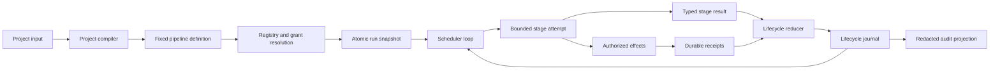

# Nova Core: From Project Input to Durable Decision

Status: implemented with stated limits
Audience: architecture reader, Nova developer, operator, incident responder
Owner: Nova maintainers
Evidence: skills/nova/project; skills/nova/core; skills/common/plugin-runtime
Evidence revision: `ce7740252864a9b547bee8a35260d6ab10c9f05e`
Applies to: `nova-project.v2`, `pipeline-definition.v2`, and the current Nova Core runtime
Last verified: source and contract inspection on 2026-10-11 at `a1569b61663e4bc85e11d38bd896bb99ed0bd396`; linked implementation files are byte-identical to the evidence revision. This inspection does not establish successful production execution.

## Purpose

Nova Core is the control authority for one pipeline run.
It turns a fixed graph into ordered attempts, durable decisions, and one final run status.

Core does not implement product work.
Plugins implement stages and adapters perform external operations.
Core decides when work can start, what authority it receives, and how its result changes the run.

This page follows that complete path.
It also explains why each safety boundary exists and what happens when a boundary fails.

For the wider component map, see [Components and Authority](components-and-authority.md).
For a shorter request trace, see [Request, State, and Recovery](request-state-recovery.md).
For operational commands, see [Operate the Pipeline](../use/operate.md).

## The Core Model

Nova separates four kinds of truth.

| Truth | Owner | Durable representation | Why it is separate |
| --- | --- | --- | --- |
| What work exists | Project compiler and graph validator | Graph in `run-snapshot.json` | Running code must not add undeclared work. |
| Which implementation may run | Plugin registry and platform policy | Registry in `run-snapshot.json` | A stage name alone does not grant authority. |
| What happened | Nova Core | Hash-chained journals and artifact records | Recovery needs ordered facts, not process memory. |
| What the facts mean for the run | Nova lifecycle reducer | Derived stage state and terminal event | Plugins must not select their own lifecycle transition. |

The separation makes replay predictable.
It also lets Core reject a changed graph, package, or result before the change gains authority.

Text version: The **Project input** enters the **Project compiler**.
The **Project compiler** produces the **Fixed pipeline definition**.
The **Fixed pipeline definition** determines the required **Registry and grant resolution**.
This resolution selects packages, registrations, grants, and providers.
The **Registry and grant resolution** supplies the **Atomic run snapshot**.
Nova stores the fixed definition and runtime selections in that snapshot.
The **Atomic run snapshot** supplies the admitted inputs for the **Scheduler loop**.
The **Scheduler loop** starts a **Bounded stage attempt**.

A **Bounded stage attempt** requests **Authorized effects**.
The **Bounded stage attempt** also produces a **Typed stage result**.
For durable **Authorized effects**, Core stores **Durable receipts**.
The **Typed stage result** enters the **Lifecycle reducer**.
**Durable receipts** constrain the **Lifecycle reducer** through the attempt's result.
Core records the **Lifecycle reducer**'s decisions in the **Lifecycle journal**.
The **Lifecycle journal** supplies state for the next **Scheduler loop** selection, including replay after interruption.
The **Lifecycle journal** also supplies the **Redacted audit projection**.

These arrows describe authority and information flow.
Receipts affect lifecycle decisions through adapter responses and attempt results;
the reducer does not directly read the receipt journal.

> **Source evidence — control authority**
>
> **Claim:** Core, not a plugin, owns scheduling and lifecycle transitions.
>
> **Implementation:** Runner admission, reducer, executor, loop and audit functions below trace the control path.
>
> [The runner validates the graph and stage inputs before it creates the scheduling loop](https://github.com/datrab/kubeclaw/blob/ce7740252864a9b547bee8a35260d6ab10c9f05e/skills/nova/core/execution/runner.ts#L40-L78).
>
> [The reducer owns all stage states and permitted lifecycle actions](https://github.com/datrab/kubeclaw/blob/ce7740252864a9b547bee8a35260d6ab10c9f05e/skills/nova/core/lifecycle/reducer.ts#L9-L52).
>
> [AdapterRuntime checks receipt outcomes before it returns effect responses to an attempt](https://github.com/datrab/kubeclaw/blob/ce7740252864a9b547bee8a35260d6ab10c9f05e/skills/nova/core/execution/adapters.ts#L52-L66).
> [The executor records the typed result before applying the reducer](https://github.com/datrab/kubeclaw/blob/ce7740252864a9b547bee8a35260d6ab10c9f05e/skills/nova/core/execution/stage-executor.ts#L31-L52).
>
> [The loop records decisions before its next scheduling selection](https://github.com/datrab/kubeclaw/blob/ce7740252864a9b547bee8a35260d6ab10c9f05e/skills/nova/core/execution/pipeline-loop.ts#L20-L37).
> [Audit derives its redacted projection from journal records](https://github.com/datrab/kubeclaw/blob/ce7740252864a9b547bee8a35260d6ab10c9f05e/skills/nova/core/telemetry/audit.ts#L13-L27).
>
> **Contract or setting:** The graph and typed result constrain scheduling; receipts influence lifecycle through the returned result, not a direct reducer receipt read.
>
> **Test evidence:** An executed complete project-to-durable-decision check is not established by this source trace.
>
> **Revision:** `ce7740252864a9b547bee8a35260d6ab10c9f05e`. Source bindings, not execution receipts.
>
> **Limit:** These control-flow sources do not prove successful production execution or an external effect.

## Authority and Invariants

The following rules hold across the complete run.

| Rule | Core enforces it by | Failure behavior |
| --- | --- | --- |
| One graph defines the run. | Core freezes, sorts, hashes, and stores the graph. | Recovery stops on a pipeline or graph digest mismatch. |
| One active runtime owns a run mutation. | A run mutation lease surrounds new runs, recovery, resume, and administrative actions. | A second mutation fails before it writes state. |
| One registration owns each stage type. | Registry build rejects duplicate owners and runtime validation resolves every stage. | Admission stops before the first attempt. |
| A plugin cannot select a lifecycle state. | The plugin returns a typed result and Core maps it through the reducer. | Invalid results or illegal source states fail closed. |
| A capability is not general access. | Core checks the grant and its resource constraints for each call. | The invocation is denied and the attempt returns a controlled failure. |
| An external effect needs stable identity. | Core writes request, acceptance, lock, fence, and receipt records. | An uncertain outcome blocks automatic continuation. |
| A wait accepts one matching signal. | Core checks wait identity, signal type, issuer, time, and prior consumption. | A stale, foreign, expired, or second signal is rejected. |
| Recovery preserves consumed budgets. | Replay folds attempt and repair events into counters. | Restart cannot restore spent attempts or repair orders. |
| A terminal run stays terminal. | Recovery and resume inspect the last run boundary. | Normal recovery and normal resume are rejected. |

These rules trade convenience for evidence.
For example, Core stops when it cannot distinguish a completed effect from an incomplete effect.
Automatic repetition would be easier, but it could duplicate a deployment, publication, or remote job.

> **Source evidence — immutable run identity**
>
> **Claim:** Graph identity is frozen and run mutations share an exclusive lease.
>
> **Implementation:** Graph snapshot construction and engine mutation-lock entry below enforce these separate identities.
>
> [The graph snapshot contains ordered nodes, ordinary edges, remediation edges, concurrency, and a content digest](https://github.com/datrab/kubeclaw/blob/ce7740252864a9b547bee8a35260d6ab10c9f05e/skills/nova/core/execution/graph.ts#L13-L50).
>
> [New, recovery, and resume paths execute inside the run mutation lock](https://github.com/datrab/kubeclaw/blob/ce7740252864a9b547bee8a35260d6ab10c9f05e/skills/nova/core/execution/engine-run.ts#L36-L43).
>
> **Contract or setting:** The snapshot digest binds nodes, both edge classes and concurrency; a mutation lease does not replace that digest.
>
> **Test evidence:** An executed concurrent mutation and changed-graph recovery check is not established by this source trace.
>
> **Revision:** `ce7740252864a9b547bee8a35260d6ab10c9f05e`. Source bindings, not execution receipts.
>
> **Limit:** Exclusive local mutation does not prove remote-resource fencing or target-volume durability.

### Identities do not substitute for each other

| Identity | What it names | Authority that verifies it |
| --- | --- | --- |
| Project ID | One authored project definition. | Project compiler. |
| Pipeline ID | One compiled pipeline definition. | Graph snapshot verification. |
| Run ID | One execution history. | Run-root resolver and every lifecycle event. |
| Graph digest | Exact nodes, edges, limits, and concurrency. | New-run snapshot and recovery. |
| Package content digest | Exact installed package content. | Discovery trust policy and pinned-package recovery. |
| Registration ID | One stage, adapter, or observer entry inside a package. | Registry and activation policy. |
| Stage ID | One graph node. | Graph builder and scheduler. |
| Attempt ID and number | One bounded execution of a stage. | Stage executor and artifact producer checks. |
| Lease ID | Temporary authority of one attempt context. | Invocation context and revocation checks. |
| Effect ID and idempotency key | One intended external operation and its retry identity. | Effect coordinator and effect journal. |
| Resource lock and fencing token | Current writer for one external resource. | Lock manager and adapter fence check. |
| Wait ID, signal ID, and signal idempotency key | One pause, one answer, and repeat-safe delivery. | Resume validation and signal journal. |
| Artifact ID and digest | A named output and its exact bytes. | Artifact adapter and checkpoint recorder. |
| Repair request digest and order ID | One defect-driven repair authority. | Repair budget and replay projection. |
| Remote job, request, plan, result, and decision digests | One Nova-to-Buster handoff and its returned facts. | Dispatch store, importer, and Nova decision logic. |

An equal label does not imply equal authority.
For example, an artifact ID without its digest and producer attempt does not identify trusted artifact content.
A remote job ID without its request digest does not identify the admitted request.

> **Source evidence — attempt and effect identity**
>
> **Claim:** Attempt/lease identity and external-effect identity bind different authority.
>
> **Implementation:** The executor and effect request type below construct those identities.
>
> [The stage executor creates the attempt and lease identities and records package ownership](https://github.com/datrab/kubeclaw/blob/ce7740252864a9b547bee8a35260d6ab10c9f05e/skills/nova/core/execution/stage-executor.ts#L55-L79).
>
> [The effect contract binds idempotency, attempt, capability, operation, resource, and payload](https://github.com/datrab/kubeclaw/blob/ce7740252864a9b547bee8a35260d6ab10c9f05e/skills/nova/core/effects/contracts.ts#L4-L14).
>
> **Contract or setting:** The effect contract binds attempt, capability, operation, resource, payload and idempotency key.
>
> **Test evidence:** An executed cross-attempt effect-identity rejection check is not established by this source trace.
>
> **Revision:** `ce7740252864a9b547bee8a35260d6ab10c9f05e`. Source bindings, not execution receipts.
>
> **Limit:** Matching labels alone do not prove trusted artifact bytes or authorize another attempt.

## 1. Project Admission and Compilation

### The command boundary

The Nova project command accepts `--project` and `--platform`.
It accepts one optional operation: compile, recover, or signal.
Without one of these options, it starts a new run.

The compile operation writes a pipeline definition without starting effects.
The command uses exclusive file creation, so it does not replace an existing output file.
A new run also checks the repository `HEAD` and the clean working tree against the declared baseline.
Recovery compiles the recovery form and then verifies the stored run identity.

> **Source evidence — command selection and baseline checks**
>
> **Claim:** The project CLI selects compile, run, recover or signal and checks its admitted runtime/baseline.
>
> **Implementation:** The linked CLI branch defines operation selection and its ordering.
>
> [The project CLI validates its operation, validates the installed runtime, and selects compile, run, recover, or resume](https://github.com/datrab/kubeclaw/blob/ce7740252864a9b547bee8a35260d6ab10c9f05e/skills/nova/project/cli.ts#L19-L56).
>
> **Contract or setting:** Project/platform inputs select this CLI path; compile output uses exclusive creation and does not start pipeline effects.
>
> **Test evidence:** An executed production project CLI check is not established by this source trace.
>
> **Revision:** `ce7740252864a9b547bee8a35260d6ab10c9f05e`. Source bindings, not execution receipts.
>
> **Limit:** A compiled definition is not an executed run, and compilation does not guarantee live provider availability.

### Input admission

The compiler accepts only `nova-project.v2`.
It rejects unknown object fields instead of silently ignoring them.
Project and module IDs use a restricted form.
Repository and workspace paths must be absolute and normalized.
The workspace must remain outside the repository.
The baseline must be a full 40-character Git object ID.

Each module must have requirements, owned paths, runtime configuration, and a test plan.
Owned paths cannot overlap between modules.
Module dependencies must exist and must not form a cycle.
A module test plan must contain at least one non-skipped blocking test.
Its plan digest and project scope must match the project.

**Why these checks exist:** The compiler converts author intent into execution authority.
An ignored field, moving revision, or overlapping owner can make two valid-looking runs mean different things.
Admission rejects that ambiguity before a plugin can change the repository.

Source admission creates a second, narrower boundary for control documents.
The project declares required architecture files and one blueprint path for each module.
A module can select named substeps.
Core then selects the corresponding `FORGE.md` files.
The compiler sorts and deduplicates these paths and rejects absolute paths, parent traversal, control characters, and empty segments.

The source binding covers the project, repository root, architecture reference, selected paths, and a digest of the project contract.
That contract includes the baseline, module requirements, ownership, checks, and final integration requirements.
An optional architecture-check stage reads the immutable subject.
An optional approval stage runs only when the architecture check reports that approval is required.
Blueprint synchronization receives the same source binding.

**Why Core selects control files before implementation:** An agent must not choose its own instructions after it receives write authority.
The source binding makes the exact instruction set part of the admitted project meaning.

> **Source evidence — strict project validation**
>
> **Claim:** Project admission rejects ambiguous fields, ownership, plans and control-file selection.
>
> **Implementation:** Compiler validation and source-admission helpers below bind the accepted project meaning.
>
> [Compiler helpers reject unknown fields, invalid IDs, non-canonical paths, duplicate lists, and unsafe ownership paths](https://github.com/datrab/kubeclaw/blob/ce7740252864a9b547bee8a35260d6ab10c9f05e/skills/nova/project/compiler.ts#L11-L45).
>
> [Module admission checks unique ownership, requirements, plan digest, plan scope, and a blocking test](https://github.com/datrab/kubeclaw/blob/ce7740252864a9b547bee8a35260d6ab10c9f05e/skills/nova/project/compiler.ts#L89-L134).
>
> [Project admission checks the schema version, paths, baseline, dependency order, and final configuration](https://github.com/datrab/kubeclaw/blob/ce7740252864a9b547bee8a35260d6ab10c9f05e/skills/nova/project/compiler.ts#L137-L192).
>
> [Source admission selects architecture and module control files and binds them to the project contract](https://github.com/datrab/kubeclaw/blob/ce7740252864a9b547bee8a35260d6ab10c9f05e/skills/nova/project/source.ts#L19-L66).
>
> **Contract or setting:** nova-project.v2, blocking test-plan scope/digest and selected control paths constrain the compiler.
>
> **Test evidence:** An executed full project admission and source-approval journey check is not established by this source trace.
>
> **Revision:** `ce7740252864a9b547bee8a35260d6ab10c9f05e`. Source bindings, not execution receipts.
>
> **Limit:** Valid input does not certify architecture quality, operator approval or successful implementation.

### Compiler output

The compiler creates a predictable module chain.
Each module has an implementation stage, a lint stage, an optional product-review stage, and a quality-test stage.
Lint, product review, and quality testing can request repair from the implementation stage.
The compiler adds source and architecture stages before module work.
It adds cumulative final stages after module work.

The project compiler sets `maxConcurrency` to `1`.
This value protects the single shared repository publication lane.
The generic Core still supports higher concurrency for explicit graphs.

Attempt and repair limits are separate.
The current module compiler gives one technical retry and category-specific repair orders.
It includes all possible orders in `maxAttempts`, so a repair recheck does not accidentally consume the technical retry allowance.

> **Source evidence — emitted stages and budgets**
>
> **Claim:** The project compiler emits declared module/repair chains and an explicit single-lane execution policy.
>
> **Implementation:** Module and final compiler construction below emit the stages and limits.
>
> [The module compiler creates implementation, lint, optional review, and test stages with declared repair routes](https://github.com/datrab/kubeclaw/blob/ce7740252864a9b547bee8a35260d6ab10c9f05e/skills/nova/project/compiler.ts#L47-L86).
>
> [The compiler orders modules, adds source and cumulative stages, sets project concurrency to one, and validates the final definition](https://github.com/datrab/kubeclaw/blob/ce7740252864a9b547bee8a35260d6ab10c9f05e/skills/nova/project/compiler.ts#L171-L192).
>
> **Contract or setting:** Compiler-derived concurrency and budgets apply to its project output; explicit graphs do not inherit them.
>
> **Test evidence:** [Repair/recheck fixture](https://github.com/datrab/kubeclaw/blob/ce7740252864a9b547bee8a35260d6ab10c9f05e/tests/verification/reliability/repair-budget.test.mjs#L21-L37) contains category orders and mandatory rechecks assertions; a fresh execution result is not established here.
>
> **Revision:** `ce7740252864a9b547bee8a35260d6ab10c9f05e`. Source bindings, not execution receipts.
>
> **Limit:** That controlled explicit-graph fixture does not establish successful execution of every project-compiled stage.

## 2. Graph Construction, Validation, and Freeze

Core models two edge types.

- An ordinary edge means that a stage must finish successfully or skip safely before a dependent stage becomes ready.
- A remediation edge means that a failed evaluation can send work to a declared repair stage.

An activation condition can skip a stage from a fact produced by an ancestor.
Core does not let an arbitrary stage control activation.
The source must exist and must be an ancestor of the conditional stage.
A remediation target cannot also use activation.

Graph admission rejects:

- an empty graph or duplicate stage IDs;
- invalid attempt, repair, timeout, or orchestrator thresholds;
- duplicate, missing, or self dependencies;
- ordinary dependency cycles;
- missing or self remediation targets;
- a remediation target without a safe order relationship;
- a remediation route that creates a prerequisite deadlock;
- unordered requesters that share one repair target;
- an invalid activation source;
- a remediation-only target with downstream ordinary work.

Core clones and deeply freezes each stage definition.
It sorts stages and edges before it calculates the versioned graph digest.
Declaration order therefore does not change a version 3 snapshot.

**Why ordinary and remediation edges stay separate:** A dependency describes normal completion.
A remediation edge describes controlled backward movement.
If Core treated both as ordinary dependencies, repair could create a cycle or release downstream work too early.

> **Source evidence — graph safety rules**
>
> **Claim:** Graph admission freezes a safe dependency/remediation/activation structure.
>
> **Implementation:** The graph builder and snapshot code below validate and digest that structure.
>
> [The graph builder validates execution limits, dependencies, cycles, remediation order, shared targets, and activations](https://github.com/datrab/kubeclaw/blob/ce7740252864a9b547bee8a35260d6ab10c9f05e/skills/nova/core/execution/graph-build.ts#L8-L96).
>
> [The graph object freezes sorted structures and creates a versioned digest from portable JSON](https://github.com/datrab/kubeclaw/blob/ce7740252864a9b547bee8a35260d6ab10c9f05e/skills/nova/core/execution/graph.ts#L19-L50).
>
> **Contract or setting:** Attempt, repair and timeout limits and safe edge relationships must be declared before execution.
>
> **Test evidence:** An executed complete graph safety matrix check is not established by this source trace.
>
> **Revision:** `ce7740252864a9b547bee8a35260d6ab10c9f05e`. Source bindings, not execution receipts.
>
> **Limit:** A valid frozen graph does not prove its stage implementation, input semantics or remote dependencies.

## 3. Registry Admission and Snapshot Handoff

The graph states which stage types are required.
The registry states which installed package owns each type.
Nova joins these facts before execution.

Runtime preparation performs this sequence:

1. Validate the pipeline contract.
2. Discover packages only from configured installation roots.
3. Apply built-in and external trust policy.
4. Build a registry and identify each required registration.
5. Resolve enabled registrations, grants, and selected providers.
6. Validate registration configuration.
7. Activate only the granted registry entries.
8. Validate each stage configuration and input against its owner's schemas.

Core then stores a registry record with package provenance, registrations, enabled entries, grants, selected providers, and configured stage owners.
It binds that record to the graph digest.
The snapshot also stores runtime-dispatch and review-cache profiles.

Nova writes `run-snapshot.json` through a private temporary file.
It uses a no-replace hard link to publish the final file.
It synchronizes the file and directory before it removes the temporary name.
A reader therefore sees either no snapshot or one complete snapshot.

**Why the registry is part of the run snapshot:** A stage type is not a complete implementation identity.
Package version, content digest, registration, grants, and provider selection can change its behavior.
A recovered run must use the admitted set, or use an explicit package-upgrade decision.

> **Source evidence — runtime preparation**
>
> **Claim:** Runtime preparation resolves trusted package ownership, grants, configuration and one atomic snapshot.
>
> **Implementation:** Preparation, runner admission and snapshot publication below connect the registry to execution.
>
> [Runtime preparation discovers trusted packages, builds the registry, resolves policy, validates configuration, and activates registrations](https://github.com/datrab/kubeclaw/blob/ce7740252864a9b547bee8a35260d6ab10c9f05e/skills/nova/core/execution/engine-runtime.ts#L23-L49).
>
> [The runner validates every stage owner, configuration, and input against the granted registry](https://github.com/datrab/kubeclaw/blob/ce7740252864a9b547bee8a35260d6ab10c9f05e/skills/nova/core/execution/runner.ts#L40-L46).
>
> [The snapshot code records runtime provenance and publishes one integrity-checked file atomically](https://github.com/datrab/kubeclaw/blob/ce7740252864a9b547bee8a35260d6ab10c9f05e/skills/nova/core/execution/engine-snapshots.ts#L75-L134).
>
> **Contract or setting:** Pinned package provenance and validated owner schemas determine admitted stage/config/input meaning.
>
> **Test evidence:** An executed complete registry activation and snapshot interruption check is not established by this source trace.
>
> **Revision:** `ce7740252864a9b547bee8a35260d6ab10c9f05e`. Source bindings, not execution receipts.
>
> **Limit:** An atomic file publication does not prove host power-loss survival or every platform setting is captured.

### Recovery compatibility

Recovery rebuilds the current registry and compares it with the stored registry.
It rejects a missing pinned package, a changed version, or a changed content digest.
An administrative package-upgrade record can authorize an exact old-to-new identity change.
The new identity must keep the same plugin ID and API version.

Recovery also rebuilds the graph from the supplied definition.
It rejects an unsupported snapshot version, changed pipeline ID, or changed graph digest.
It never reinterprets an old run with a convenient new graph.

> **Source evidence — pinned package and graph verification**
>
> **Claim:** Recovery requires the admitted graph and exact pinned packages or an explicit compatible upgrade.
>
> **Implementation:** The snapshot verification functions below compare recorded packages and graph identity.
>
> [Recovery checks recorded package upgrades and every pinned package identity](https://github.com/datrab/kubeclaw/blob/ce7740252864a9b547bee8a35260d6ab10c9f05e/skills/nova/core/execution/engine-snapshots.ts#L20-L66).
>
> [Recovery requires the same pipeline ID and graph digest](https://github.com/datrab/kubeclaw/blob/ce7740252864a9b547bee8a35260d6ab10c9f05e/skills/nova/core/execution/engine-snapshots.ts#L68-L72).
>
> **Contract or setting:** Package ID/API compatibility and exact old-to-new upgrade identity do not authorize graph replacement.
>
> **Test evidence:** [Resume graph-drift control](https://github.com/datrab/kubeclaw/blob/ce7740252864a9b547bee8a35260d6ab10c9f05e/tests/verification/contracts/check-plugin-system-v2-resume.mjs#L63-L73) contains changed-definition rejection and exact-definition resume assertions; a fresh execution result is not established here.
>
> **Revision:** `ce7740252864a9b547bee8a35260d6ab10c9f05e`. Source bindings, not execution receipts.
>
> **Limit:** The controlled resume fixture does not validate arbitrary package upgrades or deployed compatibility.

## 4. Durable State and the Run Root

Core maps a run ID to a directory below `<storageRoot>/runs`.
New directories use a SHA-256 hash of the run ID in their name.
The hash avoids path interpretation and collisions from simple character replacement.
Core can locate an older directory only after it finds the exact run ID in its event journal.

The main run records are:

| Record | Purpose | Important failure meaning |
| --- | --- | --- |
| `run-snapshot.json` | Immutable graph, registry, selected runtime-configuration subset, and runtime profiles. | A missing or invalid snapshot makes safe recovery impossible. Platform fields outside the stored subset need separate change control. |
| `events.jsonl` | Lifecycle and plugin-domain history. | An invalid hash, or a rewind or divergence detected after a reader loaded its prefix, stops replay. A new reader needs an external trusted head to detect a valid-prefix rollback. |
| Effect journal and result blobs | Requests, acceptance, receipts, and large result bodies. | An accepted request without a recoverable receipt can block recovery. |
| `signals.jsonl` | Consumed resume signals. | A second signal for one wait is rejected. |
| `administrative-decisions.jsonl` | Authorized reopen and package decisions. | A changed decision identity or unauthorized issuer is rejected. |
| Observer delivery journals | Delivery attempts and checkpoints. | A required observer can stop progress after bounded retries. |

The generic file journal serializes one JSON record per line.
Each record has a sequence, previous hash, and current hash.
Append uses a cross-process file mutex and `fsync`.
Opening `FileJournal` creates an append-lock file and can truncate an
unterminated final line before parsing. This also applies to audit, recovery,
and resume, including a command that later rejects the run. Preserve raw bytes
with stopped writers before such inspection after interruption. Use
[Inspect a Run](../use/operate.md#inspect-a-run) for the canonical preservation
procedure and the pure parser that rejects incomplete bytes without repair.
After a reader loads records, it detects file-identity, size, and timestamp
changes and reloads the file. It accepts the reload when the previous records
remain the exact prefix of the new history. It rejects a shorter history or a
different prior hash chain. A new reader has no earlier prefix for comparison;
it cannot identify a clean rollback without an externally retained trusted
head.

The journal takes a detached JSON snapshot before it writes.
It rejects cycles, proxies, accessors, sparse arrays, non-finite numbers, functions, and other non-JSON values.
This rule prevents later object mutation from changing the meaning of an earlier event.

Plugin state uses the same durable journal properties but a separate namespace.
Core derives the exact namespace as `plugin.<plugin-id>.<registration-id>`.
It checks registration provenance, monotonic sequence, and stable idempotency identity.
The same idempotency key can repeat only with the same entry.
A plugin cannot write another registration's state or select a shorter namespace.

This separation keeps plugin-owned progress out of canonical lifecycle state.
Core can store a plugin projection without letting that plugin change scheduler authority.

**Operational limit:** The file mutex needs Linux and `/usr/bin/flock` from util-linux.
The storage filesystem must supply correct kernel `flock` behavior.
File and directory synchronization reduce risk, but they do not prove storage durability after host power loss.

> **Source evidence — run directory and journal**
>
> **Claim:** Run-root identity and hash-chained journals preserve ordered history with an explicit acquisition/tail-repair boundary.
>
> **Implementation:** Run-root, journal, detached-JSON and plugin-state functions below implement storage admission.
>
> [The run-root resolver validates the run ID, uses a hashed directory, and verifies an older directory before use](https://github.com/datrab/kubeclaw/blob/ce7740252864a9b547bee8a35260d6ab10c9f05e/skills/nova/core/execution/run-root.ts#L62-L75).
>
> [The journal repairs an incomplete tail and, after it loads a prefix, rejects a later rewind or divergence](https://github.com/datrab/kubeclaw/blob/ce7740252864a9b547bee8a35260d6ab10c9f05e/skills/nova/core/state/journal.ts#L59-L103).
>
> [Journal append computes the hash chain, writes all bytes, synchronizes them, and verifies the final size](https://github.com/datrab/kubeclaw/blob/ce7740252864a9b547bee8a35260d6ab10c9f05e/skills/nova/core/state/journal.ts#L125-L155).
>
> [The JSON snapshotter accepts only detached JSON-safe values](https://github.com/datrab/kubeclaw/blob/ce7740252864a9b547bee8a35260d6ab10c9f05e/skills/nova/core/state/json-value.ts#L6-L48).
>
> [The plugin-state journal enforces namespace, registration provenance, sequence, and idempotency](https://github.com/datrab/kubeclaw/blob/ce7740252864a9b547bee8a35260d6ab10c9f05e/skills/nova/core/state/plugins.ts#L22-L105).
>
> **Contract or setting:** Plugin state binds namespace/provenance/idempotency; Linux flock and correct filesystem locking are prerequisites.
>
> **Test evidence:** [Audit corruption fixture](https://github.com/datrab/kubeclaw/blob/ce7740252864a9b547bee8a35260d6ab10c9f05e/tests/verification/reliability/audit-projection.test.mts#L10-L28) contains unchanged complete journal, redaction and changed-record rejection assertions; a fresh execution result is not established here.
>
> **Revision:** `ce7740252864a9b547bee8a35260d6ab10c9f05e`. Source bindings, not execution receipts.
>
> **Limit:** A new reader cannot detect valid-prefix rollback without an external trusted head; file synchronization is not a power-loss test.

## 5. Scheduling, Readiness, and Concurrency

The scheduler derives readiness from current state and the frozen graph.
It does not ask a plugin what should run next.

A normal stage is ready when:

- it is not complete or active;
- it is not a remediation-only target;
- all ordinary dependencies are `succeeded` or `skipped`.

Fan-out needs no special scheduler mode.
Several stages can depend on one completed stage and become ready together.
Fan-in is also explicit.
A joining stage stays pending until every declared dependency completes.
The graph-wide concurrency limit applies after Core calculates the complete ready set.

Core sorts ready stages by stage ID.
It starts only the first `maxConcurrency` entries in that stable order.
This gives a deterministic selection from the same state.
Concurrent attempts can finish in any order, so Core collects the completed decisions before it records them.
It records ordinary siblings before a repair decision can invalidate their older results.

Conditional activation runs after readiness selection.
Core reads only a named fact from the declared ancestor.
If the value does not match, Core records `stage.skipped` with the observed condition details.

Repair work uses a forced queue.
The scheduler still checks the repair target's dependencies.
After repair succeeds, Core returns the requesting evaluation stage to `pending`.

The loop stops with `succeeded` only when every required stage succeeded or skipped.
An unused remediation-only target can remain pending.
If no stage is ready and the graph is not complete, Core derives the strongest present terminal or waiting status.

> **Source evidence — deterministic readiness**
>
> **Claim:** The scheduler selects stable ready stages and handles conditional skips and forced repair separately.
>
> **Implementation:** Graph readiness, pipeline selection and finalization below define the scheduling frontier.
>
> [The graph returns sorted stages whose dependencies are complete and excludes remediation-only targets](https://github.com/datrab/kubeclaw/blob/ce7740252864a9b547bee8a35260d6ab10c9f05e/skills/nova/core/execution/graph.ts#L52-L54).
>
> [The loop limits each batch, orders repair decisions after siblings, and pauses or terminates from recorded decisions](https://github.com/datrab/kubeclaw/blob/ce7740252864a9b547bee8a35260d6ab10c9f05e/skills/nova/core/execution/pipeline-loop.ts#L20-L37).
>
> [Selection handles forced repair work and records conditional skips](https://github.com/datrab/kubeclaw/blob/ce7740252864a9b547bee8a35260d6ab10c9f05e/skills/nova/core/execution/pipeline-loop.ts#L86-L116).
>
> [Finalization defines completion and derives the run status](https://github.com/datrab/kubeclaw/blob/ce7740252864a9b547bee8a35260d6ab10c9f05e/skills/nova/core/execution/pipeline-loop.ts#L137-L143).
>
> **Contract or setting:** Ordinary ancestors, graph concurrency and declared activation facts constrain selection.
>
> **Test evidence:** An executed complete concurrent scheduling and repair-order matrix check is not established by this source trace.
>
> **Revision:** `ce7740252864a9b547bee8a35260d6ab10c9f05e`. Source bindings, not execution receipts.
>
> **Limit:** Deterministic selection does not impose completion order on concurrent external operations.

## 6. Stage Dispatch and Attempt Authority

Core resolves exactly one active registration for the stage type.
It then creates an attempt identity with run ID, stage ID, random attempt ID, and monotonic attempt number.
It records `attempt.created` and `attempt.dispatched` before it calls the plugin.

Each attempt receives a revocable invocation lease.
The lease contains:

- the attempt identity;
- the owning package and registration provenance;
- the exact capability grants;
- wall-time, memory, and CPU limits;
- issue and expiry timestamps.

The invocation lease and the resource lock solve different problems.
The invocation lease authorizes plugin-context use for one attempt.
Core revokes it when the attempt completes, times out, or receives cancellation.
It is not a cross-host worker claim and it does not renew.
The external resource lock serializes one durable effect.
Core renews that lock during adapter execution and uses its fencing token to reject an old writer.

The current Core lease declares memory and CPU limits.
The in-process stage executor enforces the wall-time deadline directly.
The selected adapter or worker must enforce resource limits that need process isolation.

The plugin context contains validated configuration, stage input, optional continuation guidance, spent budgets, and visible artifacts.
A stage can see artifacts from itself and its ordinary ancestors.
It cannot see an unrelated branch by default.

Every capability call checks the active lease first.
Core then checks that the registration received the capability grant.
A capability-specific handler checks the requested path, namespace, agent, secret, target, source, network origin, executable, or event prefix.
Plugin events must use `plugin.<plugin-id>.` and the current run ID.

**Why Core checks on every call:** Startup admission proves that a grant exists.
It does not prove that every later resource value is safe.
The invocation check prevents a broadly typed capability from becoming broad access.

> **Source evidence — attempt and lease construction**
>
> **Claim:** An attempt gets a revocable lease, bounded visibility and capability-specific resource checks.
>
> **Implementation:** Executor, authorization and invocation-context functions below construct and check attempt authority.
>
> [The executor resolves the active owner, validates the returned result, records completion, and always cleans up](https://github.com/datrab/kubeclaw/blob/ce7740252864a9b547bee8a35260d6ab10c9f05e/skills/nova/core/execution/stage-executor.ts#L31-L52).
>
> [The executor creates attempt identity, lease limits, context, artifact visibility, and durable attempt records](https://github.com/datrab/kubeclaw/blob/ce7740252864a9b547bee8a35260d6ab10c9f05e/skills/nova/core/execution/stage-executor.ts#L55-L119).
>
> [Capability authorization applies a specific resource rule for each supported capability family](https://github.com/datrab/kubeclaw/blob/ce7740252864a9b547bee8a35260d6ab10c9f05e/skills/nova/core/execution/authorization.ts#L39-L129).
>
> [The invocation context checks lease state, grants, event namespace, and run identity](https://github.com/datrab/kubeclaw/blob/ce7740252864a9b547bee8a35260d6ab10c9f05e/skills/nova/core/execution/context.ts#L34-L79).
>
> **Contract or setting:** The lease binds active owner/grants; memory and CPU declarations require an isolated executor that enforces those limits.
>
> **Test evidence:** An executed complete attempt-grant and resource-limit matrix check is not established by this source trace.
>
> **Revision:** `ce7740252864a9b547bee8a35260d6ab10c9f05e`. Source bindings, not execution receipts.
>
> **Limit:** An in-process lease is not a cross-host worker claim or proof of memory/CPU isolation.

### Timeout and cleanup order

Core races the plugin operation against cancellation and the stage deadline.
A deadline aborts the attempt context and produces `timed_out`.
Run cancellation produces `cancelled`.
Other thrown errors become a `retry` result unless they describe an uncertain external effect.
An uncertain effect becomes `blocked` and requires reconciliation.

After result recording, Core aborts the attempt controller and revokes the lease.
The outer execution boundary drains observers and then shuts down adapters.
Adapter shutdown runs even when the pipeline throws.

> **Source evidence — deadline and result normalization**
>
> **Claim:** Timeout/cancellation revoke local attempt authority and map failures to controlled results.
>
> **Implementation:** Executor races and nested engine cleanup below define normalization and shutdown ordering.
>
> [The executor races operation, cancellation, and timeout, then maps failures to controlled stage results](https://github.com/datrab/kubeclaw/blob/ce7740252864a9b547bee8a35260d6ab10c9f05e/skills/nova/core/execution/stage-executor.ts#L121-L145).
>
> [The engine drains observers and shuts down adapters in nested `finally` blocks](https://github.com/datrab/kubeclaw/blob/ce7740252864a9b547bee8a35260d6ab10c9f05e/skills/nova/core/execution/engine-run.ts#L21-L34).
>
> **Contract or setting:** Stage deadline and abort signal select the controlled outcome; observer drain and adapter shutdown remain separate cleanup operations.
>
> **Test evidence:** An executed production timeout and adapter shutdown check is not established by this source trace.
>
> **Revision:** `ce7740252864a9b547bee8a35260d6ab10c9f05e`. Source bindings, not execution receipts.
>
> **Limit:** Aborting an attempt does not prove a remote effect stopped or that shutdown completed without another error.

## 7. Lifecycle State and Result Mapping

Core has ten stage states.

| State | Meaning | Can normal scheduling select it? |
| --- | --- | --- |
| `pending` | The stage has no active attempt and can become ready. | Yes, after dependencies complete. |
| `scheduled` | A durable projection says that selection occurred. | No new selection. |
| `running` | An attempt is active or replay found an interrupted attempt. | No. |
| `waiting` | Core needs a signal, cooldown, repair, or orchestrator action. | No. |
| `retrying` | The last result authorized another attempt. | Core converts it to pending through the decision recorder. |
| `skipped` | Its declared activation condition did not match. | No; it satisfies ordinary dependencies. |
| `succeeded` | The stage passed and its facts are durable. | No; it satisfies ordinary dependencies. |
| `failed` | The stage produced a known terminal failure or timeout. | No. |
| `blocked` | Core cannot safely continue without a different authority. | No. |
| `cancelled` | The run or attempt was cancelled. | No. |

Every execution consumes one attempt.
Core removes an old wait, cooldown, or pending repair before it applies the new result.
Non-passing results must include a reason.

The journal events below drive the complete state projection.

| Durable input | Required prior condition | Projected result |
| --- | --- | --- |
| Run creation without prior stage events | Graph admission succeeded. | Every stage starts as `pending` with zero spent budgets. |
| `stage.started` | Scheduler selected a ready stage. | Stage becomes `running`. |
| `attempt.created` | Core created a new attempt identity. | Attempt number and attempts used increase monotonically. |
| `attempt.completed`, `attempt.cancelled`, or `attempt.timed_out` | Stage is `running` and the payload has a typed result. | The reducer derives success, retry, repair, wait, failure, blockage, or cancellation. |
| `stage.retrying` | A retry decision exists. | Stage returns to `pending` with spent budgets preserved. |
| `stage.waiting` or `orchestrator.required` | A wait, cooldown, or repair decision exists. | Stage becomes `waiting` and keeps its bound request. |
| `wait.resolved` | The signal matches the active wait. | Stage becomes `pending`; signal payload becomes continuation guidance. |
| `stage.scheduled` after repair | The repair target succeeded. | Requesting stage returns to `pending`; repair return markers clear. |
| `stage.skipped` | Activation condition does not match. | Stage becomes `skipped`. |
| `stage.succeeded` | Core accepted a passing result. | Stage becomes `succeeded` and stores typed facts. |
| `stage.failed`, `stage.blocked`, or `stage.cancelled` | Core selected the matching stop action. | Stage becomes terminal. |
| Recovery finds `running` without later completion | The prior process ended before a terminal attempt event. | Stage returns to `pending`; the created attempt remains spent. |

A result can change state only from `running`.
The reducer rejects a result from any other state.
Replay applies the same result mapping, repair policy, and wait creation logic as live execution.

| Plugin result | Core decision | Important limit |
| --- | --- | --- |
| `passed` | Store facts, mark `succeeded`, record completion. | Facts must use the result schema. |
| `retry` | Schedule the same stage again. | Attempt and technical-retry budgets must remain. |
| `request_fix` | Schedule the declared repair target. | The graph route and repair budget must permit it. |
| `wait` | Store the typed wait and pause. | Attempt budget must remain. |
| `orchestrator_required` | Store an orchestrator wait and pause. | Only the authorized issuer can resume it. |
| `rate_limited` | Store `retryAt` and pause. | Recovery before that time is rejected. |
| `blocked` | Mark the stage and run blocked. | Normal resume cannot reopen it. |
| `failed` | Mark the stage and run failed. | Terminal. |
| `timed_out` | Mark the stage and run failed. | Terminal, unless a higher layer creates another run. |
| `cancelled` | Mark the stage and run cancelled. | Terminal. |

If concurrent stages produce different terminal results, Core uses a stable priority.
Failure has priority over blockage, and blockage has priority over cancellation.
This rule prevents completion order from changing the final result of one batch.

> **Source evidence — complete reducer table**
>
> **Claim:** Only a running stage can map a typed result into Core lifecycle state and spent budgets.
>
> **Implementation:** Reducer and decision-recorder handlers below own transition and terminal-priority rules.
>
> [The reducer defines every stage state, lifecycle action, result handler, and budget check](https://github.com/datrab/kubeclaw/blob/ce7740252864a9b547bee8a35260d6ab10c9f05e/skills/nova/core/lifecycle/reducer.ts#L9-L135).
>
> [The decision recorder persists retry, repair, wait, stop, completion, and terminal priority](https://github.com/datrab/kubeclaw/blob/ce7740252864a9b547bee8a35260d6ab10c9f05e/skills/nova/core/execution/run-decisions.ts#L29-L131).
>
> **Contract or setting:** stage-result.v2 and declared execution budgets constrain actions; replay uses those same rules.
>
> **Test evidence:** [Repair result/replay fixture](https://github.com/datrab/kubeclaw/blob/ce7740252864a9b547bee8a35260d6ab10c9f05e/tests/verification/reliability/repair-budget.test.mjs#L21-L37) contains spent attempts and equivalent journal replay assertions; a fresh execution result is not established here.
>
> **Revision:** `ce7740252864a9b547bee8a35260d6ab10c9f05e`. Source bindings, not execution receipts.
>
> **Limit:** The fixture checks selected repair paths, not every result/state combination or external completion.

## 8. Technical Retry and Product Repair

Technical retry repeats the same stage because execution did not produce a trusted product verdict.
Examples include a temporary adapter failure or rate limit.
It consumes `maxAttempts` and, when present, `maxTechnicalRetries`.
It does not change the graph or send work to another stage.

Product repair responds to a trusted defect finding.
The requesting stage returns `request_fix`.
Core follows only its frozen `on.request_fix` edge.
It stores the original result and repair request, invalidates affected downstream state, and schedules the repair target.
After repair succeeds, Core schedules a new evaluation attempt.

Category budgets separate lint, product review, and test repair.
A category can permit a fixed number of automatic repair orders.
The policy can then request one or more orchestrator-authorized extra orders.
An authorization signal binds the pending request digest, actor, reason, wait, and current repair history.
A stale authorization cannot approve a changed repair request.

The generic pipeline contract supplies no implicit execution budget.
Every stage must declare `maxAttempts`, `maxRemediationCycles`, and
`timeoutMs`. `maxTechnicalRetries`, `repairCategory`, `repairBudget`, and
`orchestratorAfterAttempt` are optional and change only their named behavior.
If `maxTechnicalRetries` is absent and the stage has no `repairBudget`,
technical retries use the shared `maxAttempts` ceiling. A stage that owns a
`repairBudget` must also declare `maxTechnicalRetries`. Graph validation needs
that value to prove that the initial attempt, every repair order, and every
technical retry fit below `maxAttempts`. If `repairCategory` is absent, repair
uses `maxRemediationCycles`. A category-based repair requires the repair target
to own a matching `repairBudget`; an absent category is an error, not a zero
budget.

The project compiler supplies an opinionated policy. It sets a 30-minute stage
timeout, one technical retry, two automatic repair orders for each enabled
lint, review, or test category, and at most one orchestrator-authorized extra
order. It calculates `maxAttempts` so that the initial attempt, all possible
repair orders, their rechecks, and the technical retry fit under the same hard
ceiling. An explicit `pipeline-definition.v2` does not inherit these compiler
values.

| Condition | Core response | Safe next action |
| --- | --- | --- |
| Technical retry remains | Repeat the same stage. | No operator action. |
| Technical retry limit ends | Block the stage. | Inspect the attempt reason before any administrative action. |
| Automatic repair order remains | Run the declared repair target. | Let the target finish and then re-evaluate. |
| Extra repair order needs authority | Create an orchestrator wait. | Submit one matching authorization signal. |
| All repair authority ends | Block the run. | Correct the underlying product or use an authorized administrative decision. |
| Repair target is failed, blocked, or cancelled | Propagate a terminal state. | Diagnose the target; do not force the requester forward. |

**Why retry and repair use different budgets:** A network retry and a product change have different risks.
Combining them could let infrastructure noise consume all repair work, or let repeated product edits bypass a technical retry limit.

> **Source evidence — repair budgets and identity**
>
> **Claim:** Technical retries, automatic repairs and authorized extra orders spend distinct but bounded authority.
>
> **Implementation:** Budget validation, compiler policy, authorization and remediation functions below establish the ledger.
>
> [The stage contract requires the hard execution bounds and declares each optional specialized budget](https://github.com/datrab/kubeclaw/blob/ce7740252864a9b547bee8a35260d6ab10c9f05e/skills/common/plugin-runtime/contracts/plugin-system/v2/plugin-system-v2.schema.json#L481-L510).
>
> [Graph validation requires a technical retry limit for a repair-budget owner and proves the aggregate attempt ceiling](https://github.com/datrab/kubeclaw/blob/ce7740252864a9b547bee8a35260d6ab10c9f05e/skills/nova/core/execution/graph-repair-budget.ts#L3-L30).
>
> [The project compiler calculates its explicit timeout, technical retry, repair categories, and aggregate attempt ceiling](https://github.com/datrab/kubeclaw/blob/ce7740252864a9b547bee8a35260d6ab10c9f05e/skills/nova/project/compiler.ts#L55-L66).
>
> [The repair budget decides automatic, authorized, and blocked orders and records their stable identity](https://github.com/datrab/kubeclaw/blob/ce7740252864a9b547bee8a35260d6ab10c9f05e/skills/nova/core/lifecycle/repair-budget.ts#L27-L100).
>
> [Repair authorization checks the request digest, current history, budget disposition, wait, and issuer](https://github.com/datrab/kubeclaw/blob/ce7740252864a9b547bee8a35260d6ab10c9f05e/skills/nova/core/lifecycle/repair-authorization.ts#L6-L30).
>
> [Repair application records the return path and invalidates dependent results before reuse](https://github.com/datrab/kubeclaw/blob/ce7740252864a9b547bee8a35260d6ab10c9f05e/skills/nova/core/lifecycle/remediation.ts#L15-L53).
>
> **Contract or setting:** The hard maxAttempts ceiling remains above all admitted repair/retry work; authorization binds pending digest/history/issuer.
>
> **Test evidence:** [Extra-order authorization fixture](https://github.com/datrab/kubeclaw/blob/ce7740252864a9b547bee8a35260d6ab10c9f05e/tests/verification/reliability/repair-budget.test.mjs#L39-L64) contains wrong-pending-digest rejection, bounded extra order and replay assertions; a fresh execution result is not established here.
>
> **Revision:** `ce7740252864a9b547bee8a35260d6ab10c9f05e`. Source bindings, not execution receipts.
>
> **Limit:** Authorization cannot restore an exhausted hard ceiling or make an uncertain effect safe to repeat.

## 9. Wait, Signal, and Resume

A wait is durable control state.
It is not a sleeping process.
Core can stop, restart, and still require the same external decision.

A wait request states its wait ID, signal type, authorized issuer, optional expiry, and stage context.
A resume signal uses `resume-signal.v2` and adds signal ID, idempotency key, issue time, issuer, and payload.

The two contracts have closed field sets.

| Contract | Required fields | Optional field and meaning |
| --- | --- | --- |
| `wait-request.v2` | `schemaVersion`, `waitId`, `kind`, `signalType`, `authorizedIssuer`, `expiresAt` | `request` carries bounded JSON context for the named signal. |
| `resume-signal.v2` | `schemaVersion`, `signalId`, `idempotencyKey`, `waitId`, `signalType`, `issuer`, `issuedAt`, `payload` | None. `payload` is always a JSON object, including when it is empty. |

`kind` is `signal` or `orchestrator`. Issuer type is `orchestrator`,
`operator`, or `adapter`. The shared contract validates the outer payload, but
it does not give every namespaced signal type a global inner schema. The stage
or the repair-authorization path must interpret its own `request` and `payload`
fields. Core validates the complete repair payload because that signal spends
additional repair authority.

A plugin result with outcome `wait` keeps the plugin's declared kind, signal type, issuer, expiry, and request.
An `orchestrator_required` result follows a different path: Core constructs the
orchestrator wait and retains only the original wait's optional `request`.
Core-generated orchestrator waits use kind `orchestrator` and signal type `core.orchestrator.resume`.
Their wait ID is a digest of run, stage, and attempt.
They authorize only the configured orchestrator issuer and do not expire automatically.
A repair-authorization wait also embeds the complete pending repair identity.

### Production signal types and their consumers

The signal envelope identifies an active Core wait. Its payload becomes
`context.contract.guidance` for the next attempt. Matching the envelope does
not prove that this guidance will pass the stage's own checks.

| Signal type and producer | Effective Core wait | Payload consumer and accepted content |
| --- | --- | --- |
| `approval.resolved`: human approval | Kind `signal`; operator ID from `issuerId`; expiry is creation time plus `timeoutMinutes` (default 60, allowed 1–525,600 minutes); request contains `summary`. | `parseApprovalGuidance` accepts exactly `decision: approved` or `rejected`, `issuer: {type: operator, id: <configured issuerId>}`, and optional nonempty `reason` of at most 4,096 characters. The nested issuer must also match. `decision: pending` accepts only that field and runs request creation again; it does not approve work. Text is trimmed; issuer ID is limited to 1,024 characters. Reason and ID must contain neither NUL nor a line break. Unknown fields fail. |
| `approval.resolved`: architecture approval | Uses human approval only when a verified passing architecture report has findings. A report with no findings passes without an approval wait. | The same guidance parser applies. Approval of findings also requires a nonempty `reason`. The wrapper checks the report artifact's digest, producer, verdict, and review subject; the payload alone cannot approve changed evidence. |
| `core.orchestrator.resume`: Core pause or attempt threshold | Kind `orchestrator`; platform `orchestratorIssuerId`; no expiry. A threshold request contains `afterAttempt`; a plugin-requested pause retains only its optional `request`. | Core accepts JSON-object guidance after envelope checks; the resumed stage interprets it. There is no universal approval payload for this type. |
| `core.orchestrator.resume`: repair authorization | Same platform issuer and null expiry; request contains `repairAuthorization` with the pending repair identity and history. | Core requires exactly `repairAuthorization: {pendingDigest, reason}`. The digest must equal the pending digest; the reason must be nonempty after trimming and at most 8,192 characters. Current repair history and remaining authorization budget must match before signal storage. |
| `kubeclaw.review.resolve`: review plugin's returned wait | The plugin returns `orchestrator_required`, so this name is **not** the active Core signal type. `decisionWait` replaces its wait ID, signal type, issuer, and expiry with the Core orchestrator values above. The original review wait has no `request`, so Core carries no review request context forward. | Submit guidance only for the actual durable `core.orchestrator.resume` wait. Review uses optional `helperPrompt` when it builds its next dispatch request and evaluates the returned evidence again. The original review signal name grants no separate resume authority. |
| `prism.approval.resolved`: Prism design plugin | Intended kind `signal`; configured operator `issuerId`; creation time plus configured positive `timeoutMinutes`; request contains `projectId`. The current publication failure below prevents this path from returning an active Core wait. | The stage's `approval` parser requires `decision: approved`, matching nested operator issuer, nonempty `approvalId`, `architectureDigest` equal to the input architecture digest, and `bundleDigest` in `sha256:<64 lowercase hexadecimal characters>` form. It does not reject extra fields. A rejected decision is invalid. Approval then requires verified baseline archive content, not just these fields. |

The issuer in the envelope and an issuer inside guidance are separate checks.
The shared schema closes the envelope; each consumer above determines whether
its nested guidance has a closed field set. Freshness, expiry, single use, and
the `WAIT_*` failures apply before these stage-specific checks.

> **Source evidence — production signal consumers**
>
> **Claim:** The active wait envelope and the resumed stage payload have separate validators and authority.
>
> **Implementation:** Approval wrappers, Core wait replacement, repair authorization and review consumer below select the effective signal.
>
> [Human approval validates guidance, its nested issuer, expiry, and the created wait](https://github.com/datrab/kubeclaw/blob/ce7740252864a9b547bee8a35260d6ab10c9f05e/skills/nova/plugins/human-approval/src/approval.ts#L85-L132).
>
> [Architecture approval verifies the report and requires a reason for approval of findings](https://github.com/datrab/kubeclaw/blob/ce7740252864a9b547bee8a35260d6ab10c9f05e/skills/nova/plugins/human-approval/src/architecture-approval.ts#L100-L141).
>
> [Core replaces orchestrator waits and retains only their optional request](https://github.com/datrab/kubeclaw/blob/ce7740252864a9b547bee8a35260d6ab10c9f05e/skills/nova/core/lifecycle/wait-request.ts#L5-L19).
>
> [Repair guidance has exact keys and binds the pending digest, history, budget, and issuer](https://github.com/datrab/kubeclaw/blob/ce7740252864a9b547bee8a35260d6ab10c9f05e/skills/nova/core/lifecycle/repair-authorization.ts#L6-L30).
>
> [Review supplies its original wait without request context and forwards helper guidance to dispatch](https://github.com/datrab/kubeclaw/blob/ce7740252864a9b547bee8a35260d6ab10c9f05e/skills/nova/plugins/review/src/stage.ts#L52-L87).
> [Its reducer returns orchestrator_required](https://github.com/datrab/kubeclaw/blob/ce7740252864a9b547bee8a35260d6ab10c9f05e/skills/nova/plugins/review/src/review-reducer.ts#L100-L124).
>
> Revision: the page's evidence revision. Test evidence: successful production wait/resume execution remains unverified.
>
> **Contract or setting:** Use the durable Core signal type/issuer; the review plugin name does not survive orchestrator wait replacement as independent authority.
>
> **Test evidence:** [Core wait/resume fixture](https://github.com/datrab/kubeclaw/blob/ce7740252864a9b547bee8a35260d6ab10c9f05e/tests/verification/contracts/check-plugin-system-v2-resume.mjs#L42-L62) contains generated orchestrator wait and signal construction assertions; a fresh execution result is not established here.
>
> **Revision:** `ce7740252864a9b547bee8a35260d6ab10c9f05e`. Source bindings, not execution receipts.
>
> **Limit:** A controlled Core wait does not prove successful production human, architecture or Prism approval.

### Current Prism approval publication failure

This failure applies when `operator.request` selects the installed
`kubeclaw.operator-messaging:operator` adapter. Compatibility with a different
adapter requires its own proof.

When `requiresDesign` is false, the Prism stage passes without dispatch or a
wait. With design required and no approval guidance, it verifies architecture,
dispatches the design request, and creates a signal-adapter wait. It then
publishes an operator request whose top-level payload includes
`architectureDigest`. The operator messaging adapter's closed payload key set
does not allow that field. `parsePayload` therefore raises
`OPERATOR_PAYLOAD_UNKNOWN_FIELD:architectureDigest` before delivery reservation
or network publication.

The outer AdapterRuntime converts the non-completed `operator.request` receipt
into `EFFECT_OUTCOME_UNRESOLVED:<effectId>:<message>`. The Prism stage catches that
error and returns `blocked` with reason `prism_design.dispatch_failed`. It does
not reach its `wait` result. The earlier design dispatch and signal-adapter wait
record can exist, but neither establishes an active Core wait: Core needs the
stage's typed wait result to create lifecycle wait authority. A manually issued
`prism.approval.resolved` signal cannot repair this failed handoff.

Stop automatic continuation. Preserve raw run files before audit, then compare
the design dispatch identity, adapter wait record, failed publication receipt,
and blocked attempt. Reconcile any external design work under its existing
identity. Nova, Prism design, and operator messaging maintainers must align the
publication contract. Reconsider this limit only after the real adapters accept
the corrected request, Core records the typed wait, one matching approval
resumes it, duplicate delivery does not publish twice, and rejection, expiry,
and restart preserve the same identities. Until those observations exist, this
production approval path has no demonstrated successful execution.

> **Source evidence — failed Prism handoff**
>
> **Claim:** The selected Prism-to-operator payload mismatch blocks before an active Core wait exists.
>
> **Implementation:** Prism dispatch, closed payload parser and AdapterRuntime wrapping below trace that specific failed handoff.
>
> [The stage declares approval guidance, conditional dispatch, wait creation, publication, and the blocked catch result](https://github.com/datrab/kubeclaw/blob/ce7740252864a9b547bee8a35260d6ab10c9f05e/skills/nova/plugins/prism-design/src/stage.ts#L8-L35).
>
> [The payload parser's closed key set excludes architectureDigest](https://github.com/datrab/kubeclaw/blob/ce7740252864a9b547bee8a35260d6ab10c9f05e/skills/common/plugins/operator-messaging/src/payload.ts#L3-L4).
> [It rejects unknown keys before other payload checks](https://github.com/datrab/kubeclaw/blob/ce7740252864a9b547bee8a35260d6ab10c9f05e/skills/common/plugins/operator-messaging/src/payload.ts#L93-L101).
>
> [Delivery parses before reservation and transport](https://github.com/datrab/kubeclaw/blob/ce7740252864a9b547bee8a35260d6ab10c9f05e/skills/common/plugins/operator-messaging/src/adapter.ts#L37-L44).
> [AdapterRuntime wraps a non-completed external-effect receipt](https://github.com/datrab/kubeclaw/blob/ce7740252864a9b547bee8a35260d6ab10c9f05e/skills/nova/core/execution/adapters.ts#L53-L66).
>
> Limit: this source trace identifies a contract failure; it is not an observed production run or a completed fix.
>
> **Contract or setting:** The selected operator payload contract excludes top-level architectureDigest; another adapter needs separate compatibility proof.
>
> **Test evidence:** An executed successful corrected Prism approval handoff check is not established by this source trace.
>
> **Revision:** `ce7740252864a9b547bee8a35260d6ab10c9f05e`. Source bindings, not execution receipts.
>
> **Limit:** This is a source-traced contract failure, not an observed production failure or completed fix; prior design/wait-adapter effects can exist.

Resume performs these checks in order:

1. Rebuild and verify the current runtime.
2. Verify pinned packages and graph.
3. Reject a terminal run.
4. Replay state and locate the exact active wait.
5. Locate the durable wait-creation event.
6. Validate the signal schema.
7. Match wait ID, signal type, and issuer type and ID.
8. Reject an expired wait or a signal older than wait creation.
9. Validate repair authorization when the wait represents a repair order.
10. Record the signal once and append `wait.resolved`.
11. Replay again and start a new attempt with signal payload as guidance.

The signal journal treats the same idempotency key and identical content as a
no-op when resume reaches that storage check. The same key with changed content
is a conflict. A different signal for the same recorded wait is also rejected.
These storage rules do not make post-resolution CLI replay a successful resume.
Core rejects a terminal run before active-wait matching and signal storage. A
resolved wait can also fail active-wait matching while another stage keeps the
run nonterminal. Preserve the original signal bytes, ID, key, and time after
resolution. Stop; do not issue a successor identity to force acceptance.

Expiry uses Core's current clock. `issuedAt` must be at or after durable wait
creation; Core does not impose an upper bound on that timestamp. A null expiry
has no automatic expiry check. Use accurate operator time and the active wait's
actual expiry. A rejected signal does not prove that the run is still waiting.
Inspect durable state under the [canonical run-control procedure](../use/operate.md#canonical-run-control-procedure).

Normal recovery cannot bypass an active wait.
It returns `RECOVERY_SIGNAL_REQUIRED` with the wait ID.
A cooldown is different: recovery can continue after `retryAt`, but not before it.

> **Source evidence — signal validation and single use**
>
> **Claim:** Resume checks the exact active wait and stores one bound signal before continuation.
>
> **Implementation:** Shared signal schema, snapshot validation and engine resume/recovery below define admission and single use.
>
> [The shared schema gives wait requests and resume signals closed field sets, issuer types, timestamps, and JSON payloads](https://github.com/datrab/kubeclaw/blob/ce7740252864a9b547bee8a35260d6ab10c9f05e/skills/common/plugin-runtime/contracts/plugin-system/v2/plugin-system-v2.schema.json#L747-L806).
>
> [Signal validation checks contract, wait, signal type, issuer, expiry, and freshness](https://github.com/datrab/kubeclaw/blob/ce7740252864a9b547bee8a35260d6ab10c9f05e/skills/nova/core/execution/engine-snapshots.ts#L137-L143).
>
> [Resume verifies identity, replays the wait, records the signal once, and supplies continuation guidance](https://github.com/datrab/kubeclaw/blob/ce7740252864a9b547bee8a35260d6ab10c9f05e/skills/nova/core/execution/engine-run.ts#L82-L121).
>
> [Recovery refuses an active wait and an early cooldown](https://github.com/datrab/kubeclaw/blob/ce7740252864a9b547bee8a35260d6ab10c9f05e/skills/nova/core/execution/engine-run.ts#L56-L79).
>
> **Contract or setting:** resume-signal.v2 binds wait/type/issuer/time/payload; a stored signal identity does not bypass terminal-run checks.
>
> **Test evidence:** [Duplicate resume control](https://github.com/datrab/kubeclaw/blob/ce7740252864a9b547bee8a35260d6ab10c9f05e/tests/verification/contracts/check-plugin-system-v2-resume.mjs#L69-L88) contains successful controlled resume and terminal/stale replay rejection assertions; a fresh execution result is not established here.
>
> **Revision:** `ce7740252864a9b547bee8a35260d6ab10c9f05e`. Source bindings, not execution receipts.
>
> **Limit:** The signal store is not a generic repeat-success CLI contract, and accepted guidance can still fail its stage consumer.

## 10. Effects, Locks, Fencing, and Receipts

A plugin cannot perform an admitted external operation through an untracked direct call.
It asks for a capability, operation, resource, and payload through its context.
Core creates a stable effect request and routes it to the selected adapter.

The durable sequence is:

1. Resolve any parent adapter dependency identity.
2. Find a prior request by idempotency key.
3. Reject different content under the same key.
4. Return an existing matching receipt when one exists.
5. Acquire the canonical resource lock.
6. Repeat prior-request and receipt checks under the lock.
7. Write the request.
8. Mark acceptance once.
9. Invoke the adapter, or ask it to recover the prior receipt.
10. Require the adapter to assert the current fence.
11. Write a completed or failed receipt.
12. Release the resource lock.

The adapter receives the lock and a fence callback.
It must assert the fence during the operation.
Core checks the fence again before it accepts the result.
Lock renewal failure aborts the adapter signal.
A later lock owner receives a higher fencing token.

**Why request and acceptance are separate:** A stored request means that Core intended the operation.
Acceptance means that the adapter crossed the point where remote work can exist.
After acceptance, absence of a local receipt is uncertain.
Core asks the adapter for a receipt instead of repeating the effect.

Confidential effects use a different path.
Core keeps the secret-bearing request out of the durable effect journal.
The audit stream contains a redacted resource and payload.
The cost is weaker automatic recovery because Core does not retain the confidential request body.

> **Source evidence — durable effect ordering**
>
> **Claim:** Durable effects bind stable request identity, resource locking, acceptance, fencing and terminal receipts.
>
> **Implementation:** Durable invocation, confidential coordinator and file-lock manager below implement the effect boundary.
>
> [Durable invocation checks prior state, locks the resource, rechecks identity, and chooses invoke or receipt recovery](https://github.com/datrab/kubeclaw/blob/ce7740252864a9b547bee8a35260d6ab10c9f05e/skills/nova/core/effects/durable-invocation.ts#L39-L116).
>
> [The adapter must assert the current fence before Core stores its receipt](https://github.com/datrab/kubeclaw/blob/ce7740252864a9b547bee8a35260d6ab10c9f05e/skills/nova/core/effects/durable-invocation.ts#L119-L163).
>
> [The coordinator keeps confidential values out of the durable request and writes redacted audit facts](https://github.com/datrab/kubeclaw/blob/ce7740252864a9b547bee8a35260d6ab10c9f05e/skills/nova/core/effects/coordinator.ts#L34-L71).
>
> [The file lock manager assigns monotonic fencing tokens and rejects a live competing owner](https://github.com/datrab/kubeclaw/blob/ce7740252864a9b547bee8a35260d6ab10c9f05e/skills/nova/core/effects/locks.ts#L83-L144).
>
> **Contract or setting:** Stable idempotency content and current fencing constrain receipt acceptance; confidential request bodies stay outside the durable request journal.
>
> **Test evidence:** [External interruption fixture](https://github.com/datrab/kubeclaw/blob/ce7740252864a9b547bee8a35260d6ab10c9f05e/tests/verification/reliability/external-effect-recovery.test.mts#L78-L95) contains single mutation and unresolved/continuation recovery rejection assertions; a fresh execution result is not established here.
>
> **Revision:** `ce7740252864a9b547bee8a35260d6ab10c9f05e`. Source bindings, not execution receipts.
>
> **Limit:** A local receipt or confidential audit summary is not proof of arbitrary receiver deduplication or durable confidential-request recovery.

### Effect recovery stops

Before Core starts adapters on recovery, it inspects durable effects.
It stops in two important cases.

- `RECOVERY_EFFECT_OUTCOME_UNRESOLVED` means the adapter accepted a request but Core has no trusted terminal receipt.
- `RECOVERY_EXTERNAL_CONTINUATION_REQUIRED` means a prior external continuation cannot restart as an ordinary local attempt.

Read and checkpoint-style operations can continue when their contract makes repetition safe.
Other operations need a supported continuation that proves the external result.
The current Core exposes no generic receipt-import or manual receipt-repair
interface. Administrative retry and remediation call `executePrepared`, which
runs the same effect gate before adapters start. They do not bypass either
recovery error. Administrative cancellation records a stop; it does not prove
an external outcome or undo an accepted effect.

The exact blocked step is admission to another attempt after the effect check.
Stop recovery, resume, and administrative retry while either condition remains.
Preserve raw journals and result blobs before audit. The operator and the
adapter or external-service owner must compare the original effect ID,
idempotency key, resource, acceptance, receipt, and remote state. Record what
can and cannot be proved outside the run history; do not edit, fabricate, or
delete receipt records. External reconciliation alone does not create Core
continuation authority. If no supported adapter-specific path can establish
it, retain the stopped run and involve Nova maintainers before separately
governed new work that could repeat the effect.

**Owner and acceptance condition:** Nova effect-runtime maintainers own the
missing general continuation interface; adapter maintainers own external
receipt verification. A future continuation must authenticate its issuer,
bind the exact request and verified external outcome, preserve append-only
history and fencing, reject changed or duplicate identities, and pass an
interruption/restart exercise without repeating an accepted effect. A terminal
receipt alone is insufficient for the second error: Core also requires safe
continuation of the interrupted external attempt. The current Core implements no such general procedure.
This page establishes no execution verification of that procedure.

> **Source evidence — effect recovery gate**
>
> **Claim:** Recovery refuses an unresolved accepted effect or an unsupported interrupted external continuation.
>
> **Implementation:** Effect classification and shared execution/admin paths below enforce the stop before adapters start.
>
> [Recovery classifies safe checkpoint operations and rejects unresolved or interrupted external work](https://github.com/datrab/kubeclaw/blob/ce7740252864a9b547bee8a35260d6ab10c9f05e/skills/nova/core/execution/effect-recovery.ts#L8-L29).
>
> [The shared execution path checks effects before adapter startup](https://github.com/datrab/kubeclaw/blob/ce7740252864a9b547bee8a35260d6ab10c9f05e/skills/nova/core/execution/engine-run.ts#L21-L34).
> [Administrative retry and remediation use that same path; cancellation uses a separate stop path](https://github.com/datrab/kubeclaw/blob/ce7740252864a9b547bee8a35260d6ab10c9f05e/skills/nova/core/execution/engine-admin.ts#L89-L120).
>
> Limit: these guards do not establish a successful effect-recovery exercise.
>
> **Contract or setting:** Administrative retry/remediation do not bypass the shared effect gate; no general receipt-import authority exists.
>
> **Test evidence:** [Real local effect-stop fixture](https://github.com/datrab/kubeclaw/blob/ce7740252864a9b547bee8a35260d6ab10c9f05e/tests/verification/reliability/external-effect-recovery.test.mts#L78-L95) contains before/after-receipt and lost-response stop behavior assertions; a fresh execution result is not established here.
>
> **Revision:** `ce7740252864a9b547bee8a35260d6ab10c9f05e`. Source bindings, not execution receipts.
>
> **Limit:** The fixture does not implement a general authenticated external-continuation or manual receipt-repair procedure.

## 11. Artifact Checkpoints and Visibility

A stage usually returns artifacts with its final result.
Long operations can also request a checkpoint during the attempt through `artifacts.write` with `checkpoint: true`.

Core accepts only a JSON `put_json` checkpoint.
It calculates the serialized value's digest and byte length.
It compares artifact ID, namespace, media type, encoding, digest, size, and producer with the adapter response.
The producer must be the current attempt.
Core then writes `artifact.created` immediately.

Replay rebuilds checkpoints from lifecycle events.
It also reconstructs missing `artifact.created` rows from completed attempt results.
An exact repeated artifact is idempotent.
The same artifact ID and producer with different content is a conflict.

A later attempt receives artifacts from its own stage and ordinary ancestors.
It does not receive artifacts from unrelated branches.
This visibility rule matches the graph's data authority.

**Why checkpoints exist:** A long fan-out stage can complete valuable units before its process exits.
A durable checkpoint lets the next attempt reuse certified work.
It does not let a partial attempt claim final stage success.

> **Source evidence — checkpoint admission and replay**
>
> **Claim:** A checkpoint binds exact JSON content and producer identity before it gains artifact authority.
>
> **Implementation:** Checkpoint admission and replay recorder below verify, deduplicate and restore artifact references.
>
> [Checkpoint admission verifies operation, serialized content, digest, size, metadata, and producer attempt](https://github.com/datrab/kubeclaw/blob/ce7740252864a9b547bee8a35260d6ab10c9f05e/skills/nova/core/execution/artifact-checkpoints.ts#L37-L59).
>
> [The recorder restores artifacts, deduplicates exact records, rejects conflicts, and writes lifecycle evidence](https://github.com/datrab/kubeclaw/blob/ce7740252864a9b547bee8a35260d6ab10c9f05e/skills/nova/core/execution/artifact-checkpoints.ts#L74-L144).
>
> **Contract or setting:** put_json with checkpoint true must match serialized digest/size/encoding/namespace and the current producer attempt.
>
> **Test evidence:** An executed complete checkpoint admission and replay matrix check is not established by this source trace.
>
> **Revision:** `ce7740252864a9b547bee8a35260d6ab10c9f05e`. Source bindings, not execution receipts.
>
> **Limit:** A checkpoint preserves partial work; it is not final stage success or an off-node backup.

## 12. Cancellation and Shutdown

Run cancellation uses an `AbortSignal` at the Core boundary.
The pipeline loop checks it before each scheduling selection.
Core marks every non-terminal stage as cancelled and writes `stage.cancelled` for each one.
It then writes `run.cancelled` and returns the cancelled result.

An active stage receives cancellation through its attempt controller.
The stage executor records `attempt.cancelled`, revokes the lease, and prevents later context calls.
Adapters receive the same cancellation chain.
Adapter invocation phases bound cleanup and reject new calls after close.

Cancellation stops local authority.
It does not undo an external effect that already crossed adapter acceptance.
The effect receipt and recovery rules decide whether the external state is known.
Core does not claim rollback when no compensating operation exists.

Shutdown order is deliberate:

1. Stop new pipeline progress.
2. Abort active attempt contexts.
3. Record controlled attempt and stage outcomes when possible.
4. Flush observer delivery.
5. Shut down adapters and their dependencies.
6. Release the run mutation lease.

`shutdownTimeoutMs` is a required positive platform value. Core uses it for
adapter invocation cleanup and adapter shutdown. Observer registrations own
their delivery timeout, maximum attempts, and backoff. A required observer
failure can make the flush fail. A later adapter-shutdown failure can become
the thrown shutdown error because shutdown runs in the outer `finally`
boundary. Neither error can change an already stored lifecycle event. Operators
must therefore inspect observer delivery records, adapter errors, and the
canonical journal instead of treating the last thrown error as the full run
history.

> **Source evidence — cancellation and cleanup**
>
> **Claim:** Cancellation closes local authority; observers drain before adapter shutdown under distinct bounds.
>
> **Implementation:** Platform timeout, loop/executor cancellation and invocation-phase/engine cleanup below implement that sequence.
>
> [The platform contract requires one positive shutdown timeout and passes it to adapter runtime control](https://github.com/datrab/kubeclaw/blob/ce7740252864a9b547bee8a35260d6ab10c9f05e/skills/common/plugin-runtime/foundation/config/platform.ts#L6-L28).
>
> [The loop records cancellation for all open stages and for the run](https://github.com/datrab/kubeclaw/blob/ce7740252864a9b547bee8a35260d6ab10c9f05e/skills/nova/core/execution/pipeline-loop.ts#L75-L84).
>
> [The attempt executor propagates cancellation, records its outcome, and revokes the lease](https://github.com/datrab/kubeclaw/blob/ce7740252864a9b547bee8a35260d6ab10c9f05e/skills/nova/core/execution/stage-executor.ts#L65-L79).
>
> [The adapter invocation phase rejects calls after close and bounds cleanup](https://github.com/datrab/kubeclaw/blob/ce7740252864a9b547bee8a35260d6ab10c9f05e/skills/nova/core/execution/adapter-invocation-phase.ts#L14-L60).
>
> [The engine drains observers before adapter shutdown and preserves both actions in nested cleanup boundaries](https://github.com/datrab/kubeclaw/blob/ce7740252864a9b547bee8a35260d6ab10c9f05e/skills/nova/core/execution/engine-run.ts#L21-L34).
>
> **Contract or setting:** Platform shutdownTimeoutMs and each observer failure policy govern different cleanup operations.
>
> **Test evidence:** An executed full cancellation and shutdown chain check is not established by this source trace.
>
> **Revision:** `ce7740252864a9b547bee8a35260d6ab10c9f05e`. Source bindings, not execution receipts.
>
> **Limit:** A later shutdown error cannot erase committed lifecycle events or prove rollback of accepted external work.

## 13. Restart and Recovery

Recovery does not restore a memory dump.
It verifies immutable inputs and folds the append-only journal through the same lifecycle rules.

The recovery sequence is:

1. Freeze the supplied definition and prepare the current runtime.
2. Resolve the run root and acquire its mutation lease.
3. Read administrative decisions.
4. Verify pinned packages and allowed package upgrades.
5. Verify the pipeline ID and graph digest.
6. Load and hash-verify lifecycle records.
7. Reject an already terminal run.
8. Reconcile the Nova observability plan when present.
9. Replay lifecycle events in sequence.
10. Reset an interrupted `running` stage to `pending` without restoring its spent attempt.
11. Require a signal for an active wait, or wait until a cooldown is due.
12. Check unresolved effects before adapter startup.
13. Continue through the normal runner with `run.resumed`.

Replay recalculates decisions from stored results.
It rebuilds repair routes, wait state, facts, attempt counters, repair counters, and continuation guidance.
It validates repair projection identity while it does so.
A corrupt or semantically inconsistent projection stops recovery.

**Why interrupted work returns to pending:** Core cannot assume that the old process still owns execution.
The prior attempt remains spent because the journal proves that it started.
A new attempt gets a new identity and lease.

> **Source evidence — replay and interrupted attempts**
>
> **Claim:** Recovery replays the same durable decisions and spends an interrupted attempt rather than restoring its authority.
>
> **Implementation:** Recovery fold, replay-state handlers and engine admission below rebuild state under immutable identity.
>
> [Recovery folds matching lifecycle events and resets only interrupted running states](https://github.com/datrab/kubeclaw/blob/ce7740252864a9b547bee8a35260d6ab10c9f05e/skills/nova/core/lifecycle/recovery.ts#L18-L34).
>
> [The replay reducer reconstructs attempts, waits, repairs, facts, and terminal states](https://github.com/datrab/kubeclaw/blob/ce7740252864a9b547bee8a35260d6ab10c9f05e/skills/nova/core/lifecycle/recovery-state.ts#L30-L179).
>
> [The engine verifies immutable identity, reconciles state, and resumes through the normal execution path](https://github.com/datrab/kubeclaw/blob/ce7740252864a9b547bee8a35260d6ab10c9f05e/skills/nova/core/execution/engine-run.ts#L46-L69).
>
> **Contract or setting:** Stored graph/packages, attempt counters, waits and repair projection identity constrain continuation.
>
> **Test evidence:** [Repair replay assertions](https://github.com/datrab/kubeclaw/blob/ce7740252864a9b547bee8a35260d6ab10c9f05e/tests/verification/reliability/repair-budget.test.mjs#L15-L37) contains replayed stage state equality and consumed attempts assertions; a fresh execution result is not established here.
>
> **Revision:** `ce7740252864a9b547bee8a35260d6ab10c9f05e`. Source bindings, not execution receipts.
>
> **Limit:** Matching replay does not make a missing effect receipt safe or remove an active wait/cooldown.

## 14. Administrative Reopen

Normal resume resolves a recorded wait.
It cannot reopen a blocked run.
Administrative reopen is a separate authority with a separate decision record.

An `administrative-reopen.v2` decision binds:

- decision and idempotency identities;
- actor and trusted issuer;
- reason and timestamp;
- target run and stage;
- the selected continuation;
- the existing remediation target when remediation is selected.

The continuation can authorize one retry, one declared remediation path, or cancellation.
It does not reset consumed counters.
The host authenticator must identify the same actor as the decision.
The platform issuer allowlist must permit that principal.

For remediation, Core loads the last durable attempt result.
It validates the result and reconstructs the original defect evidence.
It refuses a missing result, wrong continuation, or exhausted repair authority.
It never creates a synthetic passing result to move the run forward.
Retry and remediation still pass the [effect recovery gate](#effect-recovery-stops).
Administrative authority cannot import a missing receipt or certify an interrupted external attempt.

**Trade-off:** Administrative reopen can restore progress after an exceptional stop.
It also increases authority.
The separate journal and strict binding make that authority visible and replayable.

> **Source evidence — administrative repair**
>
> **Claim:** Administrative reopen is a separately authenticated, journaled retry/repair/cancel decision.
>
> **Implementation:** Administrative repair admission and lifecycle contract below describe evidence and issuer requirements.
>
> [Administrative repair requires the remediation continuation, durable result evidence, current state, and remaining budget](https://github.com/datrab/kubeclaw/blob/ce7740252864a9b547bee8a35260d6ab10c9f05e/skills/nova/core/execution/administrative-repair.ts#L9-L28).
>
> [The lifecycle contract describes the trusted issuer, identity, and continuation limits](https://github.com/datrab/kubeclaw/blob/ce7740252864a9b547bee8a35260d6ab10c9f05e/skills/nova/core/lifecycle/README.md#L23-L41).
>
> **Contract or setting:** The durable prior result, continuation, trusted actor and remaining category ledger constrain repair.
>
> **Test evidence:** [Administrative category-ledger fixture](https://github.com/datrab/kubeclaw/blob/ce7740252864a9b547bee8a35260d6ab10c9f05e/tests/verification/reliability/repair-budget.test.mjs#L100-L120) contains exhausted-ledger rejection and admitted repair assertions; a fresh execution result is not established here.
>
> **Revision:** `ce7740252864a9b547bee8a35260d6ab10c9f05e`. Source bindings, not execution receipts.
>
> **Limit:** Administrative authority cannot reset spent budgets, import a missing receipt or certify an interrupted external outcome.

## 15. Nova-to-Buster Test Dispatch

Nova owns the pipeline decision, but Buster owns test execution.
The handoff therefore binds input, transport state, result authority, and imported evidence.

### Resolve and bind the plan

Nova resolves suite templates and declarations into one `ResolvedTestPlanV1`.
Resolution validates IDs, provider contracts, dependencies, conditions, links, limits, retries, matrices, evidence policy, and provider configuration.
It calculates stable node identities and the final plan digest.

Nova builds a source snapshot from one committed Git tree.
It checks the repository root, resolves the commit and tree, creates a bounded archive, hashes it, and adds an Ed25519 attestation.
It never reads uncommitted working-tree bytes for this handoff.

> **Source evidence — plan and source binding**
>
> **Claim:** Buster dispatch binds a resolved test plan to one attested committed source archive.
>
> **Implementation:** Plan resolution and committed-source snapshot code below construct the handoff identities.
>
> [The resolver validates declarations and creates stable plan structures before contract validation](https://github.com/datrab/kubeclaw/blob/ce7740252864a9b547bee8a35260d6ab10c9f05e/skills/nova/core/test-gates/resolver.ts#L30-L220).
>
> [Source snapshot creation binds repository, commit, tree, archive digest, size, and creator authority](https://github.com/datrab/kubeclaw/blob/ce7740252864a9b547bee8a35260d6ab10c9f05e/skills/nova/core/test-gates/source-snapshot.ts#L16-L64).
>
> **Contract or setting:** Plan/provider/dependency/limit contracts and archive commit/tree/digest/creator binding determine admitted work.
>
> **Test evidence:** An executed complete committed-source remote test journey check is not established by this source trace.
>
> **Revision:** `ce7740252864a9b547bee8a35260d6ab10c9f05e`. Source bindings, not execution receipts.
>
> **Limit:** An archive/plan digest does not prove a remote worker executed the plan or returned valid evidence.

### Dispatch and transport recovery

The remote job binds plan, run, pipeline stage, source snapshot, grants, and maximum concurrency.
Its job ID and request digest come from canonical contract content.
The dispatch store records the job and source archive before transport can report completion.

The endpoint policy permits HTTPS.
It permits plain HTTP only for a loopback endpoint behind the expected local proxy boundary.
Transport retries only retryable status classes.
Each response has a byte limit and schema validation.

Dispatch first queries the original job ID.
A 404 schedules submission of the stored job.
A retryable transport failure returns to status polling under the same deadline.
Other transport, response-validation, or identity errors propagate while the deadline remains active.
This error branch writes no interruption record.

Timeout or caller cancellation triggers cleanup only after dispatch validates the job.
Validation marks the operation prepared before durable dispatch storage finishes.
An interruption before validation skips cleanup.
Nova uses a separate cleanup deadline to attempt cancellation of the same job first.
It then polls that job's status until it observes `completed`, `failed`, or `cancelled`, or cleanup ends.
The dispatcher defaults this cleanup window to 10 seconds.
A cancellation request or 404 does not prove cancellation; a lost submission can arrive after a 404.
If cleanup cannot establish a terminal state, Nova records `unknown`.

Nova records the job ID, request digest, interruption reason, observed state, observation time, and last error in its interruption stream.
Only this cleanup branch records an interruption before returning the timeout or cancellation error.
If that record fails, the returned error retains both the interruption and persistence failures.
Later result or evidence import failures do not enter this dispatch cleanup.

For an unknown outcome or an error without reconciliation, stop new dispatch.
Preserve the original job ID, request digest, stored job/archive, failed output, and any interruption record.
Follow [Effect recovery stops](#effect-recovery-stops) before work that could repeat an accepted effect.
An interruption record does not replace an effect receipt or grant continuation authority.

One gate deadline covers dispatch, polling, result download, evidence download,
and retry delays. Each operation receives only the remaining time. Expiry
raises `NOVA_REMOTE_PLAN_TIMEOUT`; caller cancellation remains
`NOVA_REMOTE_PLAN_CANCELLED`. A transport retry cannot reset the overall
deadline.

> **Source evidence — remote dispatch**
>
> **Claim:** Remote dispatch retains one job/request identity and one deadline through polling and interruption cleanup.
>
> **Implementation:** Deadline, transport, dispatch operation and durable store functions below define submission/reconciliation.
>
> [The gate deadline shares one expiry across child operations, delays, cancellation, and timeout errors](https://github.com/datrab/kubeclaw/blob/ce7740252864a9b547bee8a35260d6ab10c9f05e/skills/nova/core/test-gates/deadline.ts#L1-L42).
>
> [Remote job creation binds the plan, source, grants, idempotency key, and request digest](https://github.com/datrab/kubeclaw/blob/ce7740252864a9b547bee8a35260d6ab10c9f05e/skills/nova/core/test-gates/remote-dispatch.ts#L23-L55).
>
> [The secure endpoint rule rejects plaintext transport outside loopback](https://github.com/datrab/kubeclaw/blob/ce7740252864a9b547bee8a35260d6ab10c9f05e/skills/nova/core/test-gates/secure-endpoint.ts#L1-L14).
>
> [Dispatch distinguishes active-deadline failures from prepared-operation interruption cleanup](https://github.com/datrab/kubeclaw/blob/ce7740252864a9b547bee8a35260d6ab10c9f05e/skills/nova/core/test-gates/dispatch-operation.ts#L18-L35).
>
> [Polling selects submission after 404 and retries only classified transport failures](https://github.com/datrab/kubeclaw/blob/ce7740252864a9b547bee8a35260d6ab10c9f05e/skills/nova/core/test-gates/dispatch-operation.ts#L37-L55).
>
> [Cleanup attempts cancellation, polls the same job, and records terminal or unknown state](https://github.com/datrab/kubeclaw/blob/ce7740252864a9b547bee8a35260d6ab10c9f05e/skills/nova/core/test-gates/dispatch-operation.ts#L56-L82).
> [The dispatcher defaults cleanup to 10 seconds](https://github.com/datrab/kubeclaw/blob/ce7740252864a9b547bee8a35260d6ab10c9f05e/skills/nova/core/test-gates/remote-dispatch.ts#L85-L90).
>
> [The store appends interruption outcomes separately from stored jobs](https://github.com/datrab/kubeclaw/blob/ce7740252864a9b547bee8a35260d6ab10c9f05e/skills/nova/core/test-gates/remote-dispatch-store.ts#L59-L64).
> [The caller shares its remaining deadline with dispatch and import without adding dispatch cleanup to import failures](https://github.com/datrab/kubeclaw/blob/ce7740252864a9b547bee8a35260d6ab10c9f05e/skills/nova/core/test-gates/remote-result-import.ts#L262-L277).
>
> **Contract or setting:** HTTPS/loopback policy, response bounds and the separate cleanup deadline constrain requests; cancellation/404 alone is not terminal proof.
>
> **Test evidence:** An executed live Buster interruption and cleanup check is not established by this source trace.
>
> **Revision:** `ce7740252864a9b547bee8a35260d6ab10c9f05e`. Source bindings, not execution receipts.
>
> **Limit:** An unknown cleanup outcome or ordinary transport/import error does not authorize a new job identity or repeated external work.

### Import result authority once

Nova imports only `completed`, `failed`, or `cancelled` remote states.
For a completed state, it fetches the result under a configured byte limit.
It verifies job, request, plan, run, stage, source, node, attempt, report, and result digests.
It calculates a gate decision from those verified facts.

Nova fetches every referenced evidence object.
It enforces a total evidence limit and checks each size and digest.
It first stores a pending import, then stores evidence blobs, then changes the import to complete.
The same job can repeat only with identical content.
A later consumer reads a result only through an exact execution binding.

Nova is the decision authority after import.
Buster states what ran and returns evidence.
Nova converts that evidence into passed, failed, execution-error, or product-review-required pipeline meaning.

> **Source evidence — result verification and import**
>
> **Claim:** Nova verifies terminal remote identities/results/evidence before one bound import becomes readable.
>
> **Implementation:** Result authority and pending/complete import-store paths below validate the imported facts.
>
> [Result authority verifies remote identities, digests, attempts, reports, artifacts, and node decisions](https://github.com/datrab/kubeclaw/blob/ce7740252864a9b547bee8a35260d6ab10c9f05e/skills/nova/core/test-gates/remote-result-authority.ts#L35-L190).
>
> [The importer accepts only terminal status, verifies completed results, checks evidence limits and digests, and records once](https://github.com/datrab/kubeclaw/blob/ce7740252864a9b547bee8a35260d6ab10c9f05e/skills/nova/core/test-gates/remote-result-import.ts#L200-L248).
>
> [The import store uses pending and complete states and rejects a conflicting import](https://github.com/datrab/kubeclaw/blob/ce7740252864a9b547bee8a35260d6ab10c9f05e/skills/nova/core/test-gates/remote-result-import.ts#L146-L196).
>
> **Contract or setting:** Exact execution binding, per-object digest/size and aggregate evidence bounds constrain acceptance.
>
> **Test evidence:** An executed complete live remote result/evidence import check is not established by this source trace.
>
> **Revision:** `ce7740252864a9b547bee8a35260d6ab10c9f05e`. Source bindings, not execution receipts.
>
> **Limit:** Verified returned bytes are not a successful entire pipeline or independently authenticated truth of every remote assertion.

## 16. Audit and Observer Delivery

The lifecycle journal is the authority.
The audit output is a derived read model.
`readPipelineAudit()` selects one run, preserves event order, includes each source record hash, and calculates an audit digest.

The output contract is `pipeline-audit.v1`. It contains `runId`, the complete
journal head, ordered event projections, and a digest of that projection. Each
event exposes event ID, sequence, type, redacted identity, occurrence time,
causation ID, redacted payload, and source-record hash. The version is the
stability boundary. A consumer must reject an unknown version instead of
inferring fields.

The audit command does not require a terminal run. Its `FileJournal` constructor
creates an append-lock file and removes an unterminated tail before parsing.
For an incomplete run with a complete valid journal, it returns the verified
prefix that exists at read time. Preserve raw bytes with stopped writers before
the first audit after interruption, as required by
[Inspect a Run](../use/operate.md#inspect-a-run). It does not add a
synthetic completion marker. A missing journal or missing run fails. A corrupt,
internally inconsistent hash chain fails inside the journal reader before the
audit projection exists.

The audit reader does not compare the current journal head with an external,
previously trusted head. A cleanly truncated file can therefore look like a
valid, shorter journal to a new process. Consumers that must detect rollback
must retain the last trusted `journalHead` or audit digest outside the run root
and compare it with later reads. The current projection proves internal chain
integrity. By itself, it does not prove that the storage owner kept every
previously observed record.

The audit projection recursively redacts fields whose names indicate credentials, secrets, tokens, cookies, passwords, or authorization data.
Redaction protects common structured fields.
It cannot make an arbitrary value safe when a producer puts a secret under an innocent field name.
Producers must still keep secrets out of ordinary event payloads.

Observers receive canonical lifecycle and plugin-domain events.
Each observer has subscriptions and a failure policy.
Delivery records every started, completed, and failed attempt.
A checkpoint binds observer provenance, run, sequence, and event ID.

Observer modes differ:

- A required observer exhausts its bounded attempts and then fails the flush.
- A non-required observer records the failure and stops later events for that run during the current drain.

Core drains observers after committed event batches.
Observer-generated effect events do not feed back into observer delivery.
This rule prevents an observation loop.

> **Source evidence — audit projection**
>
> **Claim:** Audit is a redacted journal-derived view; observer delivery keeps separate attempts and checkpoints.
>
> **Implementation:** Audit reader, journal acquisition and observer runtime below trace these projections.
>
> [Audit rebuilds from the hash-verified journal, redacts sensitive keys, preserves source hashes, and adds a digest](https://github.com/datrab/kubeclaw/blob/ce7740252864a9b547bee8a35260d6ab10c9f05e/skills/nova/core/telemetry/audit.ts#L6-L27).
>
> [A new journal reader validates the file that it sees but has no previously trusted head for a rollback comparison](https://github.com/datrab/kubeclaw/blob/ce7740252864a9b547bee8a35260d6ab10c9f05e/skills/nova/core/state/journal.ts#L42-L77).
>
> [Observer delivery uses durable attempts, provenance-bound checkpoints, subscriptions, and bounded failure policy](https://github.com/datrab/kubeclaw/blob/ce7740252864a9b547bee8a35260d6ab10c9f05e/skills/nova/core/telemetry/observers.ts#L14-L106).
>
> **Contract or setting:** pipeline-audit.v1 binds source hashes/head; observer provenance/subscriptions/failure policy determine delivery.
>
> **Test evidence:** [Audit integrity assertions](https://github.com/datrab/kubeclaw/blob/ce7740252864a9b547bee8a35260d6ab10c9f05e/tests/verification/reliability/audit-projection.test.mts#L10-L28) contains redaction, repeatability and corrupt-record rejection assertions; a fresh execution result is not established here.
>
> **Revision:** `ce7740252864a9b547bee8a35260d6ab10c9f05e`. Source bindings, not execution receipts.
>
> **Limit:** Acquisition can repair an incomplete tail; a new reader needs an external head to detect rollback, and audit is not every store.

## 17. Failure Families and Operator Response

Core error messages use stable prefixes for the failed boundary.
Some messages append identities after a colon.
Treat those suffixes as diagnostic values, not as a separate error family.
The `WAIT_*` family has separate outcomes for rejected input, expiry, terminal
runs, missing wait authority, and identity conflicts. Use the exact error below
to choose the safe response; rejection alone does not prove an active wait.

| Family | What it means | Lifecycle effect | Retry rule | Safe response |
| --- | --- | --- | --- | --- |
| `PROJECT_*` | Project input, source, plan, or repository baseline failed admission. | No run starts, or recovery admission stops. | Do not retry unchanged input. | Correct the named field, plan binding, baseline, or repository state. Compile again before execution. |
| `GRAPH_*` | The graph, budget, dependency, activation, or repair route is unsafe or differs during recovery. | Admission or recovery stops. | Do not retry with a changed graph for the same run. | Correct a new definition, or supply the exact stored definition for recovery. |
| `PIPELINE_RUN_*`, `RUN_*`, or `RUN_SNAPSHOT_*` | Run identity, exclusive mutation, snapshot integrity, or completion evidence is missing or inconsistent. | Creation, recovery, mutation, or completion verification stops. | Retry a lock conflict after the active owner exits. Do not retry an integrity conflict. | Identify the current owner. Preserve the run root. Compare the stored snapshot, journal, repository head, effects, artifacts, and budgets. |
| `PIPELINE_STAGE_*` | A required stage owner is absent or inactive. | Admission or attempt dispatch stops. | Retry only after registry correction. | Restore the admitted package and registration. Verify its digest and grants. |
| `STAGE_*` | A stage returned a result that is illegal for its current state or requested an undeclared repair route. | The result does not change the stage to the requested state. | Do not repeat unchanged output. | Correct the plugin result or graph declaration. Keep lifecycle authority in Core. |
| `PLUGIN_*` | An attempt timed out, lost context, used an undeclared capability, or emitted an invalid event. | Usually controlled retry, timeout failure, or cancellation. | Follow stage budgets. | Inspect the attempt reason. Correct plugin behavior or its declared grant. |
| `CAPABILITY_*` | Resource detail did not satisfy the grant constraint. | The effect is denied before adapter authority. | Do not retry unchanged input. | Narrow the request or explicitly change platform policy. |
| `ADAPTER_*` | Adapter activation, dependency, cleanup, fence, or confidential operation failed. | Attempt retry or effect reconciliation block. | Retry only when no uncertain accepted effect exists. | Inspect effect records and adapter health. Reconcile external state first. |
| `EFFECT_*` | Effect identity, request, receipt, acceptance, result, lock, or recovery is inconsistent. | Attempt or recovery blocks when outcome is uncertain. | Never blindly repeat an accepted effect. | Check the external system and durable receipt. Preserve journals. |
| `RESOURCE_LOCK_*` or `RESOURCE_LOCKED` | Resource ownership, lease time, fencing, or metadata is invalid, or another current owner holds the resource. | Effect does not gain trusted completion. | Retry contention after the current owner completes. Retry no stale or inconsistent fence. | Restore lock storage and reconcile the protected resource. |
| `ARTIFACT_*` | Checkpoint or final artifact metadata does not match content or producer. | The attempt fails and the artifact gets no authority. | Retry after fixing producer or adapter. | Compare ID, digest, size, encoding, namespace, and attempt identity. |
| `JOURNAL_*` or `FILE_MUTEX_*` | Durable history changed, is not JSON-safe, or cannot be locked or written. | State mutation and recovery stop. | Do not retry while storage is suspect. | Protect the run root, verify `flock`, preserve files, and restore from a trusted copy. |
| `WAIT_SIGNAL_MISMATCH`, `WAIT_SIGNAL_TYPE_MISMATCH`, `WAIT_ISSUER_DENIED`, or `WAIT_SIGNAL_STALE` | The submitted signal differs from an active wait or predates its creation. | Rejection occurs before signal storage or resolution; it does not create a new waiting state. | Review a corrected input only after complete durable evidence proves the same wait is active and unexpired. | Preserve the rejected bytes. Compare the envelope with the exact durable wait; do not edit history. |
| `WAIT_EXPIRED` | Core's current clock reached the active wait's expiry. | No signal or resolution is recorded by this submission. | Do not retry that expired wait or change its time. | Preserve raw state before audit. Reconcile prior effects before deciding whether new governed work is safe. |
| `WAIT_RUN_TERMINAL` | The current durable run boundary is terminal. | The run remains in its recorded terminal state; no signal resolution or new attempt follows. | No normal resume or recovery. | Preserve the original signal bytes, ID, key, and time. Stop and retain the terminal audit under the canonical inspection procedure. |
| `WAIT_UNKNOWN_OR_STALE`, `WAIT_ALREADY_RESOLVED`, `WAIT_CREATION_RECORD_MISSING`, or `WAIT_INVALIDATED_BY_TERMINAL_RUN` | The exact active wait is absent, a signal already exists for it, creation evidence is missing, or an earlier terminal boundary invalidated that wait. | This submission cannot establish new resume authority. | Do not issue a successor identity to bypass stale or missing authority. | Stop. Preserve raw state before audit; compare resolutions, signal records, and wait creation. Keep the same original signal bytes and identities after resolution. |
| `WAIT_SIGNAL_CONFLICT` | A stored idempotency key has different signal content. | The conflicting signal is not stored or resolved. | Never change bytes under that key or change the key to force a second resolution. | Preserve both inputs and durable evidence. Stop and investigate the identity conflict. |
| `RECOVERY_*` | The stored run is terminal, incompatible, waiting, cooling down, or has unresolved effects. | Recovery stops before new work. | Retry only after the stated condition changes. | Use signal, wait for cooldown, restore pinned runtime, or reconcile effects. |
| `REPAIR_*` or `ADMIN_*` | Repair identity, evidence, issuer, history, or budget is invalid. | Repair does not start; the run remains waiting or blocked. | Do not resubmit changed content under the same identity. | Rebuild the decision from current durable state and remaining authority. |
| `NOVA_SOURCE_*` | Source repository, process, archive, identity, or attestation failed. | Remote test dispatch does not start. | Retry after source correction. | Use the repository root, a committed revision, valid key, and allowed archive limit. |
| `NOVA_REMOTE_*` or `NOVA_DISPATCH_*` | Remote endpoint, transport, job, result, evidence, import, or retention failed. | Test gate retries, blocks, or reports execution error according to the stage result. | Reconcile the job before a new dispatch. | Query the same job identity and preserve request and import stores. |
| `NOVA_OBSERVABILITY_*`, `NOVA_FINAL_OBSERVABILITY_*`, `NOVA_RECONCILIATION_*`, or `NOVA_VERIFIED_OUTPUT_*` | Required observability, reconciled attempt ownership, or verified output binding is incomplete or conflicting. | Final evidence acceptance or recovery stops. | Retry only after the missing evidence exists or the same identity can be proved. | Compare plan, run, attempt, owner, time, and output bindings. Do not manufacture a replacement record. |
| `TEST_PLAN_*` | Test declaration or resolved plan is invalid. | Plan resolution stops before dispatch. | Do not retry unchanged plan. | Correct the exact node, link, provider, limit, retry, or evidence field. |
| `TEST_REPORT_*` | A returned test report cannot prove that a required case executed. | The quality gate does not pass. | Retry only after correcting the provider or report input. | Inspect executed, skipped, and missing cases and retain the rejected report as evidence. |
| `OBSERVER_*` or `REQUIRED_OBSERVER_*` | Event delivery or checkpoint state failed. | Required policy can fail the event flush; optional policy records a gap. | Use the observer's bounded delivery policy. | Repair observer configuration or endpoint, then resume from its checkpoint. |
| `AUDIT_*` | The requested journal or run has no audit source. | Audit projection fails; opening the journal can already have created a lock or repaired an incomplete tail. | Retry only after choosing the correct run root and run ID. | Locate and verify the authoritative event journal. |
| `DURABLE_RECORD_*` | A durable record operation lost synchronous authorization or reused an idempotency identity with different content. | The record is rejected before it becomes authority. | Retry only the same record after authority returns. | Restore the authorized context or issue a new identity for different content. |
| `LEGACY_IMPORT_*` or `LEGACY_SCAN_*` | A one-time legacy import lacks required structure, policy acknowledgement, canonical paths, or bounded scan input. | Import stops and no new run gains the old data. | Do not retry unchanged legacy input. | Correct the import bundle or start a new run when safe conversion cannot preserve meaning. |

[The terminal guard](https://github.com/datrab/kubeclaw/blob/ce7740252864a9b547bee8a35260d6ab10c9f05e/skills/nova/core/execution/engine-run.ts#L46-L50)
and [resume order](https://github.com/datrab/kubeclaw/blob/ce7740252864a9b547bee8a35260d6ab10c9f05e/skills/nova/core/execution/engine-run.ts#L82-L122)
define the separate wait outcomes above.
[Signal validation](https://github.com/datrab/kubeclaw/blob/ce7740252864a9b547bee8a35260d6ab10c9f05e/skills/nova/core/execution/engine-snapshots.ts#L137-L144)
checks current-clock expiry and creation-time freshness. These are source
boundaries; they do not establish successful lifecycle execution.

The family table gives the decision rule.
The thrown site gives the exact trigger and identity.
The following source groups are the canonical detailed index for the current revision:

- [Project compiler and command error sites](https://github.com/datrab/kubeclaw/tree/ce7740252864a9b547bee8a35260d6ab10c9f05e/skills/nova/project)
- [Graph, dispatch, wait, recovery, and attempt error sites](https://github.com/datrab/kubeclaw/tree/ce7740252864a9b547bee8a35260d6ab10c9f05e/skills/nova/core/execution)
- [Reducer and repair error sites](https://github.com/datrab/kubeclaw/tree/ce7740252864a9b547bee8a35260d6ab10c9f05e/skills/nova/core/lifecycle)
- [Journal and plugin-state error sites](https://github.com/datrab/kubeclaw/tree/ce7740252864a9b547bee8a35260d6ab10c9f05e/skills/nova/core/state)
- [Effect and lock error sites](https://github.com/datrab/kubeclaw/tree/ce7740252864a9b547bee8a35260d6ab10c9f05e/skills/nova/core/effects)
- [Remote test-gate error sites](https://github.com/datrab/kubeclaw/tree/ce7740252864a9b547bee8a35260d6ab10c9f05e/skills/nova/core/test-gates)
- [Audit and observer error sites](https://github.com/datrab/kubeclaw/tree/ce7740252864a9b547bee8a35260d6ab10c9f05e/skills/nova/core/telemetry)

## 18. Design Decisions and Their Costs

The choices below describe current Core mechanisms. The implementation links
establish behavior, not the original discussion of each local choice. The
original local constraints, alternatives, reasons, and acceptance status are
**unknown** where no decision record establishes them. Nova maintainers own
that historical evidence gap. Each explanation and comparison below is a
**current technical inference**, not a claim about the author's original intent.
Implementation status and remaining limits are separate from decision status.
For the broader architectural decisions and their recorded approval evidence,
see [Core and plugin decisions](../decisions/core-and-plugins.md) and
[Runtime and operations decisions](../decisions/runtime-and-operations.md).

### One lifecycle writer

**Problem and approach:** Plugins can disagree about whether work is complete.
**Decision:** Nova Core owns canonical stage and run transitions.
**Reason:** Current technical inference: one reducer gives the same state from
the same ordered facts and keeps wait and budget rules at one boundary.
**Alternative:** A current comparison is to let plugins write stage state.
**Why it was not selected:** Historical disposition is unknown. Today, that
alternative would need a shared transition protocol to prevent incompatible
writes or bypassed budgets.
**Cost:** Core is a central authority and depends on durable storage. The
benefit is one replayable transition rule. Implemented; this does not isolate
plugin processes or prove storage survival after power loss.
**Reconsider when:** Multiple writers are required and a versioned protocol can
prove equivalent admission, ordering, replay, and budget checks.

[The reducer defines state and result transitions](https://github.com/datrab/kubeclaw/blob/ce7740252864a9b547bee8a35260d6ab10c9f05e/skills/nova/core/lifecycle/reducer.ts#L9-L135).

### Frozen graph and runtime

**Problem and approach:** A restart can encounter changed packages or policy.
**Decision:** Store graph and registry identity before execution and verify them
on recovery.
**Reason:** Current technical inference: the recovered run retains its admitted
meaning, including stage ownership and grants.
**Alternative:** A current comparison is to rebuild with the newest packages.
**Why it was not selected:** Historical disposition is unknown. Today, that
alternative would need an explicit compatibility rule for changes to ownership,
capabilities, graph edges, and policy.
**Cost:** Existing runs require pinned packages or an exact approved upgrade.
The benefit is rejection of silent drift. Implemented for stored graph and
registry identity; the snapshot does not include all platform settings.
**Reconsider when:** A migration protocol preserves old run meaning and proves
compatibility for the exact changed identities and settings.

[Snapshot verification enforces package and graph identity](https://github.com/datrab/kubeclaw/blob/ce7740252864a9b547bee8a35260d6ab10c9f05e/skills/nova/core/execution/engine-snapshots.ts#L20-L72).

### Journal and projection

**Problem and approach:** Process memory cannot explain state after interruption.
**Decision:** Keep durable events as authority and derive state and audit views.
**Reason:** Current technical inference: ordered history retains prior decisions
and permits replay after process loss.
**Alternative:** A current comparison is one mutable state document.
**Why it was not selected:** Historical disposition is unknown. Today, that
alternative would need separate history and atomic update guarantees to retain
the cause of a transition.
**Cost:** Replay and hash verification consume work; journals grow. The benefit
is a trace from facts to state. Implemented with incomplete-tail repair; a new
reader cannot detect a valid-prefix rollback without an external trusted head.
**Reconsider when:** History size requires compaction and a checked snapshot
format preserves evidence, rollback detection, and replay equivalence.

[The journal verifies and appends hash-chained records](https://github.com/datrab/kubeclaw/blob/ce7740252864a9b547bee8a35260d6ab10c9f05e/skills/nova/core/state/journal.ts#L59-L155).

### Fail closed on uncertain effects

**Problem and approach:** Remote work can succeed before its response is lost.
**Decision:** Stop automatic continuation when Core cannot prove an accepted
effect's outcome or safely continue an interrupted external attempt.
**Reason:** Current technical inference: delay avoids repeating a potentially
completed publication, deployment, or remote job.
**Alternative:** A current comparison is unconditional retry after interruption.
**Why it was not selected:** Historical disposition is unknown. Today, that
alternative would require proven external deduplication and safe continuation.
**Cost:** A run can remain stopped after external reconciliation. The benefit
is that uncertainty does not grant another mutation. Core implements the guard;
Core does not implement a general receipt-import or external-continuation procedure.
**Reconsider when:** An authenticated continuation binds verified remote state
to the exact effect and passes the interruption, duplicate, and fencing checks
listed in [Effect recovery stops](#effect-recovery-stops).

[The effect gate distinguishes missing outcome from interrupted external continuation](https://github.com/datrab/kubeclaw/blob/ce7740252864a9b547bee8a35260d6ab10c9f05e/skills/nova/core/execution/effect-recovery.ts#L8-L29).

### Bounded repair

**Problem and approach:** Execution failures and product defects spend different
authority.
**Decision:** Separate technical retries, automatic repair orders, and authorized
extra repairs, while keeping an aggregate attempt ceiling.
**Reason:** Current technical inference: infrastructure retries do not silently
spend product repair authority, and extra changes need a bound authorization.
**Alternative:** A current comparison is one large attempt counter.
**Why it was not selected:** Historical disposition is unknown. Today, that
alternative would need another way to limit each kind of work.
**Cost:** Authors configure several related limits; operators must identify which
one ended. The benefit is explicit authority per action. Implemented; an extra
repair authorization cannot restore an exhausted hard attempt ceiling.
**Reconsider when:** Budget policies change and graph validation, replay, and
operator explanations can preserve each action's authority and aggregate bound.

[Graph validation checks the aggregate budget](https://github.com/datrab/kubeclaw/blob/ce7740252864a9b547bee8a35260d6ab10c9f05e/skills/nova/core/execution/graph-repair-budget.ts#L3-L30).
[Repair policy selects automatic, authorized, or blocked orders](https://github.com/datrab/kubeclaw/blob/ce7740252864a9b547bee8a35260d6ab10c9f05e/skills/nova/core/lifecycle/repair-budget.ts#L27-L100).

## 19. Safe Change Checklist

Use this checklist when you change Nova Core.

1. Identify the authority that changes: compiler, graph, registry, lifecycle, effect, state, or remote import.
2. Update the versioned contract before code when the durable shape changes.
3. Preserve stable identity fields and document any new digest input.
4. Add a fail-closed rule for missing, conflicting, stale, or oversized input.
5. Define restart behavior before you add the normal execution path.
6. Keep technical retry, product repair, wait, and administrative authority separate.
7. Record the decision before an external action can become ambiguous.
8. Test normal, duplicate, timeout, cancellation, process-loss, and corrupt-state paths.
9. Verify that old runs either replay with unchanged meaning or stop with a precise compatibility error.
10. Update the operator action for every new error family.

The central rule is simple: do not infer authority from successful transport or available code.
Authority comes from the fixed graph, admitted runtime, durable record, and current bounded decision.
