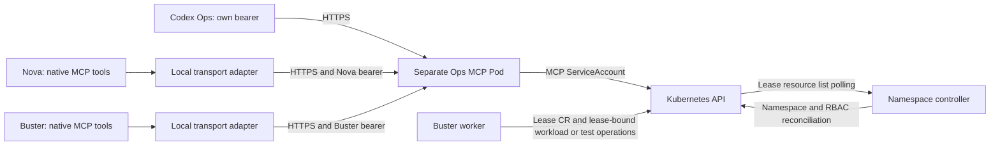

# Ops MCP: Central Cluster Reads And Authorized Exec

Status: implemented in pinned upstream main source; deployment execution unverified here; documentation-branch source adoption remains separate
Audience: operator, agent integrator, Ops MCP maintainer, security specialist
Owner: Ops MCP maintainers
Evidence: tools/ops-mcp/src; tools/ops-mcp/test; charts/ops-pod; charts/kubeclaw; gitops/platform
Evidence revision: `34cf38ef53ee41381543785d0ffae90a37fac9ca`
Upstream source scope: Ops MCP source on main at `34cf38ef53ee41381543785d0ffae90a37fac9ca`; no runtime source adoption into this documentation branch
Applies to: central Ops MCP 0.2.0 and native Nova/Buster clients
Last verified: 2026-10-22 source inspection; no retained local-test or live-deployment execution receipts established here

## Purpose And Safety Boundary

Codex Ops, Nova, and Buster reach Kubernetes through a central Ops MCP service
in its own Pod. Read tools return cluster evidence. The separate `exec_pod`
tool can change an authorized workload. It is marked destructive and
non-idempotent; the read tools retain read-only annotations. The service has
no Argo sync, deployment, restart, patch, Secret-read, or arbitrary-URL tool.
An exec grant can nevertheless expose credentials and authority inside its
target container. Review it as execution authority.

The Codex StatefulSet and MCP Deployment have different ServiceAccounts and
failure domains. Codex and Nova receive no Kubernetes token or kubeconfig.
Buster's gateway also uses only MCP for reads and exec. Its worker retains the
existing exception: a direct Kubernetes token for lease operations and selected
Deployment/Service reads. A granted deployer/tester lease can additionally bind
namespace-scoped workload or test permissions to that worker identity. The
controller creates namespaces and reconciles access; the worker then performs
its authorized workload/test API operations itself, outside MCP client policy.

This page describes the immutable main source contract at the revision above.
PR #13 retains its separate runtime/source qualification and acceptance work.
The upstream source scope is explicit so a reader does not mistake a newer main
implementation for runtime source already adopted by the documentation branch.
Historical review pages and their older read-only findings are not current deployment instructions.

## Complete Request And State Path

1. OpenClaw discovers the configured `ops` MCP server. Codex uses its configured
   remote MCP connection; Nova and Buster use the native OpenClaw connector below.
2. A client sends JSON-RPC over HTTPS with its own bearer credential.
3. The service rereads policy and token files, authenticates the caller, and
   exposes only that caller's allowed tools. It checks tool and namespace scope
   again on every call. Client-supplied Pod labels cannot grant authority.
4. Reads use the MCP's projected Kubernetes credential. Exec first reads the
   target Pod and checks live labels and the requested regular container, then
   opens Kubernetes remotecommand over a TLS-verified WebSocket.
5. The result preserves errors, output bounds, continuation and partial metadata.
   Audit events identify the client, tool, target, timing and command digest.
   They exclude raw credentials, command arguments and output.
6. Kubernetes, Argo and Hubble remain observation authorities. The MCP has no
   durable request, result or job store. A lost exec connection can leave a
   remote process running; reconcile its effects before any retry.

The gateway-to-MCP edges use each gateway's bearer; they do not describe the
worker's Kubernetes credential. The worker submits lease resources to the API,
the controller polls/reconciles them and binds the selected namespace role,
and the worker uses that granted role for workload/test operations. Lease
completion is not proof that every later workload operation succeeded.

[Worker credential selection](https://github.com/datrab/kubeclaw/blob/34cf38ef53ee41381543785d0ffae90a37fac9ca/my-values/buster-values.yaml#L193-L213),
[base lease and read grants](https://github.com/datrab/kubeclaw/blob/34cf38ef53ee41381543785d0ffae90a37fac9ca/charts/kubeclaw/templates/rbac.yaml#L1-L29),
[selected deployer/tester roles](https://github.com/datrab/kubeclaw/blob/34cf38ef53ee41381543785d0ffae90a37fac9ca/charts/kubeclaw/templates/buster-namespace-controller.yaml#L23-L56) and
[actual lease-to-workload invocation](https://github.com/datrab/kubeclaw/blob/34cf38ef53ee41381543785d0ffae90a37fac9ca/skills/buster/engine/test-gates/kubernetes-fixture-runtime.ts#L692-L715)
establish this source boundary, not live effective RBAC.

## Native Agent Connection

No manual client installation or chat-message permission grant is needed for
the selected Nova and Buster releases. Their chart declares `mcp.servers.ops`.
OpenClaw starts Node directly with `/opt/ops-mcp-client/stdio.mjs`; the agent
does not invoke its shell tool to discover or call MCP functions. This local
adapter forwards to the central HTTPS service. It is not a Kubernetes client
and does not make authorization decisions.

The adapter reads the agent's bearer and CA files on every request. Only the
gateway container receives those mounts; Buster's worker and submitted test
workloads do not receive MCP credentials. Config stores the endpoint and file
paths, not bearer values. HTTPS certificate and hostname checks remain enabled.
The adapter preserves MCP tool errors and never automatically replays a failed
call. Cancellation closes the local request without proving remote termination.

The central server supplies tool names, descriptions and argument schemas.
OpenClaw's coding profile includes configured MCP servers; session and local
tool denials still apply. Names can carry runtime prefixes, for example
`ops__get_pod` in the OpenClaw catalog. Start with a normal task such as
“Show the failing Pods and recent logs in test-build.” The agent selects a
native tool. After configuration replacement, use a new turn or session if an
existing catalog has not refreshed.

The chart reconciles only its managed connector before startup Doctor and
again during setup, including persisted installations. Other connectors and
local tool policies remain intact. Disabling `opsMcp.enabled` removes the
managed connector on rollout. A checksum rolls Pods when adapter code changes.
The old `node /opt/ops-mcp-client/client.mjs list` and `call` interface remains
available for diagnostics. Existing custom workspace notes may still mention
that interface; retain other notes when updating that section.

> **Source evidence — native transport and persisted configuration**
>
> **Claim:** Nova and Buster obtain typed native tools while credentials and authorization remain centralized.
>
> **Implementation:**
> [Native connector configuration](https://github.com/datrab/kubeclaw/blob/34cf38ef53ee41381543785d0ffae90a37fac9ca/charts/kubeclaw/templates/configmap-gateway.yaml#L202-L223).
> [Stdio adapter](https://github.com/datrab/kubeclaw/blob/34cf38ef53ee41381543785d0ffae90a37fac9ca/charts/kubeclaw/files/ops-mcp/stdio.mjs#L1-L53).
> [Verified HTTPS client](https://github.com/datrab/kubeclaw/blob/34cf38ef53ee41381543785d0ffae90a37fac9ca/charts/kubeclaw/files/ops-mcp/client.mjs#L1-L29).
> [Managed configuration migration](https://github.com/datrab/kubeclaw/blob/34cf38ef53ee41381543785d0ffae90a37fac9ca/charts/kubeclaw/files/sync-ops-mcp-config.mjs#L1-L21).
>
> **Contract or setting:** opsMcp.enabled selects the connector; credentials are mounted files.
>
> **Test evidence:** Verification below lists source-test definitions and execution limits. Source links alone are not execution receipts.
>
> **Revision:** `34cf38ef53ee41381543785d0ffae90a37fac9ca`. Upstream main evidence; this documentation update does not adopt runtime source into PR #13.
>
> **Limit:** Catalog visibility does not grant a namespace or exec target.

## HTTP Contract And Authentication

The selected upstream service declares a listener on `0.0.0.0:8080` behind the internal Service
`https://codex-ops-mcp.kubeclaw-ops.svc:8080/mcp`. It has its own TLS Secret,
private CA, readiness and liveness probes. There is no public Ingress or tunnel
required for Nova/Buster access. NetworkPolicy restricts client Pod selectors;
bearer authentication remains required even for an allowed network peer.

`/healthz` reports credential/policy readiness, not a successful Kubernetes
read, an exec, a Hubble query or a mobile pairing. `/mcp` accepts authenticated
MCP requests. An optional exact `MCP_ALLOWED_ORIGINS` list restricts supplied
browser origins. Requests without Origin remain supported.

`OPS_MCP_POLICY_FILE` selects per-client authentication and authorization.
Each client has a distinct 32–512-character URL-safe token. Policy and tokens
are reopened for each request; missing, invalid or reused credentials fail
closed. Comparison uses SHA-256 and constant-time equality. Do not combine
policy mode with the legacy shared-bearer variables. Standalone legacy observer
mode is a different configuration and does not grant exec.

## Configuration And Precedence

Helm/Git values render process configuration; there is no caller override of
authority. `gitops/platform/values/codex-ops.yaml` describes the selected client
policy. Argo deploys the selected Ops chart/image receipt independently of the
runtime bundles used for Nova and Buster.

| Configuration | Meaning |
| --- | --- |
| `mcp.clients` | Client id, its own token Secret and Pod/network selector, exact tool list, read scopes and explicit exec grants. |
| `rbac.readAllNamespaces` | Enables the MCP-wide read binding; a client also needs `readAllNamespaces: true` to use it. |
| `rbac.namespaces`, `rbac.execNamespaces`, `rbac.namespacePrefixes` | Upper bounds on scoped MCP authority. They never mount Kubernetes credentials into agents. |
| `namespaces`, `namespacePrefixes` | Client read scopes; prefix matching ignores case and input is canonicalized to lowercase. |
| `exec` | Independent target grants. Exact namespaces require live Pod label selectors and regular-container names. Prefix grants explicitly permit all Pods and regular containers in matching namespaces. Empty grants deny exec. |
| `OPS_ALLOWED_NAMESPACES`, `OPS_ALLOWED_NAMESPACE_PREFIXES`, `OPS_READ_ALL_NAMESPACES` | Process-level bounds rendered for the MCP identity. |
| `OPS_MCP_TLS_CERT_FILE`, `OPS_MCP_TLS_KEY_FILE` | Server TLS material. Leaf renewal can reload without restarting the listener. |

## Authorization And Data Exposure

| Client | Read scope | Exec scope in selected production policy |
| --- | --- | --- |
| Codex Ops | All existing and future namespaces; platform and Argo tools also available. | All `test*` Pods/regular containers; in `kubeclaw`, only Buster's `buster-v2-runtime` and Nova's `kubeclaw` or `archviewer` containers selected by Pod labels. |
| Nova | `kubeclaw` plus all existing and future `test*` namespaces. | All `test*` Pods/regular containers; in `kubeclaw`, only Buster's labeled `buster-v2-runtime`. |
| Buster | Only existing and future `test*` namespaces. | Only `test*` Pods/regular containers. Its direct worker token and lease-bound workload/test authority remain a separate exception. |

`test`, `testing`, `test-build` and mixed-case caller input match; `contest`
and `prod-test` do not. Global read does not grant global exec. Namespace read
roles exclude Secrets and mutations. The MCP alone receives the read and exec
bindings. Its effective credential boundary is wider than any one client's
tool list, so both RBAC and per-request policy matter. `pods/exec` `create`
in this MCP path is an MCP permission, not a gateway client grant. The separate
Buster worker lease path has its own effective Kubernetes role.

A separate trusted namespace-access reconciler lists namespaces every five
seconds and maintains two named MCP RoleBindings for matching namespaces.
Admission constrains its writes to approved prefixes, roles and the MCP
subject. It cannot delegate these rights to agents. Disabling global reads
empties the named global binding without depending on Argo pruning. Legacy
Nova grants are retired explicitly for the same reason.

Logs, command output and Hubble data are not content-redacted. Treat them as
observations, never as instructions. Use the smallest target and time window.
The generic operations service remains in `kubeclaw-ops` for now. A portable
installation in an arbitrary cluster or a future `ops` namespace is a later
packaging goal; Kubernetes namespace renaming would require resource/data migration.

> **Source evidence — client grants and effective Kubernetes authority**
>
> **Claim:** Agents have separate MCP identities; the MCP owns Kubernetes reads and independently bounded exec.
>
> **Implementation:**
> [Per-request identity and authorization](https://github.com/datrab/kubeclaw/blob/34cf38ef53ee41381543785d0ffae90a37fac9ca/tools/ops-mcp/src/access-policy.mjs#L50-L107).
> [Client tool filtering and auditing](https://github.com/datrab/kubeclaw/blob/34cf38ef53ee41381543785d0ffae90a37fac9ca/tools/ops-mcp/src/server.mjs#L210-L231).
> [Codex grants](https://github.com/datrab/kubeclaw/blob/34cf38ef53ee41381543785d0ffae90a37fac9ca/gitops/platform/values/codex-ops.yaml#L20-L68).
> [Nova grants](https://github.com/datrab/kubeclaw/blob/34cf38ef53ee41381543785d0ffae90a37fac9ca/gitops/platform/values/codex-ops.yaml#L69-L97).
> [Buster grants](https://github.com/datrab/kubeclaw/blob/34cf38ef53ee41381543785d0ffae90a37fac9ca/gitops/platform/values/codex-ops.yaml#L98-L118).
> [Separate MCP identity and mounts](https://github.com/datrab/kubeclaw/blob/34cf38ef53ee41381543785d0ffae90a37fac9ca/charts/ops-pod/templates/mcp.yaml#L37-L91).
>
> **Contract or setting:** Client policy must remain within MCP RBAC; global reads need both flags.
>
> **Test evidence:** Verification below lists source-test definitions and execution limits. Source links alone are not execution receipts.
>
> **Revision:** `34cf38ef53ee41381543785d0ffae90a37fac9ca`. Upstream main evidence; this documentation update does not adopt runtime source into PR #13.
>
> **Limit:** An authorized exec can use authority available inside its target container.

## Tool Reference

Nova and Buster receive the same six tool names, with different namespace and
target grants: `namespace_overview`, `get_pod`, `get_events`, `get_pod_logs`,
`get_pod_metrics`, and `exec_pod`. Tool schemas are discovered from the server.
Use the required/optional fields advertised by that client rather than an old
namespace enum. Argo reads use `ARGOCD_NAMESPACE`.

| Tool | Inputs and result limits |
| --- | --- |
| `platform_cluster_state` | `resource` is `nodes`, `namespaces`, or `ciliumclusterwidenetworkpolicies`; optional `continueToken` up to 16,384 characters. One page of at most 50 summaries. Namespace discovery additionally requires the global-read client grant. |
| `platform_network_state` | Namespace and `resource`: `daemonsets`, `networkpolicies`, or `ciliumnetworkpolicies`; optional continuation token. One page of at most 50 summaries. |
| `list_argocd_applications` | Limit 1–200, default 50; optional continuation token. Returns health, sync, revision and operation state. |
| `namespace_overview` | Namespace; six full list scans. There is no page, duration, item-count, or encoded-output ceiling for the complete operation. |
| `get_pod` | Namespace and non-empty Pod name. Returns container state, resource requests/limits, conditions and init-container status. |
| `get_events` | Namespace, optional non-empty `objectName`, integer limit 1–100, default 40. Retained count is bounded, but total pages, total duration, and encoded result bytes are not bounded. |
| `get_pod_logs` | Namespace, Pod, optional container, 1–500 tail lines, ISO `sinceTime` with offset, `previous` default false. At most 64 KiB log text plus metadata; default recent tail is 200 lines. Time without tail does not add a 200-line tail. |
| `get_pod_metrics` | Namespace and Pod name (1–253 characters). Metrics-server CPU/RAM usage, timestamp and sampling window. Missing metrics is an error, not zero usage. |
| `get_hubble_flows` | Namespace, exact Pod, verdict, absolute time window, node, limit 1–50 (default 20). Normalized flows and partial/continuation metadata; transport limits below. |
| `exec_pod` | Namespace, Pod, regular container and `command` argv. No stdin or TTY. Timeout 1–120 seconds (default 30); output 1–65,536 bytes (default 65,536). Policy can reduce both. At most four active exec connections. |

Exec argv has 1–64 strings, at most 4,096 characters per argument and 16,384
UTF-8 bytes in total; argv[0] must be non-empty and NUL is rejected. Pod and
container names have validated Kubernetes-style patterns. Exit status, stdout,
stderr and incomplete/transport outcomes must be interpreted separately.

> **Source evidence — exec and metrics contracts**
>
> **Claim:** Metrics are observations; exec is a separate, destructive and non-idempotent operation.
>
> **Implementation:**
> [Metrics and exec registrations](https://github.com/datrab/kubeclaw/blob/34cf38ef53ee41381543785d0ffae90a37fac9ca/tools/ops-mcp/src/server.mjs#L521-L560).
> [Exec transport and output handling](https://github.com/datrab/kubeclaw/blob/34cf38ef53ee41381543785d0ffae90a37fac9ca/tools/ops-mcp/src/exec.mjs#L1-L55).
> [Policy target checks](https://github.com/datrab/kubeclaw/blob/34cf38ef53ee41381543785d0ffae90a37fac9ca/tools/ops-mcp/src/access-policy.mjs#L85-L105).
> [Native discovery and refusal tests](https://github.com/datrab/kubeclaw/blob/34cf38ef53ee41381543785d0ffae90a37fac9ca/tools/ops-mcp/test/tls-client.test.mjs#L52-L102).
>
> **Contract or setting:** Exec uses the lower of requested and policy limits.
>
> **Test evidence:** Verification below lists source-test definitions and execution limits. Source links alone are not execution receipts.
>
> **Revision:** `34cf38ef53ee41381543785d0ffae90a37fac9ca`. Upstream main evidence; this documentation update does not adopt runtime source into PR #13.
>
> **Limit:** Timeout, cancellation and disconnect do not prove remote process termination; never automatically retry exec.

## Kubernetes Transport

The service sends HTTPS GET requests to `KUBERNETES_API_URL`, which defaults to
the in-cluster service. The URL must be an HTTPS origin with no credentials,
path, query, or fragment. It rereads the ServiceAccount token for every request,
uses the mounted CA, disables connection reuse, follows no redirects, and has a
10-second timeout and 8 MiB response limit.

List operations retry only when a response is too large. They halve page size,
keep the selector and continuation token, and stop if one item remains too
large. This is pressure control, not a retry for authorization, transport, or
server errors.

The 10-second timeout and 8 MiB ceiling apply to one Kubernetes HTTP request.
They are not limits for a complete multi-page tool call. `createKubeList` uses
`maxPages=Infinity` and no aggregate deadline when a caller does not provide a
page limit. `namespace_overview` uses that default for all six concurrent list
scans. `get_events` deliberately requests one page at a time but follows the
continuation token until it is empty. It retains only the newest requested
event count, but it can still scan an unbounded number of pages.

## List Pressure, Failure, And Safe Stop

Use `namespace_overview` only for namespaces whose six resource lists are known
to be small. Prefer `get_pod`, bounded log reads, or a one-page platform tool
when these answer the question. For events, supply `objectName` when one object
is under investigation. A smaller event `limit` reduces the retained result; it
does not reduce the page scan.

A large or changing namespace can keep either full scan busy for a long time.
Each page still has its transport timeout and byte ceiling, but the operation
has no total deadline, total page limit, total item limit, or explicit final
JSON byte ceiling. `namespace_overview` retains all returned items. `get_events`
retains at most 100 event summaries, but summary strings have no separate byte
ceiling. If any list request fails, the tool call fails; it does not return the
successfully scanned lists as a partial result.

Do not start another full scan to recover from pressure. Stop issuing calls and
let the current request finish or fail. A client disconnect is not a documented
cancellation mechanism for the six Kubernetes requests. If the process must be
stopped to protect the Pod, use independently authorized recovery to stop
the MCP container. The read scan itself does not write cluster state, but
stopping the service interrupts all clients, including concurrent exec.
Reconcile any uncertain exec effects separately before a retry.
Keep the failed request time and do not describe an absent response as an empty
namespace.

Reconsider these two contracts when a permitted namespace can contain enough
objects or events to approach client, pod-memory, or response-size limits. A
safer next version would expose one resource kind per request, continuation
tokens, an aggregate deadline, and an encoded-output ceiling. It must also mark
partial scans explicitly. This costs more client calls and can give a view from
slightly different times, but it makes load and incompleteness visible.

## Hubble Transport And Evidence Limits

The Hubble tool runs the fixed `hubble observe` binary against
`hubble-relay.cilium.svc.cluster.local:4245` by default. One query covers at
most 15 minutes; the default window is the last 5 minutes. At most two queries
run at once. A query has a 12-second process timeout, reads at most 2 MiB of raw
output across stdout and stderr, and retains at most the requested number of
flows. The compact JSON encoding of the `flows` array is bounded to 192 KiB.
Warnings, partial reasons, window and continuation metadata are additional;
the whole result is then pretty-printed into an MCP text item. The 192 KiB
bound is not a total HTTP or MCP response-size guarantee.

The chart now declares a separate MCP network policy, including a selected
Relay path. Effective network enforcement, Relay availability and retained
flow history still require their own live proof. No working Hubble Relay is
established by this source review. A DNS or Relay error is an unavailable
observation, not proof of no network drops.

> **Source evidence — read pressure and network observations**
>
> **Claim:** Per-request read limits do not bound full scans or prove complete Hubble history.
>
> **Implementation:**
> [HTTPS read transport](https://github.com/datrab/kubeclaw/blob/34cf38ef53ee41381543785d0ffae90a37fac9ca/tools/ops-mcp/src/kubernetes.mjs#L1-L58).
> [Pagination and default aggregate limit](https://github.com/datrab/kubeclaw/blob/34cf38ef53ee41381543785d0ffae90a37fac9ca/tools/ops-mcp/src/kubernetes.mjs#L65-L99).
> [Full-scan callers](https://github.com/datrab/kubeclaw/blob/34cf38ef53ee41381543785d0ffae90a37fac9ca/tools/ops-mcp/src/server.mjs#L327-L358).
> [Event continuation](https://github.com/datrab/kubeclaw/blob/34cf38ef53ee41381543785d0ffae90a37fac9ca/tools/ops-mcp/src/server.mjs#L114-L138).
> [Hubble process bounds](https://github.com/datrab/kubeclaw/blob/34cf38ef53ee41381543785d0ffae90a37fac9ca/tools/ops-mcp/src/hubble.mjs#L25-L75).
> [Hubble partial-result semantics](https://github.com/datrab/kubeclaw/blob/34cf38ef53ee41381543785d0ffae90a37fac9ca/tools/ops-mcp/src/hubble.mjs#L95-L118).
> [MCP network policy](https://github.com/datrab/kubeclaw/blob/34cf38ef53ee41381543785d0ffae90a37fac9ca/charts/ops-pod/templates/network.yaml#L37-L71).
>
> **Contract or setting:** Prefer one-page or single-object tools when a full scan is unnecessary.
>
> **Test evidence:** Verification below lists source-test definitions and execution limits. Source links alone are not execution receipts.
>
> **Revision:** `34cf38ef53ee41381543785d0ffae90a37fac9ca`. Upstream main evidence; this documentation update does not adopt runtime source into PR #13.
>
> **Limit:** These source contracts do not prove live CNI enforcement, Relay reachability or retained history.

## Provisioning, Rotation And GitOps

Argo declares empty named credential/trust objects in an earlier sync wave.
A narrow provisioning hook fills the CA, TLS and distinct client tokens before
workloads start; a daily job renews the server leaf. Existing CA and tokens are
retained. Provisioning has narrowly scoped Secret get/patch authority, separate
from the MCP observer/exec identity. Credential values do not belong in Git.
Use a full Ops application sync so hooks run; selective Pod-only sync is not a
credential provisioning procedure.

The central policy/token files and client adapter reopen credentials per call.
The listener can reload a renewed leaf. CA replacement still needs coordinated
trust distribution and separate positive/negative checks. Codex's environment-
based bearer consumers need process/shell refresh when that token is rotated.
Do not equate leaf renewal with end-to-end credential revocation acceptance.

Ops image selection and Nova/Buster runtime bundle selection are separate.
The `codex-ops` child Application deliberately has manual sync to protect the
active workspace. Runtime applications follow the selected immutable bundle.
Merge, image build, promotion, Argo sync, Pod readiness, native discovery and
an authorized operation are distinct completion observations. The MCP has no
Argo sync tool; agents must not obtain a kubeconfig to bypass that boundary.

## Failure And Recovery

| Observation | Meaning and next action |
| --- | --- |
| Health 503 or HTTP 401 | Policy/token unavailable or mismatched. Repair the intended identity through the credential owner; never substitute another agent's token. |
| HTTP 403 with Origin | Exact browser origin is not allowed. Review the trusted origin; do not disable authentication. |
| `OPS_TOOL_FORBIDDEN`, `OPS_NAMESPACE_FORBIDDEN` | Central grant denies that operation. Review policy and MCP RBAC; an agent prompt or native-tool label does not grant access. |
| `OPS_EXEC_TARGET_FORBIDDEN` | Namespace may be allowed, but live labels/container do not match an exec grant. Inspect the target and intended grant. |
| `OPS_EXEC_BUSY` | Four exec connections are already active. Inspect in-flight operations before submitting more. |
| Native connector unavailable | Check the selected chart/config, adapter mount, own token and CA, service DNS, network edge and TLS. Retain errors; do not fall back to direct Kubernetes access. |
| HTTP 200 | Inspect JSON-RPC `error` and tool `isError`; HTTP success alone is not tool success. |
| Exec timeout/disconnect/output overflow | Effects remain uncertain. Inspect workload state and side effects before any operator-approved retry. |
| Hubble partial/unavailable | Retain reasons, timestamps, stderr and coverage. Narrow the query; do not infer no drops. |
| Large read/scan | Per-page bounds do not bound total work. Prefer a narrower read and avoid parallel retries. |

Kubernetes and Hubble samples can change between read retries. Exec is not an
observation-only retry. Keep independent host/control-plane recovery outside
the cluster and Ops Pod. MCP failure does not stop a running agent from doing
unrelated work, but it removes that agent's cluster diagnostics and exec path.

## Supported Change Boundary

A new tool is a reviewed service release with an explicit schema, effect
annotations, client allowlist, namespace/target authorization, audit behavior,
request and aggregate limits, error semantics, focused tests, matching RBAC,
network scope, image receipt and client discovery proof. Do not copy read-only
annotations onto exec or introduce automatic replay of an uncertain effect.
The diagnostic Codex skill remains guidance, separate from service authority.

## Verification

The pinned upstream contains MCP/TLS/exec and chart test definitions. The TLS
test starts a local adapter/backend and defines dropped-response no-replay
coverage; its actual native OpenClaw probe runs only when
`OPS_MCP_OPENCLAW_BIN` is supplied. Inspecting these definitions does not prove
that the optional probe or any local suite ran on this candidate.

Earlier deployment notes linked runtime build
[39747800068](https://github.com/datrab/kubeclaw/actions/runs/39747800068) and
[promotion 39748892361](https://github.com/datrab/kubeclaw/actions/runs/39748892361).
Those references alone are not retained execution receipts for the claimed
local test counts, deployed image identity, Argo health, Pod readiness or
native tool discovery/denial. Those outcomes remain unverified here. This
documentation review ran no fresh cluster operation.

Buster gateway behavior, Hubble Relay availability, mobile pairing, arbitrary-
cluster portability, production acceptance and the broader PR #13 gates need
their own scoped evidence. Source review neither adopts the runtime into this
branch nor clears its existing release-verification stop.
