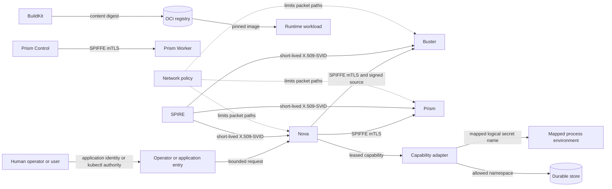

# Security and Trust

Status: implemented in parts; live enforcement and acceptance remain environment-specific
Audience: operator, security reviewer, architecture reader, maintainer
Owner: platform security and runtime maintainers
Evidence: my-values/infra/spire-values.yaml; charts/kubeclaw/templates/configmap-worker-trust.yaml; charts/prism/templates/networkpolicy.yaml; skills/nova/core/execution/authorization.ts; my-values/setup-secrets.sh; skills/nova/core/test-gates/source-snapshot.ts
Evidence revision: `13bff0a18a64e74f2cbbaa1978e746fcdeff0c10`
Upstream source scope: Ops changes on main at `34cf38ef53ee41381543785d0ffae90a37fac9ca`; runtime source adoption into this documentation branch remains separate
Applies to: the current supported release and its documented lab deployment
Last verified: 2026-09-20; diagram boundary correction source-checked on 2026-10-21; no live result

## Purpose

KubeClaw runs code, reads repositories, starts test workloads, and stores evidence.
These actions cross several trust boundaries.
This page explains how the system identifies callers, limits authority, protects traffic, handles secrets, and verifies software inputs.

The design does not depend on one security control.
It uses several smaller controls because each control answers a different question.
A network rule answers where a packet can travel.
A workload certificate answers which workload connected.
A capability grant answers which operation a plugin can request.
A digest answers whether bytes changed.
None of these answers all four questions.

This page describes the implemented controls and their limits.
It does not claim that a rendered manifest proves enforcement in a live cluster.

## Evidence Classes

Use the evidence class before you make a security claim.

| Class | What it establishes | What it does not establish |
| --- | --- | --- |
| Source | A checked function, schema, template, or values file contains a rule at the pinned revision | That Helm selected the rule or that a cluster enforces it |
| Render | The supported renderer produced a Kubernetes object and effective field values for one input set | That the API server admitted it, the CNI enforces it, or a Pod uses it |
| Live | A named cluster, namespace, workload identity, request, and negative request produced retained observations | Enforcement in another cluster, after configuration drift, or beyond the tested path |

Unit and contract tests are source-level execution evidence. Image inspection is
target-image evidence. Neither is live cluster evidence. A live positive request
alone is also insufficient: the corresponding wrong identity, missing grant, or
denied network path must fail at the intended boundary.

The source links on this page establish source behavior only. Repository render
checks establish selected object structure. This page has no stored live result
for SPIFFE issuance, CNI enforcement, Tailscale ACLs, Secret rotation, registry
authentication, or an adversarial supply-chain path.

## Security Goals and Assumptions

The current design has these goals:

- A worker accepts requests only from an explicitly allowed workload identity.
- A plugin receives only the capabilities and resource ranges that its stage lease grants.
- A network path stays closed unless a policy names its caller, destination, and port.
- Buster executes the exact committed source archive that Nova signed.
- Stored records and artifacts keep stable identities so that recovery does not depend on a mutable name.
- Secret values do not enter the repository or ordinary documentation.
- An optional operations tool does not silently become pipeline authority.

The design assumes that the Kubernetes control plane, the node operating system, and the SPIRE server are trusted administrative systems.
An administrator who controls these systems can replace workloads, policies, or identity material.
KubeClaw reduces application-level authority; it does not protect a cluster from its own administrator.

The design also assumes that operators protect signing keys, backup media, registry credentials, and external provider credentials.
Kubernetes Secrets are an access boundary, but they are not a hardware security module.

## Trust Boundary Map

**Text alternative to the diagram**

Each row names a directed connection. Labels preserve the diagram’s conditions or handoffs; dotted relationships are identified explicitly.

| From | Relationship | To |
| --- | --- | --- |
| Human operator or user | Directed connection — application identity or kubectl authority | Operator or application entry |
| Operator or application entry | Directed connection — bounded request | Nova |
| Nova | Directed connection — SPIFFE mTLS and signed source | Buster |
| Nova | Directed connection — SPIFFE mTLS | Prism |
| Prism Control | Directed connection — SPIFFE mTLS | Prism Worker |
| Nova | Directed connection — leased capability | Capability adapter |
| Capability adapter | Directed connection — mapped logical secret name | Mapped process environment |
| Capability adapter | Directed connection — allowed namespace | Durable store |
| BuildKit | Directed connection — content digest | OCI registry |
| OCI registry | Directed connection — pinned image | Runtime workload |
| SPIRE | Directed connection — short-lived X.509-SVID | Nova |
| SPIRE | Directed connection — short-lived X.509-SVID | Buster |
| SPIRE | Directed connection — short-lived X.509-SVID | Prism |
| Network policy | Dotted relationship — limits packet paths | Nova |
| Network policy | Dotted relationship — limits packet paths | Buster |
| Network policy | Dotted relationship — limits packet paths | Prism |

Text version: humans enter through an operator or application boundary. Nova delegates work through explicit leases. Protected worker calls use SPIFFE mutual TLS. The Nova-to-Buster path also carries a signed, immutable source snapshot. Capability adapters mediate access to secrets and durable stores. BuildKit sends content to a registry, and deployments select immutable image identities. Network policy limits which of these paths packets can use.

> **Source evidence — Secret resolution reads the mapped process environment**
>
> **Claim:** The secret adapter maps a logical secret name to an environment variable and returns its value.
>
> **Implementation:** [Complete adapter resolution path](https://github.com/datrab/kubeclaw/blob/13bff0a18a64e74f2cbbaa1978e746fcdeff0c10/skills/common/plugins/secret-resolver/src/adapter.ts#L3-L19)
>
> **Contract:** [Selected plugin and configuration schema](https://github.com/datrab/kubeclaw/blob/13bff0a18a64e74f2cbbaa1978e746fcdeff0c10/skills/common/plugins/secret-resolver/plugin.json#L1-L19) describes the adapter registration; it does not grant Kubernetes Secret API access.
>
> **Test:** [Secret resolver local-function test](https://github.com/datrab/kubeclaw/blob/13bff0a18a64e74f2cbbaa1978e746fcdeff0c10/skills/common/plugins/secret-resolver/tests/live-function.test.ts#L7-L41) Source inspected; not executed for this correction.
>
> **Checked revision:** `13bff0a18a64e74f2cbbaa1978e746fcdeff0c10`.
>
> **Limit:** Kubernetes may supply process environment separately. This adapter does not fetch Kubernetes Secrets or establish their RBAC or rotation behavior.

## One Request Passes Several Independent Checks

| Question | Control | Rejected condition | Why the control is separate |
| --- | --- | --- | --- |
| Which workload connected? | SPIRE X.509-SVID and Envoy mutual TLS | Missing certificate, untrusted trust domain, or wrong URI SAN | An IP address is not a stable identity. |
| Did the request come through the trusted proxy? | Worker Core loopback check | The identity header comes from a non-loopback peer | An application header alone is easy to forge. |
| May this workload call this worker? | Exact SPIFFE-ID allowlist | The verified identity is not an allowed peer | A valid platform identity does not grant access to every service. |
| May this plugin request this operation? | Revocable lease and capability constraints | The capability, path, namespace, name, origin, or executable is outside the grant | Workload identity is broader than one plugin attempt. |
| Can the packet reach the port? | Default-deny and allow policies | No policy selects the path | Authentication should not make every service reachable. |
| Are these the intended bytes? | Git identity, signature, and content digest | Revision, signature, archive digest, plan digest, or request digest differs | Caller identity does not prove content identity. |

> **Source evidence — application authorization**
>
> **Claim:** Application authorization combines trusted peer admission with per-invocation capability and resource checks.
>
> **Implementation:** Worker proxy authorization, invocation context and resource predicates below implement separate checks.
>
>
> [Worker Core requires a loopback proxy, parses one SPIFFE URI, and checks an exact allowlist](https://github.com/datrab/kubeclaw/blob/13bff0a18a64e74f2cbbaa1978e746fcdeff0c10/skills/worker/core/worker/trust.ts#L17-L52).
>
> [Nova denies missing capabilities and checks every invocation against its lease](https://github.com/datrab/kubeclaw/blob/13bff0a18a64e74f2cbbaa1978e746fcdeff0c10/skills/nova/core/execution/context.ts#L34-L79).
>
> [Capability authorization limits paths, namespaces, secret names, agents, and
> network origins](https://github.com/datrab/kubeclaw/blob/13bff0a18a64e74f2cbbaa1978e746fcdeff0c10/skills/nova/core/execution/authorization.ts#L39-L98).
> [It also constrains executable, telemetry, wait, and operator resources](https://github.com/datrab/kubeclaw/blob/13bff0a18a64e74f2cbbaa1978e746fcdeff0c10/skills/nova/core/execution/authorization.ts#L99-L130).
>
> **Contract or setting:** Loopback proxy, exact SPIFFE peer, current lease and constrained resource apply to their selected paths.
>
> **Test evidence:** No live wrong-SVID, forged-header or missing-grant exercise is established by these source links.
>
> **Revision:** `13bff0a18a64e74f2cbbaa1978e746fcdeff0c10`. Source bindings, not execution receipts.
>
> **Limit:** Network reachability and Kubernetes rights do not substitute for plugin or domain permission.
>

## Identity Types Must Not Be Confused

| Identity | Subject | Used for | Not used for |
| --- | --- | --- | --- |
| Human application identity | A person or external client | Sign-in, application roles, and product actions when that integration is enabled | Workload-to-workload authentication |
| Tailscale identity headers | A tailnet user/device presented by the owning ingress proxy | Prism Studio ingress exchange after source-proxy and shared-secret checks | Kubernetes API identity, SPIFFE identity, or independent proof without the trusted ingress |
| Kubernetes ServiceAccount | A pod workload | Kubernetes API authorization and the input to SPIRE workload selection | Human sign-in or source integrity |
| Projected ServiceAccount token | One Pod and audience for a bounded period | Kubernetes API or product-decision controller calls that explicitly mount it | General Pod identity on services that do not validate that token |
| SPIFFE ID | A running workload | Mutual TLS peer identity on protected internal routes | Long-term artifact signing |
| Gateway bearer token | One OpenClaw gateway client path | HTTP/WebSocket gateway authentication for the configured agent | Plugin capability, Kubernetes access, or source approval |
| Buster plan bearer token | Nova remote-plan client | Buster plan HTTP authentication when SPIFFE-proxy mode is not selected | Signed source provenance or permission to execute arbitrary plans |
| Prism shared HMAC secrets | Studio, Control, Worker, or ingestion caller on the configured fallback path | Body/session/ingress/dispatch authentication where the chart enables it | SPIFFE peer identity; production values can select SPIFFE instead |
| Stage lease | One plugin attempt | Capability names and resource constraints | Network encryption or Kubernetes RBAC |
| Ed25519 source authority | Nova source-snapshot signer | Nova-to-Buster committed-source provenance | General image signing or human identity |
| Ed25519 product-decision authority | Configured Prism Control signer | Short-lived accepted product-decision envelope | Source, image, or transport identity |
| Registry credential | BuildKit, runtime, or node client | OCI push/pull at one configured HTTPS registry | Authorization for an anonymous HTTP lab registry or image safety |
| Git revision and tree | A committed source state | Selecting exact source bytes | Proving who approved or deployed those bytes |
| SHA-256 digest | An archive, request, plan, artifact, package, or image | Change detection and immutable references | Proving that the content is safe |

Human identity is intentionally separate from workload identity.
An application identity provider can authenticate a person, but it does not issue the SPIFFE certificate used by a worker route.
The current repository contains integration settings for application identity where a component uses them.
This page does not claim that one identity provider is required for every deployment.

The implemented Prism Studio path uses Tailscale identity headers at its trusted ingress boundary.
Studio adds a shared ingress secret when it forwards the request to Control.
Control requires both that secret and a non-empty Tailscale login before it creates a local Prism session.
The session contains the user, the `prism` audience, roles, and a 15-minute expiry, and an HMAC protects its payload.
The browser receives the session in an `HttpOnly`, `Secure`, `SameSite=Strict` cookie.
A second cookie and request header implement the CSRF check for state-changing requests.

Product acceptance adds another authorization check.
The session user must appear in the explicit product-operator allowlist.
The request origin and CSRF value must match, and a dedicated Ed25519 key signs the short-lived decision envelope.
Thus, sign-in does not by itself grant product-acceptance authority.
Changing the allowlist, ingress secret, session secret, or decision key needs a coordinated restart and a new positive and negative acceptance check.
The current session format does not include an automatic multi-key overlap mechanism.

> **Source evidence — current human session path**
>
> **Claim:** Prism exchanges trusted ingress identity for a short-lived session; product acceptance adds distinct operator authority.
>
> **Implementation:** Session, Control cookie/CSRF guards and product-decision signing below define the human path.
>
>
> [Prism exchanges a trusted Tailscale ingress identity for a 15-minute HMAC session](https://github.com/datrab/kubeclaw/blob/13bff0a18a64e74f2cbbaa1978e746fcdeff0c10/skills/prism/control/session.ts#L1-L20).
>
> [Control checks the session and CSRF value](https://github.com/datrab/kubeclaw/blob/13bff0a18a64e74f2cbbaa1978e746fcdeff0c10/skills/prism/server/control-server.ts#L108-L122).
> [It creates protected cookies only through the ingress exchange](https://github.com/datrab/kubeclaw/blob/13bff0a18a64e74f2cbbaa1978e746fcdeff0c10/skills/prism/server/control-server.ts#L152-L172).
>
> [Product decisions require an explicit operator, origin and CSRF checks, and a dedicated Ed25519 signing key](https://github.com/datrab/kubeclaw/blob/13bff0a18a64e74f2cbbaa1978e746fcdeff0c10/skills/prism/control/product-decisions.ts#L20-L43).
>
> **Contract or setting:** Ingress secret/login, HMAC session, CSRF/origin and the explicit product-operator allowlist serve different checks.
>
> **Test evidence:** No deployed login, CSRF denial, signer rotation or product-acceptance journey is established here.
>
> **Revision:** `13bff0a18a64e74f2cbbaa1978e746fcdeff0c10`. Source bindings, not execution receipts.
>
> **Limit:** Sign-in alone does not authorize a product decision or issue workload identity.
>

The following workload-identity evidence describes the older documentation-
branch baseline, not the central upstream deployment. In that baseline the
selected Nova values enabled token mounting, lease operations and verification
reads. Do not apply that historical configuration to current upstream Nova:
the central model retires its direct API authority. Buster workers retain the
separate direct lease/workload exception described in [Ops MCP](ops-mcp.md#complete-request-and-state-path).
SPIRE still uses namespace and ServiceAccount identity independently of these grants.

> **Source evidence — workload identity**
>
> **Claim:** Workload identity and mounted Kubernetes token authority remain separate controls.
>
> **Implementation:** SPIRE selectors, ServiceAccount defaults, selected Nova values and RBAC below declare those boundaries.
>
>
> [SPIRE selects labeled workloads and derives the SPIFFE ID from namespace and ServiceAccount](https://github.com/datrab/kubeclaw/blob/13bff0a18a64e74f2cbbaa1978e746fcdeff0c10/my-values/infra/spire-values.yaml#L25-L40).
>
> [The KubeClaw ServiceAccount disables automatic token mounting by default](https://github.com/datrab/kubeclaw/blob/13bff0a18a64e74f2cbbaa1978e746fcdeff0c10/charts/kubeclaw/templates/serviceaccount.yaml#L1-L10).
>
> [Historical branch Nova values enabled token mounting and verification reads](https://github.com/datrab/kubeclaw/blob/0e35889a3c4e65d5c47ba88e924611aace67eb1d/my-values/nova-values.yaml#L80-L89).
> [The lease-client Role permits lease operations and Deployment and Service reads](https://github.com/datrab/kubeclaw/blob/13bff0a18a64e74f2cbbaa1978e746fcdeff0c10/charts/kubeclaw/templates/rbac.yaml#L16-L29).
> [Verification adds Pod reads and access to the named Tailscale IngressClass](https://github.com/datrab/kubeclaw/blob/13bff0a18a64e74f2cbbaa1978e746fcdeff0c10/charts/kubeclaw/templates/rbac.yaml#L57-L65).
> [A separate Role permits GET for only the configured OAuth Secret in the configured operator namespace](https://github.com/datrab/kubeclaw/blob/13bff0a18a64e74f2cbbaa1978e746fcdeff0c10/charts/kubeclaw/templates/rbac.yaml#L80-L96).
>
> **Contract or setting:** Historical branch Nova token mounting enabled the cited lease/verification/OAuth-read grants. Current upstream Nova instead uses MCP; Buster worker lease-bound roles are a separate authority.
>
> **Test evidence:** No live SVID issuance or effective Kubernetes denial result is established by these declarations.
>
> **Revision:** `13bff0a18a64e74f2cbbaa1978e746fcdeff0c10`; `0e35889a3c4e65d5c47ba88e924611aace67eb1d`. Source bindings, not execution receipts.
>
> **Limit:** Code reading a mounted token holds its effective RBAC rights despite a narrower plugin grant.
>

In any selected baseline, code that can read a mounted token holds its effective Kubernetes rights.
A plugin capability grant limits its configured adapter; it does not remove rights from the ServiceAccount token.

## SPIFFE, SPIRE, Envoy, and Worker Core

The trust domain is `kubeclaw.internal`.
An identity has this form: `spiffe://kubeclaw.internal/ns/<namespace>/sa/<service-account>`.
SPIRE attests the Kubernetes workload and supplies a short-lived X.509-SVID through the CSI and Workload API path.
The application does not read a long-lived private key from a configuration value.

Envoy is the transport boundary.
The calling application sends plain HTTP to a loopback listener.
The caller-side Envoy obtains its certificate through SDS and opens a mutual TLS connection.
The destination Envoy requires a client certificate, checks the exact URI SAN, replaces untrusted forwarded-certificate data, and sends verified identity data to the local application.
Worker Core then accepts that identity header only from loopback and checks its own allowlist.

This duplication is intentional.
Envoy rejects an invalid certificate before the request reaches the application.
Worker Core prevents a direct pod-network caller from supplying a forged identity header.

The configured peer relationships include these paths:

| Caller | Destination | Transport identity result |
| --- | --- | --- |
| Nova | Buster plan service | Buster accepts only the configured Nova ServiceAccount identity. |
| Nova | Prism agent | Prism accepts the configured Nova identity. |
| Prism Control and test runner | Prism agent | Prism accepts only the named Control and test-runner identities. |
| Prism agent | Prism Control | The agent verifies the Control identity. |
| Prism Control | Prism Worker | The Worker verifies the Control identity. |
| Prism Worker | Prism Control | Control verifies the Worker identity. |

> **Source evidence — proxy peer policy**
>
> **Claim:** Envoy authenticates selected workload peers before forwarding identity to local application authorization.
>
> **Implementation:** Worker-trust listeners, SDS transport and Prism policy below define the protected peer paths.
>
>
> [The shared worker-trust template defines protected listeners and exact URI SAN
> matching](https://github.com/datrab/kubeclaw/blob/13bff0a18a64e74f2cbbaa1978e746fcdeff0c10/charts/kubeclaw/templates/configmap-worker-trust.yaml#L14-L73).
> [Its downstream transport uses SDS and replaces forwarded certificate identity](https://github.com/datrab/kubeclaw/blob/13bff0a18a64e74f2cbbaa1978e746fcdeff0c10/charts/kubeclaw/templates/configmap-worker-trust.yaml#L138-L197).
>
> [The Prism policies select the same application callers and protected ports](https://github.com/datrab/kubeclaw/blob/0e35889a3c4e65d5c47ba88e924611aace67eb1d/charts/prism/templates/networkpolicy.yaml#L24-L59).
>
> **Contract or setting:** Exact URI SANs, trusted loopback forwarding and allowed ports must agree.
>
> **Test evidence:** No live certificate rotation, wrong-peer handshake or forged-header rejection is established here.
>
> **Revision:** `13bff0a18a64e74f2cbbaa1978e746fcdeff0c10`; `0e35889a3c4e65d5c47ba88e924611aace67eb1d`. Source bindings, not execution receipts.
>
> **Limit:** A syntactic listener or policy does not prove issuance, CNI enforcement or service availability.
>

### Rotation and failure behavior

SPIRE controls SVID issuance and rotation.
Envoy receives updates through SDS, so applications do not need a restart for each normal certificate rotation.
If SPIRE, its CSI path, the Workload API socket, SDS, or peer validation is unavailable, the protected route fails closed.
The correct recovery action is to restore the identity path and verify the expected peer identity.
It is not to disable certificate validation or accept a wider identity.

A Helm render proves that the listener and peer policy are syntactically present.
Unit tests prove parser and authorization behavior.
Only a live negative-path test proves that the cluster rejects a missing certificate, a wrong SVID, and a forged forwarded-certificate header.

## Secrets: Ownership, Resolution, and Recovery

The operator owns secret creation, copying, rotation, and revocation.
The application owns only the use of a secret key that its workload or capability grant names.
This split prevents a plugin from turning a general secret store into an unbounded lookup service.

The generated [Secret Inventory](../reference/secrets.md) is the authoritative
list for the shared setup helper. It is not the complete deployment Secret
inventory. Prism, Grafana, Archviewer, code-bundle, product-decision, registry,
and Ops inputs have separate owners and are included below.
Do not duplicate secret values in documentation, values files, logs, test fixtures, or support bundles.

| Secret or reference | Keys or material | Producer and consumers | Rotation, loss, and least authority |
| --- | --- | --- | --- |
| `openclaw-shared-secrets` | Per-role gateway tokens, Buster v2 token, Stitch, Discord, webhook, and LiteLLM client keys | Setup helper creates or copies it; selected agent gateways and adapters read named keys | Rotate by key and restart each consumer. Sharing one Secret object increases blast radius. A consumer must mount/reference only its named key. |
| `pipeline-test-gate-source-attestation` | Ed25519 private and public keys | Setup helper creates/copies; Nova reads private, Buster reads public | Coordinate public trust before private signing. Retained jobs can require the old public key. Loss of private key prevents new dispatch; loss of retained public key can block verification. |
| `redis-secrets` | `redis-password` | Setup helper and Redis chart; configured publishers/consumers read it | Rotate Redis and every client together. The password does not authorize Nova lifecycle state. |
| `postgresql-secrets` and `litellm-secrets` | PostgreSQL administrator/application passwords and URL; LiteLLM master key and `DATABASE_URL` | Setup helper creates/copies; PostgreSQL and LiteLLM consume | Database dump does not contain these usable credentials. Retain the LiteLLM master/salt authority needed for encrypted fields. Rotation needs database-side change plus Pod restart. |
| `google-sa-key` | `credentials.json` | Operator/setup helper supplies; LiteLLM mounts read-only | Revoke in Google, replace the Secret, and restart LiteLLM. Deleting only the Secret does not revoke the upstream account. |
| `ghcr-secret` | Docker config JSON | Operator/setup helper supplies; image pullers use it | Scope to read-only repositories where possible. Rotate/revoke at GHCR and replace every namespace copy. It is not an application credential. |
| `git-deploy-key-nova`, `git-deploy-key-buster` | `id_rsa` | Operator/setup helper supplies; each role's Git init uses its own key | Prefer repository-scoped read-only keys. Revoke upstream and replace one role at a time. Git history remains separate authority. |
| `operator-oauth` | Tailscale OAuth `client_id`, `client_secret` | Operator supplies in the Tailscale namespace; official operator consumes | Use tag-scoped OAuth authority. Rotate in Tailscale and restart/reconcile the operator. Existing devices/routes can remain and need separate revocation. |
| `github-bundle-reader` | `token` | External operator supplies; enabled role code-bundle init reads it | Scope to the one release archive source. Revoke upstream after compromise. It is absent from the shared setup helper and required only when private bundle download is enabled. |
| `nova-archviewer-auth` | `htpasswd` | External operator supplies; Nova Archviewer sidecar mounts read-only | Rotate the htpasswd file and roll Nova. Tailnet access and Basic auth are both required. Loss blocks document access, not pipeline authority. |
| `prism-postgresql-auth` | `password`, three role passwords, and four matching URLs | Prism deploy helper creates if absent; PostgreSQL bootstrap, migrator, Control, Worker, and backup consume distinct fields | Rotate each database role with its matching URL. The runtime must not receive administrator or migrator authority. Restore needs the matching current or retained credential set. |
| `prism-runtime` | Session, ingress, dispatch, worker, and ingestion shared secrets | Prism deploy helper creates if absent; only the corresponding Prism services consume | Rotate by relationship and restart both ends. SPIFFE-enabled Control/Worker transport omits the dispatch/worker fallback, but session, ingress, and ingestion secrets still have their own uses. |
| Prism product signing Secret and controller CA/token projection | Configured Ed25519 private key, configured CA, and short-lived audience-bound ServiceAccount token | External product-authority owner supplies signing/CA Secrets; Kubernetes projects the token to Control | The chart requires a signing Secret distinct from `prism-runtime`. Rotate signer with verifier trust and retained decisions. Token rotation is automatic; CA rotation needs overlap or coordinated restart. |
| `prometheus-grafana` | `admin-user`, `admin-password` | External monitoring operator supplies; Grafana reads | Rotate and restart/reload Grafana. It grants UI administration, not Prometheus or Kubernetes authority. The chart does not create it. |
| Separate Codex, Nova and Buster MCP bearer Secrets; optional Codex GitHub Secret | One MCP token per client; independent GitHub token | Argo declares objects; the narrow provisioner retains/issues distinct credentials and trust before workloads. Each gateway receives only its own MCP credential; MCP reads client tokens for authentication. | Rotate the intended identity, prove new success and old-token denial; never substitute another client token. GitHub remains separate. |
| `codex-ops-tailscale` | `authkey` | Ops bootstrap applies the operator's authkey from `OPS_TAILSCALE_AUTHKEY_FILE` when set; optional userspace Tailscale sidecar reads | Prefer reusable/ephemeral policy appropriate to recovery, revoke after use, and never treat the persisted device state as a second authkey. |
| Registry client Secret and CA Secret | Configured username/password and CA certificate keys | External registry operator supplies; BuildKit/runtime/node configuration selects them | Credentials are allowed only with HTTPS in the generator. Rotate at registry and all clients. A CA bundle is trust material, not a bearer secret, but replacement still needs coordinated client rollout. |

No repository path generates `github-bundle-reader`, `nova-archviewer-auth`,
`prometheus-grafana`, registry credentials, or a production
Prism product-decision signer. Their absence must stop the dependent feature;
the operator must not substitute a value from another Secret because its name
looks similar.

The Ops bootstrap helper creates Kubernetes Secrets but does not create upstream
GitHub or Tailscale credentials. It reads these credentials from the selected
files, rejects empty input, and applies the supplied value even if the target
Secret already exists. When pull-secret copying is enabled, it retains an
existing Ops `ghcr-secret`; otherwise, it copies the configured source Secret
and stops if that source is absent.

> **Source evidence — Ops credential preparation**
>
> **Claim:** Ops bootstrap prepares selected Kubernetes credentials without creating upstream GitHub or Tailscale identities.
>
> **Implementation:** Bootstrap branches below retain/create the bearer and validate optional credential-file inputs.
>
>
> [The bootstrap helper creates only a missing bearer and copies only a missing
> pull Secret](https://github.com/datrab/kubeclaw/blob/13bff0a18a64e74f2cbbaa1978e746fcdeff0c10/ops/pod/bootstrap.py#L56-L64).
> [Optional GitHub and Tailscale file inputs are checked and applied to their
> named Secrets](https://github.com/datrab/kubeclaw/blob/13bff0a18a64e74f2cbbaa1978e746fcdeff0c10/ops/pod/bootstrap.py#L65-L71).
>
> **Contract or setting:** Existing bearer/pull Secret retention differs from applying explicitly supplied GitHub or Tailscale file material.
>
> **Test evidence:** No fresh bootstrap, credential rotation or upstream revocation test execution is claimed here.
>
> **Revision:** `13bff0a18a64e74f2cbbaa1978e746fcdeff0c10`. Source bindings, not execution receipts.
>
> **Limit:** Replacing or deleting a Kubernetes Secret does not revoke its upstream account or device.
>

> **Source evidence — Secret consumers outside the shared helper**
>
> **Claim:** Prism, bundle, Archviewer, monitoring and Ops Secrets have distinct producers and named consumers.
>
> **Implementation:** Deployment checks, workload key references and product-decision projections below identify those separate owners.
>
>
> [Prism creates separate database-role and runtime relationship secrets and
> verifies every required key without printing values](https://github.com/datrab/kubeclaw/blob/0e35889a3c4e65d5c47ba88e924611aace67eb1d/scripts/deploy.sh#L1621-L1663).
> [Prism workloads select role-specific database and runtime keys](https://github.com/datrab/kubeclaw/blob/13bff0a18a64e74f2cbbaa1978e746fcdeff0c10/charts/prism/templates/workloads.yaml#L86-L125).
> [Product-decision configuration requires a separate signer, CA, explicit
> audience, and short-lived projected token](https://github.com/datrab/kubeclaw/blob/13bff0a18a64e74f2cbbaa1978e746fcdeff0c10/charts/prism/templates/_product-decisions.tpl#L1-L49).
>
> [Nova values select gateway, provider, Discord and Git Secret keys](https://github.com/datrab/kubeclaw/blob/0e35889a3c4e65d5c47ba88e924611aace67eb1d/my-values/nova-values.yaml#L31-L89).
> [Bundle authentication has its own selected Secret](https://github.com/datrab/kubeclaw/blob/0e35889a3c4e65d5c47ba88e924611aace67eb1d/my-values/nova-values.yaml#L1-L30).
> [Archviewer, Buster and source-attestation material use separate named references](https://github.com/datrab/kubeclaw/blob/0e35889a3c4e65d5c47ba88e924611aace67eb1d/my-values/nova-values.yaml#L91-L138).
> [Grafana reads an externally managed administrator Secret](https://github.com/datrab/kubeclaw/blob/13bff0a18a64e74f2cbbaa1978e746fcdeff0c10/gitops/platform/values/prometheus.yaml#L3-L23).
>
> **Contract or setting:** Database roles, runtime relationships, signer/CA/audience and per-container credential selection must remain separated.
>
> **Test evidence:** No complete deployed Secret creation, rotation or least-authority matrix is established by these references.
>
> **Revision:** `0e35889a3c4e65d5c47ba88e924611aace67eb1d`; `13bff0a18a64e74f2cbbaa1978e746fcdeff0c10`. Source bindings, not execution receipts.
>
> **Limit:** The shared setup inventory is not every deployment Secret or proof of external credential availability.
>

The dated upstream central Ops contract has a separate source-evidence record.

> **Source evidence — current central Ops boundary**
>
> **Claim:** The separate MCP owns cluster authority and authenticates each client independently.
>
> **Implementation:**
> [Named provisioning objects](https://github.com/datrab/kubeclaw/blob/34cf38ef53ee41381543785d0ffae90a37fac9ca/charts/ops-pod/templates/provision.yaml#L1-L50).
> [Scoped hook RBAC and Job](https://github.com/datrab/kubeclaw/blob/34cf38ef53ee41381543785d0ffae90a37fac9ca/charts/ops-pod/templates/provision.yaml#L51-L103).
> [Actual provisioner invocation](https://github.com/datrab/kubeclaw/blob/34cf38ef53ee41381543785d0ffae90a37fac9ca/charts/ops-pod/templates/_provision.tpl#L1-L30).
> [Existing-token retention and generation](https://github.com/datrab/kubeclaw/blob/34cf38ef53ee41381543785d0ffae90a37fac9ca/tools/ops-mcp/src/provision.mjs#L100-L115).
> [Codex mounts only its own MCP bearer and optional external credentials](https://github.com/datrab/kubeclaw/blob/34cf38ef53ee41381543785d0ffae90a37fac9ca/charts/ops-pod/templates/workload.yaml#L48-L82)
>
> **Contract or setting:** MCP policy and RBAC bound each caller; Codex, Nova and the Buster gateway receive no direct Kubernetes credential. Buster workers retain separate direct lease-scoped Kubernetes authority; see [the worker exception](ops-mcp.md#complete-request-and-state-path).
>
> **Test evidence:** See the source-test definitions and execution limits in [Ops MCP verification](ops-mcp.md#verification).
>
> **Revision:** `34cf38ef53ee41381543785d0ffae90a37fac9ca`; upstream main, without runtime source adoption into this branch.
>
> **Limit:** Source inspection does not establish every live client or network boundary.

The shared-Secret setup path uses this precedence. Other Secrets have their own
setup paths; do not assume that they use the same order.

1. If the target Secret exists and `KUBECLAW_SECRETS_OVERWRITE` is not true,
   retain it. Interactive setup can repair missing required keys. Non-interactive
   setup warns about missing keys and returns without trying SOPS or a source
   namespace. A warning does not prove that the Secret is ready for use.
2. Otherwise, if `SOPS_FILE` exists, create or update the shared Secret from that
   encrypted file. This path takes precedence over a source-namespace copy.
   SOPS and access to its decryption keys are required.
3. If no SOPS file exists, try the configured source namespace.
4. If no copy is available and interactive setup is enabled, read protected
   operator input or generate values only for the fields that support generation.
5. Otherwise, warn that the required Secret is missing. Supply the required
   values before starting dependent workloads; the warning alone is not a
   successful setup result.

> **Source evidence — shared-Secret precedence**
>
> **Claim:** Shared-Secret setup follows explicit retention, encrypted-file, copy and interactive-input precedence.
>
> **Implementation:** Existing-target, SOPS and fallback branches below implement this one setup path.
>
>
> [An existing target is retained or repaired, then this setup path returns](https://github.com/datrab/kubeclaw/blob/13bff0a18a64e74f2cbbaa1978e746fcdeff0c10/my-values/setup-secrets.sh#L567-L581).
> [A present SOPS file precedes namespace copying, interactive input, and the
> missing-Secret warning](https://github.com/datrab/kubeclaw/blob/13bff0a18a64e74f2cbbaa1978e746fcdeff0c10/my-values/setup-secrets.sh#L583-L609).
> [The SOPS path selects named fields and applies the shared Secret](https://github.com/datrab/kubeclaw/blob/13bff0a18a64e74f2cbbaa1978e746fcdeff0c10/my-values/setup-secrets.sh#L438-L469).
>
> **Contract or setting:** Overwrite mode, file presence, source namespace and interactivity determine the selected branch.
>
> **Test evidence:** No fresh existing/missing/SOPS/copy branch exercise ran for this source summary.
>
> **Revision:** `13bff0a18a64e74f2cbbaa1978e746fcdeff0c10`. Source bindings, not execution receipts.
>
> **Limit:** A warning or retained incomplete Secret is not proof that consumers can authenticate.
>

The source-attestation Secret is a useful example.
Setup reuses a complete key pair or copies it from the configured source.
Otherwise, it generates an Ed25519 pair and restricts the temporary-file permissions.
Nova mounts the private key, while Buster mounts the public key.
This is deliberate asymmetry: Buster can verify source identity but cannot create a valid Nova source signature.

The secret-resolver adapter adds a second application boundary.
Its configuration maps a public logical name to one environment-variable name.
The stage lease must grant the logical name first.
The adapter then rejects an unmapped name, an unsupported operation, an empty value, and an already cancelled request.
It returns the value as confidential capability output.
It does not enumerate the environment and it does not accept an environment-variable name from the caller.

> **Source evidence — secret lifecycle**
>
> **Claim:** Source-attestation private/public keys and logical environment-secret resolution have different consumers and trust boundaries.
>
> **Implementation:** Key-pair setup, role key mounts and resolver admission below implement those relationships.
>
>
> [Secret setup creates or repairs the source-attestation key pair and applies it as one Kubernetes Secret](https://github.com/datrab/kubeclaw/blob/13bff0a18a64e74f2cbbaa1978e746fcdeff0c10/my-values/setup-secrets.sh#L610-L646).
>
> [Nova receives the private key from the source-attestation Secret](https://github.com/datrab/kubeclaw/blob/0e35889a3c4e65d5c47ba88e924611aace67eb1d/my-values/nova-values.yaml#L129-L134), while [Buster receives its public key](https://github.com/datrab/kubeclaw/blob/13bff0a18a64e74f2cbbaa1978e746fcdeff0c10/my-values/buster-values.yaml#L96-L101).
>
> [The secret resolver maps bounded logical names to environment values and fails closed for all other requests](https://github.com/datrab/kubeclaw/blob/13bff0a18a64e74f2cbbaa1978e746fcdeff0c10/skills/common/plugins/secret-resolver/src/adapter.ts#L3-L22).
>
> **Contract or setting:** Nova signs with private material; Buster verifies public material; resolver callers need a granted mapped logical name.
>
> **Test evidence:** No fresh coordinated key rotation or deployed Secret-resolution test is established here.
>
> **Revision:** `13bff0a18a64e74f2cbbaa1978e746fcdeff0c10`; `0e35889a3c4e65d5c47ba88e924611aace67eb1d`. Source bindings, not execution receipts.
>
> **Limit:** Named lookup does not grant Kubernetes Secret API access or automatic overlapping-key rotation.
>

### Rotation procedure and compromise response

Plan rotation by consumer, not only by Secret name.
List every mount, environment reference, external client, and stored object that depends on the old value.
Create the replacement through the supported setup path.
Restart or reload consumers that do not watch changes, and run a positive and a negative check.
Revoke the old external credential after the new path works.

For the Nova-to-Buster signing key, coordinate both sides.
Buster must trust the matching public key before Nova sends snapshots signed by the new private key.
Existing retained jobs can still require the old verification key during their retention period.
The current single-key configuration does not provide an automatic overlapping-key rotation window.
Treat that limit as an operator-controlled maintenance boundary.

If a secret leaks, stop the affected entry path and revoke or replace the upstream credential.
Rotate the Kubernetes Secret, restart consumers, and inspect retained audit and request records.
Deleting only the Kubernetes Secret is not sufficient when the external credential remains valid.

## Network Segmentation and Negative Paths

KubeClaw treats a connection as an allowlist entry, not as an assumed property of one namespace.
Policies use default deny and add DNS, database, worker, ingestion, telemetry, registry, and external paths only where required.

The portable security contract is the permitted caller, destination, protocol, and port.
The current secured deployment uses Cilium for its policy and flow-evidence paths.
A different CNI needs equivalent policy enforcement and positive and negative test evidence before it can support that deployment.
The [current deployment boundary](platform-and-operations.md#one-network-owner-flannel-or-cilium) explains why a Flannel fallback is planned but not supported now.

### Service, policy, identity, and authority matrix

A Kubernetes Service only selects Pods and ports. It does not grant access.
Each protected path below needs the matching network allow, application or
transport identity, and operation authority.

| Path | Service and network boundary | Identity and application check | RBAC or capability check | Required negative result |
| --- | --- | --- | --- | --- |
| Nova → Buster plan | Buster plan Service, protected port 18891; Nova egress and Buster ingress select exact component labels | Envoy mTLS requires Nova SPIFFE ID, then Worker trust accepts only the configured peer; bearer mode is a separate configured alternative | `test.plan.execute` grant plus fixed repository/source/plan constraints | Unrelated Pod, wrong SVID, forged forwarded identity, wrong token, or changed request digest fails |
| Nova → Prism agent | Prism agent Service on protected port 18082; policy selects Nova and the Prism agent | Exact Nova SVID at Envoy and application allowlist | `runtime.dispatch` target and lease constraints | Same-namespace non-Nova Pod and valid but unlisted SVID fail |
| Prism Control → Worker | Internal Worker Service uses 8443 with SPIFFE, otherwise 8080; Worker ingress permits Control | Exact configured Control SVID; fallback uses body-bound worker secret when SPIFFE is disabled | Worker envelope, profile, claim, package, capability, and attempt digests | Direct test-runner, Studio, ingestion, unrelated Prism Pod, stale claim, or forged identity fails |
| Prism Worker/agent → Control | Internal Control route; policy names Worker and agent sources | Exact Worker/agent SVID; fallback HMAC only on the configured route | Control operation and product rules still apply | Valid SVID for another ServiceAccount and direct untrusted header fail |
| Tailscale proxy → Prism Studio | Studio Service 8080; ingress policy selects the proxy Pod by owning parent resource and namespace | Trusted Tailscale headers plus Prism ingress secret become a short-lived local session | Product mutation also requires role, origin, CSRF, and for acceptance a signed decision | Direct Pod connection, wrong parent proxy, absent login, wrong ingress secret, origin, or CSRF fails |
| Agents/Clawdeck → Redis | Redis Service 6379; ingress allow selects KubeClaw or Clawdeck; client egress selects Redis labels | Redis password; `rediss:` also authenticates server certificate | Plugin needs the selected publish/telemetry capability and target | Other Pods, absent password, changed target, or missing capability fail |
| Agents → LiteLLM → PostgreSQL/provider | LiteLLM 4000 and PostgreSQL 5432 have explicit ingress/egress; provider traffic is HTTPS world egress from LiteLLM | LiteLLM API/master key and provider credentials; database has its own credential | Caller route/model budget plus application configuration; Kubernetes RBAC grants none of this | Direct PostgreSQL access from an agent, absent LiteLLM key, or undeclared provider route fails |
| Buster/agents → local registry or mirror | Explicit registry ports; local registry 5000/5001 and mirror 5000 | Production registry can use HTTPS credentials/CA; checked lab local registry is anonymous HTTP | Build/runtime capability constrains registry prefix and immutable result | Credential on HTTP is rejected by config generator; undeclared registry prefix or changed digest fails |
| Namespace controller → Kubernetes API | Controller policy permits API egress | Projected ServiceAccount token | Controller ClusterRole/RoleBindings and admission policy limit lease-owned namespaces/resources | An identity without the controller grants, existing unowned namespace, or reserved-label mutation fails |
| Historical branch Nova/Buster lease client → Kubernetes API (not current upstream Nova) | Selected lease-client policy permits API egress on 443/6443 | Mounted ServiceAccount token when enabled | Namespaced lease operations and Deployment/Service reads; optional verification grants Pod reads, the named IngressClass read, and one named OAuth Secret GET | Direct namespace creation, ungranted workload mutation, or an unrelated Secret read fails |
| Agent → central MCP → Kubernetes API | Internal HTTPS Service with allowed client Pod selectors and distinct bearers | MCP holds the gateway operations credential; Codex/Nova/Buster gateways have no direct API mount. Buster workers separately hold direct lease-bound Kubernetes authority | MCP RBAC caps authority; per-request client policy narrows tools, namespace and exec targets | Unauthorized tool, namespace, label or container is denied; global read does not grant global exec |

Network reachability does not override a missing lease capability. Kubernetes
RBAC does not authorize an HTTP API operation. A valid SPIFFE certificate does
not grant every route. These controls overlap by design so that bypass of one
boundary does not silently expand another.

> **Source evidence — route relations**
>
> **Claim:** Services, network routes, workload identity and operation grants impose independent admission boundaries.
>
> **Implementation:** Platform/Prism policies, Worker peer checks and lease/Ops RBAC below ground the route matrix.
>
>
> [Project policy defines agent-to-Redis, LiteLLM, registry, mirror, gateway, and
> bounded world egress](https://github.com/datrab/kubeclaw/blob/13bff0a18a64e74f2cbbaa1978e746fcdeff0c10/my-values/infra/network-policies.yaml#L15-L74).
> [It separately selects Nova-to-Buster egress and Buster-from-Nova ingress](https://github.com/datrab/kubeclaw/blob/13bff0a18a64e74f2cbbaa1978e746fcdeff0c10/my-values/infra/network-policies.yaml#L121-L157).
> [Prism policy ties Control, Worker, test runner, Nova, agent, database, and
> ingestion callers to exact ports](https://github.com/datrab/kubeclaw/blob/0e35889a3c4e65d5c47ba88e924611aace67eb1d/charts/prism/templates/networkpolicy.yaml#L24-L59).
> [Worker ingress selects Control alone](https://github.com/datrab/kubeclaw/blob/0e35889a3c4e65d5c47ba88e924611aace67eb1d/charts/prism/templates/networkpolicy.yaml#L73-L81), and
> [Worker application authorization accepts only the configured Control SVID](https://github.com/datrab/kubeclaw/blob/13bff0a18a64e74f2cbbaa1978e746fcdeff0c10/skills/prism/server/worker-service.ts#L56-L58).
> [Historical branch Nova/Buster lease-client API egress](https://github.com/datrab/kubeclaw/blob/13bff0a18a64e74f2cbbaa1978e746fcdeff0c10/my-values/infra/network-policies.yaml#L366-L380).
> [The Studio ingress allow selects only the Tailscale proxy that owns the Prism
> parent resource](https://github.com/datrab/kubeclaw/blob/0e35889a3c4e65d5c47ba88e924611aace67eb1d/charts/prism/templates/networkpolicy.yaml#L126-L136).
>
> [The lease-client role grants lease operations and read-only Deployment and
> Service visibility, not general workload creation](https://github.com/datrab/kubeclaw/blob/13bff0a18a64e74f2cbbaa1978e746fcdeff0c10/charts/kubeclaw/templates/rbac.yaml#L1-L45).
>
> **Contract or setting:** Exact caller/destination/port, peer identity and resource grant must match the selected operation.
>
> **Test evidence:** No live permitted/denied route matrix execution is established by these manifests and handlers.
>
> **Revision:** `13bff0a18a64e74f2cbbaa1978e746fcdeff0c10`; `0e35889a3c4e65d5c47ba88e924611aace67eb1d`. Source bindings, not execution receipts.
>
> **Limit:** A reachable port or valid certificate cannot grant every route or namespace operation.
>

The dated upstream central Ops contract has a separate source-evidence record.

> **Source evidence — current central Ops boundary**
>
> **Claim:** The separate MCP owns cluster authority and authenticates each client independently.
>
> **Implementation:** [Only MCP receives the observer and exec bindings](https://github.com/datrab/kubeclaw/blob/34cf38ef53ee41381543785d0ffae90a37fac9ca/charts/ops-pod/templates/rbac.yaml#L57-L117)
> [Each client is authorized separately on every operation](https://github.com/datrab/kubeclaw/blob/34cf38ef53ee41381543785d0ffae90a37fac9ca/tools/ops-mcp/src/access-policy.mjs#L85-L107)
>
> **Contract or setting:** MCP policy and RBAC bound each caller; Codex, Nova and the Buster gateway receive no direct Kubernetes credential. Buster workers retain separate direct lease-scoped Kubernetes authority; see [the worker exception](ops-mcp.md#complete-request-and-state-path).
>
> **Test evidence:** See the source-test definitions and execution limits in [Ops MCP verification](ops-mcp.md#verification).
>
> **Revision:** `34cf38ef53ee41381543785d0ffae90a37fac9ca`; upstream main, without runtime source adoption into this branch.
>
> **Limit:** Source inspection does not establish every live client or network boundary.

Important negative checks are:

- An unrelated pod cannot reach a protected worker port.
- A valid but unlisted SPIFFE identity fails the TLS handshake or application allowlist.
- A direct caller cannot make Worker Core trust `x-forwarded-client-cert` from the pod network.
- A Prism workload cannot make an unlisted egress connection after default deny.
- A plugin cannot use network reachability to bypass a missing `network.http` grant.
- An operations Pod cannot execute in a namespace outside `rbac.execNamespaces`.

> **Source evidence — policy boundary**
>
> **Claim:** Selected policies deny undeclared paths and allow only their named workload relationships.
>
> **Implementation:** Prism and cluster-wide policy definitions below separate deny, DNS and explicit application routes.
>
>
> [Prism applies default deny, DNS, and explicit Control application paths](https://github.com/datrab/kubeclaw/blob/0e35889a3c4e65d5c47ba88e924611aace67eb1d/charts/prism/templates/networkpolicy.yaml#L1-L59).
> [Separate policies restrict Studio, Worker, and the OpenClaw agent](https://github.com/datrab/kubeclaw/blob/0e35889a3c4e65d5c47ba88e924611aace67eb1d/charts/prism/templates/networkpolicy.yaml#L61-L113).
>
> [The platform policy separates cluster-wide default deny and DNS from namespace-specific routes](https://github.com/datrab/kubeclaw/blob/13bff0a18a64e74f2cbbaa1978e746fcdeff0c10/my-values/infra/cilium-cluster-policies.yaml#L31-L90).
>
> **Contract or setting:** The supported secured deployment requires equivalent CNI enforcement and matching positive/negative path proof.
>
> **Test evidence:** No live CNI enforcement or alternate-CNI equivalence exercise is established by these declarations.
>
> **Revision:** `0e35889a3c4e65d5c47ba88e924611aace67eb1d`; `13bff0a18a64e74f2cbbaa1978e746fcdeff0c10`. Source bindings, not execution receipts.
>
> **Limit:** Rendered policy is not evidence that a particular cluster rejects unwanted traffic.
>

## Source, Package, Image, and Artifact Integrity

Integrity controls protect different objects at different times.

### Nova-to-Buster source

Nova resolves a commit and its tree and creates an archive from that commit.
It calculates the archive digest and size, and it signs canonical snapshot metadata with Ed25519.
Working-tree bytes are not included.
Buster verifies the source authority, signature, archive limit, archive digest, derived job ID, plan digest, and request digest before admission.

This design prevents a mutable checkout or changed archive from silently replacing the approved input.
It does not publish general public provenance and does not prove that the selected source is free from vulnerabilities.

> **Source evidence — committed source**
>
> **Claim:** Nova signs committed source metadata; Buster verifies that source and request identity before admission.
>
> **Implementation:** Source snapshot construction and remote-plan verification below bind the archive handoff.
>
>
> [Nova builds and signs one archive from a verified Git commit](https://github.com/datrab/kubeclaw/blob/13bff0a18a64e74f2cbbaa1978e746fcdeff0c10/skills/nova/core/test-gates/source-snapshot.ts#L16-L60).
>
> [Buster verifies the source signature and all request identities before admission](https://github.com/datrab/kubeclaw/blob/13bff0a18a64e74f2cbbaa1978e746fcdeff0c10/skills/buster/engine/test-gates/remote-plan-service.ts#L84-L123).
>
> **Contract or setting:** Commit/tree, Ed25519 authority, archive size/digest and job/plan/request identities must agree.
>
> **Test evidence:** No fresh signer-rejection or complete signed-source dispatch test execution is claimed here.
>
> **Revision:** `13bff0a18a64e74f2cbbaa1978e746fcdeff0c10`. Source bindings, not execution receipts.
>
> **Limit:** A valid source signature is not image provenance, vulnerability approval or business acceptance.
>

### Plugin packages and isolated execution

A plugin declaration is not authority by itself.
Installation validates the package and its content identity.
Activation selects registrations for one runtime role.
The stage lease then grants a smaller set of capabilities.
Trusted first-party code can load in process; external code uses the isolation path and reaches host functions only through the bounded protocol.

This layered design makes a package manifest review useful without pretending that a manifest is a sandbox.
The [Plugin Runtime](plugin-runtime.md) explains package trust, activation, isolation, and removal in full.

### Container images and registry transport

The build path uses BuildKit and an operator-owned registry contract.
An immutable digest identifies the resulting image bytes.
Deployment configuration must preserve that digest identity instead of relying only on a mutable tag.

The current local registry is an anonymous HTTP lab service.
It does not provide production transport or authentication.
The client generator requires an explicit `http-lab` transport choice for that path and permits credentials only with HTTPS.
This prevents a lab exception from looking like a secure default.

Image digest pinning proves byte identity, not vulnerability status.
Scanning and SBOM evidence are separate release checks.
The Buster runtime includes a pinned Trivy database for repeatable offline checks; operators must understand that frozen vulnerability data becomes stale.

The implemented chain has distinct identities:

1. Git selects one commit and tree.
2. The release build uses declared role inputs and produces image digests and
   receipts.
3. Release configuration selects those immutable digests.
4. BuildKit can create workload images and returns an OCI digest.
5. The registry stores manifests and layers under content digests.
6. Buster verifies the selected image and checked manifest before a temporary
   workload is admitted.

Do not replace one identity with another. A Git commit does not identify a
container filesystem. An image digest does not prove which source produced it.
A Trivy result is time- and database-dependent. An SBOM inventories content but
does not approve it. The repository has no general signature-verification path
for every OCI image; digest pinning and release receipts are the current
implemented boundary.

There is one explicit mutable-image exception in the checked Ops chart. The
Codex and Ops MCP images must match `image@sha256:<digest>`, but the optional
userspace Tailscale sidecar defaults to
`ghcr.io/tailscale/tailscale:v1.102.3`. The template does not require a digest
for that sidecar. By contrast, the separately installed Tailscale Kubernetes
Operator and its proxy image use digests. Treat the Ops sidecar tag as a known
supply-chain limit: resolve and pin its digest in deployment input before a
production use, then add a render rejection for tag-only values. Until that is
implemented and checked, do not state that every running image is immutable.

> **Source evidence — registry and scanner limits**
>
> **Claim:** Registry transport, digest identity and scanner evidence provide distinct, incomplete supply-chain guarantees.
>
> **Implementation:** Client admission, frozen scanner data and image-template selections below define the stated limits.
>
>
> [The registry client contract separates HTTPS from explicit HTTP lab transport and rejects authentication on HTTP](https://github.com/datrab/kubeclaw/blob/13bff0a18a64e74f2cbbaa1978e746fcdeff0c10/scripts/registry-client-config.mjs#L59-L118).
>
> [The Buster runtime copies a versioned Trivy database into the immutable image](https://github.com/datrab/kubeclaw/blob/13bff0a18a64e74f2cbbaa1978e746fcdeff0c10/docker/Dockerfile.buster-runtime#L115-L124).
>
> [The Ops workload rejects mutable Codex and MCP images but passes the optional
> Tailscale image without a digest check](https://github.com/datrab/kubeclaw/blob/13bff0a18a64e74f2cbbaa1978e746fcdeff0c10/charts/ops-pod/templates/workload.yaml#L1-L7).
> [The Tailscale sidecar uses that configured image directly](https://github.com/datrab/kubeclaw/blob/13bff0a18a64e74f2cbbaa1978e746fcdeff0c10/charts/ops-pod/templates/workload.yaml#L113-L135).
> [Its default is a version tag, while the Operator and proxy values use
> digests](https://github.com/datrab/kubeclaw/blob/13bff0a18a64e74f2cbbaa1978e746fcdeff0c10/charts/ops-pod/values.yaml#L37-L46).
> [The separate Tailscale Operator values select digest-pinned operator and proxy
> images](https://github.com/datrab/kubeclaw/blob/13bff0a18a64e74f2cbbaa1978e746fcdeff0c10/my-values/infra/tailscale-operator-values.yaml#L20-L34).
>
> **Contract or setting:** Credentials require HTTPS; HTTP is explicit lab mode; the optional Ops Tailscale sidecar remains tag-selectable.
>
> **Test evidence:** No fresh authenticated registry, scanner freshness or sidecar-image admission exercise ran here.
>
> **Revision:** `13bff0a18a64e74f2cbbaa1978e746fcdeff0c10`. Source bindings, not execution receipts.
>
> **Limit:** Digest selection does not prove source provenance, safety or universal running-image immutability.
>

### Supply-chain decision record

**Accepted approach:** use content digests at package, archive, artifact, and
image boundaries, and keep approval and vulnerability evidence separate. The
benefit is deterministic identity and corruption detection. The cost is receipt
management, explicit promotion, stale-scanner risk, and no single signature
that proves the whole chain. The source records the implemented checks but not
one complete historical rationale; the explanation above is an inference from
those boundaries.

Reconsider the approach when the platform can verify signed OCI provenance and
SBOM attestations against a managed trust root at admission. Keep digest checks
even then. Reconsider the anonymous HTTP registry before any environment where
the network is not an accepted lab boundary, and close the mutable Ops
Tailscale-image exception before claiming complete image immutability.

### Durable artifacts and receipts

Content digests detect a changed artifact.
They do not decide whether an artifact is approved.
Approval, lifecycle state, producer identity, and content identity remain separate fields and records.
This separation lets recovery detect a missing or changed blob without inventing a new lifecycle decision.

Prism results currently use authenticated transport and contract identities.
Do not describe every Prism result as a signed artifact attestation.
The Nova-to-Buster source signature is the specific implemented signed provenance path described above.

## Security Decisions and Reconsideration

| Status and selected approach | Reason and benefit | Cost and current limit | Reconsider when |
| --- | --- | --- | --- |
| Accepted and implemented for selected routes: SPIFFE mTLS at Envoy plus a loopback application allowlist | A certificate authenticates the workload before HTTP, while Worker Core rejects a forged forwarded identity from the Pod network | SPIRE, CSI, SDS, proxies, ports, ServiceAccounts, and application allowlists must agree; loss of identity service closes the route | The platform adopts another workload-identity system that provides exact peer policy, rotation, application binding, and equivalent negative tests |
| Accepted and implemented: revocable per-attempt capability leases | A valid workload still needs only the operation and resource range of one stage | Grants and adapters must remain synchronized; trusted in-process code shares the host process | Stronger process isolation can retain the same capability contract with lower shared-process risk |
| Accepted and implemented: external Secrets with named-key consumption | Source control contains references, not values, and consumers receive only configured material | Rotation is component-specific; Kubernetes Secret storage and Pod mounts remain cluster-admin trust boundaries | A managed secret service provides audited issuance, overlap rotation, revocation, and bounded workload access without broadening plugin lookup |
| Accepted and implemented in manifests: default deny plus explicit routes | Reachability follows the intended communication graph and reduces accidental service exposure | Enforcement depends on the selected CNI; policy maintenance can drift from Services and identities | A portable higher-level policy compiler can generate and prove equivalent Cilium and standard NetworkPolicy paths |
| Accepted with a lab-only exception: digest-pinned artifacts and images, anonymous HTTP local registry | Digests detect changed bytes; the lab registry permits local development without a credential service | Digest is not approval or provenance; HTTP permits network tampering; the Ops Tailscale sidecar remains tag-only | Production registry transport/authentication or signed-provenance admission is required, or before claiming all images are immutable |

The repository records these approaches in code, values, and enduring decision
pages. It does not record the complete historical alternatives for every local
rule. Do not infer that a present control was the only alternative considered.

## Least Authority by Layer

| Layer | Normal authority | Important exception or limit |
| --- | --- | --- |
| Kubernetes ServiceAccount | Automatic token mounting is disabled by chart default | The namespace controller and Buster worker need their own bounded tokens. Historical branch Nova values enabled lease/verification access; current upstream Nova has no direct API credential. |
| Kubernetes RBAC | Explicit verbs/resource scopes for each workload | MCP owns the gateway operations observer/exec bindings. Codex/Nova/Buster gateways have no direct cluster grants; Buster workers retain direct lease and granted workload/test authority. |
| SPIFFE peer policy | Exact ServiceAccount identities for one protected route | A valid SVID still needs application authorization. |
| Network policy | Named pod, namespace, port, and external paths | Enforcement depends on the live CNI. |
| Plugin lease | Named capabilities with resource constraints | A grant must still have a configured adapter. |
| Secret access | Named Secret or resolver name for a declared consumer | A pod-level mount exposes that value to the selected container process. |
| File and process access | Canonical roots, allowed commands, isolated runners, and Worker Core limits | Trusted in-process plugins share the host process boundary. |
| OCI access | Configured endpoint, transport, and optional credential | The local HTTP lab registry is intentionally not production-grade. |

The Ops Pod is an optional operations workspace with a separate central MCP
service. The MCP identity can observe all namespaces, while only the Ops client
has the matching global-read grant. Nova and Buster remain narrower. Exec
requires a separate client grant, live Pod labels and a regular-container match
where exact targets are used. All three clients have the selected `test*`
read/exec path; only Buster is limited exclusively to that prefix.

The MCP holds these gateway operations rights. Buster workers have the separate
direct lease-scoped Kubernetes authority above. The namespace-access reconciler
and credential provisioner have their own bounded platform identities. Agent
Pods cannot use their RBAC. Review exec as authority inside the selected target,
including any credentials available there. No automatic replay is safe after
an uncertain exec effect.

> **Source evidence — Ops authority**
>
> **Claim:** MCP RBAC and per-client policy compose the gateway read/exec boundary; the Buster worker retains a separate direct lease/workload credential.
>
> **Implementation:**
> [Separate MCP identity](https://github.com/datrab/kubeclaw/blob/34cf38ef53ee41381543785d0ffae90a37fac9ca/charts/ops-pod/templates/mcp.yaml#L37-L91).
> [Client and target authorization](https://github.com/datrab/kubeclaw/blob/34cf38ef53ee41381543785d0ffae90a37fac9ca/tools/ops-mcp/src/access-policy.mjs#L50-L107).
>
> **Contract or setting:** Per-client MCP grants remain bounded by the MCP ServiceAccount RBAC.
>
> **Test evidence:** See the source-test definitions and execution limits in [Ops MCP verification](ops-mcp.md#verification).
>
> **Revision:** `34cf38ef53ee41381543785d0ffae90a37fac9ca`; upstream main, separate from documentation-branch source adoption.
>
> **Limit:** Source bindings do not prove live RBAC enforcement or independent host recovery.

## Threats, Controls, and Residual Risk

| Threat | Primary controls | Residual risk or required operator proof |
| --- | --- | --- |
| A pod impersonates Nova | SPIRE attestation, exact URI SAN, loopback proxy check | A compromised cluster administrator or SPIRE authority can issue or redirect identity. |
| A plugin reads an unrelated secret | Lease grant, allowed secret names, resolver contract | Trusted in-process code still shares the process; package trust and activation must be correct. |
| Source changes between approval and test | Commit archive, tree identity, Ed25519 signature, archive digest | The signing private key and Nova runtime must remain trusted. |
| A mutable image tag changes | Digest selection and registry contract for release, Codex, MCP, Prism, and workload images | The optional Ops Tailscale sidecar is a documented tag-only exception; digest identity also does not prove safety. |
| A workload reaches an undeclared service | Default deny and explicit paths | The operator must prove that the chosen CNI enforces policy. |
| A secret remains valid after deletion | Rotation and upstream revocation procedure | External systems control final revocation. |
| An observer or specialist changes lifecycle truth | Nova-owned journal and bounded plugin contract | A privileged operator can still modify storage or deployment configuration. |
| An agent requests excessive exec authority | Distinct MCP identity, exact tool/namespace/target grants, live label checks and audit | An allowed exec can use credentials and authority inside its target container. |

## Verification and Recovery Order

Use this order when a protected path fails:

1. Confirm the expected source revision and rendered configuration.
2. Confirm that the source and destination use the intended ServiceAccounts.
3. Confirm SPIRE server, agent, CSI, and Workload API readiness.
4. Confirm that Envoy received an SVID and the trust bundle through SDS.
5. Confirm the exact caller URI SAN and destination peer allowlist.
6. Confirm the network policy allows only the expected caller and port.
7. Confirm Worker Core receives the request from loopback and accepts the verified identity.
8. Confirm the stage lease contains the required capability and exact resource range.
9. Confirm content signatures and digests before replay or re-admission.
10. Run one valid request and the relevant negative requests.

Do not recover by making the identity wildcard, disabling mutual TLS, opening all egress, or adding an unbounded capability.
Those changes hide the failed boundary and create a second incident.

## Current Limits

- Live SPIFFE, mutual TLS, and network-policy enforcement need environment-specific acceptance evidence.
- Source and render checks do not establish Tailscale ACL, OAuth, CNI, Secret-rotation, or registry behavior in a live environment.
- The local writable registry is an anonymous HTTP lab service.
- The optional Ops Tailscale sidecar accepts a mutable tag; do not claim complete image immutability until it is digest-pinned and render-enforced.
- The single Nova-to-Buster signing-key configuration needs coordinated rotation.
- Several required Secrets are external to the shared setup helper: Prism, Grafana, Archviewer, code-bundle, Ops, registry, and product-decision authorities need separate inventory and rotation ownership.
- A trusted in-process plugin shares more authority than an isolated external plugin.
- Image digests and source signatures prove identity, not vulnerability status or business approval.
- Prism transport identity must not be described as general signed artifact provenance.
- The central MCP remains privileged for its configured read/exec targets. MCP client credentials do not grant direct Kubernetes access. Buster workers retain separate lease-scoped workload/test authority.

These limits are not reasons to remove the existing controls.
They define where operators need additional production controls or live proof.

## Related Guides

- [Deployment and Trust](deployment-and-trust.md) maps these controls to workloads and storage.
- [Worker Trust](worker-trust.md) gives the route-level proxy and identity details.
- [Communication](communication.md) explains request, response, retry, and failure semantics.
- [Data and State](data-and-state.md) explains durable ownership and recovery boundaries.
- [Platform and Operations Architecture](platform-and-operations.md) explains the infrastructure that supplies these controls.
- [Plugin Runtime](plugin-runtime.md) explains package trust, activation, grants, and isolation.
- [Secret Inventory](../reference/secrets.md) lists exact secret producers and consumers without secret values.
- [Core and plugin decisions](../decisions/core-and-plugins.md) and [runtime and operations decisions](../decisions/runtime-and-operations.md) record the enduring trust choices and their trade-offs.
