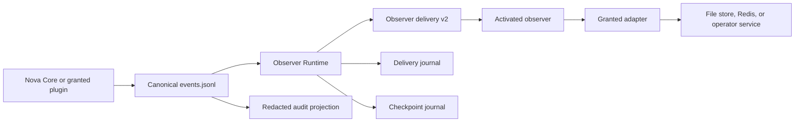
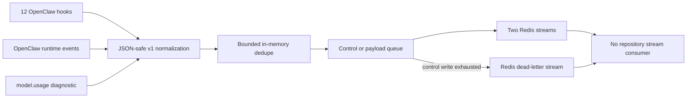
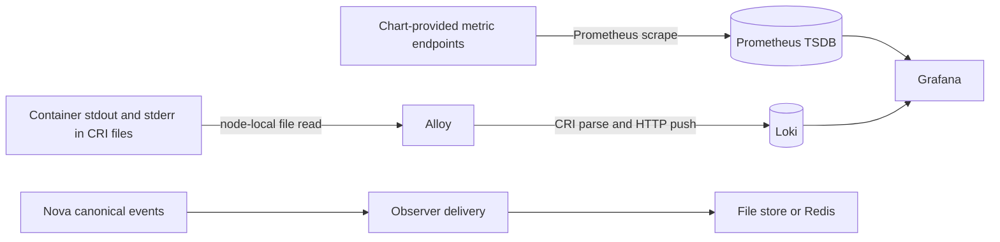

# Telemetry: Events, Delivery, and Evidence

Status: Nova v2 and OpenClaw agent-observability v1 producers are active; retained telemetry v1 has no active runtime producer or consumer
Audience: runtime developer, observer author, operator, security reviewer
Owner: observability maintainers
Evidence: skills/common/plugins/notification-observer; skills/nova/core/telemetry; skills/common/plugins/openclaw-agent-observer; contracts/agent-observability/v1; skills/common/plugins/telemetry-observer; skills/common/plugins/telemetry-store; skills/common/plugins/redis-transport; contracts/telemetry/v1
Evidence revision: `569f7b4933d4859cc67c80ddf40d5154ffd95ce5`
Applies to: Nova lifecycle-event.v2, plugin-domain-event.v2, observer delivery v2, OpenClaw agent-observability ingress v1, and retained telemetry v1 assets
Last verified: contract, runtime, plugin, chart configuration, and focused-test inspection on 2026-09-21; notification package section source/test checked 2026-10-21 only; original other-scope dates unchanged; no deployed notification claim
Scoped source correction: 2026-10-21 against `0e35889a3c4e65d5c47ba88e924611aace67eb1d`; agent projection/host-ingress catalogues reconciled; no deployed end-to-end delivery claim.

## Purpose

Telemetry answers what the system observed. It does not get permission to
change what the pipeline decided.

In the Nova path, Nova first commits a canonical event to its run journal. An observer can then
receive that event, redact it, and send a projection to a file store, Redis, an
operator channel, or another granted adapter. If a sink fails, the canonical
event still exists. Recovery restarts delivery from a verified checkpoint.

This order is deliberate. It prevents a dashboard, transport, or notification
service from becoming a second pipeline state machine.

## Two Contract Families And One Host Ingress Contract

The repository contains two telemetry contract families and one separate
OpenClaw host-ingress contract. Nova v2 and host ingress have active producers,
but they do not join into one end-to-end path.

| Family | Status | Runtime producer and consumer | Use |
| --- | --- | --- | --- |
| Nova v2 events and observer delivery | Active | Nova Core, plugin contexts, Observer Runtime, activated observer plugins, and selected adapters | Canonical runtime events and their controlled delivery |
| `agent-observability` ingress v1 | Active producer on the Buster OpenClaw host | `kubeclaw-agent-observer` writes Redis; no repository consumer reads these streams | Bounded copies of OpenClaw hooks, runtime events, and model-usage diagnostics |
| `contracts/telemetry/v1` flat envelope | Retained asset | None found in repository runtime code | Compatibility material for possible external readers; schema and generated-type checks only |

Do not confuse the two v1 names. Agent-observability v1 is a live Redis writer.
Telemetry v1 is the inactive retained asset described below. Do not describe
telemetry v1 schemas as the live ingestion contract. Their `cursor`,
timestamps, source, authority strings, quarantine bundles, and generated types
do not create a running service. No v1-to-v2 adapter exists.

> **Source evidence — the version boundary**
>
> **Claim:** Active Nova v2 and host ingress v1 are distinct from inactive retained telemetry v1.
>
> **Implementation:** Retained status, agent contract constants and SDK envelopes below define the separate families.
>
> [The retained v1 README defines its inactive runtime status and limits](https://github.com/datrab/kubeclaw/blob/569f7b4933d4859cc67c80ddf40d5154ffd95ce5/contracts/telemetry/v1/README.md#L1-L7).
>
> [The active agent-observability contract fixes its schema, source, stream
> names, event types, and absolute event-size ceiling](https://github.com/datrab/kubeclaw/blob/569f7b4933d4859cc67c80ddf40d5154ffd95ce5/contracts/agent-observability/v1/src/constants.ts#L1-L47).
>
> [The active SDK defines lifecycle and plugin-domain event envelopes](https://github.com/datrab/kubeclaw/blob/569f7b4933d4859cc67c80ddf40d5154ffd95ce5/skills/common/plugin-runtime/sdk/src/generated/contracts.ts#L597-L656).
> [It defines observer delivery and checkpoint contracts separately](https://github.com/datrab/kubeclaw/blob/569f7b4933d4859cc67c80ddf40d5154ffd95ce5/skills/common/plugin-runtime/sdk/src/generated/contracts.ts#L657-L672).
>
> **Contract or setting:** Their versioned envelopes and delivery/checkpoint types do not define a v1-to-v2 runtime bridge.
>
> **Test evidence:** An executed retained-v1 runtime activation check is not established by this source trace.
>
> **Revision:** `569f7b4933d4859cc67c80ddf40d5154ffd95ce5`. Source bindings, not execution receipts.
>
> **Limit:** Retained schemas/types are compatibility assets, not proof of a running producer or consumer.

### What the retained v1 asset contains

The retained catalog names 53 event types. Each type has one source payload
schema and one generated flat event schema. The bundle directory adds 16 schema
documents for archives, manifests, evidence exports, logs, health, and related
read models. The content manifest binds 132 delivered files by byte count and
SHA-256. Generated TypeScript and Go models are part of that set.

These counts describe repository assets only. They do not prove that a service
emits, accepts, stores, orders, or queries any v1 event. The schema accepts a
nullable cursor, but no current consumer enforces its proposed
`project/run/sequence` meaning. `source` and `authority` fields also do not
authenticate a sender.

> [The retained catalog is the complete 53-type source list](https://github.com/datrab/kubeclaw/blob/569f7b4933d4859cc67c80ddf40d5154ffd95ce5/contracts/telemetry/v1/catalog.json#L1-L28).
>
> [The retained contract describes its generated 132-file content manifest](https://github.com/datrab/kubeclaw/blob/569f7b4933d4859cc67c80ddf40d5154ffd95ce5/contracts/telemetry/v1/README.md#L26-L36).
> [The manifest states the compatibility rules and binds each listed file by
> byte count and SHA-256](https://github.com/datrab/kubeclaw/blob/569f7b4933d4859cc67c80ddf40d5154ffd95ce5/contracts/telemetry/v1/contract-manifest.json#L1-L23).

## Active Data Path



**Text alternative to the diagram**

Each row names a directed connection. Labels preserve the diagram’s conditions or handoffs; dotted relationships are identified explicitly.

| From | Relationship | To |
| --- | --- | --- |
| Nova Core or granted plugin | Directed connection | Canonical events.jsonl |
| Canonical events.jsonl | Directed connection | Observer Runtime |
| Observer Runtime | Directed connection | Observer delivery v2 |
| Observer delivery v2 | Directed connection | Activated observer |
| Activated observer | Directed connection | Granted adapter |
| Granted adapter | Directed connection | File store, Redis, or operator service |
| Observer Runtime | Directed connection | Delivery journal |
| Observer Runtime | Directed connection | Checkpoint journal |
| Canonical events.jsonl | Directed connection | Redacted audit projection |


Text version: Nova Core or a granted plugin appends an event to the canonical
journal. Observer Runtime filters it by an installed subscription. It records
each delivery attempt, invokes the observer with a bounded lease, and writes a
checkpoint only after success. The observer invokes a granted adapter. The sink
stores a projection. Audit is rebuilt directly from the canonical journal.

The active path has six authority boundaries:

1. The producer owns event meaning.
2. The Nova journal owns canonical order and durable presence.
3. The observer registration owns subscription and failure policy.
4. Observer Runtime owns attempt and checkpoint state.
5. The adapter owns transport-specific durability and limits.
6. The sink owns query and retention, but not pipeline lifecycle.

### OpenClaw agent-observability v1 path

This second active path does not enter Nova's journal or Observer Runtime. The
current chart enables it only for the Buster OpenClaw role.



**Text alternative to the diagram**

Each row names a directed connection. Labels preserve the diagram’s conditions or handoffs; dotted relationships are identified explicitly.

| From | Relationship | To |
| --- | --- | --- |
| 12 OpenClaw hooks | Directed connection | JSON-safe v1 normalization |
| OpenClaw runtime events | Directed connection | JSON-safe v1 normalization |
| model.usage diagnostic | Directed connection | JSON-safe v1 normalization |
| JSON-safe v1 normalization | Directed connection | Bounded in-memory dedupe |
| Bounded in-memory dedupe | Directed connection | Control or payload queue |
| Control or payload queue | Directed connection | Two Redis streams |
| Control or payload queue | Directed connection — control write exhausted | Redis dead-letter stream |
| Two Redis streams | Directed connection | No repository stream consumer |
| Redis dead-letter stream | Directed connection | No repository stream consumer |


The extension registers 12 hooks. It also subscribes to six OpenClaw runtime
streams and to the `model.usage` diagnostic. It converts accepted input to
`AgentObservabilityIngressEventV1`. The envelope contains `v: 1`, the fixed
source `openclaw.plugin.agent-observer`, a producer timestamp, optional
correlation identity, and a type-specific payload. Tool events are the only
events that require both `tool_call_id` and `model_call_id`. Other identity
fields can be absent, so a Redis reader must not assume that `run_id` exists.

The normalizer accepts plain JSON values, dates, and errors. It rejects
accessors and proxies, converts circular references to `[Circular]`, and limits
traversal to depth 256, 2,621,440 nodes, and a 5 MiB normalization ceiling. The
configured 3 MiB serialized-event check is stricter and runs before queue
admission. These checks protect the process from unsafe object traversal. They
do not remove confidential content.

Two in-memory controls reduce duplicate writes:

- a runtime event with `runId`, `stream`, and `seq` uses their SHA-256 value for
  60-second deduplication; this map holds at most 10,000 entries;
- an LLM-output event with `model_call_id` uses a canonical content digest for
  a 10-second hook/runtime pairing window; this map also holds at most 10,000
  entries.

Other events have no deduplication key. Both maps disappear when the process
restarts. Redis uses `XADD *`, not an idempotency key, so a restart or a replay
can create another entry.

| Redis stream | Event types |
| --- | --- |
| `pipeline:agent-observability:payload:v1` | `openclaw.llm.input`, `openclaw.llm.output`, `openclaw.tool.started`, `openclaw.tool.finished` |
| `pipeline:agent-observability:control:v1` | `openclaw.agent.ended`, the three `openclaw.subagent.*` types, `openclaw.model.started`, `openclaw.model.ended`, `openclaw.model.usage`, `openclaw.session.started`, `openclaw.session.ended` |
| `pipeline:agent-observability:deadletter:v1` | A failed control entry plus failure time, source stream, error text, and original serialized data |

The writer has one control queue and one payload queue. The configured limit is
100 events in each queue. Control has priority. A full queue or an event larger
than 3 MiB is dropped before Redis. Control writes get three attempts with
100 ms and 200 ms waits under the configured 1,000 ms delay ceiling. Payload
writes get one attempt. Each command has a 5,000 ms timeout. After the final
control failure, the writer tries one write to the dead-letter stream. A failed
dead-letter write drops the record. All three streams use approximate `MAXLEN`:
10,000 for control and payload, and 1,000 for dead letters.

The repository has no `XREAD`, consumer group, acknowledgement, checkpoint, or
replay implementation for these three stream names. The mapping from ingress
types to possible telemetry types is descriptive data; no current service
performs that promotion. Therefore, a successful `XADD` proves only that Redis
accepted one bounded projection. It does not prove that a consumer processed
the event. An external consumer must define its own start position,
acknowledgement, idempotency, retention, and recovery contract before this path
can support end-to-end evidence.

> **Source evidence — OpenClaw producer path**
>
> **Claim:** OpenClaw host inputs normalize into bounded queues and Redis streams without a repository replay consumer.
>
> **Implementation:** Registration, normalizer, dedupe, routing and writer functions below trace admission through drop/dead-letter handling.
>
> [The extension registers hooks and its runtime-event subscription](https://github.com/datrab/kubeclaw/blob/569f7b4933d4859cc67c80ddf40d5154ffd95ce5/skills/common/plugins/openclaw-agent-observer/src/index.ts#L240-L268).
> [It also registers status, self-test, and service lifecycle](https://github.com/datrab/kubeclaw/blob/569f7b4933d4859cc67c80ddf40d5154ffd95ce5/skills/common/plugins/openclaw-agent-observer/src/index.ts#L269-L308).
> [Normalization extracts optional correlation identities](https://github.com/datrab/kubeclaw/blob/569f7b4933d4859cc67c80ddf40d5154ffd95ce5/skills/common/plugins/openclaw-agent-observer/src/hook-normalizers.ts#L67-L90)
> and [constructs and validates the v1 event before queue admission](https://github.com/datrab/kubeclaw/blob/569f7b4933d4859cc67c80ddf40d5154ffd95ce5/skills/common/plugins/openclaw-agent-observer/src/hook-normalizers.ts#L126-L166).
>
> [The in-memory dedupe rules and their 10,000-entry bounds are explicit](https://github.com/datrab/kubeclaw/blob/569f7b4933d4859cc67c80ddf40d5154ffd95ce5/skills/common/plugins/openclaw-agent-observer/src/observer-support.ts#L32-L79).
> [The contract fixes depth and node limits from the 5 MiB absolute
> ceiling](https://github.com/datrab/kubeclaw/blob/569f7b4933d4859cc67c80ddf40d5154ffd95ce5/contracts/agent-observability/v1/src/complexity.ts#L1-L28).
> [Routing assigns four raw-content types to the payload stream and all other
> ingress types to control](https://github.com/datrab/kubeclaw/blob/569f7b4933d4859cc67c80ddf40d5154ffd95ce5/contracts/agent-observability/v1/src/routing.ts#L14-L29).
> [Validation permits optional identity fields but requires tool and model-call
> identity for tool events](https://github.com/datrab/kubeclaw/blob/569f7b4933d4859cc67c80ddf40d5154ffd95ce5/contracts/agent-observability/v1/src/validation.ts#L225-L244).
> [Queue admission, event-size rejection, and control-first selection are in the
> Redis writer](https://github.com/datrab/kubeclaw/blob/569f7b4933d4859cc67c80ddf40d5154ffd95ce5/skills/common/plugins/openclaw-agent-observer/src/redis-writer.ts#L122-L155).
> [The writer applies bounded retries and command timeouts](https://github.com/datrab/kubeclaw/blob/569f7b4933d4859cc67c80ddf40d5154ffd95ce5/skills/common/plugins/openclaw-agent-observer/src/redis-writer.ts#L201-L231),
> then [records a drop and makes the one dead-letter attempt for control
> data](https://github.com/datrab/kubeclaw/blob/569f7b4933d4859cc67c80ddf40d5154ffd95ce5/skills/common/plugins/openclaw-agent-observer/src/redis-writer.ts#L234-L264).
>
> **Contract or setting:** Agent ingress v1 validation, size/depth limits, queue configuration and bounded write policy govern this producer.
>
> **Test evidence:** An executed deployed OpenClaw-host to Redis delivery check is not established by this source trace.
>
> **Revision:** `569f7b4933d4859cc67c80ddf40d5154ffd95ce5`. Source bindings, not execution receipts.
>
> **Limit:** XADD acceptance is not downstream consumption; process queues/dedupe disappear on restart and raw content is not redacted.

#### Complete host-ingress v1 event and payload catalogue

Every ingress record has six envelope fields: `v: 1`, `type` from the 13 rows
below, `source: "openclaw.plugin.agent-observer"`, `ts`, `identity`, and
`payload`. The normalizer assigns `ts` from its reception clock with
`toISOString()`; it does not preserve an upstream event timestamp as authority.
Validation requires RFC 3339 without leap seconds. This envelope is neither
Nova's journal event nor the agent-observability v2 projection below.

`identity` can contain these optional fields: `run_id`, `project`,
`session_key`, `session_id`, `gateway_label`, `dispatch_id`, `agent_id`,
`agent_type`, `module_id`, `gate_id`, `attempt`, `tool_call_id`,
`model_call_id`, `parent_session_key`, and `child_session_key`. Present string
identities must be non-empty; a non-null `attempt` must be a positive integer.
The normalizer omits unresolved identities; validation also tolerates `null`
for optional identity values. Only the
two tool types require both `tool_call_id` and `model_call_id`. Other types
can have an empty identity object: missing correlation is not a fabricated run.
The normalizer resolves each field through its named event/context aliases;
it merges hook context, event `context`, then event `ctx`, with later context
keys winning, and selected fields can fall back to metadata. See the exact
identity source mapping rather than treating all payload fields as identities.

In the table, **required** means required by the ingress validator in addition
to the exact `hook`. Other named fields are optional in the declared type.
Every payload can also have optional JSON `metadata` and finite-number
`event_bytes`; the current payload normalizer copies record-shaped metadata
but does not synthesize `event_bytes`. JSON values can be `null`. Optional
strings and numbers can also be `null`; thread flags can be boolean or `null`.
Normalizers usually emit absent scalar/JSON input as `null`, histories as `[]`,
and omit record fields such as `request`, `usage`, `context`, or `metadata`
when their source is not an object. These normalization results are not proof
that the upstream hook supplied a value. The validator is not a general
closed-object schema for payload keys.

| Event type | Exact payload hook | Required fields beyond hook | Other declared payload fields |
| --- | --- | --- | --- |
| `openclaw.agent.ended` | `agent_end` | None | `outcome`, `reason`, `error`, `duration_ms`, `final_messages` |
| `openclaw.llm.input` | `llm_input` | JSON `prompt`; array `history_messages` | `system_prompt`, `provider`, `model`, record `request` |
| `openclaw.llm.output` | `llm_output` | JSON `response` | `assistant_response`, JSON `assistant_message`, `history_messages`, `provider`, `model`, record `usage` |
| `openclaw.subagent.spawned` | `subagent_spawned` | None | All subagent fields listed below |
| `openclaw.subagent.delivery_target` | `subagent_delivery_target` | None | All subagent fields listed below |
| `openclaw.subagent.ended` | `subagent_ended` | None | All subagent fields listed below |
| `openclaw.tool.started` | `before_tool_call` | Non-empty `tool_name`; JSON `params`; both tool identities in envelope | None |
| `openclaw.tool.finished` | `after_tool_call` | Non-empty `tool_name`; both tool identities in envelope | JSON `params`, `result`, `error`; `duration_ms`, `outcome` |
| `openclaw.model.started` | `model_call_started` | None | `provider`, `model`, record `request` |
| `openclaw.model.ended` | `model_call_ended` | None | `provider`, `model`, `outcome`, JSON `error`, `duration_ms`, record `usage` |
| `openclaw.model.usage` | `model_usage` | None | `provider`, `model`, `cost_usd`, `duration_ms`, records `context`, `usage` |
| `openclaw.session.started` | `session_start` | None | `session_key`, `session_id`, `outcome`, `reason`, JSON `error`, `duration_ms` |
| `openclaw.session.ended` | `session_end` | None | `session_key`, `session_id`, `outcome`, `reason`, JSON `error`, `duration_ms` |

The complete subagent field set, shared by the three rows, is
`child_session_key`, `child_session_id`, `agent_id`, `requester_session_key`,
`child_run_id`, `mode`, `spawn_mode`, `thread`,
`expects_completion_message`, JSON `requester_origin`, `outcome`, `reason`,
JSON `error`, and `duration_ms`. These are payload observations, not proof that
a child ran or that a delivery target accepted output. A history-message row
requires JSON `content`; it can also carry `role`, `name`, `tool_call_id`, and
record `metadata`. The history normalizer accepts scalar items as content and
uses `content`, or a text/message fallback, for object items.

For LLM input, prompt precedence is `prompt`, `input`, `providerInput`, then
`messages`; history uses the history aliases then `messages`. For output,
response precedence is `response`, `output`, assistant-response aliases, `text`,
then `message.content`. Provider aliases are `provider`, `providerId`,
`modelProvider`; model aliases are `model`, `modelId`, `resolvedModel`.
A started-tool observation without a name becomes `unknown_tool`; its absent
parameters become `{}`. Finished-tool parameters use only `params`; result can
fall back to `output`. Duration accepts camel case, snake case, or `duration`.
Outcome uses explicit outcome/status, then success/ok or error; agent/session
normalization can additionally infer success/error from phase `end`/`error`.
These are coercion and fallback rules, not new domain decisions.

The 12 hooks map to 12 of these types. The thirteenth, `openclaw.model.usage`,
comes from the `model.usage` diagnostic, not a thirteenth hook. Runtime streams
can enter existing hook mappings: lifecycle start becomes session-start,
lifecycle end/error becomes agent-end, assistant becomes LLM-output, item
start/end becomes tool-start/tool-finish, and command-output/patch/approval
becomes tool-finish. Unsupported phases return no event. Tool identity admission
still applies; a mapped observation missing its parent IDs is rejected before
Redis. These inputs do not create an automatic v1-to-Nova-v2 consumer.

> **Source evidence — complete host-ingress contract**
>
> **Claim:** Host-ingress v1 has type-specific required/optional payload and correlation rules.
>
> **Implementation:** Types, validators and hook/runtime normalizers below define each admitted field and fallback.
>
> [Identity, history, common fields and LLM payload declarations.](https://github.com/datrab/kubeclaw/blob/0e35889a3c4e65d5c47ba88e924611aace67eb1d/contracts/agent-observability/v1/src/types.ts#L35-L94)
> [Agent, tool, model and subagent payload declarations.](https://github.com/datrab/kubeclaw/blob/0e35889a3c4e65d5c47ba88e924611aace67eb1d/contracts/agent-observability/v1/src/types.ts#L95-L148)
> [Remaining subagent/session fields and full ingress envelope.](https://github.com/datrab/kubeclaw/blob/0e35889a3c4e65d5c47ba88e924611aace67eb1d/contracts/agent-observability/v1/src/types.ts#L149-L188)
> [Required versus optional payload validation and hook matching.](https://github.com/datrab/kubeclaw/blob/0e35889a3c4e65d5c47ba88e924611aace67eb1d/contracts/agent-observability/v1/src/validation.ts#L170-L225)
> [Envelope admission and mandatory tool-parent identities.](https://github.com/datrab/kubeclaw/blob/0e35889a3c4e65d5c47ba88e924611aace67eb1d/contracts/agent-observability/v1/src/validation.ts#L226-L252)
> [Model-usage, LLM and started-tool normalization.](https://github.com/datrab/kubeclaw/blob/0e35889a3c4e65d5c47ba88e924611aace67eb1d/skills/common/plugins/openclaw-agent-observer/src/hook-payloads.ts#L49-L104)
> [Finished-tool, agent-end and model normalization.](https://github.com/datrab/kubeclaw/blob/0e35889a3c4e65d5c47ba88e924611aace67eb1d/skills/common/plugins/openclaw-agent-observer/src/hook-payloads.ts#L105-L150)
> [Subagent/session fields and hook dispatch.](https://github.com/datrab/kubeclaw/blob/0e35889a3c4e65d5c47ba88e924611aace67eb1d/skills/common/plugins/openclaw-agent-observer/src/hook-payloads.ts#L151-L207)
> [Exact identity aliases and fallback order.](https://github.com/datrab/kubeclaw/blob/0e35889a3c4e65d5c47ba88e924611aace67eb1d/skills/common/plugins/openclaw-agent-observer/src/hook-normalizers.ts#L67-L95)
> [Runtime stream mapping, reception timestamp, validation and diagnostic ingress.](https://github.com/datrab/kubeclaw/blob/0e35889a3c4e65d5c47ba88e924611aace67eb1d/skills/common/plugins/openclaw-agent-observer/src/hook-normalizers.ts#L108-L167)
> [History normalization and declared content fields.](https://github.com/datrab/kubeclaw/blob/0e35889a3c4e65d5c47ba88e924611aace67eb1d/skills/common/plugins/openclaw-agent-observer/src/hook-values.ts#L127-L143)
>
> **Contract or setting:** The ingress envelope is separate from Nova events; tool-parent IDs are required while other identities can be absent.
>
> **Test evidence:** An executed complete deployed host-ingress catalogue check is not established by this source trace.
>
> **Revision:** `0e35889a3c4e65d5c47ba88e924611aace67eb1d`. Source bindings, not execution receipts.
>
> **Limit:** Normalization fallback/null values are not evidence that an upstream host supplied the value or that a child ran.

#### Exact deployed configuration

Configuration from a hook overrides service configuration. Service
configuration overrides registration configuration. The merged plugin value
then overrides the matching environment variable. The Buster chart supplies
all required non-secret values in the OpenClaw entry and supplies the Redis
host, port, and password as environment variables.

| Plugin key | Environment fallback | Deployed value | Effect |
| --- | --- | --- | --- |
| `enabled` | `OPENCLAW_AGENT_OBSERVER_ENABLED` | `true` | Starts Redis output and diagnostic subscription. |
| `redisHost` | `REDIS_HOST` | chart Redis host | Selects the Redis service. |
| `redisPort` | `REDIS_PORT` | chart value, default `6379` | Selects the Redis port. |
| `redisUsername` | `REDIS_USERNAME` | unset | Uses password-only Redis authentication. |
| `redisPassword` | `REDIS_PASSWORD` | Secret value | Authenticates the Redis connection. |
| `redisTls` | `REDIS_TLS` | unset, therefore `false` | Does not add TLS in this profile. |
| `redisNetworkIsolation` | `REDIS_NETWORK_ISOLATION` | `isolated` | Satisfies the extension's secure-transport policy with the password. |
| `maxEventBytes` | `OPENCLAW_AGENT_OBSERVER_MAX_EVENT_BYTES` | `3145728` | Drops a normalized event above 3 MiB; the contract hard ceiling is 5 MiB. |
| `maxQueuePerStream` | `OPENCLAW_AGENT_OBSERVER_MAX_QUEUE_PER_STREAM` | `100` | Bounds each in-memory queue separately. |
| `redisCommandTimeoutMs` | `OPENCLAW_AGENT_OBSERVER_REDIS_COMMAND_TIMEOUT_MS` | `5000` | Bounds each `XADD`. |
| `streamMaxLen` | `OPENCLAW_AGENT_OBSERVER_STREAM_MAXLEN` | `10000` | Sets approximate control and payload stream length. |
| `deadLetterMaxLen` | `OPENCLAW_AGENT_OBSERVER_DEADLETTER_MAXLEN` | `1000` | Sets approximate dead-letter stream length. |
| `controlWriteMaxAttempts` | `OPENCLAW_AGENT_OBSERVER_CONTROL_WRITE_MAX_ATTEMPTS` | `3` | Retries control writes only. |
| `controlWriteRetryBaseMs` | `OPENCLAW_AGENT_OBSERVER_CONTROL_WRITE_RETRY_BASE_MS` | `100` | Starts exponential retry delay. |
| `controlWriteRetryMaxMs` | `OPENCLAW_AGENT_OBSERVER_CONTROL_WRITE_RETRY_MAX_MS` | `1000` | Caps each retry delay. |
| `hookPriority` | `OPENCLAW_AGENT_OBSERVER_HOOK_PRIORITY` | `-100` | Registers the observer early in hook order. |
| `hookTimeoutMs` | `OPENCLAW_AGENT_OBSERVER_HOOK_TIMEOUT_MS` | `1000` | Bounds each OpenClaw hook callback. |

> [The resolver defines configuration precedence and validation](https://github.com/datrab/kubeclaw/blob/569f7b4933d4859cc67c80ddf40d5154ffd95ce5/skills/common/plugins/openclaw-agent-observer/src/config.ts#L83-L112).
> [The Buster gateway entry supplies the active values](https://github.com/datrab/kubeclaw/blob/0e35889a3c4e65d5c47ba88e924611aace67eb1d/charts/kubeclaw/templates/configmap-gateway.yaml#L282-L331).
> [The Pod obtains Redis host, port, and password from values and the configured
> Secret](https://github.com/datrab/kubeclaw/blob/0e35889a3c4e65d5c47ba88e924611aace67eb1d/charts/kubeclaw/templates/deployment.yaml#L1354-L1371).

#### Sensitive data and evidence limit

LLM input can contain the prompt, system prompt, history, and provider request.
LLM output can contain the complete response and history. Tool events can carry
parameters, results, and errors. Error normalization can include a stack. The
producer does not apply semantic or field-name redaction to these values. Redis
and any external consumer must therefore be treated as authorized for raw agent
content. Queue bounds and JSON normalization are not privacy controls.

The status method exposes queue and drop counters, written counts, retry and
dead-letter counts, the last error, and whether a Redis client object exists.
`connected: true` does not prove a successful command or a consumer. A host
restart loses the counters and both queues. No metric exporter persists them.
If later configuration disables the extension, the flush loop stops. Existing
queued entries remain only in memory. A later enabled event can schedule them,
but stopping the service while disabled loses them. Configuration-resolution
and normalization failures produce one warning per failure class outside the
writer counters, so the counters are not a complete received-event total.
Repository tests exercise normalization and writer behavior with controlled
clients. They do not prove delivery through a deployed OpenClaw host, Redis
persistence, or downstream consumption.

> [LLM payload construction retains raw prompts, responses, histories, and
> metadata](https://github.com/datrab/kubeclaw/blob/569f7b4933d4859cc67c80ddf40d5154ffd95ce5/skills/common/plugins/openclaw-agent-observer/src/hook-payloads.ts#L54-L91).
> [Tool and agent-end construction retains parameters, results, histories, and
> errors](https://github.com/datrab/kubeclaw/blob/569f7b4933d4859cc67c80ddf40d5154ffd95ce5/skills/common/plugins/openclaw-agent-observer/src/hook-payloads.ts#L94-L124).
> [The status and counter surface reports process-local writer state](https://github.com/datrab/kubeclaw/blob/569f7b4933d4859cc67c80ddf40d5154ffd95ce5/skills/common/plugins/openclaw-agent-observer/src/index.ts#L129-L147).
> [The flush loop runs only while configuration remains enabled and reschedules
> only under that condition](https://github.com/datrab/kubeclaw/blob/569f7b4933d4859cc67c80ddf40d5154ffd95ce5/skills/common/plugins/openclaw-agent-observer/src/redis-writer.ts#L170-L199).

## Active Event Catalog

### Lifecycle events

Nova Core owns the complete closed list of lifecycle event types.

| Family | Event types | Producer | Meaning and primary consumer |
| --- | --- | --- | --- |
| Run | `run.created`, `run.started`, `run.resumed`, `run.waiting`, `run.paused`, `run.succeeded`, `run.failed`, `run.blocked`, `run.cancelled` | Pipeline runner and administrative continuation | Run frontier and terminal status; recovery, audit, observers |
| Stage | `stage.scheduled`, `stage.started`, `stage.waiting`, `stage.retrying`, `stage.skipped`, `stage.succeeded`, `stage.failed`, `stage.blocked`, `stage.cancelled` | Pipeline loop and administrative repair | Stage lifecycle and consumed attempts; recovery, audit, observers |
| Attempt | `attempt.created`, `attempt.dispatched`, `attempt.completed`, `attempt.timed_out`, `attempt.cancelled` | Stage executor | Exact attempt lifecycle and result boundary; recovery, artifact reconciliation, observers |
| Effect | `effect.requested`, `effect.accepted`, `effect.completed`, `effect.failed` | Effect Coordinator bridge | External side-effect audit; effect recovery and audit. Observer-owned effect events are intentionally not re-observed. |
| Artifact | `artifact.created` | Artifact checkpoint recorder after a verified adapter response | Durable artifact reference and producer binding; later stages, recovery, audit |
| Wait | `wait.created`, `wait.resolved`, `orchestrator.required` | Lifecycle reducer, signal path, and orchestrator boundary | Durable pause, exact resume signal, or required external decision |

Each lifecycle event has the same envelope fields:

| Field | Rule |
| --- | --- |
| `schemaVersion` | Exactly `lifecycle-event.v2`. |
| `eventId` | New opaque event identity. Current Nova producers use `event:<UUID>`. |
| `sequence` | Positive append position in the canonical event journal. |
| `type` | One value from the closed list above. |
| `identity` | Always `runId`; optionally stage, attempt, effect, wait, or artifact ID as relevant. |
| `occurredAt` | Producer timestamp. It does not override journal sequence. |
| `causationId` | Prior decision, attempt, delivery, or signal identity when the producer has one; otherwise null. |
| `payload` | Event-specific portable JSON. Meaning belongs to the producer path. |

> **Source evidence — lifecycle production**
>
> **Claim:** Nova appends canonical lifecycle envelopes while observer effect events do not feed back into delivery.
>
> **Implementation:** SDK envelope, runner append and effect bridge below assign type/sequence and exclude observation loops.
>
> [The SDK contract contains the full closed list and common envelope fields](https://github.com/datrab/kubeclaw/blob/569f7b4933d4859cc67c80ddf40d5154ffd95ce5/skills/common/plugin-runtime/sdk/src/generated/contracts.ts#L605-L645).
>
> [The pipeline runner assigns the journal sequence and writes run, stage, and attempt events through one append function](https://github.com/datrab/kubeclaw/blob/569f7b4933d4859cc67c80ddf40d5154ffd95ce5/skills/nova/core/execution/runner.ts#L49-L78).
>
> [The effect bridge emits bounded effect facts but excludes effects created by observer delivery to prevent a feedback loop](https://github.com/datrab/kubeclaw/blob/569f7b4933d4859cc67c80ddf40d5154ffd95ce5/skills/nova/core/execution/engine-runtime.ts#L53-L59).
>
> **Contract or setting:** The closed lifecycle type list and common identity/payload envelope govern production.
>
> **Test evidence:** An executed complete production lifecycle event emission check is not established by this source trace.
>
> **Revision:** `569f7b4933d4859cc67c80ddf40d5154ffd95ce5`. Source bindings, not execution receipts.
>
> **Limit:** A canonical event is not proof that an observer activated or a sink received it.

### Run-start event payloads

The pipeline loop records startup with envelope identity `{ runId }`.

| Event | Payload and condition |
| --- | --- |
| `run.created` | On a non-resume start, `{ runIdentity }`, whose fields are `runId`, `pipelineId`, and `graphDigest` from the runner identity. |
| `run.started` | Immediately follows `run.created` on that path, with an empty payload `{}`; it does not include the graph or stage results. |
| `run.resumed` | On a resume start only when `resumeEventAlreadyRecorded` is false or omitted: `{ runIdentity, ...resumePayload }`. Caller-supplied resume fields are spread last and can replace the payload's `runIdentity`; the envelope `runId` remains the runner's. |

A resume start does not emit `run.created` or `run.started`. When
`resumeEventAlreadyRecorded` is true, this startup path emits no event; it does
not itself verify the earlier record. The runner defaults causation to
`resumeCausationId`, or `null`. Startup events are appended before the loop
awaits its event-commit callback and checks cancellation or schedules stages.
They therefore do not prove an attempt, external effect, or successful run.
This table covers pipeline-loop startup, not other administrative producers
or waiting, paused, and terminal run payloads.

> **Source evidence — run-start payloads**
>
> **Claim:** Loop startup chooses created/started or resumed events with distinct payloads.
>
> **Implementation:** Startup branches, commit ordering and runner envelope below define their fields.
>
> [Exact startup branch and spread order](https://github.com/datrab/kubeclaw/blob/f99aecbb00cb399b46dfbbeb3ddb375fba6218e7/skills/nova/core/execution/pipeline-loop.ts#L46-L53).
> [Startup commit and cancellation ordering](https://github.com/datrab/kubeclaw/blob/f99aecbb00cb399b46dfbbeb3ddb375fba6218e7/skills/nova/core/execution/pipeline-loop.ts#L20-L25).
> [Run identity, envelope, default payload, and causation](https://github.com/datrab/kubeclaw/blob/f99aecbb00cb399b46dfbbeb3ddb375fba6218e7/skills/nova/core/execution/runner.ts#L60-L65).
>
> **Contract or setting:** Caller resumePayload spreads last; envelope run identity remains the runner identity.
>
> **Test evidence:** An executed run-created/started/resumed startup payload check is not established by this source trace.
>
> **Revision:** `f99aecbb00cb399b46dfbbeb3ddb375fba6218e7`. Source bindings, not execution receipts.
>
> **Limit:** Startup commits precede scheduling and do not prove an attempt or external effect.

### Administrative run-resumed payload

Administrative reopening emits a different `run.resumed` payload from loop startup.
The envelope identifies only `runId`; `causationId` is the administrative
`decisionId`. The payload is `{ administrativeDecision }`, containing the full
accepted decision, not `runIdentity`, a stage result, or an accepted resume signal.
This event also precedes a requested cancellation; its name does not prove retry.

The reopener records a new administrative decision before appending this event.
It suppresses a duplicate when a lifecycle event already has the same decision
causation and type. That event lookup adds no stage filter for `run.resumed`.
The subsequent execution path sets `resumeEventAlreadyRecorded: true`, so loop
startup does not emit a second resume event. Replays can instead return a retained
terminal or waiting result after draining observers. The resume event alone proves
neither a new attempt nor successful continuation or external-effect reconciliation.
This section covers administrative reopening only; signal-based resume is separate.

> **Source evidence — administrative run-resumed payload**
>
> **Claim:** Administrative run.resumed carries its accepted decision and suppresses the later loop-start duplicate.
>
> **Implementation:** Administrative append/replay and duplicate matching below define this separate producer.
>
> [Decision recording before resume append](https://github.com/datrab/kubeclaw/blob/f99aecbb00cb399b46dfbbeb3ddb375fba6218e7/skills/nova/core/execution/engine-admin.ts#L40-L54).
> [Replay, cancellation selection, and startup suppression](https://github.com/datrab/kubeclaw/blob/f99aecbb00cb399b46dfbbeb3ddb375fba6218e7/skills/nova/core/execution/engine-admin.ts#L90-L109).
> [Duplicate matching, envelope, and full decision payload](https://github.com/datrab/kubeclaw/blob/f99aecbb00cb399b46dfbbeb3ddb375fba6218e7/skills/nova/core/execution/engine-admin.ts#L136-L147).
>
> **Contract or setting:** Decision causation and full administrativeDecision payload differ from signal or ordinary startup payloads.
>
> **Test evidence:** An executed administrative run-resumed payload check is not established by this source trace.
>
> **Revision:** `f99aecbb00cb399b46dfbbeb3ddb375fba6218e7`. Source bindings, not execution receipts.
>
> **Limit:** This event can precede cancellation and does not prove retry, a new attempt or reconciled external work.

### Terminal run event payloads

The pipeline loop emits `run.succeeded`, `run.failed`, `run.blocked`, or
`run.cancelled` with envelope identity `{ runId }` and an empty payload `{}`.
These events do not include stage results, counters, a failure reason, or an
external-effect cleanup receipt. Causation defaults to `resumeCausationId`, or
`null`; the terminal event does not automatically identify a failing attempt.

A terminal batch decision selects failed, blocked, or cancelled and uses the
terminal-return path. When scheduling has no ready stages, finalization instead
checks all stage states. Success requires every stage to be succeeded or skipped,
except a pending remediation-only target without a return owner. Otherwise,
finalization selects the first present status in this order: failed, blocked,
cancelled, waiting; if none is present, it selects failed.

A waiting finalization emits no terminal run event. The earlier paused-batch
return also returns waiting without this finalization path. Do not infer a
`run.waiting` event from either return value. On terminal paths, Nova appends the
event and awaits the event-commit callback before returning the run result.
A terminal event alone does not prove rollback, cleanup, or human acceptance.
This table covers pipeline-loop producers, not administrative run events.

> **Source evidence — terminal run payloads**
>
> **Claim:** Terminal loop run events use empty payloads and committed state-derived precedence.
>
> **Implementation:** Batch return, finalization and runner envelope below select and append the terminal event.
>
> [Batch terminal and paused-return selection](https://github.com/datrab/kubeclaw/blob/f99aecbb00cb399b46dfbbeb3ddb375fba6218e7/skills/nova/core/execution/pipeline-loop.ts#L29-L37).
> [Terminal and finalization producers, precedence, and commit ordering](https://github.com/datrab/kubeclaw/blob/f99aecbb00cb399b46dfbbeb3ddb375fba6218e7/skills/nova/core/execution/pipeline-loop.ts#L133-L148).
> [Default payload and envelope causation](https://github.com/datrab/kubeclaw/blob/f99aecbb00cb399b46dfbbeb3ddb375fba6218e7/skills/nova/core/execution/runner.ts#L60-L65).
>
> **Contract or setting:** Completion requires succeeded/skipped work subject to the stated unused-remediation exception.
>
> **Test evidence:** An executed all terminal run payload variants check is not established by this source trace.
>
> **Revision:** `f99aecbb00cb399b46dfbbeb3ddb375fba6218e7`. Source bindings, not execution receipts.
>
> **Limit:** A terminal event does not prove rollback/cleanup; waiting returns need not emit run.waiting.

### Pipeline cancellation event payloads

At the start of each loop iteration, Nova checks the runner's abort signal.
When it is aborted, the loop preserves stages already marked `skipped`,
`succeeded`, `failed`, `blocked`, or `cancelled`. For each other stage, it sets
status to `cancelled` and appends the following stage event before the run event.

| Event | Envelope identity | Payload |
| --- | --- | --- |
| `stage.cancelled` | `runId` and `stageId`; no `attemptId` | `attemptsUsed` and `remediationCyclesUsed`, copied from the prior stage state. No result or cancellation reason is included on this path. |
| `run.cancelled` | `runId` only | Empty object `{}`. It does not contain the abort signal's reason or a list of cancelled stages. |

The loop then awaits its event-commit callback and returns status `cancelled`.
The abort check is not a synchronous interruption of an executing batch: the
loop awaits the selected stages and records their decisions before its next
iteration. A terminal decision or a waiting return can end that iteration
without reaching another abort check. These events do not prove that external
effects stopped or were rolled back. Administrative cancellation and completed
stage decisions are separate producers; their payloads must not be inferred
from this table.

> **Source evidence — pipeline cancellation payloads**
>
> **Claim:** Loop cancellation preserves terminal stages and records counters for each newly cancelled stage.
>
> **Implementation:** Abort guard, batch ordering and default envelope below define this producer.
>
> [Abort guard, preserved terminal states, payloads, and commit ordering](https://github.com/datrab/kubeclaw/blob/f99aecbb00cb399b46dfbbeb3ddb375fba6218e7/skills/nova/core/execution/pipeline-loop.ts#L75-L83).
> [Batch execution, decision recording, and early return ordering](https://github.com/datrab/kubeclaw/blob/f99aecbb00cb399b46dfbbeb3ddb375fba6218e7/skills/nova/core/execution/pipeline-loop.ts#L20-L37).
> [Default empty payload and envelope construction](https://github.com/datrab/kubeclaw/blob/f99aecbb00cb399b46dfbbeb3ddb375fba6218e7/skills/nova/core/execution/runner.ts#L60-L65).
>
> **Contract or setting:** The loop checks cancellation at iteration boundaries, not by synchronously interrupting an executing batch.
>
> **Test evidence:** An executed pipeline cancellation payload and early-return ordering check is not established by this source trace.
>
> **Revision:** `f99aecbb00cb399b46dfbbeb3ddb375fba6218e7`. Source bindings, not execution receipts.
>
> **Limit:** These events do not prove external effects stopped or describe administrative cancellation payloads.

### Skipped-stage event payload

`stage.skipped` records an unmet activation condition, not an executed attempt.
Its identity contains `runId` and `stageId`. The pipeline loop sets the stage
status to `skipped` before appending the event.

| Payload field | Exact meaning |
| --- | --- |
| `stageType` | The skipped stage definition's registered type. |
| `reason.code` | Exactly `core.activation_condition_not_met`. |
| `reason.details.sourceStage` | Stage whose output facts supply the activation input. |
| `reason.details.fact` | Fact key read from that source stage. |
| `reason.details.equals` | Required value from the activation condition. |
| `reason.details.factPresent` | Whether the observed value is not `undefined`. This is not a truthiness check. |
| `reason.details.observed` | Present only when the observed value is not `undefined`; `false`, `0`, and `null` remain values. |
| `attemptsUsed`, `remediationCyclesUsed` | Existing stage counters, copied unchanged by this skip path. |

A stage without an activation condition is not skipped by this check.
Otherwise, missing source facts or a failed `Object.is` comparison triggers the skip.
Do not interpret this event as a timeout, cancellation, failed attempt, or rollback.
The envelope's causation defaults to the runner's `resumeCausationId`, or `null`;
it does not automatically name the source stage or an attempt.
Other stage-event payloads remain outside this bounded correction.

> **Source evidence — skipped-stage payload**
>
> **Claim:** An unmet activation condition skips a stage without creating an executed attempt.
>
> **Implementation:** The activation producer and envelope below preserve observed values and existing counters.
>
> [Activation test, state update, and exact payload](https://github.com/datrab/kubeclaw/blob/f99aecbb00cb399b46dfbbeb3ddb375fba6218e7/skills/nova/core/execution/pipeline-loop.ts#L105-L116).
>
> [Journal envelope and default causation](https://github.com/datrab/kubeclaw/blob/f99aecbb00cb399b46dfbbeb3ddb375fba6218e7/skills/nova/core/execution/runner.ts#L61-L65).
>
> **Contract or setting:** Object.is comparison and explicit fact presence distinguish false/zero/null from an absent fact.
>
> **Test evidence:** An executed every skipped-stage observed-value variant check is not established by this source trace.
>
> **Revision:** `f99aecbb00cb399b46dfbbeb3ddb375fba6218e7`. Source bindings, not execution receipts.
>
> **Limit:** A skipped event is not a timeout, failed attempt, rollback or proof of source-stage execution.

### Started-stage event payload

`stage.started` marks the pipeline loop's transition to `running`, before the
Stage Executor runs. Its envelope identity contains `runId` and `stageId`,
not an attempt ID. It does not prove dispatch, a completed result, or an
external effect.

| Payload field | Exact meaning |
| --- | --- |
| `stageType` | The stage definition's registered type. |
| `agentRole` | Included only when `definition.config.agentRole` is a string; absent for other values. This is configuration, not proof of role activation. |
| `administrativeOverride` | Included as `true` only when the loop consumes this stage's administrative attempt override; otherwise omitted, not `false`. |

Without an override, an exhausted attempt budget returns a blocked decision
before the loop emits `stage.started`. On the start path, Nova appends the event
and awaits the event-commit callback before invoking the executor. A retained
start event alone therefore does not establish creation of an attempt.
The runner defaults causation to `resumeCausationId`, or `null`; it does not
assign a future attempt ID. Other stage payloads still need separate contracts.

> **Source evidence — started-stage payload**
>
> **Claim:** stage.started records the running transition before executor dispatch, with only conditional label/override fields.
>
> **Implementation:** Budget guard, append/flush and executor ordering below define the start producer.
>
> [Budget check, running transition, exact fields, flush, and executor ordering](https://github.com/datrab/kubeclaw/blob/f99aecbb00cb399b46dfbbeb3ddb375fba6218e7/skills/nova/core/execution/pipeline-loop.ts#L118-L130).
> [Envelope and default causation](https://github.com/datrab/kubeclaw/blob/f99aecbb00cb399b46dfbbeb3ddb375fba6218e7/skills/nova/core/execution/runner.ts#L61-L65).
>
> **Contract or setting:** An exhausted budget blocks before the event unless the administrative override applies.
>
> **Test evidence:** An executed stage-started payload ordering check is not established by this source trace.
>
> **Revision:** `f99aecbb00cb399b46dfbbeb3ddb375fba6218e7`. Source bindings, not execution receipts.
>
> **Limit:** The event carries no attempt ID and does not prove attempt creation, remote dispatch or completion.

### Successful-stage event payload

`stage.succeeded` describes a stage completion decision, not whole-run success.
Its envelope identity contains `runId` and `stageId`, without an attempt ID.

| Payload field | Exact meaning |
| --- | --- |
| `stageType` | The stage definition's registered type. |
| `agentRole` | Included only when `definition.config.agentRole` is a string. |
| `outcome` | The completed decision's result outcome; not a separate run result. |
| `attemptsUsed`, `remediationCyclesUsed` | Counters from the decision's stage state. |
| `facts` | Included when stage-state facts are truthy; an empty object is truthy and remains present. |
| `remediationReturnTo` | Included when the stage state's return target is truthy. |

This producer does not include the full result, artifacts, or a reason field.
Use attempt and artifact events for those separate contracts.
A remediation completion then resets its requesting stage to `pending` and
emits `stage.scheduled` for that requester, with `reason: remediation_completed`
and `remediationStageId` naming the completed remediation stage.
A missing requester instead raises `GRAPH_REMEDIATION_RETURN_MISSING` after
appending the success event. The success event alone does not prove rescheduling.
It also does not prove external-effect reconciliation or whole-run acceptance.
Other terminal-stage payloads remain outside this bounded correction.

> **Source evidence — successful-stage payload**
>
> **Claim:** stage.succeeded records a completion decision and can precede remediation-requester rescheduling.
>
> **Implementation:** Success append, requester update/error and scheduled-event construction below define this path.
>
> [Exact success fields, remediation state update, missing-requester error, and rescheduling](https://github.com/datrab/kubeclaw/blob/f99aecbb00cb399b46dfbbeb3ddb375fba6218e7/skills/nova/core/execution/run-decisions.ts#L113-L126).
>
> **Contract or setting:** The current stage state supplies counters/facts/return target; a missing requester fails after the append.
>
> **Test evidence:** An executed successful-stage and repair-return payload check is not established by this source trace.
>
> **Revision:** `f99aecbb00cb399b46dfbbeb3ddb375fba6218e7`. Source bindings, not execution receipts.
>
> **Limit:** The event alone proves neither whole-run success nor successful requester rescheduling.

### Failed-stage event payload

The decision processor emits `stage.failed` when a stop decision's stage state
is neither `blocked` nor `cancelled`. Those two states instead select
`stage.blocked` or `stage.cancelled` with the same stop-path payload below.
The envelope identifies `runId` and `stageId`, not an attempt.

| Payload field | Exact meaning |
| --- | --- |
| `stageType` | The stage definition's registered type. |
| `agentRole` | Included only when `definition.config.agentRole` is a string. |
| `outcome` | The decision result's outcome; do not infer it from the event name. |
| `reason` | Copied from `decision.result.reason`; the producer does not synthesize a failure reason when none exists. |
| `attemptsUsed`, `remediationCyclesUsed` | Counters from the decision's stage state. |

This payload does not include the complete result, artifacts, facts, or a retry
schedule. A stop event is not evidence of rollback or external-effect reversal.
The processor records a terminal batch outcome after appending it; when several
terminal decisions occur, `failed` outranks `blocked`, which outranks `cancelled`.
Do not treat this stage event as the separate terminal run event.
The administrative and remediation-target producers of `stage.blocked`, and
the pipeline cancellation producer, have different payloads; the table above
applies only to the decision processor's stop path.

> **Source evidence — failed-stage stop payload**
>
> **Claim:** Stop decisions select failed/blocked/cancelled stage events with the same bounded stop-path fields.
>
> **Implementation:** Stop constructor and terminal priority below define this producer.
>
> [Stop-event selection and exact fields](https://github.com/datrab/kubeclaw/blob/f99aecbb00cb399b46dfbbeb3ddb375fba6218e7/skills/nova/core/execution/run-decisions.ts#L105-L110).
> [Terminal batch priority](https://github.com/datrab/kubeclaw/blob/f99aecbb00cb399b46dfbbeb3ddb375fba6218e7/skills/nova/core/execution/run-decisions.ts#L129-L131).
>
> **Contract or setting:** State selects the event type; result outcome/reason and counters remain distinct payload values.
>
> **Test evidence:** An executed all failed-stage stop payload variants check is not established by this source trace.
>
> **Revision:** `f99aecbb00cb399b46dfbbeb3ddb375fba6218e7`. Source bindings, not execution receipts.
>
> **Limit:** The name does not prove rollback or equal the separate terminal run event; other blocked producers differ.

### Retrying-stage event payload

`stage.retrying` records the decision processor returning a stage to `pending`.
Its envelope identity contains `runId` and `stageId`, without an attempt ID.
The payload contains only `attemptsUsed` and `remediationCyclesUsed`, copied
from the decision's stage state. It does not carry the result, reason,
`stageType`, `agentRole`, next attempt identity, or a retry deadline.

The processor updates the state before appending this event, then forces the
stage into the scheduling frontier. The event does not establish that another
attempt was dispatched or that an external effect is safe to repeat.
It does not reset the counters or prove successful recovery.
The runner defaults causation to `resumeCausationId`, or `null`.
This contract covers the decision processor's retry path, not administrative
repair or remediation scheduling.

> **Source evidence — retrying-stage payload**
>
> **Claim:** stage.retrying records pending state and spent counters before forced scheduling.
>
> **Implementation:** Retry-state update, append and runner envelope below define this producer.
>
> [State transition, exact payload, and forced scheduling](https://github.com/datrab/kubeclaw/blob/f99aecbb00cb399b46dfbbeb3ddb375fba6218e7/skills/nova/core/execution/run-decisions.ts#L63-L67).
> [Envelope and default causation](https://github.com/datrab/kubeclaw/blob/f99aecbb00cb399b46dfbbeb3ddb375fba6218e7/skills/nova/core/execution/runner.ts#L61-L65).
>
> **Contract or setting:** The event supplies no next-attempt identity, result or retry deadline.
>
> **Test evidence:** An executed retrying-stage counter payload check is not established by this source trace.
>
> **Revision:** `f99aecbb00cb399b46dfbbeb3ddb375fba6218e7`. Source bindings, not execution receipts.
>
> **Limit:** It does not reset budgets or prove another dispatch is safe or has started.

### Waiting-stage decision payloads

The decision processor emits `stage.waiting` for a persisted wait or a cooldown.
Both variants identify `runId` and `stageId`, without an attempt ID, and include
`attemptsUsed` and `remediationCyclesUsed` from the decision's stage state.

| Decision | Additional payload | Reader interpretation |
| --- | --- | --- |
| `persist_wait` | `wait`, copied from `action.wait` | The supplied wait request, not an accepted resume signal. |
| `cooldown` | `retryAt`, copied from `action.retryAt` | The decision's retry time, not proof that another attempt was dispatched. |

These alternatives are mutually exclusive in this producer: the persisted-wait
branch does not add `retryAt`, and the cooldown branch does not add `wait`.
Neither adds `stageType`, `agentRole`, the complete result, or a reason.
After appending the event, the recorder marks the batch paused. It does not
sleep until the deadline or dispatch a replacement attempt in this handler.
The runner defaults causation to `resumeCausationId`, or `null`.
The remediation scheduler also emits `stage.waiting`, but carries a different
payload (`remediationStageId` and `repairRequest`); do not parse it as either
variant above. Waiting alone is not evidence of external-effect safety.

> **Source evidence — waiting-stage decision payloads**
>
> **Claim:** Persisted waits and cooldowns have distinct stage.waiting payload variants.
>
> **Implementation:** Decision branches, remediation producer and runner envelope below separate these fields.
>
> [Exact branch selection, fields, and paused outcome](https://github.com/datrab/kubeclaw/blob/f99aecbb00cb399b46dfbbeb3ddb375fba6218e7/skills/nova/core/execution/run-decisions.ts#L97-L103).
> [Separate remediation producer](https://github.com/datrab/kubeclaw/blob/f99aecbb00cb399b46dfbbeb3ddb375fba6218e7/skills/nova/core/execution/run-decisions.ts#L70-L80).
> [Envelope and default causation](https://github.com/datrab/kubeclaw/blob/f99aecbb00cb399b46dfbbeb3ddb375fba6218e7/skills/nova/core/execution/runner.ts#L61-L65).
>
> **Contract or setting:** persist_wait carries wait; cooldown carries retryAt; remediation uses a different payload.
>
> **Test evidence:** An executed wait/cooldown payload alternatives check is not established by this source trace.
>
> **Revision:** `f99aecbb00cb399b46dfbbeb3ddb375fba6218e7`. Source bindings, not execution receipts.
>
> **Limit:** A paused batch neither sleeps until expiry nor proves safe repetition of external effects.

### Orchestrator-required decision payload

The decision recorder emits `orchestrator.required` for `request_orchestrator`,
`pause_for_orchestrator`, and `request_repair_authorization`. Its envelope
identifies `runId` and `stageId`, without an attempt ID. The runner defaults
causation to `resumeCausationId`, or `null`.

All three branches carry `attemptsUsed`, `remediationCyclesUsed`, and `wait`.
Only `request_orchestrator` adds top-level `afterAttempt`. The generated wait
uses `schemaVersion: wait-request.v2`, `kind: orchestrator`,
`signalType: core.orchestrator.resume`, and `expiresAt: null`.
Its `authorizedIssuer` has `type: orchestrator` and the recorder's issuer ID.
The `waitId` prefixes `wait:orchestrator:` to the SHA-256 hex digest of canonical
JSON for `[runId, stageId, attemptNumber]`.

| Action | Nested `wait.request` |
| --- | --- |
| `request_orchestrator` | `{ afterAttempt }`, also reflected in the top-level field. |
| `pause_for_orchestrator` | The supplied wait's `request`, when truthy; other supplied wait fields do not override the generated envelope. |
| `request_repair_authorization` | `{ repairAuthorization: action.pending }`; no top-level `afterAttempt`. |

The recorder stores the generated wait in stage state before appending this
event, then marks the batch paused. This handler does not emit `wait.created`
or accept a resume signal. A request for authorization is not authorization
itself, completed repair, or permission to repeat an uncertain external effect.
This section covers the decision-recorder producer, not every administrative
continuation or the complete event catalogue.

> **Source evidence — orchestrator-required decision payload**
>
> **Claim:** Three orchestrator actions generate one Core-owned wait envelope with action-specific request context.
>
> **Implementation:** Decision guards, generated wait and runner envelope below construct identity and authority.
>
> [Three action guards, state update, exact payload, and pause](https://github.com/datrab/kubeclaw/blob/f99aecbb00cb399b46dfbbeb3ddb375fba6218e7/skills/nova/core/execution/run-decisions.ts#L88-L95).
> [Generated wait identity, authority, and nested request selection](https://github.com/datrab/kubeclaw/blob/f99aecbb00cb399b46dfbbeb3ddb375fba6218e7/skills/nova/core/lifecycle/wait-request.ts#L5-L19).
> [Envelope and default causation](https://github.com/datrab/kubeclaw/blob/f99aecbb00cb399b46dfbbeb3ddb375fba6218e7/skills/nova/core/execution/runner.ts#L61-L65).
>
> **Contract or setting:** core.orchestrator.resume, configured issuer and action-specific nested request govern the wait.
>
> **Test evidence:** An executed all orchestrator-required payload branches check is not established by this source trace.
>
> **Revision:** `f99aecbb00cb399b46dfbbeb3ddb375fba6218e7`. Source bindings, not execution receipts.
>
> **Limit:** Requesting authorization is not receiving it; this handler does not accept a signal or prove completed repair.

### Remediation-wait payload

For `schedule_remediation`, the decision recorder emits `stage.waiting` for the
requesting stage, not the repair target. Its identity contains `runId` and the
requesting `stageId`, without an attempt ID.

| Payload field | Meaning |
| --- | --- |
| `attemptsUsed`, `remediationCyclesUsed` | Counters from the requesting stage's decision state. |
| `remediationStageId` | Target stage selected by the scheduling action. |
| `repairRequest` | Action-supplied request, or a request constructed from the graph, requester, target, remediation generation, and result. |

The nested `repair-request.v1` contains `schemaVersion`, `requesterStageId`,
`targetStageId`, `generation`, `requesterResult`, and `invalidatedStageIds`.
It can also carry `budgetOrder`. The fallback builder clones the requester result
and sorts the invalidated stage IDs. These IDs include the requester and affected
descendants, but exclude the repair target.

The recorder appends the event before applying the repair request and forcing
the target into scheduling. Applying the request clears invalidated decision
state, leaves the requester waiting, and makes the target pending with a return
link to the requester. This handler does not mark the batch paused.
Unlike persisted-wait and cooldown events, this payload has no `wait` or `retryAt`.
The event does not prove target dispatch, repair success, or safe repetition of
external effects. Terminal targets and conflicting return owners take the blocked
path below instead. Administrative remediation is a separate producer.

> **Source evidence — remediation-wait payload**
>
> **Claim:** Remediation waiting identifies the requester and binds a repair request before scheduling its target.
>
> **Implementation:** Producer append/apply order and remediation builder below determine affected-stage identity.
>
> [Guarded producer, exact payload, append/apply/schedule order](https://github.com/datrab/kubeclaw/blob/f99aecbb00cb399b46dfbbeb3ddb375fba6218e7/skills/nova/core/execution/run-decisions.ts#L69-L80).
> [Nested request, affected stages, and state application](https://github.com/datrab/kubeclaw/blob/f99aecbb00cb399b46dfbbeb3ddb375fba6218e7/skills/nova/core/lifecycle/remediation.ts#L5-L58).
>
> **Contract or setting:** repair-request.v1 binds requester, target, generation, result and invalidated stages, optionally budgetOrder.
>
> **Test evidence:** An executed complete remediation-wait payload check is not established by this source trace.
>
> **Revision:** `f99aecbb00cb399b46dfbbeb3ddb375fba6218e7`. Source bindings, not execution receipts.
>
> **Limit:** The event does not prove repair-target dispatch/success or authority to repeat uncertain effects.

### Blocked remediation-target payload

The remediation scheduler emits `stage.blocked` when its target is already
`blocked`, `failed`, or `cancelled`. It also uses this path when the target
already names a different requesting stage in `remediationReturnTo`.
The identity contains `runId` and the requesting `stageId`, not the target's ID.

The payload contains `attemptsUsed`, `remediationCyclesUsed`,
`remediationStageId` (the target), and `reason: remediation_target_terminal`.
The counters come from the blocked requesting stage. This producer does not
include `outcome`, `stageType`, `agentRole`, a complete result, or `repairRequest`.

Nova sets the requester to `blocked` before appending this event. The terminal
batch outcome can still be `failed` or `cancelled`, according to the target's
status; the event name alone does not determine the run outcome.
A conflicting return owner selects a blocked terminal outcome instead.
Neither branch applies the repair request or forces the target into scheduling.
Do not treat this event as a completed remediation or permission to repeat effects.

> **Source evidence — blocked remediation target**
>
> **Claim:** A terminal or differently owned repair target blocks its requester without scheduling that target.
>
> **Implementation:** Target-status/return-owner guards below select the blocked payload and batch outcome.
>
> [Target-status and return-owner guards, exact payload, and terminal selection](https://github.com/datrab/kubeclaw/blob/f99aecbb00cb399b46dfbbeb3ddb375fba6218e7/skills/nova/core/execution/run-decisions.ts#L69-L85).
>
> **Contract or setting:** The requesting stage owns envelope/counters; remediationStageId names the target.
>
> **Test evidence:** An executed blocked remediation-target payload check is not established by this source trace.
>
> **Revision:** `f99aecbb00cb399b46dfbbeb3ddb375fba6218e7`. Source bindings, not execution receipts.
>
> **Limit:** The stage-blocked name does not alone determine the terminal run status or establish completed remediation.

### Administrative consumed-attempt blocked payloads

Two administrative paths emit `stage.blocked` with different reasons.
Both identify `runId` and `stageId`, without `attemptId` in the envelope.
Neither payload contains a complete result or proves external rollback.

| Producer and condition | Payload |
| --- | --- |
| Administrative reopener: retry has no decision-matching terminal stage event, the target is `blocked`, `pending`, or `running`, and a decision-matching `attempt.created` exists. | `administrativeDecision` (the full accepted decision), `attemptsUsed`, `remediationCyclesUsed`, and `reason: administrative_attempt_interrupted`. Counters come from the recovered target. |
| Decision recorder: an administrative override produces an action other than `complete` or `stop`, after repair-budget evaluation. | `attemptsUsed`, `remediationCyclesUsed`, and `reason: administrative_attempt_consumed`. Counters come from the evaluated decision state. This payload has no `administrativeDecision` field. |

The reopener removes wait and remediation-routing fields from the target state.
It marks a consumed target `blocked`, then appends the event with decision causation.
Duplicate matching uses decision ID, event type, and stage ID. Without a matching
attempt, it marks the target `pending` and permits an administrative override
instead; that branch emits no blocked event here. Matching uses the current
decision's causation, not every historical attempt for the stage.

The decision recorder stores the evaluated state and records result artifacts first.
It then sets the stage `blocked`, appends the consumed-attempt event, and records
a blocked terminal batch outcome. It does not execute the otherwise selected
retry, remediation, or wait handler. Neither event authorizes repeating uncertain
external effects. These payloads are distinct from ordinary stop and terminal-target events.

> **Source evidence — administrative consumed-attempt payloads**
>
> **Claim:** Administrative interrupted/consumed-attempt paths emit different blocked reasons and payloads.
>
> **Implementation:** Reopener causation checks and decision-recorder override interception below define both producers.
>
> [Reopener retry guard, state cleanup, matching and exact payload](https://github.com/datrab/kubeclaw/blob/f99aecbb00cb399b46dfbbeb3ddb375fba6218e7/skills/nova/core/execution/engine-admin.ts#L118-L125).
> [Decision-causation matching, envelope, deduplication and audit field](https://github.com/datrab/kubeclaw/blob/f99aecbb00cb399b46dfbbeb3ddb375fba6218e7/skills/nova/core/execution/engine-admin.ts#L138-L147).
> [Override interception and artifact ordering](https://github.com/datrab/kubeclaw/blob/f99aecbb00cb399b46dfbbeb3ddb375fba6218e7/skills/nova/core/execution/run-decisions.ts#L29-L36).
> [Consumed-attempt blocked state, exact payload and terminal outcome](https://github.com/datrab/kubeclaw/blob/f99aecbb00cb399b46dfbbeb3ddb375fba6218e7/skills/nova/core/execution/run-decisions.ts#L57-L61).
>
> **Contract or setting:** Decision ID/type/stage matching and consumed counters constrain the administrative path.
>
> **Test evidence:** An executed both administrative consumed-attempt payloads check is not established by this source trace.
>
> **Revision:** `f99aecbb00cb399b46dfbbeb3ddb375fba6218e7`. Source bindings, not execution receipts.
>
> **Limit:** Neither payload is a full result, external rollback receipt or permission to repeat an uncertain effect.

### Accepted-signal wait-resolution payload

`wait.resolved` identifies `runId`, the recovered waiting `stageId`, and
`waitId`. Its causation is `signal.signalId`; its payload is `{ signal }`,
not only the signal's guidance payload. The nested `resume-signal.v2` object
contains `schemaVersion`, `signalId`, `idempotencyKey`, `waitId`, `signalType`,
`issuer` (`type` and `id`), `issuedAt`, and the JSON-object `payload`.

The resume path checks pinned packages and graph, recoverable run state, wait
history, signal schema, matching wait/type/issuer, expiry, and issue time.
It checks repair authorization before recording the signal in `signals.jsonl`,
then appends the resolution. The signal journal rejects a changed signal with
an existing idempotency key and another signal for an already recorded wait.
Resolution deduplication matches lifecycle type, run, wait, and signal causation.
The mutation lease is checked before a new resolution append.

These are separate journal writes, not one atomic cross-journal transaction.
After resolution, Nova reconstructs stage state and passes `signal.payload` as
resume guidance to execution. The event alone proves neither a new attempt nor
successful continuation; subsequent execution and effect-safety checks can fail.
This contract covers signal-driven resolution, not administrative reopening.

> **Source evidence — accepted-signal resolution**
>
> **Claim:** wait.resolved records the complete accepted signal under signal causation before resumed guidance execution.
>
> **Implementation:** Resume guards, signal schema and resolution constructor below define ordering and identity.
>
> [Resume guards, journal ordering, duplicate checks, and exact event](https://github.com/datrab/kubeclaw/blob/f99aecbb00cb399b46dfbbeb3ddb375fba6218e7/skills/nova/core/execution/engine-run.ts#L82-L122).
> [Signal validation against the recovered wait](https://github.com/datrab/kubeclaw/blob/f99aecbb00cb399b46dfbbeb3ddb375fba6218e7/skills/nova/core/execution/engine-snapshots.ts#L137-L144).
> [Nested signal contract](https://github.com/datrab/kubeclaw/blob/f99aecbb00cb399b46dfbbeb3ddb375fba6218e7/skills/common/plugin-runtime/sdk/src/generated/contracts.ts#L543-L555).
>
> **Contract or setting:** resume-signal.v2 and exact wait/type/issuer/time checks precede separate signal and event writes.
>
> **Test evidence:** [Controlled signal replay check](https://github.com/datrab/kubeclaw/blob/569f7b4933d4859cc67c80ddf40d5154ffd95ce5/tests/verification/contracts/check-plugin-system-v2-resume.mjs#L69-L88) contains resume and duplicate/stale rejection assertions; a fresh execution result is not established here.
>
> **Revision:** `f99aecbb00cb399b46dfbbeb3ddb375fba6218e7`. Source bindings, not execution receipts.
>
> **Limit:** The two journal writes are not one cross-journal transaction; resolution alone does not prove another attempt succeeded.

### Attempt event payloads

The Stage Executor emits these five events with `runId`, `stageId`, and
`attemptId` in the envelope identity. They describe an attempt, not confirmed
external effects or overall run success.

| Event | Payload and interpretation |
| --- | --- |
| `attempt.created` | `attemptNumber` and nested `attempt`. The nested `stage-attempt.v2` record contains `identity`, `owner`, `stageType`, `leaseId`, `status: created`, `retryBudgetUsed`, `remediationBudgetUsed`, and `createdAt`. |
| `attempt.dispatched` | Empty object. The identity remains in the envelope; this event does not carry a result. |
| `attempt.completed` | `repairIdentityEncoding: kubeclaw-json.utf16.v1`, `outcome`, optional `reason`, and a cloned `result`. All outcomes except `timed_out` and `cancelled` use this event, including `failed`, `blocked`, and `retry`. |
| `attempt.timed_out` | Same result payload, selected when `result.outcome` is `timed_out`. Do not infer that an external effect stopped. |
| `attempt.cancelled` | Same result payload, selected when `result.outcome` is `cancelled`. Cancellation does not establish external rollback. |

The nested attempt identity includes the attempt number. Its `owner` combines
package identity with `registrationId`; `createdAt` comes from lease issuance.
The budget fields copy stage counters when the executor records the attempt.
The result uses `stage-result.v2` and includes `outcome` and an `artifacts` array.
An optional `reason` carries `code`, optional `message`, and optional `details`.
Consumers must retain the full result rather than treating `attempt.completed`
as a success-only notification. Use the recovery authority before repeating
an action whose external outcome remains uncertain.

This table covers the Stage Executor attempt family only. Other lifecycle
families and plugin-specific nested payloads still need their own field contracts.
No deployed event delivery or full payload-catalogue acceptance is claimed.

> **Source evidence — attempt payloads**
>
> **Claim:** Attempt-created/dispatched/result events retain attempt identity and distinguish cancelled/timed-out result selection.
>
> **Implementation:** Executor constructors and SDK attempt/result types below define the payloads.
>
> [Attempt creation and dispatch](https://github.com/datrab/kubeclaw/blob/f99aecbb00cb399b46dfbbeb3ddb375fba6218e7/skills/nova/core/execution/stage-executor.ts#L112-L119).
> [Result event selection and payload](https://github.com/datrab/kubeclaw/blob/f99aecbb00cb399b46dfbbeb3ddb375fba6218e7/skills/nova/core/execution/stage-executor.ts#L137-L141).
> [The runner defaults an omitted payload to an empty object](https://github.com/datrab/kubeclaw/blob/f99aecbb00cb399b46dfbbeb3ddb375fba6218e7/skills/nova/core/execution/runner.ts#L61-L64).
> [Nested attempt and result contracts](https://github.com/datrab/kubeclaw/blob/f99aecbb00cb399b46dfbbeb3ddb375fba6218e7/skills/common/plugin-runtime/sdk/src/generated/contracts.ts#L484-L538).
>
> **Contract or setting:** stage-attempt.v2 and stage-result.v2 bind producer/budgets/results; attempt.completed is not success-only.
>
> **Test evidence:** An executed all five attempt payload constructors check is not established by this source trace.
>
> **Revision:** `f99aecbb00cb399b46dfbbeb3ddb375fba6218e7`. Source bindings, not execution receipts.
>
> **Limit:** These records do not establish confirmed external effects, deployed event delivery or whole-run success.

### Artifact event payload

`artifact.created` carries `runId`, `stageId`, and `artifactId` in the envelope
identity. Its `causationId` is the producer attempt ID; the envelope identity
itself does not include `attemptId` on this recorder path.

| Payload field | Contract |
| --- | --- |
| `namespace`, `mediaType`, `digest`, `sizeBytes` | Copied from the recorded artifact reference. |
| `artifact` | A cloned full reference: `artifactId`, `namespace`, `mediaType`, `digest`, `sizeBytes`, `producer`, and optional `encoding: kubeclaw-json.utf16.v1`. `producer` retains `runId`, `stageId`, `attemptId`, and `attemptNumber`. |
| `checkpoint` | Present as `true` for a checkpoint; omitted for an artifact projected from a stage result. Omission does not mean the artifact has no producer. |

Checkpoint writes require `checkpoint: true` and operation `put_json`. Before
recording, Nova checks the returned reference against the request resource,
namespace, media type, encoding, serialized-content digest, byte count, and
producer attempt. Result artifacts take a separate path: Nova validates the
stage result and checks each artifact's run and stage producer binding. Do not
interpret a result-derived event as proof that Nova reread the stored bytes.

An exact previously recorded reference emits no duplicate event. A different
reference with the same artifact ID and producer attempt raises a conflict.
Recovery projects artifacts from committed attempt results before dependent
stages receive their index. This event describes an artifact reference, not
successful completion of the whole run or an off-node backup.

> **Source evidence — artifact payload**
>
> **Claim:** artifact.created records a producer-bound reference, with checkpoint true only on the checkpoint path.
>
> **Implementation:** Checkpoint validation, result recovery/recording and nested reference type below define the fields.
>
> [Checkpoint response and producer validation](https://github.com/datrab/kubeclaw/blob/f99aecbb00cb399b46dfbbeb3ddb375fba6218e7/skills/nova/core/execution/artifact-checkpoints.ts#L37-L59).
> [Result recovery, producer binding, payload construction, and duplicate/conflict handling](https://github.com/datrab/kubeclaw/blob/f99aecbb00cb399b46dfbbeb3ddb375fba6218e7/skills/nova/core/execution/artifact-checkpoints.ts#L78-L124).
> [The nested artifact reference contract](https://github.com/datrab/kubeclaw/blob/f99aecbb00cb399b46dfbbeb3ddb375fba6218e7/skills/common/plugin-runtime/sdk/src/generated/contracts.ts#L497-L505).
>
> **Contract or setting:** Checkpoint JSON digest/size/encoding/producer checks differ from result-derived reference projection.
>
> **Test evidence:** An executed complete checkpoint/result artifact payload matrix check is not established by this source trace.
>
> **Revision:** `f99aecbb00cb399b46dfbbeb3ddb375fba6218e7`. Source bindings, not execution receipts.
>
> **Limit:** A result-derived event does not prove a byte reread, whole-run completion or off-node backup.

### Effect event payloads

The effect bridge supplies `runId`, `stageId`, `attemptId`, and `effectId` in
identity. Its `causationId` is the attempt ID. Observer-prefixed attempts emit
none of these lifecycle events, which prevents observer feedback loops.

| Event | Payload |
| --- | --- |
| `effect.requested` | `executionMode`, `capability`, `operation`, and `resource`. The request payload is not copied into this event. |
| `effect.accepted` | `executionMode` only. Acceptance is not completion or proof of an external result. |
| `effect.completed` | `executionMode`, `adapter` package resolution, and `result` from a completed receipt. An absent receipt result becomes an empty object. |
| `effect.failed` | `executionMode`, `adapter` package resolution, and `error` from a non-completed receipt. An absent receipt error becomes an empty object. |

`executionMode` distinguishes `durable` from `confidential`. Confidential requests
replace the resource canonical ID with `[confidential]`. Their completion audit
contains `{ confidential: true }`, not the adapter response. Their failure audit
uses code `adapter.confidential_effect_failed` and a fixed message, not the caught error.
Do not interpret a confidential completion as a journaled result available for recovery.

For non-confidential results, the bridge measures `JSON.stringify(result)` bytes.
At most 16 KiB remains inline. Larger results become `effect-result-summary.v1`
with `contentDigest`, `artifactRef: effect-result:<contentDigest>`, `bytes`, and
`externalized: true`. The digest uses SHA-256 of those serialized bytes.
This bridge constructs the summary; it does not write an artifact or provide a
retrieval API. Do not treat `artifactRef` alone as proof of retrievable storage.
Use the effect recovery authority before repeating an uncertain external action.
This table closes only the described payload omission, not the full lifecycle catalog.

> **Source evidence — effect payloads**
>
> **Claim:** Effect lifecycle events omit request bodies, redact confidential effects and summarize oversized results.
>
> **Implementation:** Effect bridge constructors and coordinator paths below define envelope and projection.
>
> [Envelope, observer exclusion, result summary, and four payload constructors](https://github.com/datrab/kubeclaw/blob/f99aecbb00cb399b46dfbbeb3ddb375fba6218e7/skills/nova/core/execution/engine-runtime.ts#L53-L84).
> [Durable mode and confidential request/result audit boundaries](https://github.com/datrab/kubeclaw/blob/f99aecbb00cb399b46dfbbeb3ddb375fba6218e7/skills/nova/core/effects/coordinator.ts#L20-L54).
> [Confidential request and receipt construction](https://github.com/datrab/kubeclaw/blob/f99aecbb00cb399b46dfbbeb3ddb375fba6218e7/skills/nova/core/effects/coordinator.ts#L57-L73).
>
> **Contract or setting:** Durable/confidential mode and the 16KiB inline threshold control this audit representation.
>
> **Test evidence:** An executed all four effect payload and summary variants check is not established by this source trace.
>
> **Revision:** `f99aecbb00cb399b46dfbbeb3ddb375fba6218e7`. Source bindings, not execution receipts.
>
> **Limit:** An effect-result summary reference is not a written artifact/retrieval API or recoverable confidential response.

### Plugin domain events

`plugin-domain-event.v2` uses the same event identity, sequence, timestamp,
causation, and JSON payload model. Its `type` is an open string, and it adds the
exact registration provenance of the producer.

A stage plugin emits through its leased invocation context. Nova supplies the
producer provenance and uses the attempt ID as causation. An adapter can emit
through Adapter Runtime. An observer can also emit a domain event, but events
that describe its adapter effects are excluded from later observer delivery.

An open event type is an extension point, not permission to invent an
unversioned contract. A producer must document the type, payload fields,
sensitive fields, subscribers, compatibility rule, and removal plan before a
consumer relies on it.

> **Source evidence — domain event authority**
>
> **Claim:** Plugin domain events retain canonical sequence and exact registration provenance.
>
> **Implementation:** SDK event type and stage emission below assign producer and attempt causation.
>
> [The SDK requires producer provenance on every plugin domain event](https://github.com/datrab/kubeclaw/blob/569f7b4933d4859cc67c80ddf40d5154ffd95ce5/skills/common/plugin-runtime/sdk/src/generated/contracts.ts#L646-L656).
>
> [Stage emission assigns canonical sequence, producer provenance, attempt causation, and the supplied type and payload](https://github.com/datrab/kubeclaw/blob/569f7b4933d4859cc67c80ddf40d5154ffd95ce5/skills/nova/core/execution/stage-executor.ts#L82-L97).
>
> **Contract or setting:** An open event type still needs its producer-owned versioned payload/subscription contract.
>
> **Test evidence:** An executed every shipped plugin domain event check is not established by this source trace.
>
> **Revision:** `569f7b4933d4859cc67c80ddf40d5154ffd95ce5`. Source bindings, not execution receipts.
>
> **Limit:** An open type string grants no new lifecycle authority, consumer compatibility or permission to expose secrets.

### Active agent-observability v2 projection

The pipeline `kubeclaw.openclaw-agent-events:source` adapter is not the direct
Buster host-to-Redis writer above. It accepts only a hook with an existing
non-empty run identity (at most 512 characters). It emits a namespaced
`plugin-domain-event.v2`; Nova supplies journal sequence and producer provenance.
Its inner payload is `openclaw-agent-event.v2`, containing exactly
`schemaVersion`, `observedFields`, and `metrics`. It removes top-level identity
and credential-like field names, keeps up to 128 entries after that filtering,
then sorts their names (each truncated to 128 characters) into `observedFields`, and keeps
only finite numeric or boolean safe-metric fields in `metrics`. It does not
copy the raw prompt, tool result, or v1 ingress payload. Field-name presence
can itself disclose information, so this reduction is not semantic privacy.

The two agent-observability observers project that canonical domain event into
this separate eight-field object. Every field is emitted; the projection has
no `deliveryAttempt`, `causationId`, or `producer` field.

| Field | Exact source and meaning |
| --- | --- |
| `schemaVersion` | Constant `agent-observability-event.v2` |
| `deliveryId` | Current Observer Runtime delivery identity |
| `eventId` | Canonical domain-event identity |
| `eventType` | Canonical namespaced event type, not a v1 `openclaw.*` type |
| `sequence` | Canonical journal sequence, not a Redis stream ID |
| `identity` | Canonical event identity copied unchanged, not passed through the payload redactor |
| `occurredAt` | Canonical event timestamp, not a new projection timestamp |
| `payload` | Canonical payload passed through `redactStructuredValue` |

`kubeclaw.agent-observability:ingester` invokes `telemetry.emit` operation
`append`, resource type `telemetry.event`, canonical ID equal to `eventType`,
with this object as the request payload. The selected granted adapter owns
persistence. The file telemetry adapter stores a second safely validated and
redacted projection in `telemetry/plugin-events`; Redis selection follows its
separate transport contract. Do not infer the three direct-host v1 stream
names from this capability call.

`kubeclaw.agent-observability:evidence` invokes `artifacts.write` operation
`put_json`, resource type `artifact.object`, canonical ID
`agent-evidence:<eventId>`. Its request specifies namespace
`kubeclaw.agent-observability-evidence`, media type `application/json`, and the
same projected object as `value`. Artifact encoding, content digest, capacity,
idempotency and retained bytes belong to the artifact adapter and its effect
receipt, not to an additional canonical event authority. The observer awaits
each call and does not swallow a rejection. Its manifest's existing
best-effort retry/checkpoint policy applies; a failed projection cannot change
the canonical event or prove business success.

The payload redactor replaces keys matching authorization, cookie, password,
secret, token, API-key or credential patterns with `[redacted]`. It truncates
beyond depth 16, keeps at most 1,000 array items or object entries at a level,
and truncates strings beyond 65,536 characters. The observer applies it only
to `payload`: identifiers and timestamps pass through unchanged. The envelope
has no observer-specific byte ceiling; selected sink/effect limits still
apply. The file sink defaults to a 1 MiB record ceiling; the artifact adapter
defaults to a 16 MiB artifact ceiling. Rejection is not permission to enlarge
all limits or drop canonical evidence. Neither field-name redaction nor these
bounds remove secrets hidden in innocent free text or identity fields.

This v2 projection subscribes to the 12 domain hook types, while its evidence
observer selects the five types listed below. The direct host v1 writer has
13 ingress types because it additionally consumes model-usage diagnostics.
The paths have different normalization, identity admission, redaction, stores,
and recovery. There is no repository v1-stream consumer that converts raw host
records into these canonical domain events or v2 projections. Local file-store
and artifact tests are not deployed-host or end-to-end delivery evidence.

> **Source evidence — canonical hook reduction and observer projection**
>
> **Claim:** The pipeline hook source reduces admitted fields into a separate canonical v2 projection and granted sink requests.
>
> **Implementation:** Source reduction, observer projection, redactor and sink admission below define this separate path.
>
> [The source adapter reduces hook fields and requires bounded existing run identity.](https://github.com/datrab/kubeclaw/blob/0e35889a3c4e65d5c47ba88e924611aace67eb1d/skills/common/plugins/openclaw-agent-events/src/adapter.ts#L10-L66)
> [The bounded source queue emits the namespaced domain event.](https://github.com/datrab/kubeclaw/blob/0e35889a3c4e65d5c47ba88e924611aace67eb1d/skills/common/plugins/openclaw-agent-events/src/adapter.ts#L67-L94)
> [All eight projection fields and telemetry append invocation.](https://github.com/datrab/kubeclaw/blob/0e35889a3c4e65d5c47ba88e924611aace67eb1d/skills/common/plugins/agent-observability/src/observers.ts#L1-L24)
> [Artifact canonical ID, namespace, media type and projected value.](https://github.com/datrab/kubeclaw/blob/0e35889a3c4e65d5c47ba88e924611aace67eb1d/skills/common/plugins/agent-observability/src/observers.ts#L25-L35)
> [Exact structured-redaction pattern and traversal/string bounds.](https://github.com/datrab/kubeclaw/blob/0e35889a3c4e65d5c47ba88e924611aace67eb1d/skills/common/plugin-runtime/sdk/src/values.ts#L107-L128)
> [File sink admission, default limits and idempotent durable append.](https://github.com/datrab/kubeclaw/blob/0e35889a3c4e65d5c47ba88e924611aace67eb1d/skills/common/plugins/telemetry-store/src/adapter.ts#L5-L40)
> [Artifact size and store-capacity configuration.](https://github.com/datrab/kubeclaw/blob/0e35889a3c4e65d5c47ba88e924611aace67eb1d/skills/common/plugins/artifact-store/src/adapter.ts#L156-L175)
>
> **Contract or setting:** Run identity, bounded observedFields/metrics and eight output fields differ from direct-host raw ingress v1.
>
> **Test evidence:** [Projection redaction unit](https://github.com/datrab/kubeclaw/blob/569f7b4933d4859cc67c80ddf40d5154ffd95ce5/skills/common/plugins/agent-observability/tests/observers.unit.test.mjs#L5-L19) contains payload redaction and omission of deliveryAttempt assertions; a fresh execution result is not established here.
>
> **Revision:** `0e35889a3c4e65d5c47ba88e924611aace67eb1d`. Source bindings, not execution receipts.
>
> **Limit:** The unit uses a supplied delivery; it does not prove v1 Redis consumption, a live host or an end-to-end deployed sink.

## Producer and Consumer Matrix

| Record | Producer | Canonical authority | Direct consumers | Subscription or filter | Delivery and sink |
| --- | --- | --- | --- | --- | --- |
| Lifecycle v2 event | Nova runner, loop, executor, effect bridge, wait/resume, or administrative repair | Hash-verified `events.jsonl` | Recovery projections, artifact recorder, audit reader, Observer Runtime | Recovery selects run and known types; observers require exact registered type | Observer policy controls retries; selected adapter controls sink |
| Plugin domain v2 event | Granted stage, adapter, or observer context; Nova assigns provenance and sequence | Same `events.jsonl` | Observer Runtime, audit, domain-specific readers | Exact subscription string; effect-loop exclusion applies | Same observer and adapter path |
| Observer delivery v2 | Observer Runtime | Delivery is not lifecycle authority; source event remains authority | One activated observer registration | Registry grant plus exact event-type subscription | Direct in-process invocation under a revocable lease and timeout |
| Delivery attempt record | Observer Runtime | Recovery authority for delivery attempts | Observer recovery | Exact observer ID, event ID, and attempt number | Local hash-chained `observer-deliveries.jsonl` |
| Observer checkpoint v2 | Observer Runtime after successful delivery | Recovery frontier for one observer and run | Observer recovery | Registration provenance, run ID, sequence, event ID | Local hash-chained `observer-checkpoints.jsonl` |
| Telemetry envelope v2 | Telemetry observer | Projection only | `telemetry.emit` adapter | Observer subscriptions in the active platform configuration | File telemetry store or Redis telemetry adapter |
| Audit v1 projection | Audit reader | Projection only; includes source record hash and journal head | CLI caller or operator | One run ID | Returned JSON; not written as a second authority by this reader |
| Agent-observability ingress v1 | Buster OpenClaw extension | OpenClaw host input is the source; the Redis copy is a projection | No repository stream consumer | Hook registration, runtime-stream mapping, or `model.usage` diagnostic | In-memory queue, then control or payload Redis stream |
| Agent-observability dead letter | Same extension after a control write exhausts retries | Failure copy only | No repository stream consumer | Control events only | One best-effort `XADD` to the bounded dead-letter stream |
| Retained telemetry v1 event | No active repository runtime producer | None in current runtime | No active repository runtime consumer | Not applicable | Schema generation and tests only |

The plugin manifest declares what an observer can subscribe to. The platform
configuration decides whether that registration is enabled and granted. A
manifest on disk does not prove activation or a reachable sink.

### Shipped observer registrations

The repository ships five observer registrations. This table is an available
registration catalog. A deployment activates only the entries selected in its
platform configuration.

| Registration | Exact subscriptions | Capability and policy |
| --- | --- | --- |
| `kubeclaw.telemetry-observer:telemetry` | All lifecycle types listed above except `run.resumed`, `run.waiting`, `run.paused`, and `stage.scheduled` | `telemetry.emit`; at least once, per run, best effort, 5 attempts, 1,000 ms backoff, 10,000 ms timeout |
| `kubeclaw.notification-observer:notifications` | `run.started`, the four terminal run events, `stage.started`, the five terminal stage events including `stage.skipped`, `stage.retrying`, `stage.waiting`, and `orchestrator.required` | `operator.request`; at least once, per run, best effort, 5 attempts, 1,000 ms backoff, 10,000 ms timeout |
| `kubeclaw.notification-observer:preview-delivery` | `artifact.created` | `operator.request`; same delivery policy |
| `kubeclaw.agent-observability:ingester` | The 12 OpenClaw domain types `agent-end`, `llm-input`, `llm-output`, `subagent-spawned`, `subagent-delivery-target`, `subagent-ended`, `before-tool-call`, `after-tool-call`, `model-call-started`, `model-call-ended`, `session-start`, and `session-end`, each prefixed with `plugin.kubeclaw.openclaw-agent-events.` | `telemetry.emit`; at least once, per run, best effort, 5 attempts, 1,000 ms backoff, 10,000 ms timeout |
| `kubeclaw.agent-observability:evidence` | `agent-end`, `subagent-delivery-target`, `subagent-ended`, `model-call-ended`, and `session-end` under the same prefix | `artifacts.write`; same delivery policy |

The telemetry observer does not receive the four omitted lifecycle types unless
its manifest changes. The event still remains canonical in Nova. This difference
is important when a sink is used for dashboards: absence from that sink does not
mean the run or scheduler did not emit the event.

This Nova v2 path is different from the direct OpenClaw-to-Redis path above.
OpenClaw Agent Events is the only shipped production *pipeline adapter* that constructs the
12 named plugin-domain types. It normalizes an accepted host hook, changes
underscores to hyphens, and emits under its fixed plugin prefix. The two agent
observers are its declared consumers. Other plugins can use the open domain
event API, but no additional fixed production type catalog was found at this
revision.

> **Source evidence — shipped producer and consumers**
>
> **Claim:** Five shipped observer registrations have distinct subscriptions, grants and failure policies.
>
> **Implementation:** Observer manifests and fixed hook producer below declare the available registrations/types.
>
> [The telemetry observer manifest contains its exact 27 subscriptions and bounded best-effort policy](https://github.com/datrab/kubeclaw/blob/569f7b4933d4859cc67c80ddf40d5154ffd95ce5/skills/common/plugins/telemetry-observer/plugin.json#L6-L50).
>
> [The notification manifest separates lifecycle notifications from artifact preview delivery](https://github.com/datrab/kubeclaw/blob/569f7b4933d4859cc67c80ddf40d5154ffd95ce5/skills/common/plugins/notification-observer/plugin.json#L6-L59).
>
> [The agent-observability manifest declares both the 12-event telemetry consumer and the five-event evidence consumer](https://github.com/datrab/kubeclaw/blob/569f7b4933d4859cc67c80ddf40d5154ffd95ce5/skills/common/plugins/agent-observability/plugin.json#L6-L65).
>
> [The OpenClaw adapter derives only the fixed prefixed type from an admitted hook name](https://github.com/datrab/kubeclaw/blob/569f7b4933d4859cc67c80ddf40d5154ffd95ce5/skills/common/plugins/openclaw-agent-events/src/adapter.ts#L52-L82).
>
> **Contract or setting:** The manifest lists availability; platform selection/grants decide activation and the selected provider decides persistence.
>
> **Test evidence:** An executed all shipped registrations in one deployment check is not established by this source trace.
>
> **Revision:** `569f7b4933d4859cc67c80ddf40d5154ffd95ce5`. Source bindings, not execution receipts.
>
> **Limit:** A manifest entry or local package test does not establish activated delivery or a reachable sink.

## Identity and Correlation

The current v2 model uses several identities for different questions.

| Identity | Answers | Stability |
| --- | --- | --- |
| `runId` | Which pipeline run owns this fact? | Stable across the complete run. |
| `stageId` | Which graph stage does it concern? | Stable inside the pinned graph. |
| `attemptId` and attempt number | Which bounded execution produced it? | Stable for replay of that attempt. |
| `effectId` | Which external effect does it describe? | Stable with the effect request. |
| `eventId` | Which canonical event is this? | Unique event identity. |
| `sequence` | Where is it in the canonical journal? | Monotonic in one event journal. |
| `causationId` | Which decision or operation directly caused it? | Producer-selected from an existing stable identity. |
| `deliveryId` | Which observer and event pair is being delivered? | `delivery:<observerId>:<eventId>`; stable across retries. |

There is no separate global trace ID in the active v2 event envelope. `runId`
is the broad correlation key. The optional identities and `causationId` provide
the narrower chain. A sink must not claim cross-run or cross-producer total
ordering from timestamps.

## Ordering and Deduplification

### Canonical order

`events.jsonl` is one append-only file per run root. `FileJournal` assigns the
next record sequence under an append lock. Event producers receive that same
next sequence. This gives one canonical order for records in that file.

The contract does not promise a total order across different run roots, hosts,
or external sinks. `occurredAt` can be useful for a display, but clock time does
not outrank the journal sequence.

### At-least-once delivery

Observer delivery is at least once around crashes. Runtime records `started`
before invocation and `completed` after success. A crash can occur after a sink
accepted a request but before Nova recorded completion. Recovery can send the
same stable delivery again.

The observer uses a stable delivery ID. Adapter effect keys remain stable for
normal observer retries. The special operator-messaging path separates the
stable logical key from the physical execution attempt, so a retry can execute
again while the sink can still recognize the logical request.

Sinks must treat an exact repeated idempotency key and payload as the same
delivery. A conflicting payload under that key is corruption or a producer bug,
not a new event.

> **Source evidence — stable delivery**
>
> **Claim:** Observer/event identity yields stable delivery and adapter keys; Redis deduplication has a separate bounded lifetime.
>
> **Implementation:** Delivery construction and Redis Lua append/dedup below define the stable logical identity.
>
> [Observer delivery derives a stable delivery ID and stable adapter keys from observer and event identity](https://github.com/datrab/kubeclaw/blob/569f7b4933d4859cc67c80ddf40d5154ffd95ce5/skills/nova/core/telemetry/observer-delivery.ts#L15-L43).
>
> [Redis performs deduplication and stream append in one Lua operation and returns the original stream entry ID on replay](https://github.com/datrab/kubeclaw/blob/569f7b4933d4859cc67c80ddf40d5154ffd95ce5/skills/common/plugins/redis-transport/src/adapter.ts#L14-L20).
>
> **Contract or setting:** Exact repeated key/content can replay, while stream MAXLEN and dedup TTL retain independent meanings.
>
> **Test evidence:** An executed live lost-acknowledgement replay through the configured Redis sink check is not established by this source trace.
>
> **Revision:** `569f7b4933d4859cc67c80ddf40d5154ffd95ce5`. Source bindings, not execution receipts.
>
> **Limit:** Stable keys do not guarantee indefinite deduplication, stream retention or a complete external consumer history.

## Redaction and Sensitive Data

Redaction happens at projection boundaries. It does not make the canonical
journal safe for secrets. Producers must not put credentials into event
identity or payload fields.

The telemetry observer applies the SDK structured-value redactor before it
invokes `telemetry.emit`. The file telemetry store validates a bounded,
accessor-free JSON snapshot and applies a second field-name redaction. It covers
authorization, cookies, passwords, secrets, tokens, API keys, credentials,
private keys, access keys, connection strings, and selected direct personal-data
names. The audit reader recursively redacts a smaller credential-name pattern.

These rules are defense in depth, not data classification. A secret stored
under an innocent key such as `value` can pass a name-based rule. A plugin must
remove or summarize sensitive values at the producer boundary.

| Boundary | Redacts | Does not guarantee |
| --- | --- | --- |
| Telemetry observer envelope | Structured identity and payload through SDK redaction | Removal of an unknown sensitive field name |
| Agent-observability v2 projection | Canonical payload only through SDK redaction; the source adapter already reduces hook fields | Redaction of copied identity or semantic secrets in retained text/name fields |
| File telemetry projection | Protected and selected personal field names after safe JSON snapshot | Semantic recognition of secrets in free text |
| Audit projection | Credential-like field names in identity and payload | That original `events.jsonl` contains no secrets |
| Redis adapter | No additional semantic redaction | Confidentiality without `rediss:` and correct network policy |
| OpenClaw agent-observability v1 | No semantic or field-name redaction; only bounded JSON normalization | Removal of prompts, histories, model output, tool data, metadata, error text, or stack content |

> **Source evidence — projection safety**
>
> **Claim:** Telemetry and audit projections redact named structured fields but cannot classify arbitrary secret content.
>
> **Implementation:** Telemetry observer, safe file projection and audit functions below define their different redaction scopes.
>
> [The telemetry observer creates a v2 envelope and redacts event identity and payload before adapter invocation](https://github.com/datrab/kubeclaw/blob/569f7b4933d4859cc67c80ddf40d5154ffd95ce5/skills/common/plugins/telemetry-observer/src/observer.ts#L7-L29).
>
> [The file telemetry projection rejects unsafe object shapes and applies bounded
> structured traversal](https://github.com/datrab/kubeclaw/blob/569f7b4933d4859cc67c80ddf40d5154ffd95ce5/skills/common/plugins/telemetry-store/src/projection.ts#L3-L62).
> [It rejects invalid scalar values and redacts protected field names](https://github.com/datrab/kubeclaw/blob/569f7b4933d4859cc67c80ddf40d5154ffd95ce5/skills/common/plugins/telemetry-store/src/projection.ts#L63-L94).
>
> [The audit reader rebuilds from the verified journal, redacts identity and payload, and binds its digest to record hashes and journal head](https://github.com/datrab/kubeclaw/blob/569f7b4933d4859cc67c80ddf40d5154ffd95ce5/skills/nova/core/telemetry/audit.ts#L6-L27).
>
> **Contract or setting:** Bounded JSON traversal and field-name patterns apply only at the specified projection boundary.
>
> **Test evidence:** [Telemetry projection unit](https://github.com/datrab/kubeclaw/blob/569f7b4933d4859cc67c80ddf40d5154ffd95ce5/skills/common/plugins/telemetry-observer/tests/live-function.test.ts#L33-L46) contains redacted payload and telemetry invocation shape assertions; a fresh execution result is not established here.
>
> **Revision:** `569f7b4933d4859cc67c80ddf40d5154ffd95ce5`. Source bindings, not execution receipts.
>
> **Limit:** The supplied delivery/unit does not prove semantic privacy, safe canonical journals or redaction of CRI logs.

## Observer Delivery, Checkpoints, and Recovery

### Admission

Observer Runtime reads registrations from the immutable registry snapshot. It
delivers only when the registration is enabled by a grant and the event type is
listed in `subscriptions`. Observer Runtime validates configuration and
checkpoint values through the schemas declared by that registration.

Effect lifecycle events produced by observer attempts are excluded. Without
this rule, sending telemetry could produce effect telemetry, which could invoke
the same observer again without a natural end.

### Attempt sequence

For each subscribed event:

1. Skip it when the observer/run checkpoint already covers its sequence.
2. Record a `started` delivery attempt.
3. Invoke the observer under its configured timeout and a 256 MiB lease limit.
4. Record `completed` on success or `failed` with an error string.
5. Retry up to `maxAttempts`, waiting `backoffMs` between attempts.
6. Commit the checkpoint only after successful delivery.

The checkpoint never moves backward. The same sequence with another event ID is
a conflict. Recovery validates checkpoints and delivery transitions against the
canonical event journal and current registration before it resumes.

### Required and best-effort policy

| Mode | Exhausted delivery | Effect on later events |
| --- | --- | --- |
| `required` | Observer Runtime throws and fails the host operation | Delivery stops; the host cannot claim the required sink completed |
| `best-effort` | Failure is returned in the drain result | Later events for the same observer and run are blocked during that drain; other runs and observers can continue |

Best-effort does not mean silent loss. The failed attempt remains in the
delivery journal, and its checkpoint does not advance.

> **Source evidence — recovery behavior**
>
> **Claim:** Observer completion/checkpoint recovery respects recorded attempts and required/best-effort failure policy.
>
> **Implementation:** Delivery loop and recovery reducer below apply subscription, attempt and checkpoint rules.
>
> [Observer Runtime filters subscriptions, enforces checkpoints, applies required or best-effort policy, retries, and checkpoints only after success](https://github.com/datrab/kubeclaw/blob/569f7b4933d4859cc67c80ddf40d5154ffd95ce5/skills/nova/core/telemetry/observers.ts#L70-L106).
>
> [Recovery validates attempt transitions and rebuilds the maximum attempt and completed-delivery sets](https://github.com/datrab/kubeclaw/blob/569f7b4933d4859cc67c80ddf40d5154ffd95ce5/skills/nova/core/telemetry/observer-recovery.ts#L71-L82).
>
> **Contract or setting:** Required throws on exhaustion; best effort blocks the same observer/run for that drain without advancing its checkpoint.
>
> **Test evidence:** [Observer reconstruction fixture](https://github.com/datrab/kubeclaw/blob/569f7b4933d4859cc67c80ddf40d5154ffd95ce5/tests/verification/reliability/observer-recovery.test.mts#L54-L84) contains exhausted retries, healthy other-run delivery and reconstructed checkpoint assertions. No fresh execution result accompanies this callout.
>
> **Revision:** `569f7b4933d4859cc67c80ddf40d5154ffd95ce5`. Source bindings, not execution receipts.
>
> **Limit:** This real local-file observer is not a deployed external sink; its best-effort case does not test every required-mode failure.

## Sink Contracts

### File telemetry store

The file adapter owns stream `telemetry/plugin-events`. It uses the stable
adapter idempotency key, redacts a bounded JSON snapshot, and returns whether it
appended a new record plus its sequence.

Defaults are:

| Limit | Default | Failure behavior |
| --- | --- | --- |
| One record | 1,048,576 bytes | Reject with `TELEMETRY_RECORD_SIZE_EXCEEDED` |
| Record count | 100,000 | Reject when the durable store is full |
| Whole store | 256 MiB | Reject when the durable store is full |
| JSON depth | 64 | Reject the record |
| JSON nodes | 100,000 | Reject the record |

The store does not silently rotate records. A full required sink applies
backpressure through Observer Runtime. An operator must add capacity or execute
owner-authorized retirement.

> [The file adapter declares the defaults, stream, operation checks, idempotent append, and size-error mapping](https://github.com/datrab/kubeclaw/blob/569f7b4933d4859cc67c80ddf40d5154ffd95ce5/skills/common/plugins/telemetry-store/src/adapter.ts#L5-L42).

### Redis telemetry adapter

The Redis adapter accepts only `telemetry.emit`, operation `append`, and resource
type `telemetry.event`. It resolves the password through `secrets.read`, rejects
payloads above 1 MiB, and uses `redis:` or `rediss:` with a bounded timeout.

Each target has a stream identity under the configured prefix. The Lua command
uses approximate `MAXLEN`, so Redis can temporarily retain more than the target.
The dedup key expires after `dedupTtlMs`. These two settings are independent:
stream retention does not prove dedup retention, and dedup retention does not
prove the stream entry still exists.

A connection failure, timeout, malformed reply, full Redis instance, or missing
secret fails the adapter call. Observer policy then decides whether the host
fails closed or records a best-effort failure.

> [The adapter validates URL, prefix, MAXLEN, dedup TTL, timeout, secret, payload size, operation, and returned stream ID](https://github.com/datrab/kubeclaw/blob/569f7b4933d4859cc67c80ddf40d5154ffd95ce5/skills/common/plugins/redis-transport/src/adapter.ts#L28-L87).
>
> [The network exchange supports plain or TLS Redis, AUTH, cancellation, timeout, and bounded reply decoding](https://github.com/datrab/kubeclaw/blob/569f7b4933d4859cc67c80ddf40d5154ffd95ce5/skills/common/plugins/redis-transport/src/exchange.ts#L5-L36).

## Evidence, Redis, Logs, and Metrics

These records can describe the same operation, but they answer different
questions.

| Record | What it can prove | What it cannot prove |
| --- | --- | --- |
| Canonical lifecycle event | Nova committed a lifecycle fact at a verified journal position | That an external side effect completed unless a verified receipt supports it |
| Effect receipt | The selected adapter recorded the exact terminal effect result under its idempotency key | That a dashboard or notification received a copy |
| Artifact reference plus verified bytes | Exact content, size, media type, producer, and digest | That the artifact changed pipeline state without the corresponding lifecycle record |
| Buster remote result digest and receipt | The returned bytes match the bound result and job identities checked by Nova; the receipt is a deterministic integrity binding, not an asymmetric signature | Independent proof of the producer's identity, or that Nova imported it, unless Nova's journal records the import path |
| Redis stream entry | A configured adapter appended one projection and received a stream ID | Canonical lifecycle order, indefinite retention, or successful downstream consumption |
| Observer delivery and checkpoint | Nova attempted delivery and, after success, advanced one observer/run frontier | Business success inside a sink beyond the sink's adapter contract |
| Runtime log | Diagnostic text from one process or tool | Complete event order, identity binding, or durable product state by itself |
| Metric sample | An aggregate or measurement at one observation time | Which exact event or artifact caused the value, unless labels and retained evidence bind it |
| Audit projection | A redacted, digest-bound view of canonical events for one run | The complete effect, artifact, Worker, or database store |

Logs and metrics remain useful because they expose latency, pressure, resource
use, and failures that do not belong in a lifecycle payload. Keep them separate
from authority. A missing metric must not change a run to failed, and a green
dashboard must not change a failed run to succeeded.

For the same reason, restore Redis and monitoring after the owning journals and
databases. Rebuild their projections from verified sources when the sink
contract permits replay.

## Deployed Metrics and Log Path

The optional monitoring stack is a second observability path. It does not
consume `lifecycle-event.v2`, `plugin-domain-event.v2`, the file telemetry
store, or Redis streams in the repository configuration.



**Text alternative to the diagram**

Each row names a directed connection. Labels preserve the diagram’s conditions or handoffs; dotted relationships are identified explicitly.

| From | Relationship | To |
| --- | --- | --- |
| Chart-provided metric endpoints | Directed connection — Prometheus scrape | Prometheus TSDB |
| Container stdout and stderr in CRI files | Directed connection — node-local file read | Alloy |
| Alloy | Directed connection — CRI parse and HTTP push | Loki |
| Prometheus TSDB | Directed connection | Grafana |
| Loki | Directed connection | Grafana |
| Nova canonical events | Directed connection | Observer delivery |
| Observer delivery | Directed connection | File store or Redis |


Text version: the Prometheus Operator stack discovers and scrapes the metric
targets created by its chart, including Kubernetes and node exporters. The
checked repository does not define a KubeClaw `ServiceMonitor`, `PodMonitor`,
application `/metrics` endpoint, recording rule, alert rule, remote-write
target, or event-to-metric bridge. Therefore, a Prometheus sample cannot prove
that Nova emitted or delivered one lifecycle event.

Kubernetes writes container standard output and standard error to node CRI log
files. One Alloy DaemonSet per node discovers Pods on that node, calculates the
CRI file path, parses the CRI framing, and pushes entries to Loki. Grafana has
Prometheus as the chart data source and adds Loki at
`http://loki.monitoring.svc.cluster.local:3100`. A Grafana query is a read path;
it does not acknowledge Nova observer delivery.

### Labels and correlation

The Alloy relabel path sets these Loki labels from Kubernetes discovery:

| Label | Source |
| --- | --- |
| `app` | First non-empty application name label, `app` label, controller name, or Pod name |
| `instance` | First non-empty instance label |
| `component` | First non-empty component label |
| `node_name` | Pod node name |
| `namespace` | Pod namespace |
| `job` | `namespace/app` |
| `pod` | Pod name |
| `container` | Container name |

The repository config adds no external Loki labels. It does not parse Nova JSON
to promote `runId`, `stageId`, `attemptId`, `eventId`, or `deliveryId` to Loki
labels. Those values are searchable only when the process wrote them in its log
body. The active Nova event/observer path keeps them as structured envelope
fields. Prometheus labels come from the selected chart's rendered scrape
objects; this repository values file adds no KubeClaw correlation labels.

### Selection, sampling, dropping, and redaction

There is no probabilistic sampling in the checked Nova observers, Prometheus
values, Alloy pipeline, or Loki values. Selection still occurs:

- an observer receives only exact event types in its registration;
- Prometheus retains only discovered scrape targets and successful samples;
- Alloy selects Pods on its own node and files that match the calculated CRI
  paths;
- kubelet can rotate a source log before Alloy reads it;
- Loki expires stored entries after 720 hours;
- Prometheus expires samples after 15 days or earlier when storage pressure
  prevents ingestion.

Alloy has no `stage.drop`, rate limit, tenant split, or content-redaction stage
in the repository configuration. It forwards the log body after CRI parsing.
Therefore, application logs must already exclude secrets. The structured
telemetry observer and file sink redaction rules do not protect CRI logs. Loki
authentication is disabled in the checked values; network and deployment
boundaries must restrict its HTTP endpoint.

### Retention, backpressure, and failure

| Boundary | Retention or buffer | Pressure or failure behavior | Evidence limit |
| --- | --- | --- | --- |
| Prometheus scrape | Scrape interval and target buffering belong to the rendered upstream chart; local retention is 15 days on 20 GiB | A failed scrape creates a gap. This repository does not route scrape failure back to Nova. | Source values do not prove which targets are live or that a sample reached TSDB. |
| CRI source | Kubelet-managed node files | Rotation can remove unread bytes. The repository does not set kubelet log limits. | Alloy cannot recover bytes that no longer exist. |
| Alloy position and send path | Node-local position files under `/var/lib/kubeclaw-alloy`; library queues/retries use rendered chart defaults | Loki or network failure delays forwarding until collector buffering/retry limits are reached. No product operation waits for it. | The source values do not state an accepted maximum outage or prove zero loss. |
| Loki | 720 hours on a 20 GiB, single-replica filesystem store | Ingestion/query/storage failure makes logs incomplete or unavailable. No replication, canary, gateway, chunk cache, or result cache is enabled. | Retention configuration does not prove capacity for 720 hours. |
| Grafana | 5 GiB UI state | Data-source failure returns query errors. Dashboards do not become product authority. | Grafana health does not prove fresh Prometheus samples or Loki entries. |

During a collector outage, keep one collector per node. Do not start Promtail
and Alloy together because duplicate ingestion can result. Alloy imports the
legacy Promtail position file only when its own positions do not exist. If
Alloy fails after cutover, stop it before re-enabling Promtail and inspect both
position sets. Readiness of either collector is not end-to-end log evidence.

> **Source evidence — optional monitoring**
>
> **Claim:** Optional Prometheus/Grafana and CRI/Alloy/Loki configuration forms a separate non-authoritative monitoring path.
>
> **Implementation:** Retention, collector discovery/relabel/write and data-source values below define the configured path.
>
> [Prometheus retains 15 days on 20 GiB and Grafana uses a 5 GiB volume plus the
> Loki data source](https://github.com/datrab/kubeclaw/blob/569f7b4933d4859cc67c80ddf40d5154ffd95ce5/gitops/platform/values/prometheus.yaml#L3-L50).
> [Loki is one unauthenticated filesystem-backed replica with 720-hour retention
> and no caches, gateway, or canary](https://github.com/datrab/kubeclaw/blob/569f7b4933d4859cc67c80ddf40d5154ffd95ce5/gitops/platform/values/loki.yaml#L1-L33).
>
> [Alloy uses a node-local position directory, imports legacy Promtail positions,
> and disables usage reporting](https://github.com/datrab/kubeclaw/blob/569f7b4933d4859cc67c80ddf40d5154ffd95ce5/gitops/platform/values/alloy.yaml#L1-L29).
> [Its discovery is restricted to the current node and CRI parsing forwards to
> Loki](https://github.com/datrab/kubeclaw/blob/569f7b4933d4859cc67c80ddf40d5154ffd95ce5/gitops/platform/values/alloy.yaml#L30-L45).
> [The relabel rules create the `app`, `instance`, `component`, `node_name`,
> `namespace`, `job`, `pod`, and `container` labels](https://github.com/datrab/kubeclaw/blob/569f7b4933d4859cc67c80ddf40d5154ffd95ce5/gitops/platform/values/alloy.yaml#L47-L98).
> [File discovery constructs CRI paths and Loki write sends to the in-cluster
> push endpoint without external labels](https://github.com/datrab/kubeclaw/blob/569f7b4933d4859cc67c80ddf40d5154ffd95ce5/gitops/platform/values/alloy.yaml#L100-L130).
>
> **Contract or setting:** Chart values select storage/retention/labels and collector positions; they do not bridge canonical event delivery.
>
> **Test evidence:** An executed live scrape and complete CRI-to-Loki delivery check is not established by this source trace.
>
> **Revision:** `569f7b4933d4859cc67c80ddf40d5154ffd95ce5`. Source bindings, not execution receipts.
>
> **Limit:** Values do not prove live targets, zero log loss, secret redaction, capacity for the retention window or restored data.

### Why event telemetry and platform monitoring are separate

**Accepted approach:** Nova keeps exact lifecycle and domain events in its own
recoverable journal and treats external sinks as projections. The optional
monitoring stack keeps infrastructure samples and process logs. This preserves
pipeline decisions when monitoring is absent. Its cost is that operators must
correlate two paths, and the repository has no automatic event-to-metric or
event-to-log completeness proof. The historical reason beyond the implemented
authority boundary is not recorded; the explanation is an inference.

Reconsider the separation if the project adds an authenticated, bounded bridge
with explicit correlation, redaction, cardinality, retention, and failure
semantics. Do not make pipeline completion depend on Grafana, Loki, or
Prometheus availability unless that new dependency has a recovery contract.

## Retention, Capacity, and Backpressure

There is no single telemetry retention policy in the runtime. Each layer has a
different bound and response.

| Layer | Capacity or retention control | When pressure reaches the limit | Data-loss meaning |
| --- | --- | --- | --- |
| Canonical event journal | Filesystem capacity; no automatic age or count retention | Append fails and Nova cannot safely continue mutation | Authority is preserved up to the last committed record; new progress stops |
| Delivery and checkpoint journals | Filesystem capacity; bounded retries; no automatic retirement | Attempt or checkpoint append fails; required path fails closed | Canonical source remains; delivery recovery cannot advance |
| Observer invocation | `timeoutMs`, `maxAttempts`, `backoffMs`, 256 MiB lease declaration | Abort, retry, then required failure or best-effort blocked run | Sink may have accepted a lost-ACK attempt; stable identity permits deduplication |
| File telemetry store | Record bytes, record count, total bytes, depth, node count | Reject append; never rotate silently | Projection is incomplete; canonical event remains |
| Redis stream | Approximate `MAXLEN` per stream | Old entries trim during append | Projection history can disappear by policy; Nova state does not |
| Redis dedup | `dedupTtlMs` per key | Key expires | A replay outside the window can create another stream entry |
| Redis server | `maxmemory 1gb`, `noeviction`, 20 GiB PVC in selected production values | New write fails instead of evicting state | Backpressure reaches observer policy; existing stream and dedup state remains |
| OpenClaw host queues | 100 control and 100 payload entries in process memory | New event is dropped; control remains first in flush order | Restart loses all queued events and counters; no replay source exists here |
| OpenClaw control/payload streams | Approximate `MAXLEN` 10,000 per stream | Redis trims old entries during later writes | No repository consumer, acknowledgement, or checkpoint proves consumption |
| OpenClaw dead-letter stream | Approximate `MAXLEN` 1,000 | Old failure copies trim; a failed DLQ write drops the new copy | The original OpenClaw hook is not recoverable from Nova's journal |
| Audit result | Caller memory/output and journal acquisition | Read fails or caller cannot retain output | No new lifecycle/audit entry; journal acquisition can repair an incomplete tail and create/open append-lock metadata (see audit caveat below) |
| Retained v1 files | Repository source retention only | Removal can break unknown external readers | No current repository runtime effect; external use must be assessed |

### Pressure propagation

A required sink propagates pressure in this order:

`sink limit -> adapter error -> observer retries -> required observer failure -> host operation fails`

A best-effort sink uses this order:

`sink limit -> adapter error -> observer retries -> failed delivery record -> same observer/run blocks for this drain`

Neither path deletes or rewrites the canonical event. This costs disk space and
can stop work, but it preserves an exact recovery point.

The adapters do not send a built-in capacity alert. The deployment's monitoring
layer must alert on filesystem space, journal growth, sink rejection, observer
failure, Redis memory, Redis persistence, stream length, and checkpoint age.
Until the operator configures and tests that integration, a bounded rejection
is the enforced safety mechanism. The operator owns early warning.

### Retirement

Do not delete canonical events while recovery, audit, effects, artifacts, waits,
or observer checkpoints still refer to them. Do not delete a sink record merely
because its stream trimmed another copy. Retirement needs the domain owner's
fence, selected identities, a reference check, and a durable receipt or
tombstone when the store supports it.

The current Nova event and observer journals have no automatic retirement
implementation. Plan filesystem capacity for the full operational retention
window and copy required evidence to an independent backup before deletion.

## Audit Is a Projection

**Before using audit:** the projection adds no new canonical lifecycle or
audit entry, but journal acquisition is **not byte-preserving or write-free**.
`readPipelineAudit` constructs `FileJournal`. Its constructor prepares the
parent directory and uses the stable `events.jsonl.append-lock` file through
`FileMutex`, which opens the lock file and invokes `/usr/bin/flock` before
loading the journal. This can create/open lock metadata even when there is no
tail to repair. The parent-directory preparation is expected to be a no-op when the
event file already exists; it is still part of the constructor path.

When the existing journal is neither empty nor terminated by a line feed
(LF), the loader opens it for writing, truncates it to the last LF
(**possibly zero bytes**), and calls `fsync` before parsing the remaining
chain and hashes. Empty or LF-terminated bytes do not need this tail
truncation, but the lock path still applies. This is limited incomplete-tail
handling, not a general corrupt-journal recovery guarantee: invalid committed
records can still fail validation after these physical effects.

`AUDIT_JOURNAL_MISSING` is raised before journal construction if `events.jsonl`
is absent; this audit path does not create the missing event journal.
`AUDIT_RUN_MISSING` is raised only after construction and filtering, so a
failed audit for a missing run can already have acquired the lock and repaired
an incomplete tail. No new entry and an early CLI return do not mean no writes.

If original bytes must be retained, preserve the first diagnostic and original
evidence before using audit. Use a correctly bound **inactive copy** of the
run root for inspection rather than the sole retained original; audit can
modify that copy too. Retain the original run identity and journal binding,
do not redirect an active run to the copy, and do not combine output from
different journal heads. There is no read-only or no-record flag in this audit
route that bypasses journal construction, and no alternative parser or command
is asserted to have equivalent behavior here.

**Source — current acquisition and effect boundaries (2026-10-15; no audit
command executed):**
[readPipelineAudit](../../../skills/nova/core/telemetry/audit.ts#L15-L27) (`skills/nova/core/telemetry/audit.ts:15–27`, current-checkout SHA-256 `59eb49b7c0e2e430b38c53572edb5d7563724957996bd2dfda261fe1a1569bfd`). [FileJournal constructor](../../../skills/nova/core/state/journal.ts#L30-L42) (`skills/nova/core/state/journal.ts:30–42`, current-checkout SHA-256 `25be25a991c93c0e523178e3c45e2f7fb15ecad6e1a03566fca241d6b27f40bf`). [recoverIncompleteTail / load](../../../skills/nova/core/state/journal.ts#L59-L81) (`skills/nova/core/state/journal.ts:59–81`, current-checkout SHA-256 `25be25a991c93c0e523178e3c45e2f7fb15ecad6e1a03566fca241d6b27f40bf`). [FileMutex.withLock](../../../skills/nova/core/state/file-mutex.ts#L8-L24) (`skills/nova/core/state/file-mutex.ts:8–24`, current-checkout SHA-256 `d6d347d6b615796ff761c0c608ed6a4d9f4f834bea92ddd2870d2312b5d04c7c`). [audit CLI branch](../../../skills/nova/core/cli.ts#L48-L54) (`skills/nova/core/cli.ts:48–54`, current-checkout SHA-256 `09121b4b0a160d2e5e35448795156856b15ccc078a229bb1895f570c22f76787`).

`audit` reads `events.jsonl`, filters one run, retains the event ID, sequence,
type, redacted identity, time, causation, redacted payload, and source record
hash, and then binds the projection to the journal head with a digest.

This makes the output useful for diagnosis and review. It does not make the
output a replacement journal. It excludes effect-receipt blobs, snapshots,
artifacts, observer delivery attempts, and other stores unless their facts were
also represented by events.

If the audit command is interrupted, retain the first diagnostic and partial
output before deciding whether to retry. Do not assume that journal bytes are
unchanged. If original bytes must be retained, retry only against the
correctly bound inactive copy described above, not the sole retained original.
Keep the original run identity and journal binding, and do not merge partial
audit output from different runs or journal heads.

## Failure and Recovery Matrix

| Failure | Preserved authority | Recovery |
| --- | --- | --- |
| Observer is not activated | Canonical event journal | Correct activation and grants. Do not advance a checkpoint manually. |
| Observer times out | Event, attempt record, stable delivery ID | Let the configured policy retry. Check the sink for a lost acknowledgment before manual action. |
| Required observer exhausts attempts | Canonical event and failed delivery history | Repair the sink or configuration, preserve journals, and restart owned recovery. |
| Best-effort observer fails | Canonical event and failed delivery history | Other observers can continue. Repair this observer; replay from its last valid checkpoint. |
| Checkpoint conflicts with event ID | Event journal and conflicting checkpoint evidence | Stop delivery. Restore or investigate the checkpoint journal; do not select one by timestamp. |
| Redis dedup key expired | Canonical event and any retained stream entry | Consumer deduplicates by event/delivery identity, or operator accepts policy-defined duplicate projection. |
| Redis stream trimmed old entry | Nova event journal | Replay only through the observer path when policy and sink allow it. A checkpoint may need an owner-approved rewind procedure; do not edit it casually. |
| OpenClaw host queue is full or the event is too large | No durable copy exists in this path; process counters and a warning remain until restart | Reduce event content or writer pressure. Do not claim recovery; the producer has no queue replay source. |
| OpenClaw payload-stream write fails | No durable copy exists; the writer makes one attempt | Repair Redis for later events. The failed payload event cannot be replayed by this extension. |
| OpenClaw control-stream writes exhaust retries | A dead-letter copy can exist if its single write succeeds | Inspect `droppedWriteFailureControl`, `deadLetterWritten`, `deadLetterFailed`, and Redis directly. No repository consumer processes the DLQ. |
| OpenClaw host restarts with queued events | Redis retains only entries that completed `XADD`; memory queues, dedupe maps, and counters are lost | Treat the gap as unrecoverable unless another independent source retained the original host events. |
| File sink is full | Nova event journal and prior sink records | Add capacity or execute verified retirement. Required observers remain failed closed. |
| Canonical event journal is corrupt | No trustworthy projection can repair it | Stop mutation and restore the complete Nova run group from verified backup. |
| Retained v1 schema changes | No current runtime effect | Regenerate manifest/types, run contract tests, and assess external readers. It does not update v2 runtime automatically. |
| Prometheus scrape fails | Product journals and the last retained samples | Repair discovery, endpoint, or network access. Do not infer product failure or replay a lifecycle action. |
| Alloy cannot push to Loki | Product journals, CRI files not yet rotated, and collector positions | Preserve positions and source files. Restore Loki/network service. Do not run a second collector concurrently. |
| Loki volume is full or corrupt | Product journals and any surviving CRI files | Stop relying on log queries, preserve the volume, and restore Loki separately. There is no repository-tested log replay or restore. |
| Grafana cannot query a data source | The underlying Prometheus or Loki store can still be healthy | Check the data source directly, then Grafana configuration and credentials. Dashboard health is not a sink acknowledgement. |

## Change Guide

### Add a lifecycle event

1. Add the type to the SDK contract and generated schema source.
2. Define the exact producer and lifecycle commit point.
3. Define identity and causation fields.
4. Keep the payload portable, bounded, and free of secrets.
5. Update recovery and audit readers when the event changes state meaning.
6. Update artifact, effect, or wait projections when they consume the event.
7. Add exact observer subscriptions and compatibility tests.
8. Test restart before and after the event commit.

### Add a plugin domain event

1. Choose a namespaced and versioned event type.
2. Document the producer registration and payload schema.
3. State whether replay of the same attempt can emit it again.
4. Define sensitive fields and producer-side minimization.
5. Add subscribers only after the producer contract is stable.
6. Test unknown consumers, duplicate delivery, and removal.

### Add an observer or sink

1. Select exact subscriptions. Avoid a broad event set without a use case.
2. Choose `required` only when pipeline progress must depend on delivery.
3. Set bounded timeout, attempts, and backoff.
4. Use stable delivery identity for every external effect.
5. Define redaction before transport.
6. Define record, store, queue, and retention limits.
7. Define full-store behavior. Never default to silent loss.
8. Test lost acknowledgment, restart, duplicate input, corrupted checkpoint,
   exhausted retries, cancellation, and shutdown.
9. Document how to retire its records and remove the observer without deleting
   canonical events.

### Change retained v1

Treat v1 as a delivered compatibility asset. Update the catalog and source
schemas, regenerate all event and bundle schemas plus Go and TypeScript types,
and run the manifest and cross-language tests. Assess external users first.
Do not claim that this activates v1 in the runtime.

### Change OpenClaw agent-observability v1

1. Change the source contract under `contracts/agent-observability/v1` first.
2. Keep hook, event type, payload validator, and control/payload routing in one
   consistent change.
3. Run the extension contract-sync step and reject a generated-source diff.
4. Define which identity is required and how a duplicate is recognized.
5. Classify raw sensitive fields before you add or promote them.
6. Set event, queue, command, retry, stream, and dead-letter limits in the
   Buster gateway configuration.
7. Add a consumer only with explicit authentication, start position,
   acknowledgement, checkpoint, replay, idempotency, and retirement behavior.
8. Test queue overflow, oversized content, restart, disabled configuration,
   payload-write failure, exhausted control retry, and dead-letter failure.
9. Verify the installed Buster host and Redis path. Local package tests do not
   prove this live route.

## Verification Map and Evidence Limits

| Area | Repository evidence | Limit |
| --- | --- | --- |
| v2 envelope and event types | SDK schema generation and type checks | Types alone do not prove a configured observer |
| Canonical order and corruption detection | FileJournal and Nova recovery tests | Does not prove target-volume power-loss behavior |
| Observer attempts, checkpoints, required/best-effort policy | Nova observer and recovery tests | Does not prove an external sink's availability |
| Telemetry observer redaction | Telemetry-observer parity and live-function tests | Field-name rules cannot detect every semantic secret |
| File sink bounds and durability | Telemetry-store package and live-function tests | Does not provide off-node backup or automatic retention |
| Redis lost-ACK and dedup behavior | Redis transport package, durability, and migration tests | Dedup remains bounded by configured TTL; cluster storage acceptance is separate |
| OpenClaw agent-observability v1 | Contract tests plus extension config, normalization, queue, retry, and package tests | No deployed-host, Redis-persistence, stream-consumer, acknowledgement, checkpoint, replay, or end-to-end completeness proof |
| Retained v1 schemas and generated languages | `generate-telemetry-contracts.mjs --check` and v1 contract tests | No runtime service, producer, consumer, authorization, or ordering implementation |
| Prometheus/Grafana values | Upstream chart render and deployment checks verify declared PVCs, Secret, port, and retention | No live scrape, alert, dashboard, or application-metric completeness proof |
| CRI → Alloy → Loki | Alloy config validation and chart render verify discovery, parsing, labels, positions, and push URL | No live proof that every container line reached Loki or remained queryable for 720 hours |

## Related Guides

- [Data and State](data-and-state.md) explains storage, backup groups, and deletion.
- [Nova Core](nova-core.md) explains event-driven lifecycle recovery.
- [Plugin Runtime](plugin-runtime.md) explains observer admission, grants, and activation.
- [Deployment and Trust](deployment-and-trust.md) separates evidence from logs, metrics, and transport.
- [Contracts](../extend/contracts.md) explains observer authoring and checkpoints.
- [Back up and recover](../use/recovery.md) gives the operator recovery sequence.

## Notification Observer: Lifecycle Summaries and Artifact Previews

`kubeclaw.notification-observer` consumes committed events; it does not create
stage outcomes, approve a run, or fetch an artifact body. Its two registrations
have separate activation, grants, delivery attempts and checkpoints. Select the
exact registration and an `operator.request` provider in the platform; grant
that registration its intended operator target. The selected messaging provider
owns endpoint configuration, credentials and transport receipts. A notification
receipt is not stage success or human acceptance.

### Configuration and lifecycle projection

Both registrations use the same closed config schema. `target` is a nonempty
string when present; the schema does not require it, but publishing without a
nonempty target throws `NOTIFICATION_TARGET_INVALID`. There is no default
target. For `notifications`, optional `pipelineLabel` and `modelLabel` are
1–256 characters. `stageLabels` maps at most 256 stage IDs (1–512 characters)
to labels of 1–256 characters. `maxMessageChars` is an integer from 256 to
8,192; omission selects 8,192. `suppressEventTypes` contains at most 64 unique
nonempty strings of at most 128 characters. Exact type membership suppresses
the lifecycle callback before target validation or any capability invocation;
this is intentional nonpublication, not proof that a receiver accepted a message.

For each nonsuppressed subscribed event, `notifications` publishes this display
projection:

- Original `type`, `eventId`, `runId`, nullable `stageId`, and optional string
  `occurredAt` retain event correlation, not a new lifecycle identity.
- `severity` is `success` for run/stage success, `error` for run/stage failure,
  `info` for starts and skipped stages, and `warning` for blocked, cancelled,
  retrying, waiting and orchestrator-required events.
- `title` names the lifecycle outcome. A stage title uses its configured label
  or title-cased stage ID; a string `payload.agentRole` adds a title-cased role
  prefix. Stage success reads “passed”. The combined title is at most 512
  characters.
- `summary` selects `payload.summary ?? payload.message`, then falls back to
  the title if the selected value is not a nonempty string. It preserves tabs,
  line feeds and carriage returns, replaces other ASCII control characters with
  spaces, and truncates to `maxMessageChars` including the final ellipsis.
- `reasonCode` takes the first non-nullish value among `payload.reasonCode`,
  `payload.reason_code` and `payload.reason.code`; it accepts a nonempty string,
  normalizes controls and bounds it to 256 characters, otherwise emits null.
- `fields` contains Run ID, Stage when present, and the configured Model when
  present. `footer` combines the bounded pipeline label (default `KubeClaw
  Pipeline`) and run ID. Labels normalize ASCII control characters to spaces.

These are bounded display strings, **not a secret-redaction guarantee** for
free-text summaries or labels. The callback does not run the source file's
unused recursive `sanitize` helper. Keep secrets out of producer summaries and
configuration; retain the complete original diagnostic under its proper journal
access controls rather than forwarding it as notification text.

> **Source evidence — configuration and lifecycle shaping**
>
> **Claim:** Notification lifecycle summaries use closed configuration and bounded display shaping, not semantic redaction.
>
> **Implementation:** Config schema, target/text helpers and lifecycle output builder below implement that projection.
>
> [The closed config schema fixes optional fields and limits](https://github.com/datrab/kubeclaw/blob/569f7b4933d4859cc67c80ddf40d5154ffd95ce5/skills/common/plugins/notification-observer/schemas/config.schema.json#L1-L23).
>
> [Target validation and the two distinct text normalizers](https://github.com/datrab/kubeclaw/blob/569f7b4933d4859cc67c80ddf40d5154ffd95ce5/skills/common/plugins/notification-observer/src/observer.ts#L48-L69).
>
> [Reason selection and stage/title/field presentation](https://github.com/datrab/kubeclaw/blob/569f7b4933d4859cc67c80ddf40d5154ffd95ce5/skills/common/plugins/notification-observer/src/observer.ts#L82-L118).
>
> [Lifecycle output construction](https://github.com/datrab/kubeclaw/blob/569f7b4933d4859cc67c80ddf40d5154ffd95ce5/skills/common/plugins/notification-observer/src/observer.ts#L119-L145).
>
> **Contract or setting:** Optional target still must be nonempty at publish; lifecycle suppression runs before target validation.
>
> **Test evidence:** [Local notification chain fixture](https://github.com/datrab/kubeclaw/blob/569f7b4933d4859cc67c80ddf40d5154ffd95ce5/skills/common/plugins/notification-observer/tests/live-function.test.ts#L104-L141) contains bounded fields, preview filtering and checkpoint deduplication assertions. No fresh execution result accompanies this callout.
>
> **Revision:** `569f7b4933d4859cc67c80ddf40d5154ffd95ce5`. Source bindings, not execution receipts.
>
> **Limit:** The local HTTP chain is not a deployed receiver, process-crash recovery or proof that free-text summaries contain no secrets.

### Artifact preview projection

`preview-delivery` receives `artifact.created` and publishes
`type: preview.artifact.available`. It preserves `eventId`, `runId`, nullable
`stageId`, and the event identity's `artifactId` or null. Its nested `artifact`
contains only `artifactId` (512-character bound), `digest` (256), `mediaType`
(256) and `logicalName` (512), with missing or invalid strings represented as
null. A non-array object at `payload.artifact` supplies these values; otherwise
the callback uses the event payload itself. The nested artifact ID falls back
to the identity when its payload value is nullish. Both IDs can therefore differ;
this callback does not establish artifact integrity or fetch authorization.

Extra metadata and artifact body fields do not enter this projection. The
callback neither reads the blob nor verifies its digest. Use the canonical
artifact reference, producer identity and authorized artifact store for those
checks. Lifecycle-only options (`suppressEventTypes`, labels and
`maxMessageChars`) do not affect `preview-delivery`, despite the shared config
schema. Its target still needs its own configuration and grant.

> [The preview projection and shared publish request show the exact metadata allowlist and operator.target resource](https://github.com/datrab/kubeclaw/blob/569f7b4933d4859cc67c80ddf40d5154ffd95ce5/skills/common/plugins/notification-observer/src/observer.ts#L146-L173).
>
> [Only the lifecycle callback applies suppression and presentation options](https://github.com/datrab/kubeclaw/blob/569f7b4933d4859cc67c80ddf40d5154ffd95ce5/skills/common/plugins/notification-observer/src/observer.ts#L174-L199).

### Failure, recovery and changes

Both callbacks await `operator.request` with `operation: publish` and resource
`{type: operator.target, canonicalId: target}`; neither catches provider errors
or owns a private retry queue. Missing target, denied grant, rejected payload,
secret resolution failure, timeout or transport failure propagates to the
observer attempt. Follow [observer delivery, checkpoints and recovery](#observer-delivery-checkpoints-and-recovery)
and the [failure matrix](#failure-and-recovery-matrix): preserve the canonical
event and original delivery/effect/receipt identities, inspect the selected
provider's receipt for a lost acknowledgement, and repair that binding before
owned recovery. Do not resend with a new identity to clear an uncertain result
or hand-edit a checkpoint. Best effort is not a delivery-success assertion.

The package stores no notification history itself. Core owns delivery journals
and the checkpoint (`sequence`, nullable `eventId`); the selected provider owns
its separate retained delivery state. Removing an observer does not authorize
deleting canonical events or a provider's receipts. Drain and preserve the
owning runtime's state through the supported lifecycle procedure before changing
activation or target authority.

For a change, update the exact callback, shared config/checkpoint schema and
manifest subscriptions/policy together when their contracts change. Keep the
two output contracts and grants separate. Check the selected messaging parser
and actual transport formatter for added keys, bounds and presentation changes;
a formatter may shorten the display further. Run from the package directory:

```sh
npm test
```

The suite checks lifecycle parity, bounded summaries, suppression and preview
metadata filtering; its local HTTP fixture activates the actual notification,
operator-messaging, network-http and secret-resolver chain, drains real file
journals, checks three messages and checkpoints, and verifies a second drain
sends none. It also checks package boundaries. This fixture does not demonstrate
a deployed receiver, process-crash recovery or an exhausted-retry scenario.
Retain the generic [observer/sink change checklist](#add-an-observer-or-sink)
for those additional obligations when changing delivery behavior.

> [The local fixture checks real delivery, checkpoint deduplication and authoritative audit before owned cleanup](https://github.com/datrab/kubeclaw/blob/569f7b4933d4859cc67c80ddf40d5154ffd95ce5/skills/common/plugins/notification-observer/tests/live-function.test.ts#L104-L141).
